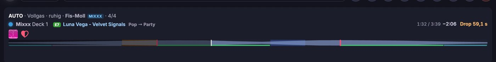
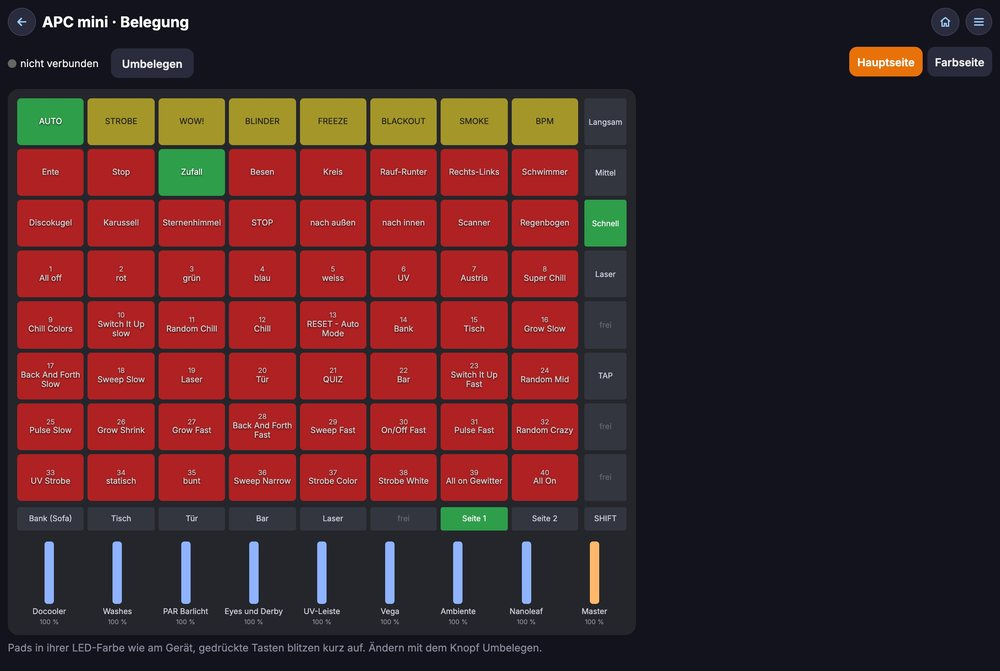
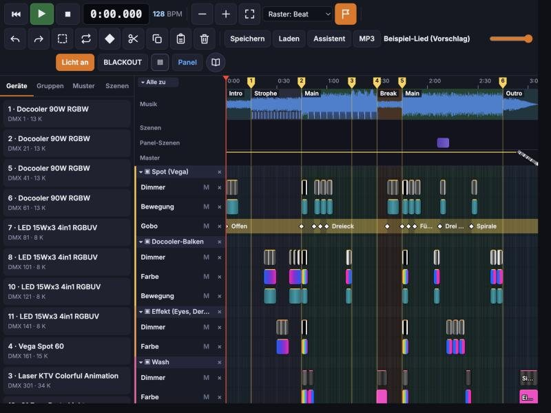
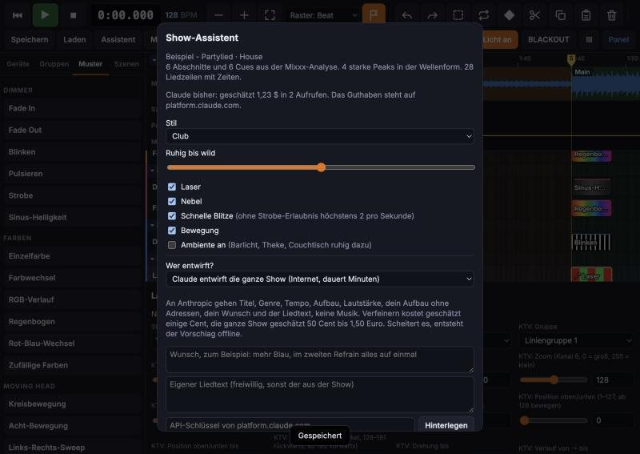
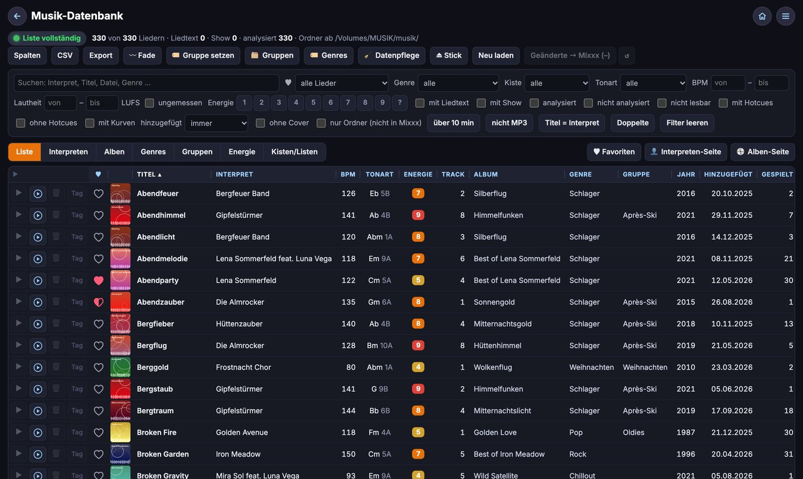
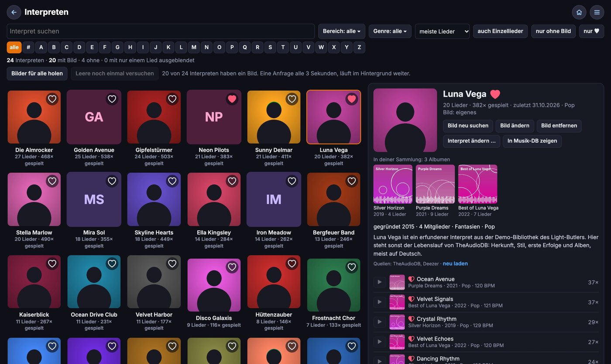
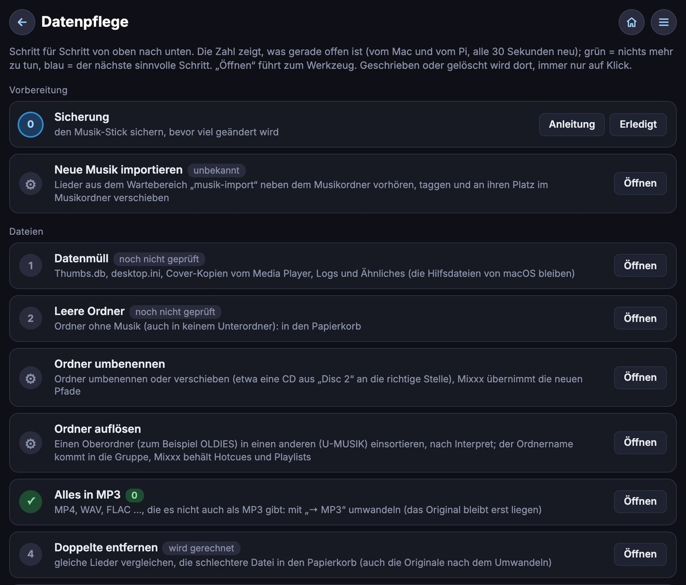
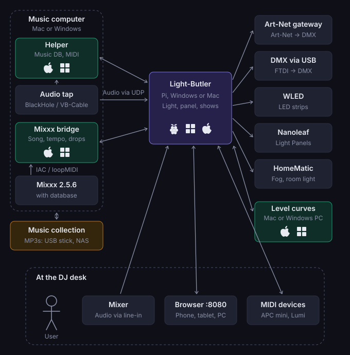

<p align="center"></p>

<h1 align="center">Light-Butler</h1>

<p align="center"><b>Lighting that understands the music.</b></p>

<p align="center">
  <a href="#download"><b>⬇ Download</b></a> &nbsp;·&nbsp;
  <a href="docs/MANUAL_EN.md">Manual</a> &nbsp;·&nbsp;
  <a href="docs/TECHNICAL_EN.md">Technical description</a> &nbsp;·&nbsp;
  <a href="README.de.md">Deutsch</a>
</p>

<table>
<tr>
<td width="62%">

**Music on – and the lights dance along.** Light-Butler listens, recognises the beat, the mood and the big moment in a song and drives every light in the room from it: moving heads, LED strips, light panels, lasers and fog.

- For parties at home, in the basement or at the club house
- Control it from your phone, tablet or a MIDI controller
- Runs on its own – or exactly to your programmed show
- Helps you keep your music collection in order, too

A small computer (Raspberry Pi, Windows PC or Mac) gets the sound from the mixer or the DJ software, listens closely and drives all lights so they match the music – nobody has to stand at a lighting desk.

**Music** → **Light-Butler** listens, understands and decides → **Light**

Free and open source (GPLv3). Web panel and manual in English and German.

</td>
<td width="38%"></td>
</tr>
</table>

### How it feels

- In quiet parts the light is soft and dimmed, before the chorus it builds tension – and at the drop it really takes off: all lights on the beat, flashes, movement.
- Christmas songs get warm colours without black light, rock looks different from pop or club music.
- One fixture after another, light waves through the room, colours on the beat – the evening never gets dull.
- The bar or the coffee table stays calmly lit so people can still find their way.

**Three ways to make light:** **AUTO** – Light-Butler does everything by itself, matching each song. **Scenes and effects** – at the push of a button: disco ball, starry sky, chaser, strobe, fog. **Shows** – for special songs, a precisely programmed light show of their own.

## The panel


Everything on one page, in the browser of your phone, tablet or computer. At the top the song that is playing with its cover, a heart for favourites and the song timeline with its highlights; below, the instant buttons, speed, style, colour, light mix and movement. Nothing to install: the panel is a web page in your own Wi-Fi. *(Screenshots show the German interface; switch the language in the settings.)*

- **Instant buttons:** AUTO, strobe, WOW!, blinder (all white), freeze, blackout, fog
- **Style:** Christmas, club, party, rock or calm – or automatically from the song's genre
- **Colours and movement:** tap the colours you want, the moving heads follow a pattern or a target in the room

## It hears the music



- **Beat and tempo:** lights change exactly on the beat, flashes sit on the beat.
- **Build-up, break and drop:** Light-Butler recognises when a song builds tension, goes quiet for a moment and then explodes – and makes the light do exactly that.
- **With the DJ software Mixxx** it even knows in advance when the drop is coming.
- **Mood and key:** minor sounds different from major, the colours follow. In quiet passages the light gets softer, in silence it goes into idle mode.
- **Track recognition:** if you like, the panel shows title, artist and the current line of the lyrics.

## Control it the way you like

<table>
<tr>
<td width="50%"></td>
<td>

**On the phone** everything is in one column – usable with one hand, right on the dance floor.

**On the controller** (AKAI APC mini): 64 lit buttons for scenes and effects, faders for every fixture group, every button freely assignable.

**On the keyboard** (ROLI LUMI Keys): scenes and colours on the keys, and the keys light up in the matching colour.

</td>
</tr>
</table>

## The show manager

<table>
<tr>
<td width="50%"></td>
<td width="50%"></td>
</tr>
</table>

- **Your own light and laser shows** for special songs: drag light cues onto the timeline – like video editing, precise to the beat.
- **Ready-made patterns:** blink, rainbow, circles, chaser, thunderstorm and many more.
- **The show assistant** builds a complete show from a song's structure at the push of a button. If you like, the AI Claude helps design it – with your own wishes such as "more blue, everything at once in the second chorus".
- The show **starts by itself** as soon as the song plays in the DJ software – or with a button on the phone.


*The room plan: where each light is. The assistant uses it for light waves from one wall to the other.*

## The music library



- All songs with cover, tempo, key, energy (1–9), genre, album and play count – filter and sort by anything.
- Light-Butler measures missing values itself: **energy, key and tempo**.
- Preview right in the browser, edit tags and covers, create a show with one click.
- **Artists and albums** with picture, biography and track list, **stars and favourites**, lyrics live with the music.

<table>
<tr>
<td width="50%"></td>
<td width="50%"></td>
</tr>
</table>

## The auto-DJ


- When does the party start, how long does it last, how wild should it get? From that comes a playlist whose energy rises through the evening.
- The songs fit together: similar tempo, harmonic keys, never the same artist twice in a row.
- The auto-DJ plays by itself and crossfades on the beat – and the light follows it.

## Keeping the collection tidy

<table>
<tr>
<td width="45%"></td>
<td>

- **Tags and covers:** fetch CD covers, fill in all tags, find titles by music recognition, generate covers
- **Damaged MP3s:** detect and repair them, convert other formats to MP3
- **Duplicate songs:** find them, keep the better version
- **Genres and groups:** clean up, merge, fill in
- **Import:** preview new music, tag it and file it in the right place
- **Backup:** mirror the collection to a NAS or a USB stick

</td>
</tr>
</table>

## Safety first

- **Lasers** stay off, except in their own laser scene or in a show with explicit permission – and off at once on pause, stop or blackout.
- **Strobe:** fast flashing can trigger seizures. Without permission at most 2 flashes per second.
- **Fog** never runs by itself: only short bursts at the push of a button, with pauses in between.
- **Blackout** always wins: one tap and everything is dark. Limits protect the fixtures from wrong settings.
- The panel has no login: only run it in your own home network, never openly on the internet.


*DMX monitor: every channel of every fixture live.*

## Technology

| | |
| --- | --- |
| **Core** | Raspberry Pi, Windows PC or Mac, controlled through a web page in your home network |
| **Sound** | USB audio from the mixer, sound from the music computer over the network, or straight from the DJ software Mixxx |
| **Light** | DMX via Art-Net or a USB adapter: moving heads, washes, derby, laser, fog machine |
| **More light** | LED strips with WLED, Nanoleaf light panels, smart sockets via HomeMatic |
| **Control** | Browser on phone, tablet, computer; AKAI APC mini; ROLI LUMI Keys; Ableton Link for the tempo |
| **Music computer** | Mac or Windows PC: music collection, analysis, tags, level curves |
| **Intelligence** | Own music analysis; if you like, Claude (Anthropic) for shows, playlists and genres |

<details>
<summary><b>How it all fits together (system diagram)</b></summary>



</details>

## Download

<table>
<tr>
<td align="center" width="33%" valign="top">
<br>
<h3>Windows</h3>
<sub>Windows 10 and 11</sub><br><br>
<a href="https://github.com/neppma/Light-Butler/releases/latest/download/Light-Butler-Setup.exe"><b>⬇ Light-Butler-Setup.exe</b></a><br>
<sub>Lighting computer: the whole light control</sub><br><br>
<a href="https://github.com/neppma/Light-Butler/releases/latest/download/Light-Butler-Musik-Setup.exe"><b>⬇ Light-Butler-Musik-Setup.exe</b></a><br>
<sub>Music computer: DJ software Mixxx, music library, sound over the network</sub>
</td>
<td align="center" width="33%" valign="top">
<br>
<h3>Raspberry Pi</h3>
<sub>Pi 3, 4 or 5 with Raspberry Pi OS (64-bit)</sub><br><br>
<a href="https://github.com/neppma/Light-Butler/releases/latest/download/light-butler-pi.zip"><b>⬇ light-butler-pi.zip</b></a><br>
<sub>Lighting computer: small, quiet, runs around the clock</sub>
</td>
<td align="center" width="33%" valign="top">
<br>
<h3>Mac</h3>
<sub>macOS 11 or later, Apple chip (M1 and later)</sub><br><br>
<a href="https://github.com/neppma/Light-Butler/releases/latest/download/Light-Butler.dmg"><b>⬇ Light-Butler.dmg</b></a><br>
<sub>Lighting computer: drag the app to Applications</sub><br><br>
<a href="https://github.com/neppma/Light-Butler/releases/latest/download/light-butler-mac.zip"><b>⬇ light-butler-mac.zip</b></a><br>
<sub>Music computer: DJ software Mixxx, music library, sound over the network</sub>
</td>
</tr>
</table>

**How to start:** you only need **one** lighting computer, a music computer is optional.

- **Windows:** double-click the setup file and install. Python is built in, no administrator rights needed. The desktop icon starts Light-Butler and opens the panel in the browser. If Windows shows "Windows protected your PC": **More info** → **Run anyway** (the installer is not commercially signed).
- **Mac:** open the DMG, drag **Light-Butler** to **Applications** and start it. The first time: **System Settings** → **Privacy & Security** → **Open Anyway** (the app has no paid Apple signature), then allow the microphone. For Macs with Intel chip: [light-butler-mac-voll.zip](https://github.com/neppma/Light-Butler/releases/latest/download/light-butler-mac-voll.zip).
- **Raspberry Pi:** write *Raspberry Pi OS (64-bit)* onto the SD card with the Raspberry Pi Imager (enter name, Wi-Fi and SSH there), log in on the Pi and paste one command – it fetches the package and installs everything:

  ```bash
  curl -sL https://raw.githubusercontent.com/neppma/Light-Butler/main/pi/install_online.sh | bash
  ```

- **Music computer Mac:** unpack the ZIP and run the install script; the `LIESMICH.txt` in the package lists the steps (German).
- A new system starts with all outputs off: add your fixtures in the panel under Settings → Fixtures, then switch the outputs on.

For more precise level curves (drums, bass, vocals separated) there is an optional helper for Windows with an NVIDIA graphics card: [light-butler-windows.zip](https://github.com/neppma/Light-Butler/releases/latest/download/light-butler-windows.zip). Everything else is in the [manual](docs/MANUAL_EN.md), details in the [technical description](docs/TECHNICAL_EN.md). All versions: [Releases](https://github.com/neppma/Light-Butler/releases).

## Licence

Copyright © 2026 Markus Nepp. Free software under the GNU General Public License version 3 (GPLv3), see [`LICENSE`](LICENSE). Without any warranty. Contact: lightbutler@gmx.at

*All pictures show a sample system with made-up music. Program and texts were created with the help of AI (Claude by Anthropic).*
