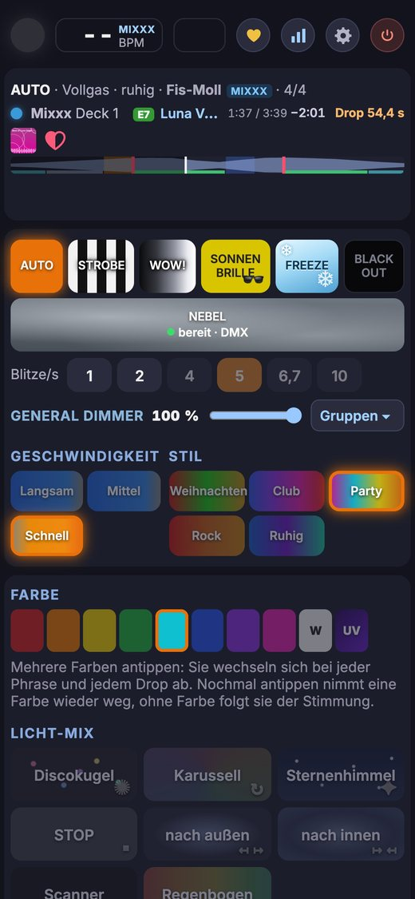
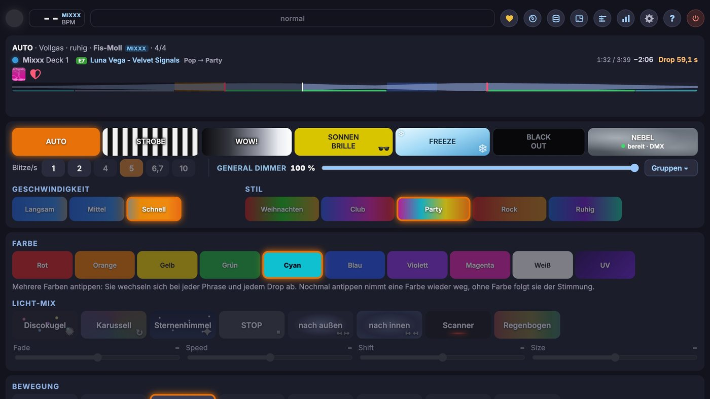
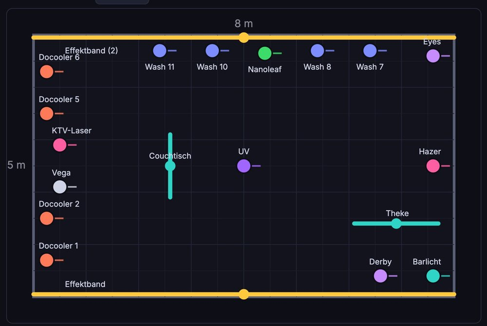
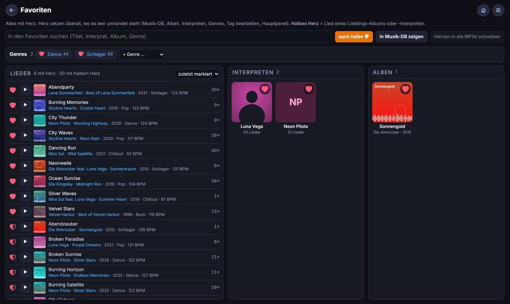
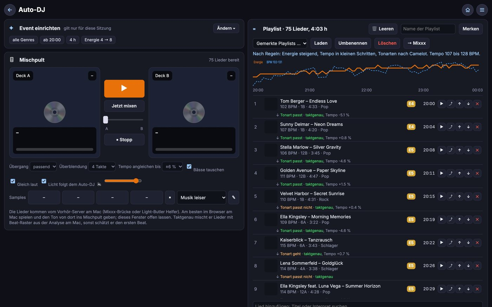
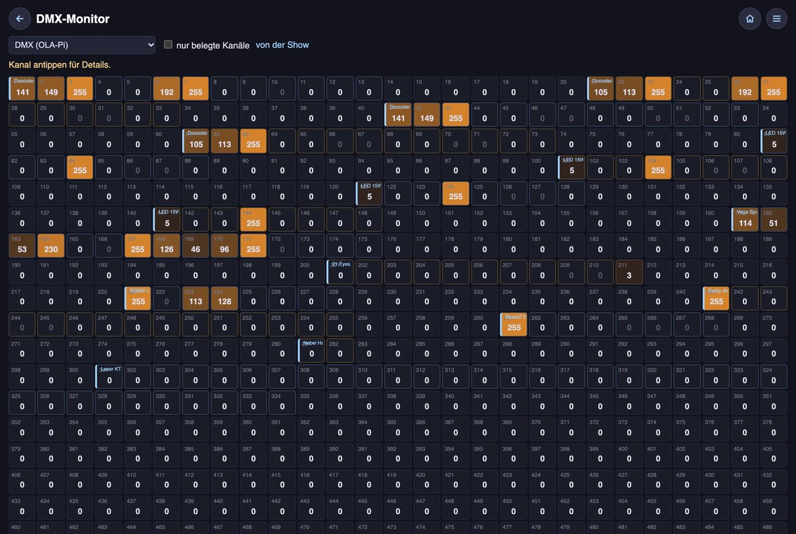
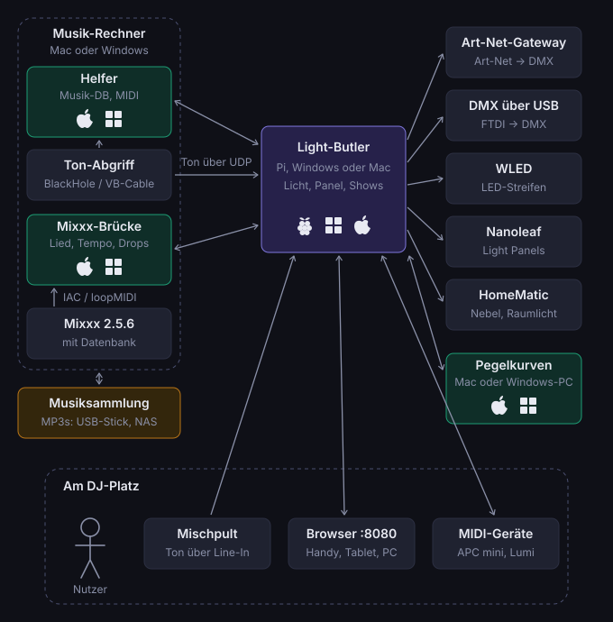

<h1 align="center">Light-Butler</h1>

<b>Licht, das die Musik versteht.</b>

  <a href="#download"><b>⬇ Download</b></a> &nbsp;·&nbsp;
  <a href="pi/static/Light-Butler-Broschuere.pdf">Broschüre (PDF)</a> &nbsp;·&nbsp;
  <a href="docs/HANDBUCH.md">Handbuch</a> &nbsp;·&nbsp;
  <a href="#english">English</a>

<table>
<tr>
<td width="62%">

**Musik an – und das Licht tanzt mit.** Der Light-Butler hört zu, erkennt Takt, Stimmung und den großen Moment im Lied und steuert daraus alle Lichter im Raum: Scheinwerfer, LED-Streifen, Lichtpaneele, Laser und Nebel.

- Für Partys zu Hause, im Keller oder im Vereinslokal
- Bedienung mit Handy, Tablet oder Controller
- Läuft von selbst – oder genau nach deiner Show
- Hilft auch beim Ordnen der Musiksammlung

Ein kleiner Computer (Raspberry Pi, Windows-PC oder Mac) bekommt den Ton vom Mischpult oder vom DJ-Programm, hört genau hin und steuert alle Lichter so, dass sie zur Musik passen – ohne dass jemand am Pult stehen muss.

**Musik** → **Light-Butler** hört zu, versteht und entscheidet → **Licht**

</td>
<td width="38%"></td>
</tr>
</table>

### So fühlt sich das an

- In ruhigen Passagen ist das Licht weich und gedimmt, vor dem Refrain baut es Spannung auf – und beim „Drop“ geht es richtig los: alle Lichter auf dem Schlag, Blitze, Bewegung.
- Weihnachtslieder bekommen warme Farben ohne Schwarzlicht, Rock wirkt anders als Schlager oder Club-Musik.
- Ein Gerät nach dem anderen, Lichtwellen durch den Raum, Farben im Takt – der Abend wird nie eintönig.
- Die Bar oder der Couchtisch bleiben dabei ruhig beleuchtet, damit man sich noch zurechtfindet.

**Drei Arten, Licht zu machen:** **AUTO** – der Light-Butler macht alles selbst, passend zu jedem Lied. **Szenen und Effekte** – auf Knopfdruck: Discokugel, Sternenhimmel, Lauflicht, Stroboskop, Nebel. **Shows** – für besondere Lieder eine eigene, genau programmierte Lichtshow.

## Die Bedienung

Alles auf einer Seite, im Browser von Handy, Tablet oder Computer. Oben das laufende Lied mit Cover, Herz für Favoriten und dem Liedverlauf mit seinen Höhepunkten, darunter Sofort-Knöpfe, Geschwindigkeit, Stil, Farbe, Licht-Mix und Bewegung. Kein Programm zu installieren: Das Panel ist eine Webseite im eigenen WLAN.

- **Sofort-Knöpfe:** AUTO, Strobe, WOW!, Sonnenbrille (alles weiß), Freeze, Blackout, Nebel
- **Stil:** Weihnachten, Club, Party, Rock oder Ruhig – oder automatisch nach dem Genre des Liedes
- **Farben und Bewegung:** Wunschfarben antippen, die Scheinwerfer folgen einem Muster oder einem Ziel im Raum

## Hört die Musik

- **Takt und Tempo:** Lichter wechseln genau auf dem Schlag, Blitze sitzen auf dem Beat.
- **Aufbau, Break und Drop:** Der Light-Butler erkennt, wenn ein Lied Spannung aufbaut, kurz ruhig wird und dann explodiert – und macht das Licht genau dazu.
- **Mit dem DJ-Programm Mixxx** weiß er sogar im Voraus, wann der Drop kommt.
- **Stimmung und Tonart:** Moll klingt anders als Dur, die Farben passen sich an. In leisen Stellen wird das Licht sanfter, bei Stille geht es in den Ruhemodus.
- **Titel erkennen:** Auf Wunsch zeigt das Panel Titel, Interpret und die aktuelle Liedtext-Zeile.

## Bedienen, wie es gerade passt

<table>
<tr>
<td width="50%"></td>
<td>

**Am Handy** ist alles in einer Spalte – mit einer Hand bedienbar, mitten auf der Tanzfläche.

**Am Controller** (AKAI APC mini): 64 leuchtende Tasten für Szenen und Effekte, Schieberegler für jede Gerätegruppe, jede Taste frei belegbar.

**An der Klaviatur** (ROLI LUMI Keys): Szenen und Farben auf den Tasten, die Tasten leuchten in der passenden Farbe.

</td>
</tr>
</table>

## Der Showmanager

<table>
<tr>
<td width="50%"></td>
<td width="50%"></td>
</tr>
</table>

- **Eigene Licht- und Lasershows** für besondere Lieder: Lichtbilder auf die Zeitleiste ziehen – wie im Videoschnitt, auf den Takt genau.
- **Fertige Muster:** Blinken, Regenbogen, Kreisbewegung, Lauflicht, Gewitter und viele mehr.
- **Der Show-Assistent** baut aus dem Aufbau eines Liedes eine komplette Show auf Knopfdruck. Wer möchte, lässt die künstliche Intelligenz Claude mitentwerfen – mit eigenem Wunsch wie „mehr Blau, im zweiten Refrain alles auf einmal“.
- Die Show **startet von selbst**, sobald das Lied im DJ-Programm läuft – oder per Knopf am Handy.

*Der Raumplan: wo jedes Licht steht. Der Assistent nutzt ihn für Lichtwellen von einer Wand zur anderen.*

## Die Musik-Datenbank

- Alle Lieder mit Cover, Tempo, Tonart, Energie (1–9), Genre, Album und wie oft sie gespielt wurden – filtern und sortieren nach allem.
- Fehlende Angaben misst der Light-Butler selbst: **Energie, Tonart und Tempo**.
- Reinhören direkt im Browser, Tags und Cover bearbeiten, mit einem Klick eine Show anlegen.
- **Interpreten und Alben** mit Bild, Lebenslauf und Titelliste, **Sterne und Favoriten**, Liedtexte live zur Musik.

<table>
<tr>
<td width="50%"></td>
<td width="50%"></td>
</tr>
</table>

## Der Auto-DJ

- Wann beginnt das Fest, wie lange dauert es, wie wild soll es werden? Daraus entsteht eine Playlist, deren Energie über den Abend steigt.
- Die Lieder passen zueinander: ähnliches Tempo, harmonische Tonarten, nie zweimal derselbe Interpret hintereinander.
- Der Auto-DJ spielt selbst ab und überblendet taktgenau – und das Licht folgt ihm.

## Ordnung in der Sammlung

<table>
<tr>
<td width="45%"></td>
<td>

- **Tags und Cover:** CD-Cover besorgen, alle Tags eintragen, Titel per Musikerkennung finden, Cover erzeugen
- **Beschädigte MP3s** erkennen und reparieren, andere Formate in MP3 umwandeln
- **Doppelte Lieder** finden, die bessere Fassung behalten
- **Genres und Gruppen** aufräumen, zusammenlegen, ergänzen
- **Import:** neue Musik vorhören, taggen und einsortieren
- **Sichern:** die Sammlung auf eine NAS oder einen Stick spiegeln

</td>
</tr>
</table>

## Sicherheit geht vor

- **Laser** bleiben aus, außer in der eigenen Laser-Szene oder in einer Show mit ausdrücklicher Freigabe – und sofort aus bei Pause, Stopp oder Blackout.
- **Stroboskop:** Schnelles Blitzen kann Anfälle auslösen. Ohne Erlaubnis höchstens 2 Blitze pro Sekunde.
- **Nebel** läuft nie von allein: nur kurze Stöße auf Knopfdruck, mit Pausen dazwischen.
- **Blackout** geht immer vor: ein Tipp, und alles ist dunkel. Grenzwerte schützen die Scheinwerfer vor falschen Einstellungen.
- Das Panel hat keine Anmeldung: nur im eigenen Heimnetz betreiben, nie offen im Internet.

*DMX-Monitor: jeder Kanal jedes Geräts live im Blick.*

## Technik

| | |
| --- | --- |
| **Herzstück** | Raspberry Pi, Windows-PC oder Mac, Bedienung als Webseite im Heimnetz |
| **Ton** | USB-Audio vom Mischpult, Ton vom Musik-Rechner übers Netz oder direkt aus dem DJ-Programm Mixxx |
| **Licht** | DMX über Art-Net oder USB-Adapter: Moving Heads, Wash-Lichter, Derby, Laser, Nebelmaschine |
| **Mehr Licht** | LED-Streifen mit WLED, Nanoleaf-Lichtpaneele, Schaltsteckdosen über HomeMatic |
| **Bedienung** | Browser auf Handy, Tablet, Computer; AKAI APC mini; ROLI LUMI Keys; Ableton Link fürs Tempo |
| **Musik-Rechner** | Mac oder Windows-PC: Musiksammlung, Analyse, Tags, Pegelkurven |
| **Intelligenz** | Eigene Musikanalyse; auf Wunsch Claude (Anthropic) für Shows, Playlists und Genres |

<b>Wie alles zusammenhängt (Systemschema)</b>

## Download

<table>
<tr>
<td align="center" width="33%" valign="top">
 
<h3>Windows</h3>
Windows 10 und 11  
<a href="https://github.com/neppma/Light-Butler/releases/latest/download/Light-Butler-Setup.exe"><b>⬇ Light-Butler-Setup.exe</b></a> 
Licht-Rechner: die ganze Lichtsteuerung  
<a href="https://github.com/neppma/Light-Butler/releases/latest/download/Light-Butler-Musik-Setup.exe"><b>⬇ Light-Butler-Musik-Setup.exe</b></a> 
Musik-Rechner: DJ-Programm Mixxx, Musik-Datenbank, Ton übers Netz
</td>
<td align="center" width="33%" valign="top">
 
<h3>Raspberry Pi</h3>
Pi 3, 4 oder 5 mit Raspberry Pi OS (64 Bit)  
<a href="https://github.com/neppma/Light-Butler/releases/latest/download/light-butler-pi.zip"><b>⬇ light-butler-pi.zip</b></a> 
Licht-Rechner: klein, leise, läuft rund um die Uhr
</td>
<td align="center" width="33%" valign="top">
 
<h3>Mac</h3>
macOS 11 oder neuer, Apple-Chip (M1 und neuer)  
<a href="https://github.com/neppma/Light-Butler/releases/latest/download/Light-Butler.dmg"><b>⬇ Light-Butler.dmg</b></a> 
Licht-Rechner: App in „Programme“ ziehen  
<a href="https://github.com/neppma/Light-Butler/releases/latest/download/light-butler-mac.zip"><b>⬇ light-butler-mac.zip</b></a> 
Musik-Rechner: DJ-Programm Mixxx, Musik-Datenbank, Ton übers Netz
</td>
</tr>
</table>

**So geht's:** Du brauchst nur **einen** Licht-Rechner, ein Musik-Rechner ist optional.

- **Windows:** Setup-Datei doppelklicken und installieren. Python ist eingebaut, Administrator-Rechte braucht es nicht. Das Symbol auf dem Desktop startet den Light-Butler und öffnet das Panel im Browser. Zeigt Windows „Der Computer wurde durch Windows geschützt“: **Weitere Informationen** → **Trotzdem ausführen** (der Installer ist nicht kostenpflichtig signiert).
- **Mac:** DMG öffnen, **Light-Butler** auf **Programme** ziehen und starten. Beim ersten Mal: **Systemeinstellungen** → **Datenschutz & Sicherheit** → **Dennoch öffnen** (die App hat keine bezahlte Apple-Unterschrift), dann das Mikrofon erlauben. Für Macs mit Intel-Chip: [light-butler-mac-voll.zip](https://github.com/neppma/Light-Butler/releases/latest/download/light-butler-mac-voll.zip).
- **Raspberry Pi und Musik-Rechner Mac:** ZIP entpacken und das Installationsskript starten, die `LIESMICH.txt` im Paket nennt die Schritte.
- Eine neue Anlage startet mit allen Ausgaben aus: Geräte im Panel unter Einstellungen → Fixtures anlegen, dann die Ausgaben einschalten.

Für genauere Pegelkurven (Schlagzeug, Bass, Gesang getrennt) gibt es optional einen Rechenhelfer für Windows mit NVIDIA-Grafikkarte: [light-butler-windows.zip](https://github.com/neppma/Light-Butler/releases/latest/download/light-butler-windows.zip). Alles Weitere steht im [Handbuch](docs/HANDBUCH.md), Einzelheiten in der [Technischen Beschreibung](docs/TECHNIK.md). Alle Fassungen: [Releases](https://github.com/neppma/Light-Butler/releases).

## English

Light-Butler is a party lighting controller that listens to the music. It runs on a Raspberry Pi, a Windows PC or a Mac, detects tempo, beat, key, mood and song structure (build-up, break, drop) and drives DMX (Art-Net or USB), WLED and Nanoleaf from it. It comes with a show editor, an auto-DJ and a music database. The web panel and the manual are available in English: [manual](docs/MANUAL_EN.md), [technical description](docs/TECHNICAL_EN.md). Downloads: see the table above.

## Lizenz

Copyright © 2026 Markus Nepp. Freie Software unter der GNU General Public License Version 3 (GPLv3), siehe [`LICENSE`](LICENSE). Ohne jede Gewährleistung. Kontakt: lightbutler@gmx.at

*Alle Bilder zeigen eine Beispiel-Anlage mit erfundener Musik. Programm und Texte sind mit Unterstützung von KI (Claude von Anthropic) entstanden.*
