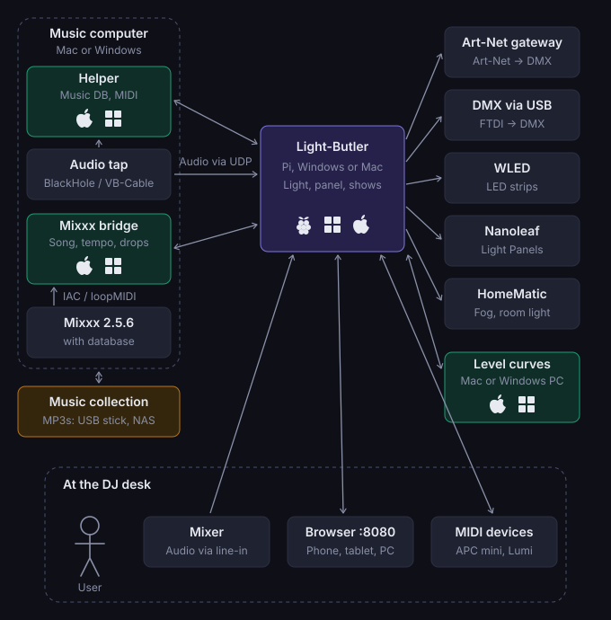

# Light-Butler – User Manual

Lighting control to the music for parties

**Markus Nepp** · As of November 2026

This manual was written with the help of AI (Claude by Anthropic).

## Overview

**Light-Butler** controls your lighting rig automatically to the music. A **lighting computer** (Raspberry Pi, Windows PC or Mac) listens to the music and sends the lighting data to all devices. You operate everything in the **web panel** on a phone, tablet or PC. Technical details are in the **Technical description** (link at the top).



The system diagram shows what runs on which computer. A clickable version is under **⚙** → **Software for other computers** → **System diagram and downloads**.

**The parts of the rig**

- **Mixer:** delivers the music to the lighting computer via a USB audio interface.
- **Lighting computer with Light-Butler:** listens to the music, calculates the light and serves the web panel.
- **DMX fixtures** (moving heads, spiders, washes, lasers, effect lights, fog machine): via an Art-Net gateway on the network or a DMX USB adapter on the lighting computer.
- **WLED LED strips** and **Nanoleaf Light Panels** (both optional): directly over the network.
- **Music computer** (optional, Mac or Windows): with the DJ software Mixxx, the Light-Butler Helper and your music collection.
- **MIDI input keys** (optional): AKAI APC mini mk2 and ROLI LUMI Keys.
- **HomeMatic** (optional): for room light, sockets and fog.

**What the software can do**

Light-Butler runs the light, and if you like the music too, all by itself. You look after your guests and the party, not the technology.

**Live light to the music**

- **AUTO:** the light follows the music without intervention. It detects tempo, beat, bar, key, mood and phases (build-up, break, drop), with four levels from Chill to Peak.
- **Light styles per genre** (Club, Party, Rock, Calm, Christmas), also via the grouping in the tag.
- **Fine effects:** brightness follows loudness, hi-hat sparkle, beat pulse, devices one after another.
- **40 scenes** with a scene editor, plus instant buttons: STROBE, WOW! (building strobe), SMOKE (fog), FREEZE, BLINDER, BLACKOUT and laser. All except AUTO only act while you hold them.
- **Track recognition** via Shazam: title and artist even without DJ software, the genre picks the light style.
- **Lyrics** run live with the music in the panel. Lines in another script (Arabic, Chinese …) are hidden by the checkbox **Liedtext nur in lateinischer Schrift** (general settings → track recognition, on). With the checkbox **Schnittstelle: nur Refrain** (there, off) other devices get only the chorus instead of the whole text.

**Show manager**

- **Your own light shows and laser shows** for an MP3, track by track on a timeline.
- **Show assistant:** creates a show automatically from the song analysis and the room plan, with Claude if you like.
- **Quick show** with one tap from the music database or the main panel.
- **Level curves** (drums, bass, vocals separated) for more precise shows.
- Shows **start by themselves** as soon as the matching song plays in the DJ software.

**Music**

- **Auto-DJ:** playlist by energy, tempo and key, transitions on the beat, the light follows. Music and light then run entirely by themselves.
- **Connection to DJ software (Mixxx):** tempo, beat, key and hotcues come exactly from the DJ software, drops are predicted.
- **Sound from any program** on the music computer (for example Spotify, YouTube) over the network.

**Music database and library care**

- **Databases** for songs, artists (with pictures and biography) and albums (with track list and the list "Missing").
- **For every song** the Light-Butler measures energy, key and BPM. You give stars and set favourites.
- **Preview** from the main part, with cover and lyrics.
- **Tags and covers:** the Light-Butler fetches the CD covers and fills in the tags (title, artist, album, year, genre), with tag editor, suggestions and auto-tagger. If a cover is missing, it creates one.
- **Tidying up:**
  - genre editor and group manager,
  - find duplicates, detect and repair damaged MP3s, convert to MP3,
  - import assistant, CD assistant, dissolve folders,
  - mirror NAS or stick, eject the stick safely.

**Rig and devices**

- **DMX** via an Art-Net gateway or a DMX USB adapter, Art-Net also as an input for other lighting programs.
- **WLED LED strips**, **Nanoleaf Light Panels** (also their own effects) and **HomeMatic** for room light and fog.
- **MIDI input keys:** AKAI APC mini and ROLI LUMI Keys, freely assignable.
- **Ableton Link:** the Light-Butler passes the tempo on to Link devices on the network.
- **Fixture manager** for your devices, **room planner** (also for light waves through the room), DMX monitor and DMX debugger.

**Safety and operation**

- **Locks** for laser, strobe and fog, a safety notice on every new installation.
- Runs on a **Raspberry Pi, Windows PC or Mac**, also mixed.
- **Operation** on phone, tablet or PC, in German or English, with your own translation table.
- **Backup** every night, plus an emergency folder with all programs on the music stick.
- **Health and statistics** of the system on their own pages.

## First steps

The Light-Butler starts by itself when the lighting computer is switched on. All you need is a browser.

### Opening the panel

1. Connect your phone, tablet or PC to the home network.
2. Open the address `http://<name-of-the-light-butler>:8080/` in the browser (or the IP address of the lighting computer with `:8080`).
3. There is no login. Only use the panel on your home network.

### The panel as an app on your phone

1. Open the panel in the phone's browser.
2. Choose **Add to Home Screen** in the browser menu.
3. The panel is now on your phone as an app with the butler icon.

### Ready in five minutes

1. Switch on the lighting computer, the Art-Net gateway (if present), the mixer and the lights. After about a minute the lighting computer is ready.
2. Open the panel. At the top left the **beat lamp** blinks on the beat as soon as music plays.
3. **AUTO** is the normal case: the light follows the music by itself.
4. Set the overall brightness with the **General Dimmer**.
5. Holding **BLACKOUT** switches everything off while you hold it.
6. The **notice line** at the bottom of the status area warns you when a device is missing.
7. The small **?** at the top right opens this manual. On a phone you find it in the menu **☰**.

### Safety notice on first start

On a new installation a window about strobe, laser, fog, outputs and setup appears on first opening. Read it and tap **Understood**. This applies to the whole installation and never appears again.

A new installation starts with **all outputs off** and without strobe permission. Only switch the outputs on under **Connections** when this Light-Butler is the only sender, otherwise two fight over the light.

### Shutting down

On a Raspberry Pi the red button **⏻** at the top right shuts the lighting computer down cleanly.

1. Tap **⏻**. The window shows buttons to switch off the HomeMatic sockets that are still on.
2. Confirm with **Shut down**. The light and the lasers go off at once.
3. Wait about 30 seconds until the green LED on the Pi stops blinking, then disconnect the power.

On a Mac and on Windows the same button only quits the Light-Butler (button **Quit**), the computer stays on. Start it again with the Light-Butler icon.

## The main page

The main page is for operating only. It is divided into grey sections. From top to bottom:

### The header

| Row | What you see |
| --- | --- |
| 1 | **Beat lamp**, **BPM**, the **status field** and round buttons: heart (**Health**), CD (**Auto DJ**), database (**Music library**), bars (**Statistics**), **⚙** (**Settings**), **?** (help) and **⏻** |
| 2 | Mode, level in words (**Chill**, **Groove**, **Party**, **Peak**), mood, key (orange **3/4** only when the light counts in groups of three) and a small level meter of the audio input |
| 3 | Song from Mixxx or the Auto-DJ: title, energy level, genre, remaining time and the next events, for example "Drop 5.1 s" |
| 4 | **Song progress**: the loudness of the song as a curve with build-up, break, drops and hotcues, for viewing only |

- The **status field** shows what is happening right now: for example **DROP !**, **BUILD-UP**, **BREAK**, **SILENCE**, **STROBE** or **LASER ACTIVE**.
- A tap on the lamp or BPM opens the **tempo window**: **÷ 2**, **× 2**, **−1**, **+1**, **TAP** and **Auto**. A manual tempo only acts on scenes and WOW!.

### AUTO and manual

- **AUTO on** (orange, after start): the light runs on autopilot. Color, Light Mix, Movement, targets, Beam, scenes and effect strip are locked. Orange frames show what is running.
- **AUTO off** (manual): all buttons are free. Whatever was marked stays as your choice. Color, Movement and Speed are then **presets**: the light keeps running with the music, just in your colour or movement.
- **AUTO on again** clears all manual presets.
- Always free are the instant buttons, **Flashes/s**, the **General Dimmer** and the group sliders.

### Instant buttons

All except AUTO are **push buttons**: they only act while you hold them.

| Button | Effect |
| --- | --- |
| AUTO | autopilot on and off (the only toggle) |
| STROBE | all lights flash |
| WOW! | building strobe, releasing it triggers a drop |
| BLINDER | everything at full brightness |
| FREEZE | light and movement stand still, lasers off at once |
| BLACK OUT | everything off, including laser and fog |
| SMOKE | fog, at most 10 seconds at a time |

- If the connection breaks (phone locked, Wi-Fi gone), the Light-Butler releases a held button by itself after 1.5 seconds.
- Below you choose the **Flashes/s** (1 to 10). Without strobe permission the fast steps are dimmed.
- **General Dimmer** sets the overall brightness. **Groups ▾** opens a separate slider per light group (for example spiders, washes, moving head, ambience, Nanoleaf). The slider **API** affects no light; it only dampens the brightness other devices get through the interface, for example a dashboard on the TV.

### Speed and Style

- **Speed:** **Low**, **Med** or **Hot** fixes the intensity and sets the tempo of Light Mix and Movement. Tap again = back to the music.
- **Style:** **Christmas**, **Club**, **Party**, **Rock** or **Calm** colours the light in AUTO. With **Auto** the style comes from the song's genre, a manual style takes priority.

### Color and Light Mix

- **Color:** tap one colour = only this colour. Tap several colours = they alternate at every phrase and every drop. Tap again removes a colour. White and UV only work on their own.
- **Light Mix:** a pattern for all lights, for example **Disco**, **Carousel**, **Sparkle**, **Static** (colours stand still), **Chase-Out**, **Chase-In**, **Scanner** or **Rainbow**. Tap again deselects it.

### Movement, targets and Beam

- **Movement** for moving head and spiders: **Float**, **Center**, **Random**, **Sweep**, **Circle**, **Tilt**, **Pan**, **Swim**. Tap again releases it. Fine sliders below Movement and Light Mix set fan, speed, shift and size.
- **Targets** point the moving head and the spiders at a fixed spot, for example **Couch**, **Table**, **Door**, **Bar**. Only these devices then light up white. Tap again (or **Free**) ends this.
  - Your own target: **✎ Edit**, then **+ Target**, enter a name, aim with the sliders, **Save**.
- **Beam** controls the beam of a moving head (gobo, zoom, roll, prism). **Auto** = the show does it, otherwise your setting applies until you switch off **manual**.

### Scenes and effect strip

- At the end are the **Scenes** and the **Effect strip**: one button per preset of the effect strip, tap again = automatic again. **♫** = the preset reacts to the music by itself.

### The notice line

At the bottom of the status area there is always the notice line. If everything is fine it says "✓ All devices reachable".

- **red:** a device is unreachable.
- **orange:** an output is switched off. Tap switches it on.
- **blue:** Art-Net from outside, a pending restart or **SHOW RUNNING**. Tap takes you there.
- **⏻ in front:** the device hangs on a HomeMatic socket that is off. Tap switches it on after a confirmation.

## Scenes and effects

### Choosing scenes

1. Tap a scene: it holds a fixed light picture.
2. Tap the same scene again: deselected, the light follows the music again.
3. For **permanently dark** (break, tidying up) use the scene **All off**.

There are 40 standard scenes, plus special scenes such as **All off**, **RESET**, **Laser** and the target scenes. While a scene is active, Color, Movement and Light Mix change this scene.

### Editing scenes

1. Tap **✎ Edit** above the scenes.
2. Tap a scene. You can set name, light mix, tempo, colour, movement, brightness, which lights take part and a preset.
3. **+** creates a new scene. Copying, moving and deleting work the same way.
4. **Reset scenes to default** brings back the original scenes.

### Scene automation

If you like, the show briefly picks a scene by itself in AUTO (**Settings (auto detection)** → **Scene automation**, default off). Calm scenes belong at the front of your list, wild ones at the back. It never picks laser or target scenes.

### Strobe permission

Fast flashing can trigger **epileptic seizures** in sensitive people. That is why without permission it flashes at most 3 times per second, and there is no strobe burst at the drop and no single strobe.

- Switch on: **⚙** → **Settings (auto detection)** → **White flashes and strobe** → at the very top **Strobe permission**.
- Only switch it on when you know it is fine for all guests, and take it back afterwards.

### Laser in brief

- Lasers only run in the scene **Laser** and, if you allow it, in laser clips of a show.
- When the scene starts, all other lights go off. On freeze, blackout, silence and scene change the lasers are off at once.
- The **laser operation** setting (group **Laser**) chooses whether the Light-Butler drives the lasers or they play their own program to the music.
- **Never point lasers at people or at eye level.**

### Fog in brief

1. Hold **SMOKE**: fog while you hold it, at most 10 seconds.
2. After that a pause of 20 seconds applies. The button shows the remaining time.
3. If the fog machine hangs on a HomeMatic socket, the first press switches it on. The panel first asks about the **smoke detectors**. Fog only comes after the warm-up time.

The small line on the button shows the state: off, heating, ready, remaining time or pause. The fog machine never runs by itself.

## Show manager

With the show manager you program your own light show for an MP3 and play it back in sync. You reach it via the menu **☰** → **Show manager** (page `/shows`). A detailed guide with pictures is downloaded as a PDF by the round button at the top right (German only).

### Playing a show

1. Tap a show in the list.
2. Press **▶**: the music starts in the browser, the light follows it.
3. **⏸** pauses, **⏹** ends the show and returns the light to AUTO, **⏮** jumps to the start.

| Switch | Meaning |
| --- | --- |
| **Light on / off** (Licht an / aus) | off: music only, the light stays on AUTO |
| **Sound here / elsewhere** (Ton hier / woanders) | elsewhere: the browser plays nothing, the show runs on the clock of the lighting computer |
| **BLACKOUT** | everything dark, always takes priority |

While a show runs, the AUTO button is called **SHOW**, a tap on it ends the show. BLACKOUT, BLINDER, FREEZE and the General Dimmer keep working. If the light runs ahead of or behind the sound, set the **light offset** in the show properties.

### Creating a new show

1. Tap **+ New show** (+ Neue Show) in the overview.
2. Choose an **MP3**. The browser calculates the waveform and estimates the tempo.
3. Drag a device or a group from the left bar onto the timeline. Tracks such as dimmer, colour and movement appear.
4. Drag a pattern from **Patterns** (Muster) onto a track and set it up below (start time, duration, speed, fade in, fade out and more).
5. A double tap on a track sets a **keyframe**. Between keyframes the values blend.
6. **Save** (Ctrl+S). A dot on the button shows unsaved changes.

### The editor in outline

- **Zoom** with Ctrl + mouse wheel, two fingers or the keys + and −. **Jump** by tapping the ruler.
- **Loop:** drag a range in the ruler, **⟳** switches it on and off, **⟳✕** removes it.
- **Undo** and **Redo** with ↶ ↷ (Ctrl+Z, Ctrl+Y). **Space bar** = play and pause.
- The row **Master** controls the brightness of all devices, for example for a fade-out at the end of the song.
- **Light while programming:** **▶** goes to the real light. With **Light off** you only listen in the browser.

### Show assistant

The button **Assistant** (Assistent) builds a finished proposal from song and devices. Your show stays unchanged, the proposal comes as a copy (if the show is still empty, directly into it). Every further click makes a new proposal.

1. Tap **Assistant** in the editor.
2. Check style and strength (calm to wild), set the ticks for laser, fog, flashes and movement.
3. Choose who designs: the assistant by fixed rules (free, offline) or, if you like, **Claude** (needs internet and your own API key, costs a few cents to a little over one euro).
4. Let it create the proposal, then fine-tune it.

The assistant never switches on a permission. Check the proposal before its first use, especially the laser. With a saved **room plan** the proposals get better (for example light waves through the room).

### Quick show

- In the **music library**, **⚡ Quick** creates a finished show in one step for a song with level curves: fetch the MP3, waveform, cue points, lyrics and assistant.
- In the **main panel**, **⚡ Quick show** appears when such a song without a show plays in Mixxx. The finished show starts once with the current song.

### Starting shows automatically

1. Switch on **⚙** → **General settings** → **Output** → **Start shows from Mixxx automatically**.
2. When you play a song with a show in Mixxx, the show takes over the light. The browser does not have to be open.
3. If a song is not recognised, choose the matching song in the editor's properties with **Pick song** (Lied wählen).

### Laser and fog in shows

Both only work with a tick under **General settings** → **Output** (**Allow laser in shows**, **Allow fog in shows**, default off). Lasers go off at once on pause, stop and jump, the show never switches the fog machine on.

## Music library

The round button with the database icon (on a phone in the menu **☰**) opens the page `/musik`: all songs of your collection. The list comes from the music computer, from Mixxx and from your music folder. The page never affects the light.

### List, search and filter

- **Search:** type into the search field, several words work (title, artist, album, genre, folder …).
- **Filters** for example by energy, stars, "without cover", "added" (today, yesterday, since …), "over 10 min" or "no MP3".
- **Sort:** tap a column header, again for the other direction.
- **View:** **List** or grouped by artists, albums, genres, groups, energy or crates/playlists.
- **CSV** downloads the filtered list for a spreadsheet, **Export** copies the filtered songs into a folder (for example onto a party stick), without overwriting anything.

If a red notice appears at the top, the music computer is unreachable or the music folder is missing (stick unplugged). Then preview, tags and covers do not work.

### Preview

1. Tap **▶** next to a song. The music comes directly from the music computer.
2. At the bottom a bar appears with pause, position for jumping, time and volume. **✕** closes it.
3. With the tick **Ab Hauptteil** (from the main part) the song starts where you can judge it well, for example at the chorus.
4. While a song from the music library plays, the main page shows it with the source **Local**, with cover plus time; the pixel matrix shows pictures plus scrolling text for it. It has no effect on the light.

### Energy, key and BPM

For every song the list shows **energy** (1 to 9), **key** and **BPM**, from the DJ software, from the file or measured by the Light-Butler itself. Estimated values carry a tilde (**E6~**), "?" means it could not be determined. Details: Technical description.

### Stars and favourites

- **Stars:** in the column **★** tap the 1st to 5th star. The same star again = no stars. Stars from Mixxx come along.
- **Favourites:** tap the **heart** next to songs, albums, artists and genres. A half heart means: song of a favourite album or artist. Songs with 5 stars count as favourites.
- The page **♥ Favourites** shows everything you marked. In the main panel the heart sits next to the cover of the current song.

### Artists and albums

- **👤 Artists page:** all artists as tiles with a picture. Tap shows their songs, albums and, if you like, a biography. The Light-Butler fetches pictures from the internet on request (only the name goes out).
- **💿 Albums page:** all albums as tiles with cover. Tap shows the songs by track. If you like, the Light-Butler fetches the album's track list and shows which titles you are missing.

### Missing songs

If an album title is missing or the search finds nothing, note the song with **+ merken** (note it). The page **Missing songs** shows the list, songs from your collection drop out by themselves.

### Editing tags and covers

1. Tap **Tag** next to a song. The window **Tag bearbeiten** (edit tag) shows all fields of the MP3.
2. Change fields (title, artist, album, year, genre, group …). **Vorschläge** (suggestions) searches matching details on the internet, Shazam recognises the song by its sound.
3. Insert a cover, remove it or make one yourself with **Cover erzeugen** (create cover).
4. Save. Only what you changed is written, the music stays the same.

### More buttons per song

- **+ Show** creates a new show for a song and opens the editor.
- **Play next** (CD with ▶) puts the song in the Auto-DJ directly after the current one.
- **🗑** moves the file on the music computer to the recycle bin (with confirmation).
- **→ MP3** converts a file that is no MP3 into an MP3. The original stays.

## Library care

The button **🧹 Library care** in the music library shows a recipe for tidying up, from top to bottom: **green** = nothing to do, **blue** = next sensible step, **Open** takes you to the tool. Nothing is written before your click, no file is ever overwritten.

### The steps

- **Backup:** back up the collection before tidying up, then tick it yourself.
- **Check files:** finds junk (leftovers like Thumbs.db), empty folders and short pieces with guessed values. Everything goes to the recycle bin, nothing is deleted right away.
- **Everything to MP3:** shows files that are no MP3, to convert with **→ MP3**.
- **Duplicates:** looks for duplicate songs and proposes which file stays. You delete per group or tap **Keep all**.
- **Tidy up Mixxx:** remove missing titles in Mixxx and rescan the library. You do this in Mixxx and tick it yourself.
- **Clean up titles:** finds titles with a track number in front ("01 - Song"). Green = certain, orange = please check. **Leave as is** remembers exceptions.
- **Title = artist:** finds songs whose title and artist are the same. The assistant makes proposals, you decide.
- **Tag suggestions and covers:** the **auto-tagger** searches details and covers in the background, on the page **Tag suggestions** you accept or reject them.
- **Changed → Mixxx:** shows songs whose tags you changed. Then choose "Import metadata from file" in Mixxx.
- **File names:** songs whose file name does not match the tags, with the proposal "Artist - Title" for renaming.
- **Enter energy:** writes the estimated energy level into MP3s without a level.
- **Genres:** counts all genres, proposes merges and writes only the genre field. The light style comes along.
- **Damaged files:** files that cannot be played. MP3s can often be **repaired**, the original goes to the recycle bin.
- **Loose album songs:** songs of an album lying next to the album folder; the tool moves them into the folder if you like. Every step can be undone.

### Tools with a gear ⚙

- **Import new music:** put new songs into the waiting area `musik-import` next to the music folder, then **Einsortieren** (sort in): the tool compares with your collection.
- **CD assistant:** for whole CDs with wrong or missing tags. Paste the track list, the assistant matches the songs and fills in the tags.
- **Rename folders:** rename or move a folder, subfolders come along. Mixxx takes over the new paths.
- **Dissolve folder:** sort a top folder you once created only for selecting into another one, with a group in the tag if you like.
- **Tags from file names:** for songs without tags. Choose folder and pattern (for example "Artist - Title"), check the preview, **Eintragen** (enter).
- **Groups:** the group manager for the field group in the tag (for example a party theme). Tick songs, move them, assign them additionally or remove them.
- **Mirror:** brings one drive up to the state of another (for example "Stick → NAS"), always with a trial run first.
- **Runs in advance:** fetches lyrics, cue points, covers and level curves for the whole collection in the background. Pause and resume at any time.

### Around the stick

- **⏏ Eject stick** (music library and **Connections**): pauses all work on the stick and ejects it safely.
- **Excluded folders** (under **Connections**, at the music folder): one folder per line that the Light-Butler never reads and never changes.

## Auto-DJ

The **Auto-DJ** puts together a playlist from your collection and plays it with transitions on the beat. The round button with the **CD** opens it in its own window, so the music keeps playing while you browse the panel.

### Creating a playlist

1. Open **Event einrichten** (set up event). In five steps you choose occasion, audience, music (genres, groups, crates), start, length and energy.
2. **Playlist nach Regeln** (playlist by rules) builds the playlist for free without internet: energy and tempo rise, keys fit together, the same artist does not come shortly after itself.
3. Or **Mit Claude vorschlagen** (suggest with Claude): Claude picks matching songs by theme and audience (needs internet and the API key, a few cents).
4. **Neu würfeln** (reshuffle) makes another playlist with the same wishes.
5. **Merken** (remember) keeps a playlist, **Laden** (load) brings it back.

### Playing

1. Tap play in the **mixer** (Mischpult). Deck A and deck B show cover, title, BPM and remaining time.
2. The Auto-DJ crossfades before the end and matches the tempo. **Jetzt mixen** (mix now) changes earlier.
3. **Übergang** (transition) chooses the kind: matching, soft, filter, echo or brake.
4. In the playlist **▶** plays right away from a song, **⤴** sets it as next, **↑ ↓** reorders, **✕** removes it.

The music comes from the music computer. Ideally play the Auto-DJ in the browser on the music computer and feed the sound from there into the mixer. Keep the window open.

### The light follows

With the tick **Licht folgt dem Auto-DJ** (light follows the Auto-DJ, default on) the light works as with Mixxx, the top shows **Auto-DJ Deck A** or **B**. Laser, strobe and fog stay behind their permissions.

## Internet radio

With the round **radio** button at the top of the main page (or menu **☰** → **Internet radio**) you listen to radio stations from the internet, with the light running to it.

- **Find stations:** choose country, genre or name, then **Suchen** (search). **♡** marks favourites, **+** puts a station on one of the **12 preset slots**. Tapping a slot plays it, **Bearbeiten** (edit) empties slots.
- **Playback** runs on the music computer in the **Light-Butler helper**, at the volume from the page. It also sends the sound to the Light-Butler; you may close the page.
- **For the light** the Light-Butler needs the input **Musik-Rechner (Netzwerk)** (music computer, network); the page offers to switch.
- **Ton: dieses Gerät** (sound: this device; switch next to stop, remembered per device): the browser plays by itself, for example on the TV, while the music computer stays silent. Title, cover, style are still there. If the device is connected to the **line-in** of the Light-Butler, the checkbox below sets the input to line-in while playing, then back. Some devices start the sound only after a tap on **▶ Ton hier starten** (start sound here).
- **📺 Fernseher-Ansicht** (TV view; button at the preset slots, remembered per device): shows only what is playing plus the preset slots, large, selectable with the arrow keys and OK of the remote. The sound then always plays on this device with line-in. On a TV it switches itself on at the first visit; **↩ Normale Ansicht** (normal view) switches back.
- If the station sends **artist and title**, you see them with a cover (on the page, at the top of the main page; the mouse over it enlarges it), the light takes the matching **style**, and the pixel matrix shows cover and station logo. Other texts (programme, news) are shown as info only. Traffic news and radio text are not available over the internet.

## DJ software and music computer

### Mixxx

With the DJ software **Mixxx** on the music computer, the Light-Butler knows tempo, beat and key exactly and knows before the drop that it is coming.

1. **Always start Mixxx via the app "Light-Butler Mixxx"** (on Windows the shortcut of the same name). It starts Mixxx plus the bridge to the Light-Butler.
2. Load and play a song. The Mixxx row in the panel shows title, remaining time and the next events.
3. If the analysis of a song is missing, the bridge calculates it in a few seconds. Bit by bit it analyses the whole library in the background.
4. So that the prediction also drives the light: set **⚙** → **Settings (auto detection)** → **Mixxx prediction** → **Use the prediction for the light** to "light follows".

- The group **Mixxx prediction** also holds the table **Genre styles**: there you give every genre a light style.
- Without Mixxx: switch off **Use Mixxx** (**General settings** → **Track recognition**). The panel then hides everything that only works with Mixxx.

### Light-Butler Helper

The **Helper** is a small background program on the music computer, also without Mixxx: it forwards APC and LUMI, sends the sound and keeps the music library up to date.

### Sound from the music computer

If the music plays on the music computer (for example Spotify, YouTube), the Helper sends a copy of the sound over the network.

1. On the Mac install the audio driver BlackHole once (you type your Mac password yourself):

```
brew install blackhole-2ch
```

2. In the app **Audio MIDI Setup** create a **Multi-Output Device**: tick your speakers plus "BlackHole 2ch", tick **Drift Correction** for BlackHole, the same rate everywhere (44100 Hz). Without drift correction the sound to the Light-Butler can break off after a while, even though you still hear it on the Mac. Drift correction applies to every device except the **primary device**. In Mixxx under Sound Hardware set the sample rate to 44100 Hz as well. If something is off, the panel shows **⚠ Ton am Musik-Rechner** at the bottom.
3. Choose this device in System Settings under **Sound → Output**.
4. If macOS asks for **microphone access** for the Helper: allow it.
5. In the panel under **Audio input** choose the input **Musik-Rechner (Netzwerk)** (music computer, network).

On a Windows music computer the Helper uses VB-Cable, Stereo Mix or line in.

### Track recognition

Without Mixxx the Light-Butler recognises title and artist via Shazam (Raspberry Pi only, needs internet): **General settings** → **Track recognition** → **Recognise title and artist**. The genre then picks the light style.

### Installation on the music computer

- **Mac:** download **⚙** → **Software for other computers** → **Mac: Mixxx bridge and Helper (ZIP)**, unpack it and run in the folder in Terminal:

```
bash install_mac.sh
```

- The script asks for the address of the Light-Butler, sets up the app "Light-Butler Mixxx" plus the Helper and tells you at the end what is still to be done by hand.
- **Windows:** download **Light-Butler-Musik-Setup.exe** from the project page on GitHub (Releases), double-click it and install. The installer asks for the address of the Light-Butler, starts the Helper with Windows and creates the icon **Mixxx with Light-Butler**. Always start Mixxx with this icon.
- For Mixxx on Windows you need the free program loopMIDI once, with the port "Light-Butler". Details: Technical description.

## MIDI controllers

### AKAI APC mini mk2

The APC mini operates the show with pads, keys and faders. The LEDs show the state, even when you change something in the panel.

1. Plug the APC into the lighting computer via USB, or into the music computer (then the Helper or the Mixxx app forwards it).
2. Under **⚙** → **General settings** → **MIDI controller** it must say "connected".
3. Do **not** activate the APC as a controller in Mixxx, otherwise Mixxx also reacts to the keys.

| Area | Assignment |
| --- | --- |
| Pads row 1 | AUTO, Strobe, Wow, Blinder, Freeze, Blackout, Smoke, BPM |
| Pads row 2 | Movement |
| Pads row 3 | Light Mix |
| Pads rows 4 to 8 | scenes 1 to 40 |
| Keys on the right | Low, Med, Hot, laser scene, TAP |
| Keys at the bottom | four targets, laser, main page, colour page |
| Faders 1 to 8 | group brightness, fader 9 = General Dimmer |

- Hold **SHIFT**: the pads show the colours.
- A fader only acts once you have moved it up to the current value. That way nothing jumps.

### ROLI LUMI Keys

The LUMI is a second control next to the APC: on the keyboard you choose colours, movement, light mix and scenes. Laser, strobe and fog are deliberately left out.

1. Plug the LUMI into the music computer via USB.
2. Start the Helper or the app "Light-Butler Mixxx". Under **MIDI controller** it then says "ROLI Lumi: connected".
3. The octave keys on the LUMI act like a page change.

### Changing the mapping

1. Open **⚙** → **APC mini · Mapping** or **ROLI Lumi · Mapping**. You see the device drawn, pressed keys flash.
2. Tap **Remap**, then tap a key or press it on the device.
3. Choose the new assignment from the list. It takes effect at once.
4. **Restore default** deletes all your own changes.

For the key colours on the LUMI, download the **Lumi program** on the page **ROLI Lumi · Mapping** and drag it onto the LUMI in ROLI Dashboard.

## Devices and rig

### Fixtures

The page **Fixtures** (**⚙** → **Fixtures**) shows every device with name, number and DMX address. Expanding shows all channels with description and live value.

1. Switch on **Edit**.
2. Change name, number, DMX address, group or target IP (for WLED).
3. **+ Fixture** creates a new device from an existing type. If addresses overlap, the panel warns you.
4. For a completely new device: under **+ Fixture** → the button **… Fixture-Datenbank …** (fixture database or file) search the free Open Fixture Library on the internet (for example "Spot 60") or pick a manufacturer, then device and mode or load a device file (.json, QLC+ .qxf), then **Als Gerätetyp übernehmen** (use as device type). Or create a type yourself under **Device types**, ideally with **Copy of** a similar one.
5. Name and descriptions apply at once. Address, group, new and removed devices after a restart: tap **Restart now** (the light is off for about 5 seconds).

- Devices from the database: lasers and fog machines stay locked, strobe and program channels are fixed to "off". The data is maintained by hand and may contain errors: check it on the device before the first use.
- **Export** (at the bottom of every expanded device) saves its device type as a file: **Light-Butler** (complete, can be read in again with **… Fixture-Datenbank …**, for example on a second light computer), **OFL** (Open Fixture Library), **QLC+** or **YAML**. With OFL and QLC+ the channels are described only roughly; locks and limits appear there only as a note.
- The group **Ambience** makes a colour device calm: soft transitions, without beat and without flashes, for example for a work light at the bar.
- **Remove** takes a device out, **Removed fixtures** brings it back, **Discard changes** resets everything.

### Room plan

On the page **Room plan** (menu **☰**) you draw where your devices stand in the room. The plan does not affect the light directly, but the show assistant uses it.

1. Enter the room size in metres.
2. Tap devices in the list of those missing from the plan and drag them to their place.
3. Tap a device to set position, direction and length (for LED strips) exactly. **+ Stück** (add piece) adds another piece to a strip.
4. **Save**.

You can also place the **pixel matrix** and the **API display** (a TV or screen that shows beat and lyrics via the interface). They are displays only: they do not affect the light or the show assistant.

### Connections and outputs

Under **⚙** → **General settings** → **Connections** you see all network devices and whether they are reachable. A tap on the address opens their web interface.

- Per output (DMX, WLED, Nanoleaf) there is **Off**, **On** and **Not present**. **Off** is meant for a while (orange reminder), **Not present** for a rig without this device (no warning).
- **DMX route:** **Art-Net gateway** over the network or **USB adapter** directly on the lighting computer. For the gateway you enter its **address** below; it applies after the restart.
- **Art-Net input** (default off): accepts light from another lighting program. The locks for laser, fog and strobe still apply.
- **Ableton Link** passes the tempo on to Link devices on the network.

### WLED and Nanoleaf

- **WLED:** in WLED the **transition time must be 0**, and presets must have no transition of their own, otherwise the strip does not flash on the beat.
- **Pair Nanoleaf** (under **Connections**): enter the IP, hold the power button on the Nanoleaf for 5 to 7 seconds until the LEDs flash, then tap **Pair** within 30 seconds. The Light-Butler fetches the key and reads the panels; after the restart they light along. This also works for pairing again.
- **Nanoleaf:** you can also change address and key under **Fixtures** → **Edit**. If the panels cannot keep up with strobe, lower the **strobe limit for Nanoleaf**.
- **Pixel matrix:** a WLED with a 2D matrix (for example 32 × 32 LEDs) shows patterns of its own to the music: plasma, rings on the beat, level, sparks, tunnel, plus snake (tunnel with curves), grid (tiles flash on the beat), scanner (bars shoot across), explosion (ring of sparks on every kick), kaleidoscope, glitch (picture briefly disturbed). **Auto** changes with the music: scanner in the build-up, explosion with grid at the drop, otherwise another pattern each phrase (all in turn, the scanner too). If dark areas look brighter on the matrix than in the preview, raise **Contrast (gamma)** (default 2.2). **Follows loudness** (default 70 %) makes quiet passages darker, loud ones fully bright, as fast as the music; 0 = off. **Lyrics** (default off): if the song has lyrics with times (like the line in the main panel), the matrix shows the sung line as scrolling text or word by word, only in the chorus (lines that occur several times in the song) or always. Under **Settings** → **Pixel matrix** you enter the address (or **Im Netz suchen**, search network: all WLEDs in the network in a list, matrices first, the size is taken over), see a preview and switch **Send** on. The **test picture** checks rotation and wiring. While a song plays, the matrix now and then shows the cover, the artist picture, the album cover for a few seconds each (only those that exist), then the effect returns. A **scrolling text** with artist, title, album comes with it: A one big line, B three small lines, C cover with a band, D word by word on the beat, **Auto** a different one of the four each time (choice, speed on the page pixel matrix). During silence the matrix goes dark. The state of the pictures (no song, loaded, no picture) is shown on the page below the preview. Off by default; without strobe permission the music triggers something new at most twice a second. If the matrix does not answer (switched off, unplugged), sending pauses until it is back; with sending off it is neither checked nor reported.

### HomeMatic (Home)

In the section **Home** (under **Connections**) you switch room light and sockets of your HomeMatic central unit.

- **Room light** (in the panel "living room light"): slider for the brightness, **Off** and **On**.
- **Sockets:** a tap toggles, switched-on ones are orange.
- **Automatic:** if no music plays for a while, the Light-Butler dims the room light up; when the music returns, it switches it off.
- **Settings: CCU and channels** (bottom of the section): enter the address, **Get channels from the CCU**, take them over with **+ Add**. This also works on a new installation without a prepared file, on every lighting computer.
- **Roles** (in the same place): choose the **fog machine socket** and the **living room light** for the automatic. With the socket set to **none**, SMOKE fires the fog right away via DMX (machine plugged into the wall, switched on by hand).
- The fog burst is never offered there, fog only via the SMOKE button.

### DMX monitor

The **DMX monitor** (**⚙** → **Tools**) shows all 512 channels as they are going out right now, for viewing only.

### DMX debugger

With the **DMX debugger** (**⚙** → **Tools**) you set each DMX channel on its own to explore a device.

**Caution:** the DMX debugger works **without any locks**, also for lasers, fog machine and the mode and reset channels of the devices.

- Never point lasers at people.
- Best disconnect the fog machine from power while testing.
- Do not test strobe channels when sensitive people are in the room.
- The push button **Kurz dunkel** (briefly dark, or the space bar) sets all channels to 0 while you hold it.
- BLACKOUT always takes priority. The debugger switches off when the page is closed and after 2 seconds without connection.

### Test piece

The **test piece** (**⚙** → **Tools**) checks how well the Light-Butler detects music.

- It is a test track of 3 minutes with fixed sections: silence, music without a beat, beat, break, build-up, drop plus a soft beat.
- Play it on the device whose sound reaches the Light-Butler, at normal volume, with no other music.
- The page shows what is detected while it plays, and at the end how much of each section was right.
- With the same piece you can compare settings before and after a change.

## Settings

The gear **⚙** at the top opens the page **Settings**. It has two large expandable sections and below them links to further pages.

### Layout of the page

| Section | Content |
| --- | --- |
| **General settings** | connections, home, backup, MIDI controller, audio input plus output, fog, track recognition and panel |
| **Settings (auto detection)** | how AUTO reads the music: silence, kick and beat, energy, phases, levels, strobe, laser, scene automation, ambience, Mixxx prediction |
| **Devices** | Fixtures, room plan, pixel matrix, APC mini · Mapping, ROLI Lumi · Mapping |
| **Own links** | buttons to your own devices in the home network, for example a dashboard on the TV: enter address and port (or paste a whole address with a path), **Next**, give it a name, **Save**. The button opens the page in a new tab, **✕** removes it |
| **Tools** | DMX monitor, DMX debugger, test piece |
| **Software for other computers** | system diagram and downloads of the installation packages |

- Every change takes effect at once and is saved.
- **↺** next to a value restores the default, **All to default** resets everything. The defaults are tuned for mixed party music.

### Language and texts

- **General settings** → **Panel** → **Language of the buttons**: **Deutsch** or **English**. This applies at once on all devices, also for this manual.
- **Show hint texts in the panel** hides or shows the grey explanation lines.
- In the **translation table** below you give every button your own text. **↺** resets a row, a vertical bar **|** makes a line break on the button.

### Audio input

All the automation depends on the music signal.

1. Under **Audio input** choose the **input**: the sound card at the mixer or **Musik-Rechner (Netzwerk)** (music computer, network).
2. A sound card you just plugged in is found by **rescan devices**.
3. Check the level: peaks between about −12 and −3 dB, never red.
4. Too quiet: raise **Gain (software)**. Too loud (red **CLIPPING**): turn it down at the mixer.

Use a line input, never a microphone input.

**Bluetooth:** The lighting computer can also receive music via Bluetooth, like a speaker. Under **Audio input** → **Bluetooth-Empfänger** press **Sichtbar machen** (make visible, 3 minutes), pair "Light-Butler" on the phone and choose the input **Bluetooth** at the top. Set it up once before: the hint there names the command. So that the music from the phone can still be heard, choose an output of the lighting computer below at **Ton weiterleiten an** (forward sound to: headphone socket or USB sound card into the mixer). The same exists for the sound from the music computer: **Ton vom Musik-Rechner weiterleiten an**, in case the music computer is away from the mixer. A **Bluetooth speaker** also works as output: find it with **Geräte suchen** (search devices), **Koppeln** (pair), then it appears in the list. Since it plays a little later, the **light delay** in milliseconds can be set under general settings → output (about 150 to 250). If the Bluetooth sound stutters while the lighting computer is on a cable, press **WLAN trennen** (disconnect Wi-Fi) there (Bluetooth shares the radio with Wi-Fi).

### The most important switches

- **Laser operation** (group **Laser**) plus **Fog via** DMX or HomeMatic (group **Fog**).
- **Output:** start shows from Mixxx automatically, allow laser and fog in shows, light offset.
- **Track recognition:** recognise titles, fetch lyrics, use Mixxx, write estimates into the MP3.

### Typical adjustments

| Problem | What to do |
| --- | --- |
| light too restless or too calm | move **Overall calmer / livelier** |
| too many or too few drops | adjust the thresholds of the group **Phases** |
| light goes idle at quiet passages | lower the **silence threshold** or raise the silence duration |
| quiet passages too bright or too dark | raise or lower **Brightness follows loudness** |

## Backup

### What is backed up when

- **Every night at 04:30** the Light-Butler (on the Raspberry Pi and on the Mac) backs up settings, scenes, devices, room plan, shows (without MP3s) and programs. The last 14 backups are kept.
- The Helper creates an **emergency folder** "Light-Butler-Programme" on the music stick: all installation packages, the latest backup and this manual.

### In the panel

1. Expand **⚙** → **General settings** → **Backup**.
2. **Back up now** makes a backup right away.
3. **Download** next to a backup downloads it. Keep it on another device too, for example a NAS, because the nightly backup lies on the same SD card.

The Nanoleaf key and the Claude key are deliberately left out of downloaded backups. Do not pass backups on.

### Restoring

1. Install a new lighting computer (see Installation), ideally with the package **Pi: replacement with my devices**.
2. Restore the latest backup. You find the exact command in the Technical description.
3. Afterwards pair the Nanoleaf again and enter the Claude key again.

## Installation

You find all packages under **⚙** → **Software for other computers**, in the **system diagram** also via the icons (raspberry = Raspberry Pi, window = Windows, apple = Mac). They contain no personal data and start with all outputs off.

### Raspberry Pi

1. Write a Raspberry Pi OS (64 bit) onto the SD card with the Raspberry Pi Imager. Enter hostname, user `admin`, Wi-Fi and SSH there.
2. Log in on the Pi (`ssh admin@<name-of-the-light-butler>`) and paste this command. It fetches the package from GitHub and installs it:

```
curl -sL https://raw.githubusercontent.com/neppma/Light-Butler/main/pi/install_online.sh | bash
```

3. Without internet on the Pi or for a replacement: download the package **Pi: fresh installation (ZIP)** or **Pi: replacement with my devices (ZIP)**, copy it onto the Pi and install it there:

```
scp light-butler-pi.zip admin@<name-of-the-light-butler>:
unzip light-butler-pi.zip && cd Light-Butler-Pi && bash install_pi.sh
```

4. Enter the password once and wait 5 to 15 minutes. The script sets up the service, the nightly backup and the shutdown button.
5. Open the panel, create your devices under **Fixtures**, then switch on the outputs.

Running it again updates the programs. Settings, scenes, shows and devices stay.

### Windows PC

1. Download **Light-Butler-Setup.exe** from the project page on GitHub (Releases).
2. Double-click it. If Windows shows "Windows protected your PC": **More info** → **Run anyway**.
3. Click **Install**. Administrator rights and Python are not needed. If you like, the Light-Butler starts with Windows.
4. Start the Light-Butler with the icon on the desktop or in the Start menu. The panel opens in the browser (`http://localhost:8080/`). If the firewall asks, only allow **Private networks**.

The black window shows the messages, closing it stops the Light-Butler. A new installer only replaces the programs, settings, scenes and shows stay. On Windows, track recognition and the nightly backup are missing.

### Mac

1. Download **Light-Butler.dmg** from the project page on GitHub (Releases, for Macs with Apple chip) and open it.
2. Drag **Light-Butler** onto **Applications**, then double-click it in Applications.
3. The first time macOS says the app is not verified: **System Settings** → **Privacy & Security** → at the bottom **Open Anyway**. If macOS asks for the microphone: allow it.

A small window shows **Open panel** and **Quit**, the panel opens in the browser. Settings and shows are in `~/Light-Butler`. To start at login: right-click the icon in the Dock → **Options** → **Open at Login**. For Macs with Intel chip the package **Mac: whole Light-Butler (ZIP)** with `install_lightbutler_mac.sh` is still available. This version is new and has not yet been tested on real lights. For Mixxx and the Helper on a music computer see chapter DJ software and music computer.

### Level curves computer (Windows with graphics card)

1. Download the package **Windows: level curves (ZIP)** and unpack it.
2. Type in PowerShell:

```
powershell -ExecutionPolicy Bypass -File install_stems.ps1
```

3. From then on the computer fetches jobs from the Light-Butler by itself when you log in. On the Mac, `install_mac.sh` offers the level curves as well.

## Safety

The rig has lasers, strobe, fog and powerful lights. The locks of the software do not replace your attention on site.

### In an emergency

- Hold **BLACKOUT** (panel or APC pad): everything off at once, including laser and fog.
- For **permanently dark** tap the scene **All off**.
- **FREEZE** switches the lasers off at once.
- When the Light-Butler is stopped, the lasers go off at once.

### Laser

- Lasers only run in the scene **Laser** and, with a tick, in laser clips of a show.
- On freeze, blackout, silence, scene change and stop they are off at once.
- **Never point lasers at people or at eye level.** Plan the aiming while setting up, never during the party. The software does not know where the beam points.

### Strobe

- Without **strobe permission** it flashes at most 3 times per second.
- Fast flashing can trigger seizures in people with epilepsy. Only switch the permission on when it is fine for all guests, and take it back afterwards.
- STROBE only flashes while you hold it.

### Fog

- The fog machine never runs by itself: only with SMOKE or, with a tick, in a fog clip of a show.
- At most 10 seconds at a time, then a 20 second pause.
- Mind **smoke detectors** nearby and deactivate them beforehand if needed. Activate them again afterwards.

### Network

- The panel has **no login**. Only use it on your home network and never expose it to the internet.
- Anyone on your home network can operate the light. Only give guests your home Wi-Fi if you want that.

## Troubleshooting

You recognise most problems from the notice line and the status field. More help and commands are in the Technical description.

| Problem | What to do |
| --- | --- |
| panel does not open | try the IP address of the lighting computer instead of the name, check lighting computer and network |
| panel shows old things | reload the page, on every device (on a phone pull down) |
| light does not react to music | **Audio input**: choose the right input, check the level, raise the gain |
| red CLIPPING | turn down at the mixer or interface |
| no DMX | read the notice line: is the DMX output on, is the Art-Net gateway reachable, is the USB adapter plugged in? |
| WLED strip or Nanoleaf dark | check power and Wi-Fi of the device, switch on the output under **Connections** |
| a button at the top only acts briefly | STROBE, SMOKE, BLACKOUT, WOW!, BLINDER and FREEZE are push buttons: hold them |
| controls locked | AUTO is on (or a show runs): tap AUTO or SHOW |
| SMOKE does not react | the line on the button shows the reason: pause, off, heating |
| lasers stay off | choose the scene **Laser**, check **laser operation** |
| Mixxx row says not connected | start Mixxx via the app "Light-Butler Mixxx", activate the controller in Mixxx |
| APC fader does nothing | first move the fader up to the current value |
| preview fails, red notice | switch on music computer plus Helper, plug in the stick, check the music folder under **Connections** |
| heart at the top yellow or red | open the page **Health**, it says what is wrong |
| the light jumps during a speech | if the Light-Butler detects speech, the top shows **🎤 Speech**, then the light runs calmly: no drops, no flashes, no scene or effect changes, no song recognition, no lyrics; otherwise switch on **Sprache: keine Drops** (speech: no drops) under settings (auto detection) → phases |

## About Light-Butler and licence

- **Light-Butler** is free software under the **GNU General Public License version 3 (GPLv3)**, without any warranty.
- The page **About Light-Butler** (bottom of the menu **☰**) shows version, copyright, source code, licence and the internet services used. They only run on request, the light needs no internet.
- Contact: lightbutler@gmx.at
