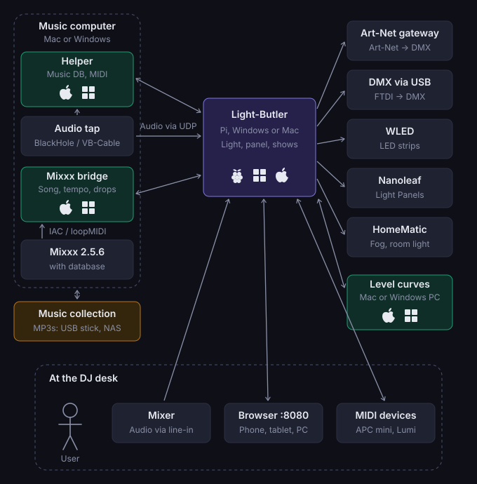
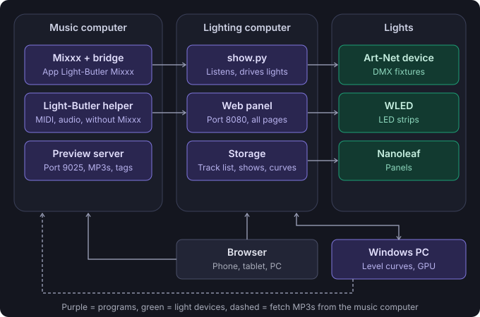

# Light-Butler – Technical description

Lighting control to the music for parties

**Markus Nepp** · As of November 2026

This description was written with the help of AI (Claude by Anthropic).

## Overview

**Light-Butler** controls your lighting rig automatically to the music: a **lighting computer** (Raspberry Pi, Windows PC or Mac) analyses the music signal and sends the lighting data to all devices. You operate it in the web panel on a phone, tablet or PC and, if you like, also with MIDI input keys. On the home network you reach the panel at `http://<name-of-the-light-butler>:8080/`, for example `http://lightbutler.local:8080/`. In the phone's browser, "Add to Home Screen" puts it on the phone as an app with the butler icon.



The system diagram shows what runs where: on the left the music computer, in the middle the Light-Butler, on the right the light outputs plus the level curves computer, at the bottom the DJ desk. A clickable version with the matching downloads is in the panel under Settings → Software for other computers → **System diagram and downloads**.

The lighting computer is the centre: it listens to the music, receives tempo and drops from the DJ software if you like, accepts commands from the panel and the input keys, and passes the lighting data on to the light outputs.

**The parts of the rig**

- **DJ mixer** delivers the music signal to the lighting computer via a USB audio interface (line in).
- **Lighting computer with Light-Butler** analyses tempo, beat, time signature, key, mood and phases (build-up, drop, break), calculates the scenes and serves the web panel on port 8080.
- **DMX fixtures** (moving heads, spiders, washes, lasers, effect lights, fog machine) receive the lighting data in one of two ways:
  - via an **Art-Net gateway** on the network that converts Art-Net to DMX (for example a second Raspberry Pi with OLA; its address is `artnet_target` in `fixtures.yaml` and can be changed under **Connections** → **Art-Net gateway address** (in `fixtures_user.json`, applies after the restart, same address as in the file = no change)), or
  - via a **DMX USB adapter** (FTDI, Open DMX USB) directly on the lighting computer (setting **DMX route**, see Appendix).
- **WLED LED strips** and **Nanoleaf Light Panels** (both optional) are driven by the Light-Butler directly over the network.
  - During **silence** (idle mode) effect strips stay completely dark and play no presets of their own.
  - **Ambient strips** (for example at a bar) are switched off by the Light-Butler when it stops and switched on once when it starts. Otherwise a WLED that is switched off but still receives data blinks wildly. In the simulator the WLEDs are never touched.
- **Music computer with DJ software** (optional, Mac or Windows): the **connection to the DJ software** sends tempo, beat, key and a prediction of the drops. It is implemented for **Mixxx**.
- **MIDI input keys** (optional) via USB on the lighting computer or on the music computer. Supported are the AKAI APC mini mk2 and the ROLI LUMI Keys.
- **HomeMatic home automation** (optional) for room light and fog bursts.

**What the software can do**

Light-Butler runs the light, and if you like the music too, all by itself. You look after your guests and the party, not the technology.

**Live light to the music**

- **AUTO:** the light follows the music without intervention. It detects tempo, beat, bar, key, mood and phases (build-up, break, drop), with four levels from Chill to Peak.
- **Light styles per genre** (Club, Party, Rock, Calm, Christmas), also via the grouping in the tag.
- **Fine effects:** brightness follows loudness, hi-hat sparkle, beat pulse, devices one after another.
- **40 scenes** with a scene editor, plus instant buttons: STROBE, WOW! (building strobe), SMOKE (fog), FREEZE, BLINDER, BLACKOUT and laser. All except AUTO only act while you hold them.
- **Track recognition** via Shazam: title and artist even without DJ software, the genre picks the light style.
- **Lyrics** run live with the music in the panel.

**Show manager**

- **Your own light shows and laser shows** for an MP3, track by track on a timeline.
- **Show assistant:** creates a show automatically from the song analysis and the room plan, with Claude if you like.
- **Quick show** with one tap from the music database or the main panel.
- **Level curves** (drums, bass, vocals separated) for more precise shows.
- Shows **start by themselves** as soon as the matching song plays in the DJ software.

**Music**

- **Auto-DJ:** playlist by energy, tempo and key, transitions on the beat, the light follows. Music and light then run entirely by themselves.
- **Connection to DJ software (Mixxx):** tempo, beat, key and hotcues come exactly from the DJ software, drops are predicted.
- **Sound from any program** on the music computer (for example Spotify, YouTube) over the network.

**Music database and library care**

- **Databases** for songs, artists (with pictures and biography) and albums (with track list and the list "Missing").
- **For every song** the Light-Butler measures energy, key and BPM. You give stars and set favourites.
- **Preview** from the main part, with cover and lyrics.
- **Tags and covers:** the Light-Butler fetches the CD covers and fills in the tags (title, artist, album, year, genre), with tag editor, suggestions and auto-tagger. If a cover is missing, it creates one.
- **Tidying up:**
  - genre editor and group manager,
  - find duplicates, detect and repair damaged MP3s, convert to MP3,
  - import assistant, CD assistant, dissolve folders,
  - mirror NAS or stick, eject the stick safely.

**Rig and devices**

- **DMX** via an Art-Net gateway or a DMX USB adapter, Art-Net also as an input for other lighting programs.
- **WLED LED strips**, **Nanoleaf Light Panels** (also their own effects) and **HomeMatic** for room light and fog.
- **MIDI input keys:** AKAI APC mini and ROLI LUMI Keys, freely assignable.
- **Ableton Link:** the Light-Butler passes the tempo on to Link devices on the network.
- **Fixture manager** for your devices, **room planner** (also for light waves through the room), DMX monitor and DMX debugger.

**Safety and operation**

- **Locks** for laser, strobe and fog, a safety notice on every new installation.
- Runs on a **Raspberry Pi, Windows PC or Mac**, also mixed.
- **Operation** on phone, tablet or PC, in German or English, with your own translation table.
- **Backup** every night, plus an emergency folder with all programs on the music stick.
- **Health and statistics** of the system on their own pages.

### Devices, programs and connections



| From → to | Port | Purpose |
| --- | --- | --- |
| Mixxx bridge → lighting computer | UDP 9020 | Tempo, beat, key, track plan and the track list ("Light-Butler hat empfangen" (Light-Butler received) in the music database) |
| Music computer (bridge or helper) ↔ lighting computer | UDP 9021 | APC mini on the music computer: buttons there, LEDs back |
| Music computer → lighting computer | UDP 9022 | Audio from the music computer (on the Mac via BlackHole, on Windows via VB-Cable or Stereo Mix: for example Spotify, YouTube) |
| Music computer → lighting computer | UDP 9023 | ROLI LUMI on the music computer, notes only |
| Browser → lighting computer | TCP 8080 | Panel and all pages |
| Browser → music computer | TCP 9025 | Preview server: preview, covers, writing tags, folder images, playlists for Mixxx |
| Music computer → lighting computer | TCP 8080 | Settings (music folder) every 30 s, backup of curves and covers to the music stick |
| Level-curve computer (for example Windows PC) ↔ lighting computer | TCP 8080 | Level curves: fetch jobs, deliver finished curves |
| Level-curve computer → music computer | TCP 9025 | MP3s for the level-curve pre-run |
| Lighting computer → Art-Net gateway, WLED | Art-Net 6454 | DMX fixtures (universe 0), LED strips |
| Lighting computer → Nanoleaf | UDP and HTTP | Panels |
| Mixer, APC mini → lighting computer | USB | Music for the analysis, control directly at the lighting computer |

- **Light-Butler Mixxx** (app on the Mac, on Windows the shortcut "Light-Butler Mixxx") starts Mixxx and the **bridge**. The bridge follows Mixxx (decks, track, plan) and sends that to the lighting computer. It runs the track list and the preview server only when no helper is running (after 30 seconds without a helper it takes over, when the helper is back it hands over again).
- The **Light-Butler helper** runs in the background, also without Mixxx: APC, LUMI, audio from the music computer and the level-curve watcher (computes curves for new shows, the last ones of the library as a reserve). Plus by default everything that does not need Mixxx: track list, preview server (with auto-tagger, duplicates, folder images), estimates and background analysis, also while the Mixxx app runs. When the Mixxx app makes a new copy of its database (at every start), it reloads the list within a minute.
- The **lighting computer** runs a single program `show.py` (on the Pi as the service `lichtshow`): listening, computing the light, web panel, storage.
- The **level-curve computer** (for example a Windows PC with a graphics card, otherwise the Mac) computes the level curves for the show manager (on Windows as a task at sign-in, see level curves).
## Getting started

The light control runs on the lighting computer (on the Pi as the service `lichtshow`) and starts by itself when switched on. All you need is the web panel in a browser.

**Open the panel**

- Address: `http://<name-of-the-light-butler>:8080/`, for example `http://lightbutler.local:8080/` (or the lighting computer's IP address with `:8080`).
- There is no login. Only use the panel on your home network.
- Create a bookmark on your phone.

**Ready in five minutes**

1. Switch on the lighting computer, the Art-Net gateway (for example a Raspberry Pi with OLA, if you have one), mixer and lights. After about a minute the lighting computer is ready.
2. Open the panel. Top left, the **beat lamp** flashes in time as soon as music is playing.
3. **AUTO** is the normal case: the light follows the music on its own and the controls below the instant buttons are locked. Press AUTO again = manual.
4. In manual mode, tap a **scene** to hold it. Tapping the same scene again deselects it.
5. Set the overall brightness with the **General Dimmer** (at the top). Holding **BLACKOUT** switches everything off while you hold it.
6. Under **Connections** (further down) you can see whether the Art-Net gateway, WLED and Nanoleaf are reachable, with their IP addresses. The **notice line** at the bottom of the status area warns you when something is missing.
7. The small **?** at the top right opens this manual (in the language set for the panel). On a phone you will find it in the **☰** menu of the header bar instead (for example via **⚙**).
8. The red **⏻** next to it shuts the Pi down cleanly (with confirmation). Afterwards you can unplug the power without endangering the SD card.

**Shutting down the Pi**

- Tap the reddish **⏻** button at the top right. The window has one switch-off button each for the HomeMatic sockets of your devices (for example Nanoleaf, LED strips, DMX fixtures, music system and the power of the fog machine), as long as the CCU reports them as on. They do not go off by themselves. Confirm with **Shut down**: the light goes off immediately, the lasers are off, then the Pi shuts down.
- Wait about **30 seconds** until the green LED on the Pi stops blinking. Then unplug the power. To switch on, plug the power back in; the service starts by itself.
- **One-time setup:** the service needs a permission for this. On the music computer, in the project folder (Terminal), run this and enter your Pi password: `ssh -t admin@<name-of-the-light-butler> "sudo bash ~/lichtshow/install_poweroff.sh"`. This allows the user admin exactly the command `/usr/sbin/poweroff` without a password, nothing else. To undo: `sudo rm /etc/sudoers.d/lichtshow-poweroff`.
- Without the permission the panel shows a notice and does not shut anything down. In the simulator the button is locked.

**Managing the service (on the Pi, via SSH)**

| Task | Command |
| --- | --- |
| Restart (after every change to files) | `sudo systemctl restart lichtshow` |
| Show status | `systemctl status lichtshow` |
| Read the latest messages | `journalctl -u lichtshow -n 40 --no-pager` |
| Check files before restarting | `cd ~/lichtshow && python3 phase2_test.py --check` |

The start options are in `/home/admin/lichtshow/show.conf`, for example `--device USB --master 1.0 --strobe --web 8080`. You install new versions from the Mac, in the project folder, with `./deploy.sh push` and restart the service with `./deploy.sh restart`. Simpler in one command: `./deploy.sh alles` (everything) copies (with tests), restarts the Pi only if program files changed (type the sudo password for the Pi), reinstalls the app "Light-Butler Mixxx" and the Light-Butler helper on the Mac and restarts the helper. If "Light-Butler Mixxx" is running, it asks you to quit it via its icon, waits for that and then starts it again by itself. If the folder you install from lacks something that is already in `main`, `push` stops and shows the missing commits, so that nothing is overwritten on the Pi. Then **reload** the panel on every device, otherwise the old page keeps running there. If the old behaviour continues, the restart was forgotten.

**Renaming the Pi (host name)**

The Pi is called for example `lightbutler` when it is set up. You rename it from the music computer (Mac, in the project folder), for example to `lightbutler2`:

1. Run `./deploy.sh rename lightbutler2` and confirm the question with **j**.
2. The Pi asks once for your **sudo password**; you type it yourself. It then restarts, and the light is off for about a minute.
3. The new name is entered everywhere on the Mac: in `~/.light-butler-pi` (the shared setting for `deploy.sh`, the Mixxx app and the helper) and for the Mixxx app and the Light-Butler helper. Quit and restart both apps once afterwards.
4. The panel is then at, for example, `http://lightbutler2.local:8080/` (or with your router's domain). Update bookmarks and the home-screen entry. If the router (for example a FRITZ!Box) doesn't know the new name after two minutes, change the Pi's name in its list of home-network devices.

- Allowed are lowercase letters, digits and hyphens, not at the start or end. The service `lichtshow`, the folder `~/lichtshow` and the user `admin` stay as they are.
- `./deploy.sh where` shows which Pi is currently addressed. If your Pi has a different name, enter it once in `~/.light-butler-pi` (one line, for example `mypi.local`). The install scripts then suggest that name.
- The panel deliberately has no rename function: it has no login, and renaming needs administrator rights.
## The web panel

The top area has fixed heights so that nothing jumps when displays change. The controls follow below.

**The header (from top to bottom)**

| Line | Content |
| --- | --- |
| 1 | **Beat lamp** (flashes in time), **BPM** as a whole number (to the right, small above "BPM": **MIXXX** (or **AUTO-DJ**) in blue or **MANUELL** (manual) in orange if the value comes from there; while Mixxx or the Auto DJ plays, number and lamp show their tempo even if no sound reaches the input, the light then stays in idle mode; lamp, number and status field are on one line), the **status field** (as tall as the round buttons), the **heart** for **health**, the **CD** for the **Auto DJ**, the **music library** (database symbol), the three bars for **statistics**, the gear **⚙** for the **settings**, the help button **?** (on a phone in the settings instead) and **⏻** to shut down |
| 2 | Mode (AUTO, scene, BLACKOUT, ALL BRIGHT), level in words (**Chill** = level 0, **Groove** = 1, **Party** = 2, **Peak** = 3), mood, key (if it comes from Mixxx, a small blue badge **MIXXX** follows), orange **3/4** only when the light counts in groups of three (`bar_len`; the meter detection alone is no longer shown since 25.11.2026, its "3/4?" was mostly wrong). `/api/takt` gives as `quantum` the same grouping as the light. At the far right a small **level meter** of the audio input: bar = level (green, yellow from −12 dB, red from −3 dB), white line = peak, all red = clipping, dashed frame = no signal. Next to it the source as a symbol: jack plug = line-in, network = LAN (sound from the music computer), Bluetooth sign = Bluetooth (the name shows on hover). If the sound is forwarded, an arrow follows plus the target (jack plug = line-out or headphones, Bluetooth sign = Bluetooth speaker, HDMI), pale while no sound flows. Tapping opens the settings at the audio input |
| 3 | **Mixxx line**: deck, title of the playing track, remaining play time and the next events. Without a track from Mixxx and with track recognition, **Live** with the recognized song |
| 4 | **Track progress**: always the same height; if no deck is playing, a dashed placeholder is shown so the buttons below don't jump |

**The status field** always has the same place and shows what is happening: **BLACKOUT**, **BLINDER**, **WOW! 42 %**, **FREEZE**, **STROBE**, **SMOKE**, **DROP !**, **BUILD-UP**, **SILENCE**, **BREAK**, **LASER ACTIVE**, otherwise discreetly "normal" or "no music". Whatever you press yourself takes priority over the automatically detected phases. On a phone the field is too narrow for text and shows only the colour, only **LASER ACTIVE** always stays visible as text.

**The notice line** sits at the bottom of the status area and always keeps the same height, so nothing jumps. If everything is fine it shows "✓ All devices reachable". Otherwise it shows one field per notice, and with many notices you can swipe it sideways: **red** a device that is unreachable, **orange** a switched-off output (DMX, WLED, Nanoleaf; tapping switches it on), **blue** external Art-Net or a pending restart (tappable). If the device has a HomeMatic socket (for example Nanoleaf or an LED strip on one or more sockets), **⏻** is shown in front: tapping switches the socket(s) on after a confirmation. Devices without their own reachability (for example DMX fixtures on a shared socket, or the music system) appear there with the name of their socket as "⏻ <name> off" as soon as their socket is off according to the CCU, also tappable. The mapping is in `homematic.yaml` under `ccu.power_for` and `ccu.power_watch`. Switching off is never possible from there, and the fog machine is excluded.

**The Mixxx line** shows on the left the dot and the deck ("Deck 1" or "Deck 2"), then the track title and on the right **played / total** and the **remaining play time** (for example "1:37 / 3:38 −2:01", converted to real time when pitch is used) and the next events, for example "Silence 4.2 · Drop 5.1 s". The dot is **green** when the light follows the prediction, **blue** for display only and grey without a connection.

**Energy level and genre:** Before the title the energy level of the track appears as a badge **E1** to **E9**, from blue (calm) through green to red (E7 green, E8 brown, E9 red like the track colours in Mixxx). After the title the **genre** from Mixxx is shown in grey. The level comes from the **comment** of a DJ analysis program (for example "8A - Energy 7"), otherwise from a crate **"Energy 9"** or **"Energy 8"** (the highest counts), otherwise from the track colour (red #993333 = 9, brown #997733 = 8, green #339933 = 7). The show shifts the energy with it: a little more per level above the middle (6), a little less per level below. With E9 level 3 comes more easily and lasts longer, calm tracks stay calmer (settings **Mixxx energy weight** and **Mixxx energy middle** in the Mixxx group). Tracks without a level stay unchanged.

**Estimated energy level:** Tracks without a level from a DJ analysis program get an estimated level on the music computer. The Mixxx bridge measures once per track loudness, dynamics, bass and treble share, timbre, onsets, beat, tempo and key and computes the level from them with a model. The model was calibrated on roughly 8800 tracks with a level from a DJ analysis program. It hits exactly the same level for almost 60 % and is at most one level off for 96 %. It does not recognize E8 and E9, it says E7 there. The length counts at most as 15 minutes: long DJ mixes as well as concerts (with earlier versions often E1) are estimated like a song of this kind; a wrong level already written is then replaced by the bridge by itself (only its own). Estimated levels carry a tilde, for example **E6~**, in the main panel and in the music database. They act like a real level on the light, the assistant and Quick. The bridge measures new tracks gradually in the background. A level from a DJ analysis program always takes priority. The bridge writes the estimated level into the MP3 files only with the switch **Write estimated energy level into the MP3** (Settings → Sound and music → Song recognition, default off). It uses the ID3 field EnergyLevel like common DJ analysis programs, with the note "estimated". The music in the file stays the same byte for byte, the shows still find their MP3. A level from a DJ analysis program is never overwritten, tracks in a deck are skipped. Mixxx does not show this field. In the music database the column **E geschätzt** shows the estimate for every measured track, also next to a level from a DJ analysis program. If it differs, the difference appears next to it (for example "+1"). This way the original and the estimate can be compared.

**Key without Mixxx:** If Mixxx does not know the key of a track, the bridge takes it from the TKEY field of the file (DJ analysis programs write for example "8A" there). If there is none there either, it estimates the key from the sound: with essentia (profile "bgate") if the environment `~/s2l-key` is set up on the Mac, otherwise with a simpler own method. In a sample of 400 tracks essentia hit exactly the same key as Mixxx for 73 % and the same or a closely related one (relative key or fifth) for 84 %, the simple method for 64 % and 78 %. Estimated keys carry a tilde in the music database (for example "Am 8A~"). If the key is not clear, the track gets none: with low confidence of the estimate (there only about one in five was right in the sample), for files under 30 seconds (noises) and over 20 minutes (whole DJ sets). The music database then shows "?". In the same way the bridge measures the **BPM** of tracks Mixxx has none for: first the TBPM field of the file, otherwise with essentia in the same pass as the key (in a sample of 300 tracks within 2 % of Mixxx for 79 %, double or half speed for another 4 %). Without essentia the bridge measures the tempo itself from the pulse of the onsets (on 60 tracks within 2 % of Mixxx for 75 %, double or half speed for another 8 %). Estimated BPM appear with "~" in the music database, undeterminable ones with "?"; the switch for this is called **Write estimated key and BPM into the MP3** and writes the BPM into the TBPM field, never over an existing value. Nothing goes into the file for this, not even a placeholder, because other programs would read it as a key. On the light it acts like the key from Mixxx, but only for tracks that have none in Mixxx. With the switch **Write estimated key and BPM into the MP3** (Settings → Sound and music → Song recognition, default off) the bridge writes it as Camelot into the TKEY field, without tilde and with the note "estimated". It never overwrites an existing key in the file, the music stays the same. The results are stored per file on the music computer (`~/Light-Butler-Daten/tonart`) and go to the lighting computer with the library.

**Loudness (play at equal volume):** The bridge (or the Light-Butler helper) measures the loudness of every track in the background according to EBU R128, like radio or Spotify: how loud the track sounds to the ear, in LUFS (−6 very loud, −14 like Spotify, −20 quiet), plus the true peak in dB. This is done by ffmpeg (on the Mac from Homebrew), about 200 times faster than real time, one file after the other; the music stays unchanged. In the music database the values are in the columns **LUFS** and **Spitze** (peak; above 0: the file clips, orange), the filter **Lautheit von – bis** (loudness from – to) finds outliers (for example up to −18 = the quiet ones), **ungemessen** (unmeasured) shows those not yet measured. When **previewing**, the checkbox **gleich laut** (equal volume) in the bar evens things out: loud tracks play quieter, as loud as −14 LUFS (the browser cannot make them louder there). The **Auto-DJ** evens out in both directions with the checkbox **Gleich laut**: loud ones quieter, quiet ones louder, but never above 1 dB below the peak, so nothing clips. With the switch **Write ReplayGain into the MP3** (Settings → Sound and music → Song recognition, default off) the bridge writes the ReplayGain information (REPLAYGAIN_TRACK_GAIN plus _PEAK, reference −18 LUFS) into the MP3, so Mixxx as well as other players also play at equal volume. This only happens in files that have no ReplayGain information yet; an existing one from another program stays as it is (in the LUFS column with "ʳ", ours with "ᴸ"). Mixxx also measures by itself when analysing (Preferences → Normalization). The measurements are stored on the music computer in `~/Light-Butler-Daten/lautheit`. It has no effect on the light.

**Operation without Mixxx:** the Light-Butler also works entirely without the DJ software Mixxx. Then the music computer (Light-Butler helper) takes the songs from the music folder, measures key, tempo, energy plus loudness itself and analyses build-ups plus drops in the background; Auto DJ, music library, albums, artists, favourites as well as data care work as usual. The switch **Mixxx verwenden** (use Mixxx; Settings → Sound and music → Song recognition, default on) tidies up the panel for this: off, it hides everything that only works with Mixxx (comparison Mixxx/stick, “Geänderte → Mixxx”, “Mixxx aufräumen”, crates plus playlists, hotcue filters, the columns played, last played, cues plus source), hints plus explanations no longer mention Mixxx, and the Mixxx line in the main panel only appears for the Auto DJ. The music computer then takes the songs only from the music folder, even if an old copy of the Mixxx database is still there. Nothing is changed or deleted in Mixxx: switched on again, everything is as before (stars you set in the meantime go in at the next start of the Mixxx app). The manual itself stays complete. The switch has no effect on the light.

**Cue points without Mixxx:** hotcues otherwise only come from Mixxx. For songs without hotcues there are two switches (Settings → Sound and music → Song recognition, both default off). **Cues ohne Mixxx fürs Licht** (cues without Mixxx for the light): the music computer takes the cues from the MP3 (if another program stored them there) or estimates them from its own analysis: start (first beat or end of the intro), clear drops plus the starts of verse, main part, break and outro, snapped to the beat, at most 8, never two closer than 8 seconds; pieces under 30 seconds (samples, jingles) only get "LB Start" where the sound begins. Songs from 15 minutes on (DJ mixes, live sets) are divided into 8 parts of equal length: in the first one the start, in every other one the best point of this part (drop, otherwise main part or break, otherwise verse or outro), without any of them the beginning of the part ("LB Teil"); so the 8 cues reach across the whole mix. The light uses them like hotcues from Mixxx (drops snap to them, at a cue the light changes as with a new phrase); hotcues from Mixxx always take precedence. **Geschätzte Cues in Mixxx schreiben** (write estimated cues into Mixxx): the app "Light-Butler Mixxx" writes them into the Mixxx database at start, before Mixxx runs, with a backup copy and only into songs without any hotcues. They are called "LB Start", "LB Drop", "LB Hauptteil" … (from the MP3: "LB Cue 1" …) and are purple, so you can tell them from your own. You can move or delete them in Mixxx like any hotcue; if you delete them for a song, they never come back there. Long mixes that already got LB cues with an earlier version (back then all at the start) get the spread ones at the next start of the app, but only if exactly the old LB cues are still there; if you moved or renamed one of them or added one of your own, the song stays as it is. In the music database the filter **ohne Hotcues** (without hotcues) shows the songs that have none yet. Also, at start the app creates the playlist **"LB zu analysieren"** (LB not analysed) in Mixxx: all songs Mixxx itself has not analysed yet (waveform, beat grid). Mixxx shows this nowhere else, "New tracks" under Analyze are only those of the last week. Select 30 to 50 songs in the list, right-click → Analyze; with every start of the app it gets shorter, once everything is analysed it disappears. Do not analyse hundreds at once: Mixxx can hang doing that (window gone, not responding). **Same file twice in Mixxx:** umlauts can be stored in two ways in file names ("ü" as one character or as u with dots); for Mixxx these are two songs. The app merges such pairs at start: the entry in the spelling Mixxx itself uses when scanning stays (umlaut as one character), crates, playlists, hotcues as well as rating move to it, the other one is hidden in Mixxx; the file stays as it is. The duplicates page counts them as one file, and playlists of the Light-Butler for Mixxx write paths in this spelling too. (Earlier versions kept the other entry; after a library rescan these songs were then listed as missing tracks. The next start of the app turns this around, the missing tracks then disappear.)

**Tracks from the music folder (without Mixxx):** The Mixxx bridge also reads all MP3s in the music folder (Settings → Connections, otherwise `MUSIC_ROOT` in `config.sh`), at start and then every 10 minutes. Tracks that are already in the Mixxx library are left out (compared by folder and file name). From every other file it reads only the header: title and artist (without tags from the file name "Artist - Title.mp3"), genre, BPM (field TBPM), key (TKEY), energy (EnergyLevel or the comment from a DJ analysis program), length and bitrate. Without a level or key in the file the bridge estimates them as for Mixxx tracks (with ~). In the music database the column **Quelle** shows "Mixxx" or "📁 Ordner", the filter **nur Ordner (nicht in Mixxx)** shows only these tracks. Preview, "+ Show" and covers work as for Mixxx tracks. Without a Mixxx database the bridge runs with this list alone. When Mixxx is not running, the **Light-Butler helper** does the same (see chapter Audio input). Both use the same storage in `~/Light-Butler-Daten` (tag suggestions, duplicates "keep all", energy and key measurements); whatever the helper collected in its own folder before, it moves there once at startup. The auto tagger saves after every song, a restart of the lighting computer or the music computer loses nothing. The analysis of structure and drops is not yet available for these tracks. The bridge remembers what it has already read in `~/Light-Butler-Daten/ordner`.

**Excluded folders:** Under Settings → **Verbindungen** (connections) there is a field **Ausgeschlossene Ordner** below the music folder: one folder per line, seen from the music folder (for example `Hörbücher` or `Kindermusik/Duplikate`), or a full path. After **Speichern** the Mixxx bridge as well as the helper pick up the list within 30 seconds. Tracks in these folders then do not exist for the Light-Butler: the folder list does not read them, Mixxx tracks in them drop out of the music database, data care (duplicates, file check, folder images, genres, tag suggestions, energy, key) does not look inside, there is no analysis, no stem curves, no preview, and nothing is ever written into these files. Below the field each folder shows whether it exists and how many MP3s it holds. Remove a line again and the folder is included in the next pass. Upper or lower case does not matter. Mixxx itself has no such list: whatever lies in the music folder Mixxx takes in at its next rescan. So put new music into a waiting area next to the music folder first (for example `/Volumes/<stick>/musik-import`), then move it into the music folder once it should belong. The list is stored in `music.json` on the lighting computer, the bridge remembers it in `~/Light-Butler-Daten/ausschluss.json`.

**Eject stick:** while the helper or the Mixxx app runs, the Light-Butler keeps reading the music stick in the background (tags, checks, estimates, backup of the curves), so the stick often cannot be ejected (on the Mac in the Finder). The button **⏏ Stick auswerfen** (eject stick; Settings → Verbindungen, below the music folder, plus **⏏ Stick** at the top of the music database) pauses this work on the music computer, waits until no file is open any more (at most one minute), then ejects the stick. The panel reports "Stick ausgeworfen, du kannst ihn abziehen" (ejected, you can unplug it) or which program still holds it; if it is Mixxx (a song from the stick in a deck), quit Mixxx, then tap again. While the stick is ejected, preview, export as well as import deliver nothing. Plug it in again and the Light-Butler carries on by itself. If you enter another stick as music folder instead (for example a spare stick), the lock disappears within 30 seconds. The lock is kept in `~/Light-Butler-Daten/stick_sperre.json`, so helper as well as Mixxx bridge respect it.

**Genre styles:** The genre from Mixxx sets a style in AUTO: colour palette, speed of movement, energy and white accent flashes. The light still follows the music, the style only tints it. The panel shows the style after the genre when its name differs (for example "Techno → Club").

| Style | Genres | Colours | Movement | Energy | White flashes |
| --- | --- | --- | --- | --- | --- |
| Christmas | Weihnachten | red, green, gold, no UV light | slow | a little calmer | none |
| Club | EDM, House, Techno, Trance, Dance, Electronic | by mood as before | as before | as before | as before |
| Party | Pop, Austropop, Schlager, Neue Deutsche Welle, Latin, Reggae, Oldies, Volksmusik | magenta, cyan, yellow, orange | livelier | as before | as before |
| Rock | Rock, Metal, Punk, Blues, Funk | red, orange, amber | a little livelier | a little more | as before |
| Calm | Klassik, Ambient, Meditation, Soundtrack, Jazz, Musical, Soul, Folk, Synthesizer | blue, violet, turquoise | half as fast | clearly calmer | none |

All other genres stay as before. The **group** (grouping) in the tag counts too: a group “Weihnachten” (or Christmas, Xmas) gives the Christmas style, as does any group you give a style yourself in the table of genre styles; it then takes precedence over the genre. So a Christmas song can have the genre Pop while still glowing red, green plus gold. Other groups change nothing about the light, while the Auto-DJ takes songs of the group Weihnachten only on request. Colours you choose yourself in the panel take precedence. A style only makes flashes rarer, never more frequent; strobe is unaffected. Switch **Genre styles** in the Mixxx group.

**Your own mapping:** Under Settings → Mixxx prediction there is the table **Genre styles** with all genres of your Mixxx library (the number is the count of tracks; the bridge on the music computer sends the list every 30 seconds). For each genre you choose **Default** (the built-in mapping above), one of the five styles or **no style** (light as before). Your own choices have an orange frame and apply immediately. They are stored on the lighting computer in `genre_styles.json` and are kept when deploying. The app "Light-Butler Mixxx" must be up to date for this: on the Mac run `bash mac/mixxx_bridge/install_launcher.sh` once and restart the app. Without Mixxx nothing changes.

**The track progress** sits as a narrow bar directly below it while a deck is audibly playing: the loudness of the track as a curve (like the overview in Mixxx), **build-up** orange, **break and silence** dark blue, **drops** as a red line, a **strip along the bottom edge** for the sections (intro and outro teal, verse grey, main part green; the bridge on the music computer derives them from the loudness and does not detect repetition, so "main part" means: the full part, usually the chorus), the **hotcues** from Mixxx as short yellow marks at the top and bottom and a **white line at the current position**. The part already played is dimmed. Without an analysis the bar only shows the progress. For the curve the app "Light-Butler Mixxx" must be up to date: on the Mac run `bash mac/mixxx_bridge/install_launcher.sh` once. The bar is for viewing only.

**Hotcues:** many tracks already have hotcues, set by hand or by an analysis program (often up to 8, "Cue 1" to "Cue 8", exactly on the beat at the changes between sections). The show uses them twice:

- **Snap drops:** If a drop from the analysis lies at most 1.5 s next to a hotcue, it moves exactly onto the hotcue. Build-up and silence before it end with it. This makes the drops more punctual. Setting **Snap drops to hotcues** (0 = off).
- **Change at hotcues:** When the track passes a hotcue, the show changes as after 8 bars: new colour (at the earliest after the minimum time per colour), new light mix and now and then a scene. If you jump within the track or load another one, there is no change. Setting **Change at hotcues** (on/off).

**The button row** (English names, German in brackets)

| Button | Effect |
| --- | --- |
| AUTO | Autopilot on and off (normal operation: on). The only button that is not a push button |
| STROBE | All lights flash while you hold it |
| WOW! | Building strobe while you hold it; releasing triggers the drop |
| BLINDER (SONNENBRILLE) | Everything at 100 % brightness while you hold it, ignores master and group sliders |
| FREEZE | Light and movement stand still while you hold it, the lasers go off immediately |
| BLACK OUT | Everything off, including lasers and fog, while you hold it |
| SMOKE (NEBEL) | Fog while you hold it, at most 10 seconds at a time |

An active button has an **orange glowing frame**; AUTO also has an orange background. The backgrounds show the function: zebra stripes for STROBE, fog grey for SMOKE, black for BLACKOUT, a gradient to white for WOW!, ice blue with snowflakes for FREEZE, sunglasses for BLINDER.

**Push-button safety:** while you hold a button, the panel reports "still pressed" every 0.4 seconds. If that stops for 1.5 seconds (phone locked, Wi-Fi gone), the show releases the button itself. If you switch apps or lock the phone, it is released immediately.

The big buttons are as tall as the buttons for movement and light mix. Below them on the left you choose the **flashes/s** with six buttons (1, 2, 4, 5, 6.7 or 10); the selected one is orange. Without the strobe permission the buttons above 3 are dimmed and only take effect with the permission (tooltip "max. 3 without permission"). To the right is the **General Dimmer** for the overall brightness with the button **Groups ▾**: it opens the sliders per light group (see below). If a group is not at 100 %, the button shows the number, for example "1 changed". If the screen is too narrow (phone), the dimmer gets its own line below. The **strobe permission** is under Settings, White flashes and strobe.

**Further down**

- **Group brightness** (button **Groups ▾** next to the General Dimmer, two columns, one on a phone): one slider per light group ("Spider", "Washes", "PAR Barlicht" for the work light at the bar, "Eyes and Derby" for the effect lights, "UV-Leiste" (UV bar), "Moving Head", "Ambiente" (ambient) as well as "Nanoleaf"), plus **API**: it affects no light; it dampens `masterDim` with `helligkeit` in `/api/takt` (for example for a dashboard on the TV; dimmer 80 % with API 50 % gives `masterDim` 40). Group sliders only affect the light, never the lasers. The work light at the bar (PAR) follows two sliders, **PAR bar light** and **ambient**, both together. The UV bar pulses with the music: it follows the slider exactly, but is often briefly dark in time and hardly visible at small values. With **UV-Leiste: Grundhelligkeit** (settings, group ambient, default 0 %) it always shines at least that bright in AUTO mode, the music pulses on top.
- **Remembered across restarts:** main dimmer (master), all group sliders, the flashes per second and the Beam section are back where you left them after a restart (file `levels.json` on the lighting computer, saved at the latest 2 seconds after the last change). The **strobe permission** is deliberately never remembered: without it, flashing after a restart is limited to 3 per second even if the slider is set higher. If you move a fader on the APC mini, its position applies immediately.
- The buttons sit in grey sections. **Speed** and **Style** sit side by side with the instant buttons, followed by one section with **Color** and **Light Mix**, then **Movement** grouped with **Target for all movements** and Beam. Movement and Light Mix have the same arrangement as on the APC mini.
- **Speed:** Auto, Low, Med, Hot. Low to Hot have a colour gradient from blue (cold) via orange to red (hot).
- At the end are the **scenes** and the section **Effektband** for the WLED effect strip (see the next sections).
- **Tempo window:** tapping the lamp or the BPM number opens a small window below. At the top is the detected tempo (Mixxx or audio), in large the current one. **÷ 2** and **× 2** help when the detection is half or double, **−1** and **+1** fine-tune, **Auto** hands the tempo back to the detection. With **TAP in time** you tap 4 to 8 times in time and the tempo is taken over. When set manually, the top shows "MANUELL" and the set number. It affects scenes and WOW!, not AUTO. Tapping outside closes the window.
- **Font:** the whole panel uses the font **Inter** (free font, SIL Open Font License). It lives on the lighting computer (`static/inter.woff2`) and is loaded from there, so the panel needs no internet for it. All buttons are set the same: 14 px semibold, the narrow top row 13 px (11 px on a phone).
- **Header bar on every subpage:** All pages open in the same tab (exception: the **Auto DJ** opens in its own window so its music keeps playing while you browse the panel; if the window is already open, the button just brings it to the front) and have the same bar at the top: on the left **←** (back to the page you came from, like the browser's back button; from a show you opened from another one, for example after the assistant, back to the show list; if you opened the page directly, for example from a bookmark, it goes one level up: from Fixtures, APC, Lumi, DMX monitor and DMX debugger to the settings, from the show editor to the show list, otherwise to the panel), then the title, on the right **house** (always to the panel) and **☰** (menu with Panel, Show manager, Music library, Auto DJ, Room plan, Statistics, Health, Settings and Help; the current page is orange). Tapping next to it or Escape closes the menu. Buttons that belong to one page only (BLACKOUT, PDF guide) are in the row below.
- **Health** (round button with a heart left of the statistics button): a separate page with the header bar at the top. At the top is one sentence on how the Light-Butler is doing ("I'm doing fine" or what is wrong right now), then **show timing** (frames per second, work per frame, dropouts), **CPU** (total, per core, show program, waiting for storage), **temperature** and CPU as a graph of the last hour, **RAM**, **storage** (free, written since the computer started, last backup) and **power and connections** (under-voltage, throttling, automatic restarts, devices, network, Mixxx, audio dropouts, send errors). Each card shows OK, Warning or Critical. The page refreshes every 5 seconds, only measures and has no effect on the lights. If something is wrong, the **heart** on the main page changes colour: **yellow** for Warning, **red** for Critical.
- **Statistics** (round button with three bars left of the gear): a separate page with the header bar at the top. It shows the **Mixxx library** (tracks, how many analysed with share, hours of music, tracks with hotcues, file types), the tracks **per style** with the share analysed, the **energy** E1 to E9 as columns, the **tempo** in 10-BPM steps, the most frequent **genres** with share analysed and the tracks played **since the start** of the service (time, energy, genre and style, recognized tracks only). The bridge on the music computer sends the library figures every 30 seconds (the top shows how old they are), the page refreshes every 10 seconds.
- **Settings** (gear **⚙** at the top): a separate page with the header bar at the top. On it a search field plus seven sections (27.11.2026): **Devices and outputs**, **Sound and music**, **How the light reacts**, **Safety**, **Home**, **Controls**, **System**. Each section shows its status briefly on the right (devices reachable or missing, strobe allowed or locked, number of changed values). A tap opens the section (address `/settings#dev`, `#ton`, `#licht`, `#sicher`, `#haus`, `#bed`, `#sys`, the back button of the browser leads to the overview). The groups from `settings.py` land in the matching section by their name (`SETCAT_G` in `webpanel.py`, single keys via `SETCAT_K`: laser plus fog in shows as well as the light delay under safety, stem curve length plus shows from Mixxx under sound and music as the group show manager; unknown groups under how the light reacts). The strobe permission is at the top of safety. The **search** reads the page itself (name plus description of every slider, titles of the collapsible sections, links, fields under connections), umlauts count the same as ae/oe/ue/ss; a result opens section plus collapsible section and marks the spot orange for 4 s. **Changed only** lists all sliders that differ from the default. **Setup** (`/settings#einrichten`, button on the start page and under system): six steps (`WZ` in `webpanel.py`) that show the existing sections (audio input, connections, fixtures, home plus MIDI controller are moved into the assistant and put back when leaving, nothing is built twice); the assistant itself only sets the language, everything else happens through the usual fields. The summary shows language, sound input with level, DMX output, number of devices, reachable network devices and whether a restart is needed. After confirming the safety notice (only on a new installation) the panel opens the setup. The system section holds **Backup**, **Health**, **Software for other computers**: first **System diagram and downloads** (page `/software`: a picture of what runs on which computer; on the left the music computer with helper, audio tap plus Mixxx bridge, below it the music collection (MP3s on a USB stick or NAS), in the middle the Light-Butler, on the right the light outputs plus HomeMatic, below them the computer for the level curves (Mac or Windows PC), at the bottom the DJ desk with mixer, browser plus MIDI devices. The symbols in the coloured boxes download the matching package: raspberry = Raspberry Pi, window = Windows, apple = Mac; a pale symbol means “coming later”. A box without a symbol shows a short explanation), then the single packages: **Mac: Mixxx bridge and helper (ZIP)**, **Windows: level curves (ZIP)**, **Windows: complete Light-Butler (ZIP)** (see chapter “Windows PC as lighting computer”), **Mac: complete Light-Butler (ZIP)** (see chapter “Mac as lighting computer”), **Pi: fresh installation (ZIP)**, **Pi: spare unit with my devices (ZIP)** and **Latest backup of the Pi (ZIP)**. **New Raspberry Pi** (Pi 3, 4 or 5, for a friend or as a spare unit): write Raspberry Pi OS (64-bit) to the SD card with the Raspberry Pi Imager (set hostname there, for example `lightbutler2`, user `admin`, Wi-Fi as well as SSH), copy the ZIP to the Pi (`scp light-butler-pi.zip admin@lightbutler2.local:`), on the Pi `unzip light-butler-pi.zip && cd Light-Butler-Pi && bash install_pi.sh`. With internet on the Pi it also works without copying, with one command: `curl -sL https://raw.githubusercontent.com/neppma/Light-Butler/main/pi/install_online.sh | bash` (`pi/install_online.sh`: checks for a 64-bit Pi, downloads `light-butler-pi.zip` from the latest release on GitHub, unpacks it to `~/Light-Butler-Pi`, an older package there goes to `~/Light-Butler-Pi.alt`, and starts `install_pi.sh` with input from the terminal). There is deliberately no ready SD card image: it would be about 1 GB, almost all of it Raspberry Pi OS, which the Imager downloads anyway. The script installs the system packages as well as the Python environment `~/venv`, copies the programs to `~/lichtshow`, sets up the service, the nightly backup plus the button to shut down (password once, 5 to 15 minutes). The ZIP is made fresh on every download from the programs currently running on the Pi, so it is always up to date; running it again updates and keeps settings, scenes, shows, devices plus `show.conf`. No personal data is included: no settings, scenes, shows, room plan, keys; the fresh installation has a device file with all device types, but without devices or addresses (add devices in the fixture editor, enter the Art-Net target IP in `fixtures.yaml`) and without HomeMatic, the spare unit has your `fixtures.yaml` plus `homematic.yaml` with their addresses. Start options without strobe permission. **A new Light-Butler starts with all outputs off** (DMX, WLED, Nanoleaf): if two send at the same time, they fight over the light. Switch them on under Settings → Output only when this one is the only sender. For the spare unit then restore the latest backup: `cd ~/lichtshow && ~/venv/bin/python backup.py --restore ~/lichtshow-backup-….zip --only data --ausgaben-aus`, then `sudo systemctl restart lichtshow` (data only, the programs stay the new ones, outputs stay off; enter Nanoleaf plus Claude key again). On the Mac `./deploy.sh rename NAME` chooses which Pi gets sound and Mixxx. A Pi 3 is much weaker: meant as an emergency unit, the Health page shows whether it manages 40 frames per second. The backup is made every night at 04:30 on the Pi (`~/backups`, the last 14 are kept, but on the same SD card); with the link you download the latest one to keep it on another device, for example on a NAS. Because the panel has no login, it leaves out the Nanoleaf token (`nanoleaf.json`) as well as the key of the show assistant (`claude.json`); after a restore pair the Nanoleaf again and enter the key again. Everything else is in it (settings, scenes, fixtures, room plan, shows without MP3s, programs), `backup.py --verify` checks it. For a new Mac (or a new user): download the ZIP, unpack it, run `bash install_mac.sh` in that folder in Terminal. The script checks Python (otherwise it says how to get it with `xcode-select --install`), creates the environment `~/s2l` with all packages, asks for the address of the Light-Butler, sets up the app "Light-Butler Mixxx" and the Light-Butler helper and offers ffmpeg, essentia and the level curves; at the end it lists what is still to do by hand (Mixxx, IAC driver, mapping, BlackHole). For the Windows PC: unpack the ZIP and run `install_stems.ps1` as described in LIESMICH.txt. The Light-Butler builds the packages fresh on every download, `./deploy.sh push` copies the files for that. Show manager, music library and help are in the **☰** menu. The main page ends with scenes and effect strip.
- Selected buttons for movement, light mix, speed, beam, colour and effect strip have an **orange outline**, just like the buttons in the row at the top. For movement and light mix the small symbol in the button then moves too.

**Connections**

- Shows the Art-Net gateway (for example a Raspberry Pi with OLA), the WLED strips and Nanoleaf with **IP address** and whether they are reachable. If the device is reachable, the IP address is a **link to the device's configuration page** (new tab): the OLA web interface (port 9090, if the Art-Net gateway uses OLA), WLED and the WebUI of the HomeMatic CCU. Nanoleaf has no web interface, so only the address is shown.
- Switches for the **DMX output** (off = other Art-Net senders can use the Art-Net gateway), to the **WLED lights** and to the **Nanoleaf panels**, each with **Aus** (off; for DMX **Aus (Gateway frei)**, gateway free), **An** (on) as well as **Nicht vorhanden** (not present). Off is meant for a while, an orange reminder then shows at the top. Not present is for a system without this device: nothing is sent, no warning shows at the top, and the Light-Butler does not check whether it is reachable (no red “missing”). For the light it is the same as off.
- **DMX route:** **Art-Net-Gateway** (Art-Net over the network to the Art-Net gateway) or **USB adapter** (FTDI adapter plugged straight into this lighting computer). Next to it is the adapter state: device file and channel count, or an error (not found, pyserial missing, connection lost). With USB the list shows **DMX-USB** instead of **Art-Net-Gateway**. When switching, the previous route gets a few blackout frames.
- **Art-Net input** (default off): the Light-Butler accepts Art-Net from another lighting program just like an Art-Net gateway, for example as a fallback. Next to it it says "receiving from <IP address>" or "waiting for data", and the header shows **ART-NET EXTERNAL** (tap = off). More in the appendix.
- **DMX monitor →** (top right of the section): a separate page in the same tab with all 512 channels in a grid, similar to the web interface of OLA. It shows exactly what is going out, updated four times a second and coloured by value. You can choose the DMX chain (**DMX (Art-Net-Gateway)**, with USB **DMX (USB)**) as well as the WLED devices. A device starts with a blue border and its name; channels in use are outlined. Tapping a channel shows device, channel name and value in percent. "only channels in use" hides the free ones. The page is for viewing only; nothing can be set there.
- **Own links** (24.11.2026, `pi/links.py`, stored in `links.json` next to `settings.json`, `deploy.sh` leaves it alone): buttons to devices in the home network. Address with port, or a whole address with a path (`http://localhost:8123/party-sender.html`; `localhost` is the device you tap on), then a name. Only addresses in the own network: private IPv4 addresses or names without a dot or with the usual home-network endings like `.local`, `.lan`, `.home`; only http/https, at most 20. The button opens the page in a new tab (like the web interfaces of the devices); the Light-Butler never calls them itself. Commands `link_add`, `link_del`, `GET /api/links`.
- **DMX debugger →** (`/dmx-debug`, in the same tab): set every channel of the DMX chain individually to explore a device. **Without any locks**, also for lasers, the hazer and the mode and reset channels: never aim lasers at people, and better keep the fog machine without power. When on, the show rests on the DMX chain, the panel shows **DMX DEBUG ON**. The button **Kurz dunkel** (or the space bar) sets all channels to 0 while you hold it, on release the set values return. It always starts with all channels at 0 and goes off immediately on BLACKOUT, when closing the page, after 2 s without connection and on restart. WLED and Nanoleaf stay with the show.
- **Test piece: check the detection →** (`/eichen`, 23.11.2026): an artificial test track of 180 s (`pi/eichstueck.py`, numpy only, fixed random seed, ready as `static/eichstueck.mp3`, 160 kbit/s) with fixed sections plus target values (`SECTIONS`): silence 0–5 s, applause 5–18 s, melody with pad without a beat 18–35 s, beat 120 BPM 35–65 s, break 65–85 s, build-up 85–95 s, drop 95–125 s, silence 125–135 s, soft beat 95 BPM (soft kick only) 135–165 s, fade without a beat 165–175 s, silence up to 180 s. Target values per section: `spielt`, `aktiv`, `bpm` (±3 %, half or double is noted separately) as well as `abschnitt` as in `/api/takt`, for the drop `einsatz` (it has to start within the first 4 s; a drop is an onset, no lasting state, version 3). The page plays the piece in the browser (playback bar without “from the main part”) and reads `/api/takt` plus `/api/state` every quarter second (also beat clarity, level, input); the time is the position in the piece. Display: **Now** (target with measured value, ✓/✗), **Course** (one cell per second for each field: green right, red wrong, brown within the first 4 s after a change, `GRACE_S`) as well as **Result per section** (share right after the first 4 s, “right from”: from when on it stays right until the end, measured tempo with clarity). At the end the result goes to the light computer (command `eich_result`, in memory only, checked like untrusted data, `showman/eichen.py`) and can be fetched with `GET /api/sm/eichen`; **Download measurements** saves it as JSON. If Mixxx is playing, its tempo counts; the page warns then. Never affects the light.
- Switch for **Ableton Link** (see the section Ableton Link).

**Language and translations**

- Under **Settings → Controls → Panel → Button language** you choose **Deutsch** or **English** (default English). It applies immediately to all devices that have the panel open. The help button **?** then opens this manual in the matching language.
- **Show hint texts in the panel** (Yes/No, default Yes): with No the grey hint lines disappear, for example below the effect strip, at tempo, colour, in the connections and when editing targets and scenes. The descriptions in the settings stay visible.
- Below is the **translation table**: for every button, every section, every menu, the status lines at the top and the names of the settings groups there is one field for German and one for English. Change it, leave the field, and it applies immediately on all devices.
- Changed rows are orange, the arrow **↺** resets a row, **Reset all translations** resets everything. A vertical bar **|** makes a line break on the button.
- Your own texts are stored in `texts.json` on the lighting computer and are included in the backup. Settings, fixtures and notices stay in German.

**Viewing and editing fixtures**

On the **Fixtures** page (gear **⚙** → **Fixtures →**, **←** at the top to go back) every device is listed with number, name and DMX address. Expanding it shows all channels with a **description** (function and value ranges), live value and safety note (for example "Laser: only enabled in the Laser scene").

- **Export (YAML):** the button at the top downloads the file `fixtures.yaml` with all your changes and the channel descriptions. The comments of the original file are missing in this export.
- **Edit:** switches the editor on. Per fixture you change **name, number, DMX address, group** and the **target IP** (for WLED devices). The IP is also shown in the device's header line without editing. The group must be one that suits the device type (for example wash, bar light, effect or **ambient** for a colour device). **Ambient** means: as calm as the ambient strips (WLED), with a 1-second crossfade, no beat and no flashes. That suits lights that flicker too much, for example a PAR used as a work light at the bar. The device then also follows the group fader "Ambiente". In the channel table you edit the **channel descriptions**; they apply to all devices of the same type.
- **+ Fixture:** create a new device from an existing type. Address and number are pre-filled. If the DMX range overlaps with another device, a warning appears.
- **Device types:** for devices that don't exist yet you create your own type: channel list with parameter, description, default value and maximum. With **Copy of** you start from an existing type. Colour devices need the parameters r, g and b. The maximum protects channels such as a mode channel.
- **From the fixture database or a file** (under **+ Fixture**, `pi/ofl_import.py`, `pi/static/sm/ofl.js`): device types from the Open Fixture Library (open-fixture-library.org). The lighting computer only queries it on request (search in the whole database `/api/ofl/search?q=&m=` via its search `/api/v1/get-search-results`, manufacturers `/api/ofl/man`, devices of a manufacturer `/api/ofl/man?m=`, device `/api/ofl/fx?m=&f=` with the largest possible mode preselected; answers kept in memory for a day, only the search term plus the names of manufacturer and device go out); without internet the file import works (OFL JSON from the device page "Download → OFL" or QLC+ `.qxf`, preview via `/api/ofl/preview`). It is saved as your own type in `fixtures_user.json` (command `type_import`, name `ofl_<manufacturer>_<device>_<mode>`, field `ofl` = origin). Conversion: dimmer → `dimmer`, colours → `r`, `g`, `b`, `w`, `uv` (several cells `r1`, `g1`, … `rN`, matrix modes are resolved, at most 64 channels), pan/tilt with fine channel, colour wheel and gobo wheel with presets from the colour of the slots, gobo rotation, prism, zoom, focus. Safety: category laser or fog/hazer = whole type locked (group locked, always 0, never laser release or manual mode; the fog button keeps using the type `hazer`); channels with "laser" in their name in other devices locked (`locked_channels`); strobe/shutter fixed to "open" (otherwise "no function", otherwise 0 with a note), so never strobe and no single strobe; program, sound, reset and maintenance channels fixed to "no function" (`safe_limits`); unknown channels are called `x_…` and stay at their default. `fixture_edit.check_import` only allows these fields; editing the type later in the type editor keeps locks and fixed limits. Imported moving heads (group spot) light up in AUTO like the Vega, but only move with measured limits (`limits_norm` in `fixtures.yaml`). The library data is maintained by hand: check it on the device before the first use.
- **Export per fixture** (`pi/fixture_export.py`, route `/api/fixture_export?f=NAME&fmt=lb|ofl|qxf|yaml`, read-only): Light-Butler file `NAME.lightbutler.json` (`lightbutler: "geraetetyp"`, the whole type with descriptions, default values, limits, presets and locks, plus name, group and address of the fixture as information); Open Fixture Library `NAME.ofl.json` (one mode, categories from the channels, roles Intensity, ColorIntensity, Pan/Tilt with fine channel, Zoom, Focus, Prism, speed, otherwise Generic; locks and limits as `comment`); QLC+ `NAME.qxf` (presets for dimmer, colours, pan/tilt, zoom, focus, speed, otherwise a group with description, locked channels as Maintenance); YAML excerpt with `types` and `fixtures`. Reading back via the file import: the Light-Butler file keeps only safe fields (`fixture_export.SAFE_KEYS`), laser channels become `locked_channels`, fog devices are locked completely, never `laser_channels`, `hw_strobe`, `rest_values`, `manual_allowed` or auto/sound mode (with a note on what is missing); the type name stays, otherwise with a number. The file import now also accepts the usual header `<!DOCTYPE FixtureDefinition>` of real QLC+ files, other DOCTYPEs and ENTITY never.
- **Remove:** a fixture disappears from the show after the restart. Under **Removed fixtures** you bring it back. **Discard changes** resets everything to the state of the file.
- **When does it take effect?** Name, number and descriptions apply immediately. Address, group, target, new and removed fixtures and new types take effect after a **restart**: the notice "RESTART PENDING" appears in the header, and the Fixtures section shows "Restart now" (the light is off for about 5 seconds).
- The changes are stored in the file `fixtures_user.json`; your file `fixtures.yaml` stays unchanged. The backup contains both.
- **Nanoleaf:** in the entry "Nanoleaf Light Panels" you change the **IP address** and the **API key (token)** in edit mode. The token is never displayed, only "stored". A new token is checked on the Nanoleaf before saving. Both apply after the restart. The IP is stored in `fixtures_user.json`, the token in `nanoleaf.json`.
- The locks of the laser channels belong to the device type and also apply to new devices of that type.

## Scenes and auto mode

In AUTO mode the software listens to the music and chooses colours, patterns and movement by itself. A scene, on the other hand, holds a fixed picture until you deselect it.

**What AUTO detects in the music**

- **Tempo and beat** from the audio, or more precisely from the DJ software (Mixxx).
- **Kick** (bass drum), loudness and treble share.
- **Time signature** 3/4 or 4/4. The light only counts in groups of three when the detection is almost certain (setting `meter3_conf`).
- **Key** with major or minor, for example "A minor (62 %)".
- **Mood** (euphoric, intense, happy, calm). It determines the colour family.

**The four intensity levels** (display "Level" in the header)

| Level | Name | How the light behaves |
| --- | --- | --- |
| 0 | calm | slow breathing, soft colour cloud, nothing on the beat |
| 1 | gentle | slow waves across the lights |
| 2 | groove | lights brighten on the beat, pairs alternate every two beats |
| 3 | peak | full dynamics: changes on every beat, kick flashes, faster movement |

The level follows the energy of the music with some inertia and changes at most every few seconds. You set the thresholds in the settings.

**Spider variety** (setting **Abwechslung Spider/Moving Head**, group Intensity levels, default on): this function is built for a row of four spiders (supplied type `docooler_90w`) with a moving head in the middle (supplied type Vega Spot 60). In levels 0 to 2 the four spiders don't always all light up. They change between groupings every 8 bars (setting "neue Gruppierung alle") and immediately after every drop. Which device hangs outside and which inside follows from the order of the DMX addresses.

| Level | Spiders | Moving head in the middle |
| --- | --- | --- |
| 0 calm | one alone, the two outer ones or the two inner ones | only softly, when the inner ones are dark |
| 1 gentle | outer, inner, one by one wandering (outer left, outer right, inner left, inner right) or left against right | lights up when the inner ones are dark |
| 2 groove | outer and inner alternating every bar, left against right, outer or inner | hits on the beat when the inner ones are dark |
| 3 peak and drop | all four as without variety | as without variety |

When switched off, all spiders always light up and the moving head runs independently.

**The phases of a track**

| Phase | What the light does |
| --- | --- |
| normal | show according to level and mood |
| build-up | rising brightness and tempo towards the drop |
| silence | short darkening right before the drop |
| drop | white impact (0.6 s), then full colour and brightness for the set drop duration, faded out softly in the last second. A strobe burst only comes with the permission |
| break | dimmed, calm light without a bass carpet |
| no music | idle mode, the lasers are off |

**Scenes**

- The grid contains **40 standard scenes**. Tap a scene = hold it. **Tap the same scene again = deselected.** "All off" works the same way.
- **Scene editor:** switch on "Edit", then tap a scene. You can set name, light mix, tempo, colour, movement, brightness, **which lights take part** (light types) and a preset. The **+** for a new scene and **Reset scenes to default** only appear after "Edit", as with the targets. There is also copy, move forward or back and delete.
- **Special scenes** (All off, RESET, Laser and the target scenes Bank, Tisch, Tür, Bar) can only be renamed and moved.
- The scene list is stored in `scenes.json` and is part of the backup.

**Color, Light Mix, Movement, Speed** (English, German in brackets)

- **Color (Farbe):** Auto, Red, Orange, Yellow, Green, Cyan, Blue, Violet, Magenta, White, UV. The buttons are tinted in their colour and all sit in one row. On a phone they are just colour swatches, with the abbreviations **A** (Auto), **W** (white) and **UV**.
- **Light Mix (Licht-Mix):** a button selects the mix, **tapping it again deselects it**.

| Button | Effect |
| --- | --- |
| Disco (Discokugel) | short points of light, randomly spread. Effect strip (WLED): preset Disco (for example the WLED effect Colortwinkles, colourful points of light) |
| Carousel (Karussell) | a soft area of light circles across all devices. Effect strip: preset Karussell (for example Chase Rainbow) |
| Sparkle (Sternenhimmel) | rare, soft points of light. Effect strip: preset Sparkle (white sparks on dark) |
| Static (STOP) | **Colour freeze:** colours and brightness stand still, the movement of the heads continues. Lasers are off |
| Chase-Out (nach außen) | running light like Scanner, but in pairs: from the middle of the rig device by device outwards, always only one pair on (same order as Scanner) |
| Chase-In (nach innen) | like Chase-Out, but from the outside to the middle. Speed and Fade work as with Scanner, Shift and Size only on the Nanoleaf panels. The effect strip is off for both |
| Scanner | one device after the other by DMX address with afterglow, reverses at the end. Effect strip: preset Scanner |
| Rainbow (Regenbogen) | each device a rainbow colour in turn, slowly moving on. **Stays in AUTO:** brightness, beat, build-up and drop keep following the music |

- **Movement (Bewegung)** of the moving head and the spiders: **Float** (Ente, arms parallel, the moving head swings and floats gently up and down), **Center** (stop, middle), **Random** (Zufall), **Sweep** (Besen), **Circle** (Kreis), **Tilt** (up and down, only the moving head: spiders that can only turn sideways, for example the supplied type `docooler_90w`, stay still), **Pan** (left and right), **Swim** (Schwimmer, arms apart). Tapping again deselects, also in a mix scene.
- **Fine sliders** (four sliders each under Movement and under Light Mix): **each button has its own values.** If you choose Float, for example, the sliders show the values of Float. What you change applies only to Float and stays saved (file `fine.json` on the light computer). If you switch to Circle, the sliders jump to the values of Circle. **Center** (Movement) and **Static** (Light Mix) have no sliders. Without a selected button, with Center, Static, in fixed scenes and in AUTO without a selection the sliders are greyed out and locked. **50 % is always "as without slider"**. Double-tapping a slider sets it to 50 %.

| Slider | Movement | Light Mix |
| --- | --- | --- |
| Fan / Fade | **Fan:** how far the arms of the spiders fan out (0 % no fan, 100 % twice as far) | **Fade:** transitions hard (0 %, four times faster) to soft (100 %, four times slower) |
| Speed | fine adjustment of Low/Med/Hot: 0 % half as fast, 100 % twice as fast. Nothing jumps while adjusting | as with Movement, for the pattern of the light mix (Rainbow too) |
| Shift | offset of the arms against each other: 0 % all the same, 100 % opposed | offset of the devices: the pattern runs as a wave across the rig (below 50 % in one direction, above 50 % in the other). With Rainbow it rotates the colours |
| Size | size of the movement around the middle (moving head and swing of the arms): 0 % stands in the middle, 100 % twice as large up to the permitted edge | width of the lit area: 0 % half, 100 % twice as wide. With Rainbow: how far the colours are spread across the rig |
- **Speed:** **Low**, **Med** or **Hot**; tap again to deselect, then the music decides. The choice applies to AUTO and every light mix together and is kept when switching. In a light mix it sets the tempo of the patterns and the movement (Med for Auto). Fixed scenes keep their own speed: there the button shows the speed of the scene and pressing it changes nothing (the only exception is the Laser scene). You set a fixed tempo in the tempo window (tap the BPM number: ÷ 2, −1, Auto, +1, × 2, TAP). It only affects scenes and WOW!; with the DJ software connection (Mixxx) you don't need it.
- **Beam (Lichtstrahl)**, in the movement section below the targets, controls the beam of a moving head with gobo wheel and prism (for example the supplied type **Vega Spot 60**):
  - **Auto:** the show controls the beam itself (setting **Moving-Head-Strahl lebendig** (moving head beam lively), group Moving-Head-Strahl (moving head beam), default on):
    - calm music: gobo open, no rotation, no prism;
    - more energy: all five gobos in turn (every 16 bars), the rotation follows level and tempo and changes direction every 2 phrases;
    - build-up: the beam gets tighter, after 2 seconds the prism joins in (standing), the rotation gets faster;
    - drop: immediately the next gobo, the prism rotates fast, the gobo too.
    - Off: simple control (gobo change with more energy, fixed slow rotation, never prism or zoom).
  - **Gobo:** Open or gobo 1 to 5 (with the type Vega Spot 60: star, spiral, three dots, triangle, five dots).
  - **Zoom:** beam size (focus) in percent, 100 % = basic setting.
  - **Roll:** rotation of the gobo. 50 % stands still, above it rotates clockwise (100 % fastest), below anticlockwise (0 % fastest).
  - **Prism:** 0 % off. 50 % the prism stands still, above it rotates clockwise (100 % fastest), below anticlockwise (1 % fastest).
  - As soon as you change the gobo or a slider, Beam is manual, in AUTO and in all scenes, until you turn off the **Manual** button or turn on AUTO. Blinder, WOW!, Blackout and Freeze work unchanged. The values are remembered for next time, also across a restart (file `levels.json`). Double-tapping a slider resets it (Zoom 100 %, Roll 50 %, Prism 0 % = off).
- **Style**, with the instant buttons to the right of Speed: one of the five genre styles **Christmas**, **Club**, **Party**, **Rock**, **Calm** (each button in the colours of its style, Club by mood). This lets you choose the style by hand, for example for live music without DJ software. As with Mixxx, the style applies in AUTO to colours, movement, energy and white flashes (see DJ software connection (Mixxx), genre styles). A manual choice wins over the genre from Mixxx. With **Auto** the style comes from the genre of the track playing in Mixxx; the matching button then has a white frame. Colours you choose yourself still take precedence.

**Autopilot and manual mode**

There is only one **AUTO** button, in the button row at the top. When it is on (orange, default after start), the show runs on autopilot: speed, style, colour, light mix, movement, target, beam, scenes and effect strip are locked and dimmed, on the MIDI controllers too. Orange frames show what is currently running. For colour and movement that is the most similar button, a display only. STROBE, WOW!, BLINDER, FREEZE, BLACKOUT, SMOKE, flashes/s, General Dimmer, group faders and the tempo window stay free.

Press AUTO again = **manual**: all buttons are free, what is currently marked stays as your selection, and the show no longer picks scenes by itself. Turning AUTO on again clears all manual choices. In manual mode the colour, movement and speed buttons only set a **preference**: the light keeps running to the music with all effects. No static scene is created.

- **Color:** tap one colour = the show uses only this colour. **Tap several colours** (for example red, orange and yellow) = they alternate at every phrase (8 bars) and every drop. Tapping again removes a colour; without a colour it follows the mood again. White and UV can only be selected on their own. On the APC mini a colour pad selects exactly one colour.
- **Movement:** the moving head and the spiders run the selected pattern, the lights stay on the beat of the music. **Tap the active movement button again** to release it.
- **Speed:** with no choice the intensity level follows the music (calm passages up to peak). Low, Med and Hot fix the **intensity level** at 1, 2 or 3 and set the speed of the selected movement. Tap again = back to the music. Break, build-up and drop keep working as usual.
- The preferences are kept if you use a scene in between. While a scene is active, the buttons change that scene.

**Scene automation** (Settings, group **Scene automation**, default off)

In AUTO the show occasionally picks a scene by itself for a short time, as if a lighting DJ pressed it. The scene shows a green **AUTO** at the top right in the panel; the AUTO button stays on.

- **Which scene:** by its position in your scene list (front calm, back wild). Calm passages in the track take scenes from the front part, medium ones from the middle, high levels from the back part, a **drop** (also predicted from Mixxx) one of the wildest from the end. If you reorder the list, the automation follows the new order. Never the same one twice in a row.
- **When and how long:** at the start of a phrase (8 bars) with the set probability (**how often**, default 35 %), then 1 bar up to **at most bars** (default 4). At a drop for as long as the drop (can be switched off: **scene at drop**). Never in silence or in a break.
- **Never automatically:** the **Laser** scene, the target scenes (Bank, Tisch, Tür, Bar), All off, RESET and QUIZ. Strobe scenes (UV Strobe, Strobe Color, Strobe White, Gewitter) only with the strobe permission; it never switches the permission on itself. The fog stays a button thing.
- **Austria only for Austria tracks:** the automation otherwise never picks the scene **Austria** (red-white-red, effect strip preset Austria). At the **drop** and at every **hotcue** of a track from Mixxx whose title contains "Austria" or "Österreich", however, it always takes Austria (at a hotcue for **at most bars**). If the automation is paused after your own operation, Austria also only comes afterwards. You can pick the scene by hand at any time.
- **Effect strip presets too:** part of the picks (**share of effect strip presets**, default 40 %) is, instead of a scene, only a fitting preset of the effect strip for a few bars; the rest of the light keeps running in AUTO.
- **You have priority:** if you press an instant button (for example blackout or blinder), the automatic scene ends immediately and the automation pauses (**pause after own operation**, default 2 minutes). In manual mode it picks no scenes.

**Effect strip** (below the scenes, in the panel "Effektband")

- One button per preset of the effect strip (number and name, as in WLED). Tap: the effect strip shows this preset, in AUTO and in scenes, also during silence (then dimmed). Tap again: automatic again.
- Green outline = running now, **AUTO** = chosen by the scene automation. Presets that flash (for example Lightning or a strobe preset) only work with the strobe permission.
- **♫** = sound-reactive preset: it reacts to the music by itself through the microphone of the WLED controller (for example the WLED effects Gravimeter, Midnoise, DJ Light, Gravfreq, Gravcenter, Juggles, Noisefire, Noisemeter, Puddlepeak, Ripple Peak or a playlist of such presets). The list is in `fixtures.yaml` (`preset_sound`). If you create new ones in WLED, add them there.
- **Effect strip without sound** (Settings → Devices and outputs → Output, default off): if no sound reaches the microphone of the effect strip, the ♫ presets stand still. With **on** the show no longer chooses them by itself, neither in AUTO nor as a drop accent, in the scene automation or in fixed scenes. Instead it takes the other presets of the same role (for Party for example chase, scanner and disco presets). In the panel the ♫ presets are then faded. If you tap one by hand, it still runs.
- Where the effect strip is otherwise off (Chase, UV, Laser, Blackout), it stays off even with a selected preset. Flash, strobe burst and WOW! still briefly use Solid white.
- AUTO picks the presets by itself according to the level in the track (calm, medium, party); this also includes Sparkle (calm), Karussell (medium) and Disco (party).
## Special functions

These functions intervene in the show by hand. **STROBE, SMOKE, BLACKOUT, WOW!, BLINDER and FREEZE are push buttons:** they only act while you hold them, in the panel and on the MIDI controllers. If the sign of life stops for 1.5 seconds, the show releases the button itself.

**Flash (strobe)**

- The **STROBE** button makes all lights flash while you hold it. The slider below sets **1, 2, 4, 5, 6.7 or 10 flashes per second**.
- Without the **strobe permission** (Settings → White flashes and strobe → at the very top) the rate is limited to **3 per second**. The permission is part of the safety: fast flashing can trigger seizures in sensitive people. Only switch it on if you know your guests.
- The start value of the permission depends on the option `--strobe` in `show.conf`. After a restart this value applies again.
- **Strobe limit per group:** under Settings, White flashes and strobe you set for each group up to which rate it flashes along (never, 1, 2, 4, 5, 6.7 or 10). With a faster strobe it stays dark. Example: Nanoleaf at 5, because the panels can't keep up from 6.7 flashes per second. This applies to STROBE, strobe burst and WOW!.

* **Why only these rates:** the show calculates in frames of 25 ms (40 per second). Only at these rates is every flash the same length; otherwise the rhythm becomes irregular. All lights switch together in the same frame, without the strobe channels of the devices, which would run freely and drift apart.
* **Flash duration:** a flash lasts 2 frames (50 ms) by default. Adjustable under Settings, White flashes and strobe, flash duration.
* **Effect strip (WLED):** for a flash, the strobe burst and WOW! it is set to the preset Solid white and switched on and off in time with all the others. For this the **transition time in WLED must be 0** (Config, LED Preferences, Transition delay). **The stored presets must not contain their own transition either:** a preset with `"transition": 7` sets 0.7 s when called, and then the effect strip follows the brightness from the Light-Butler only sluggishly. If you save a preset again in WLED, check under Presets → Edit that no transition is stored with it. Back up the presets before larger changes (in WLED under Config → Security & Updates → Backup presets). The switch "Effect strip flashes in sync" (settings) switches back to the WLED's own strobe preset, which doesn't run in sync.
* The output sends every frame of the show exactly once so that the rhythm stays even on the wire too.

**Single strobe in AUTO mode**

With the strobe permission, in AUTO mode **a single fixture** occasionally flashes via its own strobe channel while all others continue normally. The fixture shines in the current colour at full brightness; the status field shows "SOLO" and the name.

- **When:** only from intensity level 3, only with normal music or in the drop, never with a scene, blackout, freeze, WOW! or STROBE. Default: every 4 bars with 60 % probability, 4 beats long, a different fixture each time. Everything under Settings, White flashes and strobe ("Single strobe ..."), where you also find the switch and the speed.
- **Which devices:** all types with a strobe entry, in the basic set spiders, moving head (shutter), PAR, UV bar and washes. Washes of the supplied type Wash 4in1 RGBUV flash via their strobe program (mode 230, fixed colour via the colorwheel channel, speed via the speed channel). Effect lights (Eyes), derby effects and lasers never take part. The values are stored as `hw_strobe` per type in `fixtures.yaml`.
- **Devices with a sluggish dimmer** (for example the washes of the type Wash 4in1 RGBUV, marked `blitz: false` in `fixtures.yaml`) are too slow for fast dimmer on/off. That's why they are **not in the general strobe** (STROBE, strobe burst at the drop, strobe stages of WOW!) and stay dark there. In the steady light of WOW! they shine along again.
- **Try it out:** in the Fixtures section every suitable device has a button **Test single strobe (3 s)**. This only works with the strobe permission switched on. At the first test of the washes check whether the colour (colorwheel) and the direction of the speed are right, and adjust the values in `fixtures.yaml` if necessary.

**WOW! (building strobe)**

- **Hold** the button: a strobe builds up on the tempo grid of the music and reaches the final stage (steady light) after **8 beats**.
- **Releasing** triggers a **drop** if the build-up was above 30 %. The progress is shown in the status field.
- Safety: if the button stops reporting for 1.5 seconds (for example when the connection drops), WOW is cancelled.

**Fog**

- Hold **SMOKE (NEBEL)**: pump and fan of the fog machine (hazer) run while you hold it, **at most 10 seconds at a time**. Releasing stops the fog immediately.
- After that a **pause of 20 seconds from the end** applies. The button shows the remaining time; the status field shows **SMOKE** while fog is running. Pump and fan are configured in `fixtures.yaml` under `hazer: burst`.
- The fog machine never runs by itself, only on this button. **BLACKOUT** stops it.
- **Switching on and warming up the fog machine** (with HomeMatic): if the fog machine is plugged into a switchable HomeMatic socket and that socket is off, the first press on SMOKE switches it on. Fog only comes after the **warm-up time** (default 4 minutes, Settings, group Fog). If the machine was already on when the show started, it counts as warm. After **30 minutes without fog** the show switches the socket off again (adjustable, 0 = never).
- **Fog via DMX or HomeMatic** (setting **Fog via**, default DMX): DMX drives the fog machine via the DMX route (Art-Net gateway, for example a Raspberry Pi with OLA, or a DMX USB adapter). HomeMatic instead switches a switch actuator on the CCU that triggers the fog burst (switch **Nebelschub**, fog burst, entered in the HomeMatic connection), for example when the machine's DMX reception is unreliable. With HomeMatic the switch must also be reachable. Every burst first sends a **switch-on duration (ON_TIME, at most 10 s)**: if the off command gets lost over the radio, the switch still turns itself off. Releasing, 10 seconds, BLACKOUT and stopping the service switch it off immediately.
- **Smoke detectors:** before the SMOKE button switches the fog machine on, the panel asks ("Switch on the fog machine? Deactivate the smoke detectors in the room first!"). As long as the machine is on, a yellow bar **"⚠ Fog: smoke detectors deactivated?"** appears below the header; tap **OK** to dismiss it. When the machine goes off (by hand or after 30 minutes), a green bar reminds you: **"Fog machine off: reactivate the smoke detectors"**. On the MIDI controllers there is no confirmation, but the bar still appears.
- **Cancel warming up:** if you tap SMOKE again while it is warming up, the panel asks whether to cancel and switches the fog machine off again.
- **The SMOKE button shows its state** in a small line:

| State | Appearance | Line |
| --- | --- | --- |
| off | dark grey | 🔌 off · tap (tapping switches the machine on) |
| heating | orange pulsing frame, bar at the bottom fills up | heating 2:14, then "waiting for switch" until the fog burst switch is reachable |
| ready | fog grey, green dot | ready · HM or ready · DMX |
| fogging | white, drifting fog | remaining time of the 10 s |
| pause | dimmed, bar empties | pause 14 s |
| error | red frame | ⚠ no CCU or ⚠ socket (not reachable) |

**Freeze, Blinder, Blackout**

- **FREEZE** stops light and movement while you hold it, darkens the effect strip and switches the lasers off immediately. To freeze only the colours while the heads keep moving, use the light mix **Static**.
- **BLINDER (SONNENBRILLE)** sets everything to **100 %** while you hold it, regardless of master and group sliders.
- **BLACKOUT** switches everything off, including lasers and fog, while you hold it. For **permanently dark** (tidying up, break) use the scene **All off**. It stays until you tap it again.

**Targets (Target for all movements)**

- A target points the **moving head** and the **spiders** at a fixed place in the room. Only the moving head (white) and the spiders (only the white LEDs) shine; everything else stays dark. The moving head moves to the target even without music. Tapping again (or **Free**) ends the target mode.
- Built in are **Couch (Bank), Table (Tisch), Door (Tür), Bar**. They are also available as special scenes and on the lower buttons of the APC mini.
- **Edit** (button to the right of the heading): **+ Target** creates a new target, which is selected right away. Tapping a target shows a name field and below it the sliders: moving head left ↔ right and up ↔ down, tilt of the spiders (Spider Tilt 1/2) for all or individually (one slider per device). Then **Save**.
- Your own targets can be deleted. The four fixed targets can be renamed and moved but not deleted (scenes and the APC mini use them). An empty name brings back the default name.
- All target points and names are stored in `aim.json` and are part of the backup.
## Show manager

With the show manager you program a complete light show to an MP3 and play it back in sync, similar to a music production program. You reach it with the button with the three bars and the line at the top of the panel (on a phone in the settings at **Show manager**) or directly at `/shows`. A detailed illustrated user guide can be downloaded as a PDF with the round button at the top right (German only).

**Playing a show (page `/shows`)**

1. Tap a show in the list.
2. Press **▶**: the music starts in the browser, the light follows it.
3. **⏸** pauses, **⏹** ends the show and returns the light to AUTO, **⏮** jumps to the start. In the waveform you can jump to any position.

**Switches on this page**

| Switch | Meaning |
| --- | --- |
| **Light on / off** (shown in German: Licht an / aus) | Off: you only hear the music, the light stays on AUTO |
| **Sound here / elsewhere** (Ton hier / woanders) | Elsewhere: the browser plays nothing, the show runs on the clock of the light computer |
| **BLACKOUT** | Everything dark, as in the panel. Always takes priority |

While a show controls the light, the panel shows **SHOW RUNNING** in the notice line. Tapping it leads here. BLACKOUT, BLINDER, FREEZE, WOW!, flash, fog and the general dimmer also work during a show.

**Programming a show (editor)**

1. In the overview tap **+ Neue Show** (new show).
2. Choose **MP3**. The browser computes the waveform and estimates the tempo. You can correct the tempo and the first beat below in the properties of the show.
3. Drag a device or group from the left bar into the timeline. This creates the tracks dimmer, color and movement where available. Further tracks (gobo, color wheel, zoom ...) can be added below when the device is selected.
4. Under **Muster** (patterns) drag a pattern onto a track. It can be adjusted below: start time, duration, speed, intensity, start and end value, fade in, fade out, repetitions.
5. Double-tapping a track sets a **keyframe**. Between keyframes the value is blended: linear, ease in, ease out, ease in/out or constant. Tracks with fixed steps (WLED preset, gobo, color wheel) always jump, choose the step below in the list with names (♫ = needs sound, ⚡ = flashes, only with strobe permission), the timeline shows its name.
6. **Speichern** (save). A dot on the button shows unsaved changes. An automatic copy is also made every minute.

**Using the timeline**

| Action | Mouse | Touch | Key |
| --- | --- | --- | --- |
| Zoom | Ctrl + wheel | two fingers | + and − |
| Scroll horizontally | Shift + wheel | drag on an empty area | |
| Jump | tap the ruler, also drag in the waveform | same | Home = start |
| Set loop | drag in the ruler at the top, move edges and band | same | |
| Loop on, off, remove | ⟳, ⟳✕ | ⟳, ⟳✕ | L, Shift+L |
| Move | drag an event | same | |
| Change length | drag the left or right edge (the pointer becomes a resize arrow), or ▲ ▼ at the field | same | Up and down arrow in the field |
| Multiple selection | drag a frame, Shift + click | button with dashed frame | Ctrl+A = all |
| Copy, cut, paste | buttons | buttons | Ctrl+C, X, V |
| Delete | button | button | Del |
| Undo, redo | ↶ ↷ | ↶ ↷ | Ctrl+Z, Ctrl+Y |
| Keyframe at the play position | ◆ | ◆ | K |
| Play, pause | ▶ | ▶ | Space |
| Save | button | button | Ctrl+S |

**Loop:** drag a range in the ruler, the editor then plays it over and over, orange band at the top. **⟳** switches it on and off, the range stays remembered in this browser. If there is none yet or it lies outside the view, **⟳** sets it anew: on the selected events, otherwise four bars from the play position or the start of the view. You can also drag a new range over an old one, **⟳✕** removes it completely. During playback the line then jumps into it right away. If you scroll or zoom yourself during playback, the view stays until you jump or start again. The loop applies only in the editor, not on the playback page and not from Mixxx, and is not stored in the show. On every jump back the laser stays off for 0.5 s, and a fog burst only comes if the minimum pause is over.

**Line and sound:** if the red line audibly runs behind the sound, set **Linie vorziehen** below in the properties of the show, for example 50 ms. This only affects the display in this browser, never the light or set times. Zoomed far out one pixel is up to half a beat wide, so zoom in to place things exactly. 

**Light offset:** if the light runs ahead of or behind the sound, set **Licht-Versatz** below in the properties of the show, plus = earlier. It takes effect immediately, also while the music is playing, and is also available under settings → devices and outputs → output. You hear it best with a loop around a clip that starts hard on a beat, not with a continuous pattern: blinking in time looks the same again after a shift by a whole cycle. If the light runs late by the offset at the start of a clip, it stays dark during that time.

**Fading patterns up and down:** **Fade In** and **Fade Out** fade the whole pattern in and out, in seconds. With blinking and a fade in of 4 s the flashes get brighter for 4 s, the dark phases stay dark. **Intensity**, by contrast, is the fixed strength over the whole clip.

**Single color:** under **Muster** there is the clip **Einzelfarbe**: it holds a fixed color while it runs, with fade in and fade out. If a color should stay until the next change, set a keyframe on the track **Farbe** and choose **Konstant**.

**Overview:** The button **Alle zu** at the very top of the column with the track names folds all devices to their head line, **Alle auf** opens them again. Master, scenes and panel scenes stay, the browser remembers the setting.

**Arranging devices:** drag the head of a device in the timeline (the line with the name) up or down, an orange line shows the target. This also changes the priority: if a device and its group control the same value, the lower track wins, for the dimmer still the brightest value. Tapping folds or unfolds the tracks. When folded, the head shows a narrow line per track with the clips and keyframes, so you see when the device does something. Double-tapping it unfolds it again.

The **grid** (bar, beat, 1/2, 1/4, second, 0.1 s or off) shows its lines and snaps while dragging. Clips show their kind: dimmer black and white by the shape of the pattern, colors colorful, movement blue-green, the line at the top in the color of the device. Enter exact times below in the properties, and the play position by tapping the time display.

The row **Panel-Szenen** below the scenes calls up scenes from the main panel for a certain time: double tap, choose the scene below, drag the edges. The scene runs exactly as in the panel and replaces all tracks during that time, the master still applies. Special buttons and the scene Laser are not available here, lasers only run through laser clips.

**Lyrics:** The button **Liedtext holen** below in the properties of the show searches LRCLIB (free, without sign-up; title and artist go there, no music, only on button press). If the length of the entry fits the MP3, the lines appear as bars at their place at the bottom of the waveform (the end is often estimated, because lyric files usually only know the start of a line), the playback page shows the current line, and Claude gets them for the design. If the length does not fit, for example with another remix, there is only the text without times. The times come from other users and can be inexact. The lyrics belong to their rights holders: meant for use at home, a public display is something else. In the **main panel** the current line appears below the song title when a show with lyrics is running. For AUTO there is the switch "Liedtext zum laufenden Lied holen" in the settings under song recognition (default off): the Light-Butler then searches LRCLIB once per song and remembers it, without a hit of matching length the line stays empty. This applies to songs from Mixxx and, if song recognition is on, also to music without Mixxx. There the position in the song comes from Shazam's answer if it is included, and every new recognition corrects it. The line has a fixed place in the status area, so the buttons below stay put, even without text. The button **Text** next to it opens a window with the whole text. If the text is wrong or missing, **Text neu suchen** in this window searches again, optionally with another artist or title; the old text stays until there is a hit. Without Mixxx you can tap the line being sung there, the Light-Butler continues from that point. Shazam often does not recognize a real live band, and its tempo differs: then only tapping remains, if there is a text at all. It never affects the light. On the page **Vorab-Läufe** (runs in advance; library care, last step, `/musik/vorab`), **Fetch lyrics in advance** gets the lyrics of all songs of the Mixxx library slowly in the background, one request every 3 seconds, so at least about 8 hours for 10,000 songs. Stopping and continuing later works at any time, after a restart it continues by itself, even without the music computer once the Light-Butler has received the library (the music computer sends it every 10 minutes). The songs of the current library are counted, each once; "with lyrics" means lyrics with timings. When all are searched it says "Done" and the button disappears (the percentage is always shown, rounded down: 99.9 % means a few songs are still missing); when new songs come into the library, **Start** appears again. For this all titles and artists go to LRCLIB, no music. Afterwards the display also works without internet if the switch is on. **Latin script only** (setting `lyrics_latin`, on, 24.11.2026, `showman/latin.py`): when displaying (main panel, matrix, `/api/takt`, `/api/lyrics`, running show), lines whose letters are more than 30 % non-Latin are dropped (the time stays, so the line before ends correctly), single foreign characters plus emojis too; umlauts, ß with accents stay. If no line remains, it counts as no lyrics. The whole text is always stored (cache with show file), off = everything visible again, also for lyrics fetched earlier.

The **Nanoleaf** can also play its own effects instead of single panels: drag the pattern **Nanoleaf-Effekt** onto the track "Effekt" and choose the effect below, the list comes from the device, ♫ reacts to the sound module. The change runs over the network and is not frame-exact, so use it for stretches of a few seconds. On pause, stop, BLACKOUT, ALLES HELL and FREEZE the Nanoleaf goes back to single panels. The master does not control the brightness of an effect.

The **Master** row below the scenes controls the brightness of all devices, for example for a fade-out at the end of the song or "everything at 50 % in the break". A double tap sets a keyframe, the top is 100 %, the bottom 0 %. The patterns stay, they only get darker. Without a keyframe 100 % applies, the dimmer in the panel works in addition. The master does not control laser and fog, they keep following their clips.

The **sections and cue points** of the song help with positioning. The sections (intro, verse, main, break, outro) tint the waveform and lie as faint bands across all tracks; the cue points are yellow lines with a number in the ruler. The song only has to be in a Mixxx deck once, after that they are stored in the show and are there without Mixxx too. The song is found through the MP3 of the show or the title under **Lied wählen**. Without a finished analysis there are only the cues. If they come from a different file than the MP3 of the show, the editor warns you, because they may then be offset. Clips snap to cues and section borders, with their start and with their end, unless the grid is set to "off". The button with the flag next to the grid hides everything and also turns off snapping to it. None of this affects the light.

**Show assistant**

The **Assistent** button creates a finished suggestion from the song and your devices as a new copy of the show, for example "My song (Vorschlag)". Your show stays unchanged, every further click makes a new suggestion with other colors and patterns. **If the show is still empty** (no clips or keyframes) and nothing is unsaved in the editor, the suggestion goes straight into this show instead of a copy, so empty shows do not pile up; the window says beforehand where it goes. After that only the fine-tuning is left.

- **How it knows the song:** If the song has been in a Mixxx deck once, it uses sections, cues, builds, gaps, drops, energy and genre. Without Mixxx it estimates the structure from the waveform of the MP3, which is less exact. The window shows what is available.
- **With the stem level curves** (calculated on the music computer or a Windows PC, see stem level curves): Where the kick is missing for at least 2 bars, it is calm, even if the music is loud. If snare/hi-hat gets louder there, it builds up, and if the kick returns after at least 4 bars, that is a drop. If all tracks are quiet, it goes dark. In calm parts with vocals, the moving head projects its gobo onto the opposite wall, or the Nanoleaf lights up with the washes. Claude gets the curves roughly, one value per bar.
- **Style and strength:** The style comes from the genre and can be changed in the window. The slider goes from calm to wild. It starts according to the energy level of the song (from a DJ analysis program or Mixxx): level 1 fully calm, 6 in the middle, 9 almost fully wild, without an energy level in the middle; you can change it before creating. Quick uses the same value.
- **How it works:** One device plays alone for a few seconds, everything else is dark, then the next one comes exactly on the beat: moving head, Nanoleaf, effect strip, spiders, laser, effect lights and derby effects, washes, then from the start. In the main part every third turn comes with a fitting second device, never more: sometimes both play together, sometimes they switch back and forth on every beat. If a cue or a new section falls on that spot, the effect strip takes its turn. Only at the big drops, far apart, all work together for 2 bars like a thunderstorm. Strong peaks you can also see in the waveform (bass, ship horn) are found from the MP3: there one device starts at 100 % and fades with the amplitude of the peak, as keyframes you can adjust; with the laser the fan stays fully open and the image zooms small. Between dense peaks it stays dark. A series of peaks belongs to one device, the next series to the next: effect strip, laser, spiders, moving head, Nanoleaf. Every third turn of the Nanoleaf is one of its own effects, if it is long enough. After some changes one device stays on longer so it does not get hectic. If the song gets quieter at the end, the **Master** row fades the light out with the level of the waveform. In a build the blinking gets faster, in a gap in the music it goes dark. The washes stay subtle (at most 40 %), new colors come with each section. The ambient lights are off, the checkbox **Ambiente an** lets the ambient devices (for example a work light at the bar and ambient strips) glow along calmly.
- **Room and brightness** (based on the room plan, see chapter Room plan): spiders that only turn sideways (type `docooler_90w`) only move horizontally. Weak devices (moving head, effect lights, derby effects, washes) never play alone in the loud main part: moving head, effect lights and derby effects get the spiders, the washes the Nanoleaf. Peaks only go to devices that have an effect in the room (effect strip, laser, spiders, Nanoleaf). In calm parts the Nanoleaf is dimmed. After a fog burst the moving head is next, then you can see its beam.
- **With the room plan** (room plan page, only once saved): Chase, running light and group wave run across the spiders, washes, effect lights and derby effects in the order in which they hang in the room. Every fourth turn in the main part is a **light wave**: the devices light up one after the other from left to right, one step further on every beat, and back again. Devices standing close together light up together. Washes, ambient, laser and fog do not take part. Claude gets the positions in metres.
- **Laser, fog, flashes, movement:** One checkbox each. The assistant only places clips and turns on no permission: laser and fog still work only with your settings, without strobe permission at most 2 flashes per second apply. Check the suggestion before its first use, especially the laser.
- **Who designs (Claude is optional):** Offline the assistant works by fixed rules. "Claude verfeinert" only rearranges this direction. "Claude entwirft die ganze Show" hands over the rig, song analysis, wish and, if you paste it, the lyrics: Claude then sets clips and keyframes itself, also panel scenes and Nanoleaf effects. This takes some minutes and costs an estimated 50 cents to 1.50 euros. Both need internet and an API key from platform.claude.com, a subscription is not enough. You enter it in the window, it stays only on the light computer and is not shown again. Deleting is at the top of the Claude area, with a confirmation. The top of the window always shows the estimated total so far, after every call also its cost, from Claude's figures and the price list. This is neither billing nor a balance: both are on platform.claude.com, the balance cannot be queried through the API. Title, genre, tempo, structure, loudness per bar, your rig without addresses, your wish and the lyrics go to Anthropic, no music. Refining costs an estimated few cents. If it fails, the suggestion is created offline and the window names the reason. Claude too can only choose known patterns and values and cannot turn on anything you unchecked; what does not fit is discarded by the Light-Butler, which names the count.

**Groups and scenes**

- **Groups:** the groups of the rig are already there, you create your own under **Gruppen**. A track on a group controls all its devices together. Chase, running light and group wave spread across the devices, for other patterns use the offset per device.
- **Scenes:** under **Szenen** create an empty scene or take over the current image with **+ Aus Position**, and drag it into the line **Szenen** of the timeline. Fade in and fade out can be set. Tracks lie above scenes.
- **Merging:** for the dimmer the brightest value wins, otherwise the lowest track. A running pattern lies above the keyframes of its track.
- **Own patterns:** save an adjusted clip with **Als eigenes Muster**. It is then available in all shows.

**Light while programming**

When the editor opens, the light stays on AUTO. **▶** then goes to the real light, the panel shows **SHOW**. With **⏸** the show also stays on the light and follows the play position and every change. **⏹** returns to AUTO. With **Licht aus** you only listen in the browser, the rig stays on AUTO. If you switch on **Licht an** while stopped, you see the image at the play position without starting. The slider with the **speaker** at the top right sets the volume for listening in the browser (only there, the browser remembers it).

**SHOW in the panel**

While a show controls the light, the panel shows **SHOW** with the name as the mode, **SHOW** in the status field, and the AUTO button is labelled **SHOW**. The music control then rests completely. Scenes, colors, movement and speed are locked, the quick effects, the general dimmer and the group faders stay free. A tap on **SHOW** ends the show and switches to AUTO, also on the MIDI controllers.

**Shows from Mixxx**

When you play a song in Mixxx that has a show, the show takes over the light by itself. For this, switch on **Shows aus Mixxx automatisch starten** under settings → sound and music → show manager (default: off). The sound comes from Mixxx, the browser does not have to be open.

- **How the song is recognized:** if the same MP3 as in the show is loaded in Mixxx, the Light-Butler recognizes it by itself, even if the tags have changed. Otherwise choose the song from the decks or the library in the editor below in the properties of the show with **Lied wählen**. Then title and length (±1 s) must match.
- **Requirement:** the song needs an analysis in Mixxx, otherwise the Light-Butler does not know its title.
- **Within the song:** the show follows the deck, also with pitch, sync and jumps. The **lead** from Mixxx and the light offset also apply here.
- **Mixing:** only one show runs at a time. It changes about 2 s after the other deck has become louder. If the other song has no show, AUTO takes over.
- **End:** pause, a quiet deck or the end of the show switch to AUTO after about 1.5 s. After the button **SHOW** the show stays off for this song until another song has been played.
- **Priority:** a show playing from the browser with **Licht an** stays. A paused editor or one with **Licht aus** does not hold anything up. With the checkbox **startet aus Mixxx** you exclude a single show. If there are copies with the same MP3, the one saved last wins.

**Staying in sync**

The browser plays the music and sets the time. The display **Synchron** gives the deviation in milliseconds. **Eigene Uhr** (own clock) means the browser is not reporting (Wi-Fi gone, page closed): the show continues on the clock of the light computer and catches up as soon as it is back. If the light is audibly ahead or behind, set the **light offset** under settings → devices and outputs → output. Bluetooth speakers need about +150 to +250 ms.

**Safety**

- Single laser and hazer channels as well as the mode and reset channels cannot be programmed. Lasers and fog exist only as their own clips, see below. The scene Laser rests during a show.
- Without strobe permission at most **2 flashes per second** are possible, whatever is programmed, and the strobe channels stay off. You give the permission only in the panel, the show never switches it on.
- A running show ends with the song. After that AUTO applies again.

**Lasers and fog in shows**

Both are possible only with a checkbox: settings → safety → **Laser in Shows erlauben** and **Nebel in Shows erlauben** (default: off). The checkboxes also apply if the show starts from Mixxx. Without a checkbox the show runs without lasers and fog, the clip then shows a notice.

- **Laser:** under **Muster** drag the clip **Laser** onto a device with a laser (effect light Eyes, derby effect or KTV laser, see chapter Lasers; create the track **Laser** at the device). Color, tempo and pulses per beat can be set, for the Derby the pattern, for the KTV **group** (line group 1 to 6, animation group), **pattern** (0 to 42), **zoom**, **rotation**, **position**, **wave**, **fan** and **effect** (channel 15). **Fan**, **zoom**, **rotation** and the two **positions** also have a value **bis** (to): if it differs, the value runs there during the clip, depending on **KTV: Verlauf** once, back and forth or in time (per beat, per bar), with a selectable **transition**. Clips with a sweep show a ↗ in the timeline. **LASER ACTIVE** is then shown at the top.
- **Laser off immediately:** on pause, jump, stop, **Licht aus**, BLACKOUT, FREEZE, BLINDER and if browser or Mixxx do not report for more than 0.6 s. So you do not see the laser when programming while stopped, only during playback. Without strobe permission at most 2 pulses per second.
- **Aiming:** never aim lasers at people or at eye level. The software does not know where the beam points or who is in the room. That stays your responsibility, especially if the show starts from Mixxx by itself.
- **Fog:** drag the clip **Nebelschub** onto the hazer. Its duration is the length of the burst, at most 10 s. It takes the same way as the SMOKE button (DMX or HomeMatic) with the same minimum pause.
- **Fog is skipped:** if the machine is off or cold or the pause is not over. The panel then shows a notice, the show never switches the machine on. Jumping over a burst fires none, pause, stop and jumping end a running one. Beware of smoke detectors.

**Stem level curves (preparation)**

The music computer (Mac) or a Windows PC can separate the MP3 of a show into vocals, bass, drums and other and calculate five level curves from them: vocals, bass, kick, snare/hi-hat and other. It sends them to the Light-Butler by itself, one small file per MP3 is stored under `shows/_stems`, the separated tracks are deleted again. Shows with the same MP3 share this file and are only processed once. This has no effect on the light yet, the curves are the basis for a later step. In the editor they appear as five narrow rows below the waveform, each in its own colour, and show when vocals, bass, kick, snare/hi-hat and the other instruments play. The **Kurven** button on the left below “Musik” folds them in and out, the browser remembers this.

Set up once on the Mac (about 550 MB, the model is downloaded on the first run), then in the project folder:

```bash
bash mac/stems/install_stems.sh
```

```bash
~/s2l-stems/bin/python mac/stems/stems_show.py --liste
```

```bash
~/s2l-stems/bin/python mac/stems/stems_show.py "My song"
```

`--alle` processes all shows without current curves. **Automatically:** the app "Light-Butler Mixxx" starts a watcher (`--watch`) that asks the Light-Butler every minute and computes new shows without curves one after the other, even next to Mixxx (better not play a song meanwhile). Switch off with `STEMS_AUTO="0"` in `~/Light-Butler-Daten/config.sh`. Messages go to `~/Library/Logs/Light-Butler/stems.log`. This takes about 1.5 times the length of the song and loads all cores, so it does not start while Mixxx is running (unless you add `--auch-mit-mixxx`). Music and tracks stay on your computer, nothing goes to the internet. The **Statistics** page shows how many MP3s of the shows already have curves, copies count once. If a show gets a different MP3, it has no curves until you process it again. The nightly backup of the light computer does not contain the curves. **They are backed up to the USB stick:** the Mixxx bridge on the music computer copies new curves from the Light-Butler every 30 minutes into the folder `musik-backup/Light-Butler-Kurven` next to the music folder (for example `/Volumes/<Stick>/musik-backup/Light-Butler-Kurven`), only what is new, nothing stays on the music computer, nothing on the stick is ever deleted. The folder is called `musik-backup`, so it sits next to `musik` plus `musik-import`; an older backup in the folder `Backup` moves there by itself at the next sync (your own files in `Backup` stay where they are). If the stick is not plugged in, nothing happens. Restore, for example after a new light computer (the Light-Butler checks every file): `python3 ~/Light-Butler-Daten/stems_backup.py --pi <name-des-light-butler> --ziel "/Volumes/<Stick>/musik-backup/Light-Butler-Kurven" --zurueck`.

**Only songs up to the set length:** curves are only made for MP3s up to the length in **Settings → Sound and music → Show manager → Pegelkurven bis Liedlänge** (default 10 minutes, 0 = no limit; it applies to shows and to the advance run, the Mac and the Windows PC fetch it from the Light-Butler; the length of the MP3 itself, the Light-Butler reads it from the file). Longer ones such as recordings or mixes are skipped by the helper, `--liste` shows them as "MP3 zu lang". Another limit: `--max-min 8`, no limit: `--max-min 0`. If you name a show, it is always processed.

**On the Windows PC with a graphics card:** the same helper also runs on Windows and is much faster there with an NVIDIA graphics card. The Light-Butler provides the files at `http://<name-des-light-butler>:8080/helfer/` (`stems_show.py`, `stem_curves.py`, `install_stems.ps1`). Download all three into one folder and run `powershell -ExecutionPolicy Bypass -File install_stems.ps1` there in PowerShell. This creates `%USERPROFILE%\s2l-stems` (about 5 GB with Torch for CUDA, Python 3.9 to 3.12 needed, no ffmpeg) and a task "Light-Butler Pegelkurven" that starts the watcher without a window at logon. Messages go to `%LOCALAPPDATA%\Light-Butler\stems.log`. Remove: the same script with `-Entfernen`. **Mac and PC share the work:** before a computer processes an MP3, it registers it on the Light-Butler, and the other one skips it. If a computer crashes, the registration expires after 20 minutes.

**Whole library in advance (on the Windows PC):** on the page **Vorab-Läufe** (runs in advance; library care, last step, `/musik/vorab`) the card **Stem curves in advance (library)** starts a run over all MP3s of the Mixxx library from 30 seconds to the set length (default 10 minutes) (MP4, WAV and others are counted as "keine MP3": a show only exists with an MP3), whether there is a show for them or not. The watcher on the Windows PC does the work (it runs there with `--vorab`, which `install_stems.ps1` sets up, `-OhneVorab` leaves it out). It fetches each MP3 from the preview server on the music computer, so the music computer with the Mixxx bridge must be running and the music stick plugged in; the music never ends up on the light computer, only the curves (about 150 KB per song). New shows always come first, the PC checks every 5 minutes. The card shows how many songs already have curves, who is processing what, the average time per song and an estimate of how long it will take. **Stop** stops after the current song, **Start** continues where it left off; it also continues after a restart of the light computer if it was running. If the music computer cannot be reached, the PC waits and tries again every minute. A song with an error (for example the file is missing on the music computer) is only tried again after a day, **Fehler neu versuchen** (retry failed) on the card puts them back on the list at once; **Lieder mit Fehler anzeigen** (show failed songs) lists which ones and why they failed. If you later create a show for a song, it has its curves immediately, because they belong to the MP3. The state is kept on the light computer in `shows/_stems_vorab.json`.

**Cue points in advance:** the card **Cue-Punkte vorab holen** (fetch cue points in advance) on the Vorab-Läufe page fetches cue points, sections and drops for every song of the Mixxx library once from the music computer (from the Mixxx database and the bridge analysis) and stores them on the light computer (`shows/_marks`, one small file per song). After that every show gets them immediately, even with the music computer switched off, without the song ever being in a deck. About one second per song, stop and continue at any time, it continues after a restart. Songs not yet analysed on the music computer come again with the next **Start**; files the analysis on the music computer cannot read (filter "unreadable" in the music library) never get cue points from the music computer and do not count towards the 100 %, the card names them separately; changed cue points in Mixxx likewise only with a new run. The Mixxx bridge backs up the cue files together with the curves every 30 minutes to the stick in `musik-backup/Light-Butler-Cues` (readable files with path, title, cue points and sections, usable without Mixxx too); restore: `python3 ~/Light-Butler-Daten/stems_backup.py --pi <name-des-light-butler> --ziel "/Volumes/<Stick>/musik-backup/Light-Butler-Cues" --cues --zurueck`.

**Covers:** the picture of the song appears in the music library (first column after ▶, can be shown or hidden under **Spalten**), in the show list, large above the player of the show manager page, at the top of the show editor and in the main panel to the left of the lyrics line (song from Mixxx or the running show). For a show the Light-Butler reads the picture directly from its MP3, which works without the music computer too. It comes from the file itself (MP3: embedded picture, MP4/M4A: cover atom), otherwise from a picture `cover`, `folder`, `front`, `albumart` or `album` (.jpg/.png) in the same folder. The preview server on the music computer scales it down to at most 300 pixels; the Light-Butler fetches it once on first display and keeps it (`shows/_covers`, file name = fingerprint of the music file). The card **Cover vorab holen** (fetch covers in advance) on the Vorab-Läufe page fetches all of them at once (about half a second per song, stop at any time). Songs without a picture stay empty and are asked again only with the next **Start**. The Mixxx bridge backs up the covers every 30 minutes to the stick in `musik-backup/Light-Butler-Covers` (`<fingerprint>.jpg`); restore: `python3 ~/Light-Butler-Daten/stems_backup.py --pi <name-des-light-butler> --ziel "/Volumes/<Stick>/musik-backup/Light-Butler-Covers" --covers --zurueck`. It has no effect on the light. Hovering the mouse over a cover shows it large (300 pixels); on the tablet press and hold.

**Quick show in the main panel:** when Mixxx plays a song (MP3) with stem curves that has no show yet, the button **⚡ Quick show** appears on the right of the lyrics line. It does the same as Quick in the music library (MP3 from the music computer to the Light-Butler, waveform, cue points, lyrics, assistant with default values, offline) and shows the current step. When the show is ready it starts once with the playing song at the right position, even if "show automatically with Mixxx" is off. Ended with the SHOW button, it does not start again; with the next song the button no longer applies. Laser and fog of the show only with their settings as always.

**Show from the show manager and Mixxx:** if a show from the show manager is running with "Licht an" (light on, also when paused) and Mixxx audibly plays a different song for more than 3 seconds, it ends by itself: the light goes back to AUTO, cover and lyrics in the main panel follow the new song, and its show starts if there is one and "show automatically with Mixxx" is on. If Mixxx plays the same song, the show stays.

**Seeing it in the show manager:** in the editor the toolbar shows "Kurven: PC rechnet …" (processing), "Kurven: noch keine" (none yet) or "Kurven: MP3 zu lang" (too long). The editor asks every 15 seconds and shows finished curves by itself, without reloading. On the Shows page a line below "Shows" shows which computer is processing which song (show or library in advance) and how far the advance run is; in the list each show says "Kurven ✓" or "Kurven werden gerechnet".

**Files**

Each show is a folder under `shows/NAME` in the program folder (on the Pi `~/lichtshow/shows/NAME`) with `show.json`, `audio.mp3`, `fixtures.json`, `patterns.json` and `peaks.json`. Deleted shows are in `shows/_papierkorb`; on the Shows page the collapsible **Papierkorb** (trash) at the bottom lists them with the date of deletion, **Zurücklegen** (put back) restores one (if the name is taken by now, it is called "Name (zurueck)"), **Endgültig löschen** (delete for good) and **Papierkorb leeren** (empty trash) ask first and cannot be undone. The nightly backup contains the shows, but **not the MP3s**. Save device profiles with **Profil sichern** at the device and read them back under **Geräte** with **Profil laden**. New devices are created as before under **Fixtures**.

## Lasers

The lasers only run in the **Laser** scene and, if you allow it, in laser clips of a show (chapter Show manager). For safety reasons they are separated from the normal light.

**Devices**

The Laser scene is built for these supplied device types with lasers. You set the start address and fixture number in the Fixtures section.

| Device type | Type in `fixtures.yaml` | Channels |
| --- | --- | --- |
| Laser (supplied type KTV laser) | `laser_ktv34` | 34 channels (set mode and start address on the device, for example `d301` for address 301), see chapter Device manuals |
| Effect light with laser (type 21 Eyes) | `eyes_21` | 11 channels (laser, motor, UV, LED) |
| Derby effect with laser (type Derby 4in1) | `derby_4in1_15ch` | 15 channels |
| Effect light with six arms plus laser (type Six-armed King Kong) | `kingkong_6arm` | 26 channels (laser red plus green, channels 18 and 19) |

**How the Laser scene behaves**

- When the scene starts, **all other lights go off**; only the lasers work to the music.
- The laser enable applies to **each frame individually**. On **freeze, blackout, silence, scene change** and when the service stops, the lasers are off **immediately**.
- When it starts, a notice with the operating mode appears. Never point lasers at people or at eye level.

**The three operating modes** (Settings → group **Laser** → **Laser mode**)

| Mode | Eyes (channel 1) | Derby (channel 14) | KTV (channel 15) |
| --- | --- | --- | --- |
| **Pi controls (DMX)** | mode 0, the Light-Butler controls colours, motor and lasers | mode 0, the Light-Butler controls | 0, no self-run, the Light-Butler chooses the patterns |
| **Sound-to-light (internal)** | **151** (DJ sound, own microphone) | **116** (sound control 1) | 253 (sound effects) |
| **Auto (own show)** | **31** (AUTO, own show without microphone) | as "Pi controls" | as "Pi controls" |

The default is **Sound-to-light**. The "Auto" mode is worthwhile when the built-in microphone reacts poorly.

**Pulse on the beat and speed** (only when the Light-Butler controls the lasers, i.e. with "Pi controls", and with "Auto" for KTV and Derby):
- The lasers pulse on the beat: on shortly after each pulse, then off until the next one. How long they stay on is set with **Laser: pulse share** (Settings, group Laser, default 40 %, 100 % = always on, without pulsing).
- **Speed** acts in the Laser scene:

| Speed | Pulse | Pattern and colour changes | Motors |
| --- | --- | --- | --- |
| Low | every 2 beats | half as often | slower |
| Med (and Auto) | every beat | base tempo | base tempo |
| Hot | every half beat | twice as often | faster |

- **Safety:** without the strobe permission the lasers pulse at most **2 times per second** (at a fast tempo only every second beat), and Hot then pulses no faster than Med. With the strobe permission the table applies.

**Settings and limits**

- **KTV laser: auto speed** (default 40): value for channel 6 when the KTV laser runs in 6-channel mode (type `laser_ktv`). It has no effect in 34-channel mode.
- The mode values for Eyes and Derby are in `fixtures.yaml` (`sound_mode`, `auto_mode`). Other programs of the Derby: sound control 2 to 4 are 151, 186 and 221.
- These values only go to the devices **in the Laser scene**. In every other state the mode channels stay in the safe range (Eyes up to 30, Derby up to 10). Any other value is limited.
- The group sliders (Eyes and Derby) only act on the LEDs, not on the lasers.
## Audio input

All the automation depends on the audio signal. In the **Audio input** section (collapsible) you choose the device and set the level. A change needs no restart. A sound card you plug into the lighting computer only after the start (for example a simple USB audio interface such as the Behringer UCA202, it is called "USB Audio CODEC" there) is found by the button **Geräte neu suchen** (search devices again) below the selection. The sound drops out briefly, the chosen input is open again afterwards.

**The elements**

- **Input:** list of all inputs of the lighting computer with channel count and sample rate. A tap switches the device.
- **Level meter:** bar for the level, white line for the peak (holds 1.5 s), numbers in dB. At full scale a red **CLIPPING** flashes for 3 seconds.
- **Debug-Aufnahme bei Signal** (debug recording on signal; at the bottom of the section, default off, off again after a restart): on: as soon as sound above the silence threshold arrives at the input, the Light-Butler records a WAV file (with 1 s lead-in), exactly as the sound comes from the sound card or the network: all channels (stereo stays stereo, left and right separate), before channel selection and software gain. Writing happens on the side, the analysis never waits for it; if the storage (on the Pi the SD card) cannot keep up, "Blöcke verworfen" (blocks dropped) shows next to it. After 3 seconds without sound it ends; with the next sound a new one starts. Below it shows "● Nimmt auf" (recording) or "Wartet auf Ton …" (waiting for sound) as well as the list of recordings to download (⤓), **Alle löschen** (delete all) clears the folder. At most 10 minutes per file and 1 GB in total, the oldest are removed then. The files are in the subfolder `aufnahmen` of the program folder (on the Pi `~/lichtshow/aufnahmen`). It has no effect on the light. **MP3:** every finished recording is converted by the Light-Butler in the background into an MP3 (stereo 192 kbit/s, mono 128 kbit/s, same sample rate as the input, roughly a seventh of the size); the WAV is deleted only once the MP3 is complete. Only one conversion runs at a time, at the lowest priority on a single core: the show plus a recording that follows right away always come first. The list shows per file MP3 or “WAV, wird zur MP3” (being converted), below it how fast the last conversion was. For this the lighting computer needs the small program lame (on the Pi once: `ssh -t admin@<name-of-the-light-butler> sudo apt-get install -y lame`, then restart the service) or ffmpeg; without either the files stay WAV (note in the list).
- **Gain (software):** -12 to +24 dB. It acts before the analysis.
- **Channel:** sum (default), left or right.
- **Sound card control:** only appears if the card has a capture control (ALSA). Simple interfaces often have none.

**Setting the level correctly**

- Goal: **peaks between about -12 and -3 dB, never red.**
- Too loud: lower the level on the **mixer or interface**. A clipped signal cannot be rescued; the software gain doesn't help then.
- Too quiet: raise the software gain. The silence threshold (default -60 dB) and the level evaluation act **after** the gain.
- Use a **line input**, not a microphone input. If it hums, a ground loop isolator between mixer and interface helps.

**Saved and safe**

- Your choice (device, gain, channel) is stored in `audio.json` and takes **priority over `--device`** in `show.conf`. Devices are chosen by their name, not by the changing ALSA number. To reset, delete `audio.json`.
- When switching, the input is gone for about a second; the light briefly goes into idle mode.
- If the device can't be used (busy, wrong sample rate), you get a message and the previous device keeps running. If a USB device is unplugged, the meter shows "no signal from device".

**Bluetooth (input "Bluetooth", 24.11.2026, `bt_audio.py`)**

The lighting computer as a Bluetooth receiver (A2DP): a phone, tablet or laptop pairs as with a speaker, the music goes into the analysis like line-in. The lighting computer plays it only when a forwarding output is chosen (step 4). Only on the Raspberry Pi (Linux); on Windows as well as on the Mac the section just shows a hint (there, plug a Bluetooth receiver into the line-in).

1. **Set up once** (on the Pi, with sudo): `ssh -t admin@<lighting computer> sudo bash lichtshow/bluetooth_setup.sh`. The script installs `bluez-alsa-utils` plus `rfkill`, lifts the radio block, starts bluez-alsa as a receiver only (`bluealsad -S -p a2dp-sink`, drop-in `/etc/systemd/system/bluealsa.service.d/light-butler.conf`, `bluealsa-aplay` stays off), registers the Pi as a speaker (`Class = 0x240414` plus `ControllerMode = bredr` in `/etc/bluetooth/main.conf`: classic Bluetooth only, otherwise an iPhone pairs via Bluetooth Low Energy, which cannot carry music, backup `main.conf.vor-light-butler`), adds the user to the group `bluetooth` and restarts Bluetooth plus the service (the light is off for a few seconds). Without setup the section only shows this hint.
2. **Pairing:** In the **Audio input** section under **Bluetooth-Empfänger** press **Sichtbar machen**: visible as well as pairable as "Light-Butler" for 3 minutes (`WINDOW_S`). Pair on the phone under Bluetooth. Or **Geräte suchen** (search devices, 30 s) and **Koppeln** (pair) at the device found. Paired devices are trusted and may connect at any time afterwards; **Verbinden**, **Trennen** and **Entfernen** (connect, disconnect, remove) per device.
3. Choose the input **Bluetooth** at the top. Below it says "Empfängt über Bluetooth von …", if the device is not playing, nothing comes (like silence). Turn the volume up on the phone.
4. **Forwarding** (25.11.2026): whoever picks the lighting computer as output on the phone hears nothing on the phone any more. Under **Ton weiterleiten an** (forward sound to) choose an output (from `aplay -l`: headphone socket of the Pi, USB sound card, HDMI), then the lighting computer plays the music there, for example into the mixer. Kept in `audio.json` (`bt_out`). Forwarding also runs when another input is chosen at the top. If the USB sound card is also the input, route its mixer channel so it does not go back into the recording path (feedback). Likewise for the sound from the music computer: **Ton vom Musik-Rechner weiterleiten an** (`net_out`, command `{"bt": {"op": "out", "src": "net", "dev": …}}`); if the input is another one, a separate receiver listens on UDP 9022 just for forwarding, lost packets go out with the substitute (`concealment`).
5. **Bluetooth speaker** (25.11.2026): bluez-alsa also runs as a sender (`-p a2dp-source`, run `bluetooth_setup.sh` once more for this). Put the speaker into pairing mode, **Geräte suchen** (search devices), **Koppeln** (pair): the Light-Butler trusts it, then connects after 4 s unless the speaker has already connected by itself (`CONNECT_AFTER_S`; "InProgress" counts as no error). Connected speakers appear in both lists as "Bluetooth-Lautsprecher …" (`bt:MAC`, from `bluealsa-cli list-pcms`, `a2dpsrc/sink`). The sound goes out via `bluealsa-cli open`, converted to the format of the speaker. If it is disconnected, this shows below the choice, the Light-Butler calls it at most every 10 s (`BT_CONNECT_S`). In pauses the speaker receives silence so it stays connected (some, for example JBL, disconnect as soon as the music stops); after 30 min without music (`BT_KEEP_S`) the Light-Butler releases it so it can switch off. Receiving from the phone while serving a speaker works at the same time, yet shares the radio with Wi-Fi: may stutter. The speaker plays about 150 to 250 ms later; for this there is the **light delay** (`light_delay_ms`, settings → safety, default 0): the whole light (DMX, WLED, Nanoleaf) goes out later in whole frames of 25 ms (`Output._delay`). BLACKOUT acts at once, laser as well as hazer channels go to 0 at once (`instant_channels`), only switching on comes delayed. Programmed shows additionally have the **light offset** of the show manager.
6. **Disconnect Wi-Fi** (25.11.2026, `wlan.py`): Bluetooth shares one radio chip with Wi-Fi on the Pi (BCM43455); on a cable, Wi-Fi traffic disturbs the Bluetooth sound (in the bluez-alsa log "Missing RTP packets"). At the top of the section: **WLAN trennen** / **WLAN wieder verbinden** (disconnect / reconnect Wi-Fi; setting `wlan_trennen` under output, kept over a restart; `nmcli device disconnect wlan0`). Switching the radio off entirely (`nmcli radio wifi off`) made the Bluetooth part of the chip crash after one to two minutes of sound ("hci0: hardware error 0x00", only a reboot of the Pi helped): so the radio always stays on, the watcher switches it back on. Disconnecting only with a connected cable; if the cable is gone for 20 s (`CABLE_LOST_S`), the watcher reconnects Wi-Fi, when the cable returns it disconnects again. Allowed by a polkit rule from `bluetooth_setup.sh` (`/etc/polkit-1/rules.d/50-light-butler-wlan.rules`: `network-control` as well as `enable-disable-wifi`). Command `{"wlan": {"on": false}}`, status in `GET /api/bt` under `wlan`. If the name of the lighting computer has two addresses (cable plus Wi-Fi), helper as well as Mixxx app send to the one where the panel answers (`mac/mixxx_bridge/pi_addr.py`, checked every 30 s); otherwise their packets went to the old Wi-Fi address after disconnecting.

Technology: A permanent `bluetoothctl` is the agent with `NoInputNoOutput`. It answers pairing and service questions with "yes" only while the window is open (or after **Koppeln** from the panel), always for paired devices, otherwise "no": nobody pairs without a button press. A device paired during the window is trusted (`trust`, also made up for if the event was missed), otherwise BlueZ refuses the music connection ("a2dp auth_cb Access denied", on the iPhone "connection failed"). The sound is read by `bluealsa-cli open` (int16, mostly 44.1 kHz; `Resampler` converts 48 kHz continuously, without jumps between blocks). Query `GET /api/bt`, command `{"bt": {"op": "visible|hide|scan|scan_off|pair|connect|disconnect|remove", "mac": …}}`, forwarding `{"bt": {"op": "out", "dev": "plughw:CARD=…,DEV=0"}}` (empty = off). Forwarding writes the same samples unchanged into `aplay -t raw` (`PassThrough`, own thread, a full queue is dropped so a hanging output never holds up the analysis; busy output: message, new attempt after 2 s). Source as well as output have their own clocks: the conversion runs up to 0.5 % faster or slower so that about 0.12 s of sound waits in the queue (`FILL_TARGET_S`, `DRIFT_K`; bug report 25.11.2026: before, the queue slowly filled up, then a piece of sound was dropped every few seconds, dropouts at the JBL). bluez-alsa gives the sound to one reader only: if the input is another one, a separate reader serves the forwarding. In the status field the source shows **Bluetooth**. It affects the light only like any other input.

**Sound from the music computer (input "Musik-Rechner (Netzwerk)")**

If the music plays on the music computer (Spotify, YouTube, Apple Music) and there is no line-in at the lighting computer, the **Light-Butler helper** (or the app "Light-Butler Mixxx") sends a copy of the sound over the network to the Light-Butler (UDP port 9022). If packets get lost on the way (mostly over Wi-Fi, with the test piece on 23.11.2026 about 1 %), the Light-Butler fills the gap with the last packet, quieter for longer gaps (up to 40 packets, about 0.23 s, `audio_net.FILL_MAX_PKTS`). Without that the music ran too fast on the light computer, the detected tempo was 1.5 % too high, every gap was a hard jump in the sound. Counters `net.lost` with `net.filled` in `/api/audio`. The analysis is the same as for the line-in. The following steps are for the Mac; on a Windows music computer the helper uses VB-Cable, Stereo Mix or Line-In (see chapter Windows PC as lighting computer).

1. Once, install the virtual audio driver **BlackHole** on the Mac. It needs your Mac password, so you do this yourself: `brew install blackhole-2ch`
2. In the **Audio MIDI Setup** app click **+** at the bottom left → **Create Multi-Output Device**. Tick your speakers (or headphones) **and** "BlackHole 2ch". **Primary device** the speakers (clock symbol, no drift correction there), drift correction on for BlackHole (lock closed). Rule: drift correction on for every device except the primary device. In **Mixxx** under Preferences → Sound Hardware choose **sample rate 44100 Hz**: on start Mixxx switches its output devices (BlackHole too) to its rate. At the top for the multi-output device, for BlackHole and for the speakers choose the same **rate** (44100 Hz). If they differ (for example 48000 and 44100 Hz), the copy for the Light-Butler loses short pieces every few seconds (dropouts of about 0.1 s, with noise in between). Without drift correction for BlackHole the copy can go fully silent after a while, while the speakers keep playing. The helper (like the Mixxx bridge, `audio_send.py`) looks up the address of the lighting computer only in its own thread, never in the audio thread, and reopens BlackHole when Core Audio delivers no block for 3 seconds (`STALL_S`, message "liefert seit … nichts, oeffne neu" in the log). If no block has come at all since opening (the computer is asleep, lid closed), it tries again only after 60 seconds, then each time twice as long, at most every 10 minutes (`QUIET_S`, `QUIET_MAX_S`); reopening all the time during sleep had crashed the helper. The helper checks this every minute (read only, `mac_audio_check.py` via Core Audio, 25.11.2026): BlackHole or the multi-output device away from 44.1 kHz, or drift correction off for a device other than the primary device, then the hint row of the panel shows in orange **⚠ Ton am Musik-Rechner** (sound on the music computer); tapping shows what to do (message `macaudio` to UDP 9020, valid 3 min).
3. In System Settings under **Sound → Output** choose this multi-output device. You hear everything as usual, and BlackHole gets a copy.
4. Once, install the **Light-Butler helper** (see below). If macOS asks for **microphone access**, allow it: that is what macOS calls reading from BlackHole.
5. In the panel under **Audio input** choose the input **Musik-Rechner (Netzwerk)**. Below it says "Empfängt vom Musik-Rechner (<IP of the music computer>)".

- With a multi-output device the **Mac's volume keys don't work**. You set the volume in the app (for example Spotify) or on the speaker. You set the level for the analysis with the software gain, as for the line-in.
- The sound arrives about 30 to 80 milliseconds later than at the speakers. You hardly notice it in the light.
- If the helper on the music computer is off or nothing is playing, it counts as silence. You can go back to the line-in at any time with the same selection.

**Light-Butler helper (music computer, without Mixxx)**

The helper is a small background program for the music computer. It forwards the **APC mini mk2** (plugged into the music computer) and the **sound from the music computer** to the Light-Butler and keeps the **music database** on the Light-Butler up to date. It doesn't need Mixxx, so it also suits someone without Mixxx. The steps are for the Mac; for Windows there is the package **Windows: music computer** (see chapter Windows PC as lighting computer).

1. Run once: `bash mac/helper/install_helper.sh` in the `<project folder>` (or `bash install_mac.sh` from the package **Mac: Mixxx bridge and helper** under Settings → Software for other computers).
2. Confirm the address of the Light-Butler (for example `lightbutler.local`).
3. Answer "Beim Anmelden am Mac automatisch starten?" (start automatically at login) with **J**. Then it always runs in the background, without a Dock icon.
4. If macOS asks for **microphone access** for the "Light-Butler Helfer", allow it.

- While the helper runs, the app "Light-Butler Mixxx" leaves APC and sound to it by itself and only takes care of Mixxx. Without a helper, the Mixxx app does both as well.
- **Track list without Mixxx:** the helper sends the tracks of the Mixxx library (from the last copy of the database, `~/Light-Butler-Daten/mixxxdb.sqlite`, which the app "Light-Butler Mixxx" makes at every start) and the MP3s in the music folder to the music database on the Light-Butler. New MP3s in the folder thus show up without Mixxx, with estimated energy and key. Preview, "+ Show" and covers work as with the Mixxx app (port 9025). Mixxx tracks not yet analysed are analysed in the background (structure, break, drop; off with `BACKGROUND_ANALYSIS="0"` in `~/Light-Butler-Daten/config.sh` or `--no-analysis`). No track list at all: `--no-library`.
- **When you start the app "Light-Butler Mixxx", the helper hands this part over to it within 2 seconds** (the bridge registers in `~/.light-butler-bruecke.pid`) and takes it back as soon as you quit Mixxx. APC and sound stay with the helper.
- If the music is on a USB stick or a NAS, macOS asks the first time whether the "Light-Butler Helfer" may access it: allow it.
- Log: `~/Library/Logs/Light-Butler/helper.log`. Stop: `pkill -f helper.py`. Remove: `bash mac/helper/install_helper.sh --uninstall`.
- After a new version, run the install script again. The app stays, and so does the microphone permission.
## Track recognition (SongRec)

When music is playing without Mixxx, for example via line-in or the sound from the music computer, the Light-Butler can recognize **title and artist** (on the Raspberry Pi only). This is done by the free program SongRec, which uses Shazam's recognition. Only the recognized genre affects the light, see below.

**Setup (once, in the terminal on a computer in the home network):**

1. `ssh -t admin@<name-of-the-light-butler> 'sudo apt install -y snapd'`
2. `ssh -t admin@<name-of-the-light-butler> 'sudo snap install songrec'`
3. `ssh -t admin@<name-of-the-light-butler> 'sudo snap refresh --hold songrec'` (no automatic updates during a party)
4. `ssh -t admin@<name-of-the-light-butler> 'sudo loginctl enable-linger admin'` (without this permanent session SongRec reports "cannot track application process" in the service)

**Switching on:** Settings → Sound and music → Track recognition → **Recognize title and artist**. The default is **off**.

**Display:** If no track comes from Mixxx (not connected or no deck audible), the Mixxx line shows **Live** with artist, title and genre instead. The panel keeps the same height. The statistics page lists the song under the played tracks. When a track plays in Mixxx the line shows Mixxx again, because it knows the title more precisely.

| Display | Meaning |
| --- | --- |
| waiting for music | Silence, or the music has been playing for less than 12 seconds |
| searching ... | Request in progress |
| not recognized | Shazam does not know this passage, for example during a transition or an announcement |
| no internet | The Light-Butler cannot reach the internet, the show keeps running normally |
| SongRec not found | The program is missing on the Pi or is in a different location |
| Recognition error | Another problem, for example throttled by Shazam. The reason appears as a tooltip on the line |

**Style from the genre:** The genre of the recognized song sets the style in AUTO, just like the genre from Mixxx (colour palette, movement, energy, white flashes only less often). The line then shows for example "Rock" or "Dance → Club". A manual style and a song from Mixxx take priority, and so do colours you chose yourself. Switch it off with **Recognized genre sets the style**. Shazam partly names genres differently from Mixxx: **Holiday** counts as Christmas, but for example **R&B/Soul**, **Hip-Hop/Rap** or **Alternative** have no fixed style, so the light stays as without a style. Recognized genres appear in the **Genre styles** table (Settings → Mixxx prediction), where you can give them a style. If the song ends and no new one is recognized, the style drops away after 20 seconds of silence or three failed attempts.

**How it works:** The Light-Butler keeps the last 12 seconds of sound and asks for the title every 40 seconds (setting **Interval between requests**). It does not ask during silence or while Mixxx is playing, and after an error at most every 2 minutes. A new song therefore often appears only about a minute after it starts. The old title disappears after 20 seconds of silence or after three failed attempts. For the request the Light-Butler raises the sound to a fixed level, so a quiet input matters less. The last unrecognized sample stays on the Pi for listening in `~/songrec_tmp/last_nomatch.wav` (12 seconds, replaced each time).

**Good to know:** A fingerprint of the sound goes to Shazam's online service, not a recording. SongRec does not use an official Shazam access, so the service may change or fail. If SongRec is in a different location, set the command in `show.conf` with `--songrec-cmd`.
## Connection to DJ software (Mixxx)

With the DJ software Mixxx on the music computer, the Light-Butler knows tempo, beat and key exactly and already knows before the drop that it's coming. The light then no longer reacts only to the audio signal but to what is happening in the track. The following steps are for the Mac; for a Windows PC see chapter Windows PC as lighting computer (shortcut "Light-Butler Mixxx", loopMIDI instead of the IAC driver).

**The building blocks on the music computer**

- **Mapping "Light-Butler Bridge"** in Mixxx: reads the state of the decks every 0.1 seconds (position, tempo, pitch, sync, faders).
- **Bridge `mixxx_bridge.py`:** reads the terminal output of Mixxx (started with `--controller-debug`), recognises the track, fetches or calculates the analysis and sends everything via UDP (port 9020) to the Light-Butler. If the lighting computer is off or unreachable, Mixxx and the bridge keep running, and the data arrives as soon as it is back.
- **App "Light-Butler Mixxx"** (on the Mac; on Windows the shortcut of the same name): starts Mixxx and the bridge with one click.
- **`analyze_track.py`:** analyses tracks for build-up, silence and drop.

**Setup (once)**

1. Enable the **IAC driver**: Audio MIDI Setup → MIDI Studio → IAC Driver → "Device is online".
2. Copy the **mapping files** into the Mixxx controller folder (if Mixxx runs inside the container, it is at `~/Library/Containers/org.mixxx.mixxx/Data/Library/Application Support/Mixxx/controllers`, via the Finder).
3. In Mixxx: Preferences → Controllers → enable **IAC Driver Bus 1** and select the mapping "Light-Butler Bridge".
4. In the folder `mixxx_bridge` run: `bash install_launcher.sh`. The script asks for the address of the Light-Butler, creates `~/Light-Butler-Daten` and generates the app `~/Applications/Light-Butler Mixxx.app`. To find it again: `open -R ~/Applications/Light-Butler\ Mixxx.app`, then drag it into the Dock.
5. On the lighting computer the files `mixxx_link.py`, `show.py`, `settings.py` and `webpanel.py` must be up to date; after copying a new version, restart the service. The Light-Butler then listens on UDP port 9020.

**In operation**

- **Always start Mixxx via the app.** If Mixxx is already running, the app asks you to quit it first, because the bridge needs a fresh start.
- At every start the app copies the Mixxx database so that new tracks are known. At the first start macOS asks for permission (data of other apps, network drive). Allow both.
- When you load a track, the bridge recognises it by **length, BPM and key**. If the track exists twice (for example on a USB drive and the NAS), it takes the reachable copy.
- If the analysis is missing, the bridge calculates it **in the background** (a few seconds). The **music storage (stick or NAS) must be connected** for this. The results are stored as small files in `~/Light-Butler-Daten/analysis`. Older analyses are renewed automatically when loading.
- The Mixxx line in the panel shows the state and, if there are problems, the reason: "Analysis running ...", "File not reachable", "Analysis failed", "Track ambiguous" or "Track not in the library".

**What is taken from Mixxx**

As long as a deck is **audibly playing** (channel fader and crossfader count), **tempo, beat and key** come from Mixxx, also with sync and pitch. The beat lamp and all changes on the beat then follow exactly the grid of Mixxx. The header shows "(Mixxx)". If the deck pauses or the connection breaks, the audio detection takes over again immediately.

**Prediction of build-up, silence and drop**

- The analysis finds breaks, build-ups, the silence before the drop and the drop itself (the entry of the bass drum). In addition **entries without a break**, for example from the verse into the chorus.
- The panel shows the countdown, for example "Drop 5.1 s", with pitch and sync taken into account.
- At first the prediction is only displayed. Under **Settings → Mixxx prediction → Use prediction for the light** (position "Light follows") it also controls the light.
- If the connection or the plan is lost, the audio detection takes over again.

**Settings of the group Mixxx prediction**

| Setting | Meaning |
| --- | --- |
| Use prediction for the light | display only or light follows |
| Tempo and beat from Mixxx, key from Mixxx | each on or off. Plus idle mode when Mixxx pauses (on): if Mixxx reports "no deck audible" (pause, end of the track, fader closed), the light goes into idle mode immediately, without waiting for the audio signal and without a false drop. If music from another source plays through the mixer, the show notices it by the kicks (setting **Mixxx paused: music at input from**, default 4 kicks in 3 seconds) and takes over with the audio detection, including beat lamp and BPM |
| Minimum strength for drops | from what strength an entry after a break (0.35) or without a break (0.30) counts as a drop |
| Lead | react earlier (plus) or later (minus), -0.2 to +0.5 s. If the light flashes before the hit: lower the value |
| Time shift | shifts build-up, silence and drop together, -3 to +3 s |
| Snap drops to hotcues | drops up to this distance (1.5 s) move exactly onto the hotcue, 0 to 3 s; 0 = off |
| Change at hotcues | at every hotcue a new colour, light mix, possibly a scene (on) |
| Genre styles | colours, movement, energy, flashes by the genre from Mixxx (on) |
| Mixxx energy weight, Mixxx energy middle | this much more energy per level above the middle (6), this much less below (0.03, 0 to 0.10; 0 = off). Example: E9 = +0.09, E3 = −0.09 |
| Connection counts as lost after | time without messages until the fallback (2 s) |

**Analysing the whole library in advance**

**Automatically in the background (default):** while the app "Light-Butler Mixxx" is running, it analyses all tracks that have no analysis yet, one after the other in a separate process with low priority. If you load a track in Mixxx, that one is analysed first; the background work pauses and continues 10 seconds later. If the music storage is not connected, it waits. Files that cannot be read are listed in `~/Light-Butler-Daten/analysis/_nicht_lesbar.json` and are not tried again at the next start (delete the file = new attempt). When you quit Mixxx it stops, and at the next start it continues where it left off. The **Statistics** page shows the progress under Mixxx library. To switch it off: set `BACKGROUND_ANALYSIS="0"` in `~/Light-Butler-Daten/config.sh` (kept when reinstalling).

**By hand, all at once:** this way every track is ready immediately when loaded. The music storage must be connected, a NAS ideally via LAN cable. On the Mac, in the Python environment `~/s2l`:

```
cd ~/Light-Butler-Daten
python3 analyze_track.py --db mixxxdb.sqlite --all --jobs 4
```

Tracks that are already done are skipped. If the drive is named differently on the music computer than in the library, `--path-map /Volumes/old=/Volumes/new` helps.

**Limits**

- About 5 % of tracks cannot be identified unambiguously by length, BPM and key. There the audio detection runs as usual; there is no false prediction.
- The analysis is an estimate. Tracks without a bass pause, such as a lot of pop, often have no events. If individual times are off, the time shift helps.
## Ableton Link

The Light-Butler can share the current tempo on the network via **Ableton Link**, over LAN and Wi-Fi. Ableton Live, Link apps and synthesizers then take it over.

- **Switch on:** Connections → **Ableton Link** → On. Default is off; the choice is kept after a restart.
- **Tempo:** exactly the tempo shown at the top of the panel (from Mixxx or the audio detection), to two decimals. **During silence the Light-Butler sends 20 BPM**, the lowest tempo Link knows.
- The Light-Butler sets the tempo. If someone changes it on another device, the Light-Butler resets it after a quarter of a second.
- Next to the switch it says, for example, "sending 128.00 BPM to 2 devices".
- Only the tempo is transmitted, not the exact position of the beats.
- Requires the package `LinkPython-extern` in the Python environment of the lighting computer (on the Pi: `/home/admin/venv/bin/pip install LinkPython-extern`). If it is missing, the panel shows "not available" and the show continues normally.
- **List for other devices: `GET /api/liste`** (24.11.2026, `pi/takt_liste.py`): all scenes (from the current scene list, description from colour, light mix, tempo with movement), all effects of the effect strip (number, name, description per name, state of the WLED backup 01.11.2026; unknown names get a general one) as well as all movement kinds, each with a short description (colours, tempo, character), so that for example a dashboard can match a pattern to every scene. JSON, `Access-Control-Allow-Origin: *`. Read only.
- **Beat with the position of the beats: `GET /api/takt`** (23.11.2026, for example for patterns on the beat on a TV). Read only, does not need Link. Answer JSON (`Access-Control-Allow-Origin: *`, `no-store`): `version` 1, `aktiv` (there is a tempo), `spielt` (music is playing, also without a beat or a known tempo; no silence, no BLACKOUT), `sprache` (`true` while someone speaks: no drops, `abschnitt` stays normal; setting "Sprache: keine Drops", 25.11.2026), `bpm`, `quantum` (beats per bar, 4 or 3), `beat` (count of the show with decimals, a multiple of `quantum` is the downbeat, as the light counts) at the moment `zeit` (Unix milliseconds), from a steady beat clock (`takt.TaktClock`: fits a line through the detected beats and pulls it only 15 % per beat, so the jitter of the detection disappears); `aktiv` only once the tempo stayed within 3 % for 3 s (a tempo briefly detected double at the start of a song is never reported), `jetzt` (clock when sending, for matching the clocks), `abschnitt` (normal, break, aufbau = build, drop as the light; the short pause before the drop counts as break), `abschnittSeit` (start of the bar from which it applies, always present; a drop lasts at least 4 bars), `naechsterDrop` (beat of the next drop, only if the song analysis from Mixxx knows it), `energie` (0–1, arousal of the music, 0 without music), `ereignis` (counts up at every change of the section, also the end of a drop; so a short break between two requests is never lost), `quelleAbschnitt` (`analyse` if the light follows the analysis made in advance from Mixxx, setting "Vorhersage fürs Licht nutzen", otherwise `live` detected from the sound), `tasten` (effect keys `strobe`, `wow`, `sonnenbrille` = BLINDER, `freeze`, `blackout`, `nebel` = SMOKE; always all of them, `true` while held), `tastenSeit` (only held ones: beat from which), `tastenZaehler` (per key every press since the start, never reset; so no short tap gets lost; read every frame from the state of the show, whether panel, APC or Lumi), `strobeHz` (only while strobe is pressed: flashes per second, exactly as the light flashes, at most 3 without the strobe permission), `wowProzent` (only while WOW! runs: level of the build-up 0–100, the same value the light uses; 0 until it starts on the next beat), `dynamik` (`langsam` = chill or groove, `mittel` = party, `schnell` = peak: exactly the level the light is running with, so break calm, build plus drop full, otherwise from the music or the speed button; missing without music), `dynamikSeit` (start of the bar from which it applies), `liedId` (id of the song playing, 8 characters from name, length, new at every song change), `liedPosition` (position in the song in s at the moment `zeit`; missing for internet radio, where it is unknown), `lyrics` (is there a text), plus `stil`, `farben` (1–4 as `#rrggbb` from the colour of the light), `helligkeit` (0–1: General Dimmer times “brightness follows loudness” times the group slider API, 0 during BLACKOUT), `masterDim` (General Dimmer times the group slider API in percent, 0–100, always present, without loudness or BLACKOUT), `szene` (name of the active scene, by hand or scene automation, exactly as in the panel; missing in AUTO), `szeneSeit` (beat from which it applies), `effekt` (name of the preset currently running on the effect strip; missing when it is off), `bewegung` (current movement effect like the marked buttons: Rechts-Links, Schwimmer, Ente, Zufall, Besen, Kreis, Rauf-Runter, Ruhig; missing at Stop), `pegel` (0–1, loudness of the music itself, independent of master or “brightness follows loudness”: smoothed over 0.25 s, relative to the loudest moment of the last 30 s, in decibels, 30 dB quieter = 0; so quietly recorded tracks do not look weak, at a fade-out it goes towards 0; missing without music), `baender` (`bass` 20–150 Hz, `mitten` 150–2000 Hz, `hoehen` 2–12 kHz, computed the same way, each relative to its own maximum; missing without music), `titel`, with Link also `teilnehmer`. Between two requests the receiver computes `beat + (time − zeit) × bpm / 60000` by itself. Without music still 200 with `aktiv: false`. The position of the beats comes from the show (`Show.takt`, `takt_mark`), not from Link (its phase runs freely). The light stays the same.
- **Lyrics: `GET /api/lyrics`** (23.11.2026, same rules): `version`, `liedId` (as in `/api/takt`), `titel`, `synchron` (every line with a time), `quelle` (`lrclib` or `show`), `zeilen` (`t` start time in s from the start of the song, `text`, empty = pause; without times only `text`). Without a song or text still 200 with `zeilen: []`. The text comes as in the panel (`Show._takt_song`: show, Mixxx plus Auto-DJ, song recognition, also the music library in the browser and internet radio, there without times) from the lyrics cache (LRCLIB, once per song, only artist, title, length); fetching only with "Liedtext zum laufenden Lied holen" (`lyrics_auto`). **Chorus only** (setting `lyrics_api_chorus`, off, 24.11.2026, `Show._chorus_only`): on = only the lines that occur several times in the song (same rule as the pixel matrix, `lyrics.repeats`), the others have an empty `text` (the time stays); without times only the chorus lines with a blank line between the blocks. Without a chorus it counts as no text (`lyrics` in `/api/takt` false). Panel with matrix stay the same.
## AKAI APC mini mk2

The controller gives you hands-on control of the show: pads for scenes, buttons for the most important functions, faders for brightness. The LEDs show the state, even when you change something in the panel.

**Setup (on the Raspberry Pi)**

1. Install packages: `sudo apt install -y python3-mido python3-rtmidi`.
2. Copy the files `midi_ctl.py`, `show.py`, `dmx.py` and `webpanel.py` to `~/lichtshow/` (already included in a new installation).
3. Plug in the controller via USB. Check with `aconnect -l`: "APC mini mk2" appears with two ports (Control and Notes).
4. `sudo systemctl restart lichtshow`. In the panel under **MIDI controller** it must say "connected".

The Light-Butler listens to both ports and uses the one on which something arrives (usually the Control port). If you unplug the controller and plug it back in, it reconnects by itself. With `--no-midi` in `show.conf` you switch the function off.

**Controller on the music computer instead of the lighting computer**

If the lighting computer is too far away, plug the APC into the music computer via USB. The **Light-Butler helper** (see chapter Audio input, no Mixxx needed) or the app "Light-Butler Mixxx" then forwards every button and fader over the network to the Light-Butler (UDP port 9021) and sends the LED colours back. Mapping and functions are exactly the same.

1. Once, run the install script on the Mac again: `bash mac/mixxx_bridge/install_launcher.sh` (copies `apc_relay.py` too). `mido` and `python-rtmidi` are already installed in `~/s2l`. On a Windows PC the package **Windows: music computer** takes care of this part.
2. In Mixxx under Preferences → Controllers do **not** enable the APC mini, otherwise Mixxx reacts to the buttons as well.
3. Start the app "Light-Butler Mixxx" (or the helper). In the panel under **MIDI controller** it then says "APC mini mk2 Control (am Mac)".

- The APC only works while the app or the helper on the music computer is running. If the music computer is off or asleep, the panel remains for operation. The show releases held buttons (STROBE, SMOKE and so on) by itself after 1.5 seconds without a sign of life.
- If the APC is plugged directly into the lighting computer, that connection takes priority.
- If you unplug the APC from the music computer and plug it back in (wait at least 2 seconds in between), it reconnects by itself and the Light-Butler sends all pad colours again.
- If the pads light up but buttons and faders don't react, the APC itself is stuck: briefly unplug the USB cable and plug it back in.
- To test without Mixxx: `cd ~/Light-Butler-Daten && ~/s2l/bin/python3 apc_relay.py <name-of-the-light-butler>`.

**Mapping as a picture**

Under Settings (gear **⚙**) → **APC mini · Mapping** or in the MIDI controller section via **Mapping as a picture →** you see the whole board drawn:

- **8 × 8 pads** with their mapping (scenes with number and name) in the **LED colour as on the device**, live: active pads green, pulsing ones pulse here too.
- The **8 scene launch buttons** on the right (Low, Med, Hot, Laser, free, TAP, free, free), the **bottom row** and **SHIFT**, all square as on the device. Active buttons are green.
- The **9 faders** with group name and current value.
- At the top you switch between **main page** and **colour page**.
- **If you press a button or move a fader on the APC, it flashes briefly in the picture.** That way you quickly find the number for your own mapping in `midimap.json`.
- **Remap:** Tap **Remap**, then a pad, button or fader, or use it on the APC (this also triggers its current function), and choose the new assignment from the list. It takes effect at once and stays saved in `midimap.json`. Pads apply to the page currently shown, SHIFT stays fixed. **Restore default** deletes all your changes. Strobe permission, laser release and fog limits apply unchanged.
- If no APC is connected, "not connected" is shown, the mapping is displayed anyway.

**Pads (8×8), main page**

| Row | Assignment |
| --- | --- |
| 1 | **AUTO**, **Strobe**, **Wow**, **Blinder**, **Freeze**, **Blackout**, **Smoke**, **BPM** (like the button row in the panel) |
| 2 | Movement: Float, Center, Random, Sweep, Circle, Tilt, Pan, Swim |
| 3 | Light mix: Disco, Carousel, Sparkle, Static, Chase-Out, Chase-In, Scanner, Rainbow |
| 4 to 8 | Scenes 1 to 40 in the order of the panel, starting top left |

- In row 1 all except AUTO and BPM are **push buttons** as in the panel. **BPM** flashes green on the beat (a little longer on the one).
- **AUTO** turns the autopilot on and off. While it is on, only row 1, TAP, the page switch and the faders work.
- **Pad colours:** inactive red, row 1 yellow, AUTO blue. Active green, the active scene pulses green.
- **Hold SHIFT** (button at the bottom right): the pads show the **colours** (row 1: Auto, red, orange, yellow, green, cyan, blue, violet; row 2: magenta, white, UV) in their real colour. As in the panel, you add several colours one after another (they then alternate); pressing again deselects a colour; with no colour, Auto applies. Releasing brings the main page back.

**Round buttons**

| Row | Assignment |
| --- | --- |
| Right, from top to bottom | **Low**, **Med**, **Hot** (speed; press the active button again = by the music), **Laser** scene, free, **TAP** (tempo: press 4 to 8 times in time; lit while the tempo is set manually), free, free |
| Bottom, from left to right | four aim targets (target positions of moving head and spiders, for example Bank, Tisch, Tür, Bar), Laser, free, **main page**, **colour page** (the colours stay, even without SHIFT) |

**Faders**

Each fader controls a device group (you set the group per device in the fixture editor):

| Fader | Function |
| --- | --- |
| 1 | Spiders (group `bars`) |
| 2 | Washes (group `wash`) |
| 3 | PAR / work light at the bar (group `bar`) |
| 4 | Effect lights and derby effect (group `fx`, LEDs only) |
| 5 | UV bar (group `uv`) |
| 6 | Moving head (group `spot`) |
| 7 | Ambient (group `ambient`: ambient strips, effect strips) |
| 8 | Nanoleaf |
| 9 | General Dimmer |

**Fader pickup:** a fader only acts once you have moved it up to the current value. This way nothing jumps. If you change a value in the panel, the fader picks it up again on the next touch.

**Calibration and custom assignment**

- In the panel under **MIDI controller** you see the current pad page (main page or colours), and a monitor shows every pressed button with number and port. SHIFT is note 122. The **LED test** lights pad n in colour n, the **button test** lights the round buttons one after the other.
- You write custom assignments into `midimap.json` (next to `show.py`), only what differs. `pads1` is the main page, `pads2` the colour page. Pad numbers: bottom left 0, top left 56, top right 63. Bottom buttons 100 to 107, right 112 to 119, faders 48 to 56.
- With **Reload mapping** the file takes effect without a restart. The formats are described in `README_midi.txt`.
## ROLI LUMI Keys

The LUMI Keys is a second control surface next to the APC, not a replacement: you pick colours, movement, light mix and scenes on the keyboard. It has no faders. With the Lumi program its keys show the mapping in colour, but not the state of the show.

**Setup (on the music computer)**

1. Plug the Lumi into the music computer via USB.
2. Once, run the install script of the app you use again: on the Mac `bash mac/helper/install_helper.sh` or `bash mac/mixxx_bridge/install_launcher.sh`, on a Windows PC the package **Windows: music computer** (see chapter Windows PC as lighting computer).
3. Start the Light-Butler helper or the app "Light-Butler Mixxx". In the panel under **MIDI controller** you then see "ROLI Lumi: verbunden" with "LUMI Keys BLOCK (am Mac)".

The notes travel over the network to the Light-Butler (UDP port 9023), separately from the APC. Both can run at the same time. Do **not** enable the Lumi in Mixxx under Preferences → Controllers. If the Lumi is plugged directly into the lighting computer, that connection takes priority. With `--no-lumi` on the helper or the Mixxx bridge it stays off.

**Mapping**

What counts is the note, not the position on the device: the octave buttons on the Lumi therefore act like a page switch. In the default position the 24 keys span notes 36 to 59, that is octaves 0 and 1. Each press of octave up moves the window one octave further.

| Octave | From note | White keys | Black keys |
| --- | --- | --- | --- |
| 0 | 36 (C2) | Red, Orange, Yellow, Green, Cyan, Blue, Violet | Wow, Blinder, Freeze, AUTO, TAP |
| 1 | 48 (C3) | Magenta, White, UV, Low, Med, Hot, Blackout | Scenes 1 to 5 |
| 2 | 60 (C4) | Movement 1 to 7 | Scenes 6 to 10 |
| 3 | 72 (C5) | Movement 8, light mix 1 to 6 | Scenes 11 to 15 |
| 4 | 84 (C6) | Light mix 7 and 8 | Scenes 16 to 20 |

- Wow, Blinder, Freeze and Blackout only act while you hold the key.
- While the autopilot is on, only the quick effects and TAP work. Colours, movement, light mix, speed and scenes work once you switch it off with AUTO.
- Scenes count in panel order, but only normal scenes.

**Mapping as a picture**

Under Settings (gear **⚙**) → **ROLI Lumi · Mapping** or in the MIDI controller section via **Mapping as a picture →** you see the Lumi drawn, with the name of the assignment on every key.

- The arrows **‹ ›** at the top show the other pages, like the arrows on the device. The page does not learn when you press the arrows on the Lumi.
- **When you press a key on the Lumi, it flashes in the picture.** If it is not in view, the picture switches there.
- The keys on the device light up in these colours when the Lumi program is loaded (see below).
- The page also shows your own mapping.

**Remapping keys**

On the page **ROLI Lumi · Mapping** tap **Remap**, then a key or press it on the Lumi, and choose the new assignment from the list. It takes effect at once and stays saved in `lumimap.json`. A key pressed on the device also triggers its current function. **Restore default** deletes all your changes. The keys on the Lumi then keep the old colours until you load the Lumi program again.

**Key colours (Lumi program)**

For the keys to light up in the colours of the mapping, the program `LightButler.littlefoot` runs on the Lumi. Download it on the page **ROLI Lumi · Mapping** with the button **Lumi program** and drag the file onto the picture of the Lumi in ROLI Dashboard. Each octave arrow then jumps two octaves, a whole page of 24 keys: notes 36–59, 60–83 and 84–107. The colours follow immediately, a pressed key lights up white.

- The program replaces the default program permanently, also for other music software: no rainbow, no mode button. To go back, use "Reset Block to factory settings" in Dashboard.
- The button always creates the file from the current mapping. After a change, download it again and drag it onto the picture again.
- The colours are fixed and do not show what is currently active.

**Deliberately not on the Lumi**

Laser, strobe and fog are not available here, because it is easy to hit the wrong key on a keyboard. This also applies to the scenes Laser, UV Strobe, Strobe Color, Strobe White, all lightning scenes as well as All off, Reset and the aim positions. A custom mapping cannot change this.

**Custom mapping**

Create the file `lumimap.json` next to the program. `base_note` shifts the whole default mapping, `keys` changes single notes, `null` frees a note:

`{"base_note": 36, "keys": {"60": {"color": "rot"}, "61": null}}`

Allowed are `color`, `move`, `mix`, `speed`, `aim`, `scene`, `scene_index` and `cmd` (`wow`, `allbright`, `freeze`, `blackout`, `auto`, `tap`, `beam_auto`, `eb_auto`). Anything else is ignored and reported in the panel. After a change: **Belegung neu laden** in the MIDI controller section.
## Nanoleaf Light Panels

The Nanoleaf Light Panels work along as their own light group. The Light-Butler streams the colours via UDP directly to the device, without DMX.

**Setup**

Easiest in the panel: **Settings** → **Connections** → **Pair Nanoleaf**. Enter the IP of the controller, hold the power button on the Nanoleaf for 5 to 7 seconds until the LEDs flash, then tap **Pair** within 30 seconds. The Light-Butler fetches the key (`POST /api/v1/new`), reads the model and the layout of the panels and writes `nanoleaf.json` (own settings such as `fps` stay). On an error nothing is saved. Then restart (notice at the bottom of the status area). The key is never shown.

By hand (without the panel):

1. In the program folder of the Light-Butler (on the Pi `~/lichtshow`) create the file `nanoleaf.json` with `host` (IP of the controller) and `token` (the API key of the Nanoleaf).
2. `python3 nanoleaf.py --setup` reads out the panels and stores their layout. It reports the number of light panels, which must match your setup.
3. `python3 nanoleaf.py --test` lights the panels one after the other from left to right.
4. Restart the service. In the panel the dot **Nanoleaf** appears under Connections and the entry "Nanoleaf Light Panels" under Fixtures.

With `python3 nanoleaf.py --status` you see the state of the device. The key in `nanoleaf.json` is secret; don't pass on the file or the backups. You can change the **IP address and token** later in the panel (Fixtures → Edit → Nanoleaf Light Panels).

**Behaviour**

- The panels follow colour, pattern and brightness of the scenes and of AUTO. Patterns such as Scanner and Carousel move from left to right according to the **layout of the panels**.
- In the **UV scene** (and the colour UV) the panels stay **dark**, because their blue would otherwise ruin the UV effect.
- **During silence** (no music, idle mode) the panels are completely **dark**, while the other lights keep breathing softly.
- **Blinder** = full brightness, **Blackout** = off. The **Nanoleaf** slider under group brightness (fader 8 on the APC mini) fades the panels in or out.
- With a fast strobe the panels can't keep up. Under Settings, White flashes and strobe set the **strobe limit: Nanoleaf** to 5, for example; above that they stay dark.
- When the **service stops**, the Light-Butler restores the previous effect of the panels (setting `on_exit`: restore, off or keep).

**Fine tuning in `nanoleaf.json`**

| Key | Meaning | Default |
| --- | --- | --- |
| `fps` | frames per second. Higher = smoother; the panels handle about 10 to 20 | 10 |
| `trans` | fade time. 0 = harder, 2 = softer | 1 |
| `on_exit` | what happens when stopping: restore, off, keep | restore |

Restart the service after every change. If the connection display shows the panels as unreachable, check the power and Wi-Fi of the controller.
## Pixel matrix (WLED)

A WLED with a 2D matrix gets finished pictures from the Light-Butler instead of presets (`pi/wled_matrix.py`, 21.11.2026).

- **Path:** DDP over UDP 4048, the real-time protocol of WLED. A picture with 32 × 32 LEDs is 3072 bytes in three packets, 40 pictures a second (about 120 kB/s). Nothing has to be set up in WLED; after the end WLED returns to its own program once its real-time pause is over.
- **Settings** (group pixel matrix): `pm_on` (off by default), `pm_pattern` (Auto, plasma, rings, level, sparks, tunnel, test picture, since 21.11.2026 followed by snake, grid, scanner, explosion, kaleidoscope, glitch; new patterns always at the end so stored numbers stay the same; every trigger via `_trigger_ok`, snake keeps the total brightness constant, `tests/test_matrix_effekte.py` counts the flashes), `pm_bright`, `pm_gamma` (contrast, default 2.2: `to_bytes` computes value^gamma, because LEDs light up linearly, a screen does not; without correction dark areas are visibly bright on the matrix, sparks fade sluggishly; if WLED applies a gamma correction to realtime data, use 1.0 here; the preview shows the values without gamma), `pm_loud` (envelope, default 0.7) as well as `pm_loud_db` (range, 18 dB): the show supplies `loud` = 1 − (`loud_ref` − `db_short`)/range, the matrix smooths it (rise 0.06 s, fall 0.35 s) and then uses the master without `loud_k` (`master_raw`), quietest point `LOUD_FLOOR` 12 %; 0 = as before master × `loud_k`, `pm_lyrics` (lyrics: off, chorus/always × scrolling/word by word; `Show._matrix_lyric` asks `_lyric_source` at most every 0.25 s, chorus = `lyrics.repeats` (line of three words or more occurring several times, short calls only next to the chorus), `LyricOverlay`: scrolling in exactly the duration of the line, words spread evenly, grouped so each group lasts at least `gap_s`, effect dimmed to 25 %, never during silence, BLACKOUT, FREEZE, laser scene, test picture; long words condensed (`pixfont.render(gap=0)`), otherwise split), `pm_w`/`pm_h`, `pm_rot` (rotation), `pm_serp` (zigzag). The address is in `matrix.json` next to `settings.json` (command `matrix_ip`, never overwritten). Reachability (21.11.2026): only with `pm_on` does `_watch_hosts` check the matrix every 5 s (ping, otherwise TCP 80) and report it like the other devices (row Pixel-Matrix, warning when it is missing); when it does not answer, `Matrix.tick` sends nothing and only computes for an open page /matrix (`set_reachable`, `info.reach`), a new address is tried at once. Device search (`pi/wled_discover.py`, `/api/matrix_scan`, only on request): mDNS query for `_wled._tcp.local` with the unicast bit, `/json/nodes` of known WLEDs (fixtures plus matrix), then the own /24 network (private networks only) with `GET /json/info` (0.8 s, 64 at a time, about 4 s); each device only with a valid answer from `/json/info` (name, version, LEDs, `leds.matrix` w/h), answers treated as unchecked data. The choice fills in address plus size, saving stays with the user.
- **Auto:** silence and break calm plasma, build-up a tunnel getting faster, drop rings with sparks, otherwise by level plasma, rings or per phrase rings with sparks, level bars, tunnel. Colour as the show (mood, multi, rainbow, white, UV). Movement on the beat (`MatrixFx.clock`): on every beat the tunnel jumps one ring on (several during build-up), the plasma gets a push, in between almost everything rests; plus a slight brightness pulse within the flash limit. Without a beat it keeps moving slowly.
- **Safety:** without strobe permission beat, kick, hi-hat trigger something at most every 0.5 s, with it every 0.125 s; no full-area flash. BLACKOUT, scene Laser black, FREEZE holds the picture, ALL BRIGHT white. Switching off, end of service send black pictures. A dry run never sends.
- **Light:** the matrix only reads the state of the show (after `Output.notify`), all other light stays the same frame by frame. An error only switches the matrix off.
- **Pictures for the song** (`pm_pics`, on by default, `pm_pic_s` 4 s per picture, `pm_pic_every` 60 s, 0 = only at the start of the song): cover of the song, picture of the artist (`shows/_interpreten`), cover of the first album song, identical pictures only once (`ShowManager.matrix_pictures`). Song from Mixxx or Auto DJ (title, length) or the running show. Fetched, cropped to the matrix size with ffmpeg in a thread of its own (`Pictures`), the show never waits; without ffmpeg only the effect. Faded in, out softly (0.6 s), never during build-up, drop or the test picture.
- **Scrolling text** (`pm_text`: off, A, B, C, D, Auto, default A; Auto = `TEXT_AUTO`, each sequence a random different kind, never the same twice in a row; `pm_text_px` pixels per beat, default 8): own 5 × 7 pixel font with umlauts (`pi/pixfont.py`, proportional, accents mapped to the base letter). Slides in the same sequence as the pictures (`Pictures._build`): A `LineSlide` (double size, once through), B `LinesSlide` (title white, artist in the mood colour, album dimmed, what fits stands still), C `BandSlide` (song cover on top, band below, replaces the cover picture), D `WordsSlide` (one word per beat, flash limit as all triggers). Speed on the beat (`text_speed`). Artist, title, album: `ShowManager.matrix_song_text` (library, internet radio, show, music library in the browser via the path).
- **Silence:** in silence, in pauses within a song (phase idle, gap) the matrix fades dark in about 1 s, back with the music in 0.15 s; test picture, ALL BRIGHT stay. The page shows the state of the pictures (`Pictures.status`, for example "ffmpeg fehlt am Licht-Rechner").
- **Page** `/matrix` (Settings → Devices): preview 10 pictures a second (`/api/matrix`), computed only while sending or while the page is open. Computing time on the Mac below 1 ms per picture.

## House (HomeMatic)

In the collapsible section **House** (below Connections) you switch devices of your HomeMatic CCU directly from the panel, without any other home automation in between. You decide yourself which devices appear there (see below, Settings: CCU and channels).

- **Room light** (in the panel "Wohnzimmerlicht", a dimmer): slider for the brightness, plus **Off** and **On**. On brings back the last set brightness.
- **Sockets:** for example for Nanoleaf, LED strips, effect lights, music system and fog machine (power). A tap toggles. Switched-on sockets are orange; below it says On or Off.
- The state is read from the CCU every 5 seconds, with a single call via ReGa (port 8181) from the CCU's memory, **without radio**. If you switch something at the wall switch or in another app, the panel sees it shortly afterwards.
- **Duty cycle:** the CCU may only transmit to a limited extent (legal limit; at 100 % devices are "unreachable"). That's why the show sends at most **12 switching commands per minute** (above that a notice appears in the House section), the automation at most one command every **30 seconds** and none if the light is already set that way. Every switching command is in the log of the service (lines with "HomeMatic:", on the Pi for example with `./deploy.sh logs`).
- An unreachable device (for example unplugged) is greyed out with "unreachable".
- **Fog:** the socket of the fog machine only switches the power (for heating up); the SMOKE button switches it on by itself when needed. The fog burst itself only goes via the SMOKE button, either via DMX or via a switch actuator "Nebelschub" (fog burst) on the CCU (see Special functions, Fog). As a channel in the House section the fog burst is deliberately not switchable.
- **Connection:** switching via XML-RPC without login (HmIP port 2010, BidCos port 2001), reading via ReGa (port 8181). So anyone on the home network can switch the devices via the panel.
- **Room light automation** (Settings, group House, in the panel "Wohnzimmerlicht automatisch", default on): if no music has been playing for a while (default **10 seconds** in idle mode), the show dims the room light up to **60 %**, and the party lights stay dark instead of breathing, but only if music has played for at least **5 minutes** in total before (**Light on only after music for**; noise or a sound at the input does not switch anything this way, afterwards it counts from zero again; 0 = already after a short time of music). It dims up and down slowly over the **dimming time** (default **5 seconds**, 0 = at once; the slider in the House section still dims at once). When music plays again (default for **30 seconds**) and at least one party light is reachable (Art-Net gateway, a WLED strip or Nanoleaf), it switches the room light off. It only switches on a change: what you switch yourself in between stays. You set the times, the brightness and on/off directly in the **House** section under "Automatik Wohnzimmerlicht" (the same values as under Settings, group House).
- Under **Connections** the **CCU** is also listed with its IP address and a green or red dot.
- **Settings: CCU and channels** (at the very bottom of the House section, expand it). Everything applies immediately, without a restart, and stays saved:
  - **CCU address:** enter `<IP of the CCU>`, **Save**. If you enter the address from `homematic.yaml` again, that one applies.
  - **Change names:** tap into the name field, write the new name, leave the field (or Enter). At most 40 characters.
  - **Add a channel:** tap **Get channels from the CCU**. The show reads the list of all sockets and dimmers from the CCU (without radio, spares the duty cycle). Tap **+ Add** at the channel you want, then preferably rename it right away. If it says "added", the channel is already in the panel. The **fog burst** (entered in `homematic.yaml` under `ccu.fog_trigger`) never appears in the list and cannot be added in any way (safety rule: fog only via the fog button).
  - **Remove:** hides the channel in the panel (with confirmation). It comes back at any time via "Get channels from the CCU". If the room light is removed, the automation rests.
  - **Roles:** choice **fog machine socket** (sockets only) and **living room light (automatic)** (socket or dimmer), each with **none**. The choice goes before `ccu.fog_power` and `ccu.room_light` from `homematic.yaml`. Socket **none**: the SMOKE button switches no power and waits for no warm-up time, the fog comes at once (via DMX or the fog burst, as chosen under **Fog via**). If another socket is chosen, the show reads its state again: if it is already on, the machine counts as warm.
  - **Without `homematic.yaml`** (new installation on the Pi, on Windows or on the Mac) the connection starts empty: no address, no channels, nothing is read and nothing is switched until an address is entered. Address, channels and roles then come entirely from the panel. Without the file there is no fog burst switch.
  - The changes are stored in `homematic_user.json` on the lighting computer (state file, never overwritten by an update and included in the daily backup). `homematic.yaml` stays unchanged.
- In the simulator the connection is off.
## Room plan

The round button with the floor plan at the top of the panel (on a phone **Raumplan →** in the settings or in the **☰** menu) leads to the page `/raum`. There you mark where the devices of your rig are in the room. The plan has no direct effect on the light, it is the basis for rules of the show assistant.

- **Move:** Drag a device with your finger or the mouse. With the checkbox it snaps to 10 cm.
- **Set exactly:** Tap a device. Next to the plan are X and Y in metres, the direction (buttons ±15° and 90°) and the length.
- **LED strips:** WLED strips are lines with a length. **+ Stück** adds another piece of the same strip, for example a second segment that runs around a corner.
- **Missing devices:** They are listed in the box below the room settings. The Nanoleaf is listed as a whole, not panel by panel. Tapping puts them in the middle, **Aus dem Plan** takes one out again.
- **Displays:** The list of missing devices also offers the **Pixel-Matrix (Anzeige)** (page `/matrix`) and the **API-Anzeige (Fernseher)**, a screen that reads `GET /api/takt`. They are drawn as a narrow bar across the viewing direction; instead of the length you set the **screen width** (start 0.3 m and 1.2 m). They are only drawn in: room groups, light wave and the positions for Claude leave them out (`room.DISPLAY_NAMES`, `room.lights_only` in `ShowManager.saved_room`), they never affect the light.
- **Room:** Length and width in metres, default 8 × 5 m. **Spiegeln ↔** and **Spiegeln ↕** flip the whole plan.
- **Save:** A dot on the button shows unsaved changes. The plan is stored in `raum.json` on the lighting computer. Until you save, the page shows a suggestion as a starting point.
## Internet radio

Page `/musik/radio` (`static/sm/radio.html`/`.js`), on the light computer `showman/radio.py`, on the music computer `mac/mixxx_bridge/radio_play.py` in the helper (21.11.2026).

- **Station list:** radio-browser.info (`de1`/`de2.api.radio-browser.info`, no key, kept 10 min), countries, common genres, search by popularity. Only country, genre, search text, the station id (counted on play, as the database asks) go to the internet.
- **Storage:** `shows/_radio.json` (slots 1–12, favourites, last heard, volume, country), logos `shows/_radio_logos/<uuid>.img` (images only, internet addresses only, `public_host`), covers `shows/_radio_covers/`. Commands `radio_*`, routes `/api/sm/radio`, `/api/sm/radio_want`, `/api/sm/radio_logo`, `/api/sm/radio_cover`.
- **Playback:** the helper asks `/api/sm/radio_want` every second, reads the station with `Icy-MetaData: 1`, takes the title field out (`icy_split`), decodes with ffmpeg to 44.1 kHz stereo (HLS directly via ffmpeg), plays on the default output, sends the same via UDP 9022 (`audio_send.packets`). The BlackHole forwarding sends nothing meanwhile (`mute`, the input stays open). Only one thread opens the sound output (`_out_loop`), it stays open when the station changes; every station has a number (`gen`), leftovers of the old one are dropped (bug report 21.11.2026: after quick changes Core Audio and PortAudio blocked each other, everything hung at "verbinde"). Report `radio_report` (state, title field, error), after an error a new try every 10 s. Without the helper nothing plays.
- **Playback on the device** (22.11.2026, TV at the line-in): switch `#where` (localStorage `radio_ton`, browser id `radio_dev`). `radio_play` with `here`/`dev`, then `want_info` gives the helper `play: false`. The browser plays the station address in the `<audio>` element, reports `radio_here` every 2 s (state, checkbox `line`; on closing `sendBeacon` with "aus"), other browsers get `other` and stop. The light computer reads the title field itself (`IcyTitle`, internet addresses only, the sound is dropped, ends with the station). Checkbox line-in (`radio_line`, on by default): `ShowManager.line_tick` (own thread, every second) sets the input to `line_device` (real sound card, USB first), then back after the end or 6 s without a report, only if nobody chose another input meanwhile. HLS plays only in a browser that supports it (Safari), otherwise a hint. **TV view** (23.11.2026): class `body.tv`, localStorage `radio_tv`, without a choice from the browser id (`TV_UA`: Android TV, Google TV, Chromecast, BRAVIA, Fire TV, Tizen, webOS, HbbTV), `?tv=1`/`?tv=0` sets it; hides the sound switch, checkbox, edit, station list, slots with `tabindex` plus OK key, sound always on the device with line-in.
- **Title field:** "artist – title" (`split_title`, otherwise info: programme, adverts, news). Once per song iTunes (artist, title only, at most every 3 s): genre, cover (300 px, only `mzstatic.com`). Genre → light style (`radio_style`, on by default, after manual style, Mixxx, `Show._style_key`), track recognition rests then. Pixel matrix: cover, artist picture (if in the collection), station logo.
- **Display:** main panel line "Radio" with station, title, genre → style (`Radio.panel`, `S.radio`), cover, otherwise station logo in `#pcover`; the playing station is outlined orange in the list; genres alphabetical. The matrix fetches the pictures again once the iTunes search is done (key with "(sucht)").
- **Not possible:** RDS (traffic news TA, radio text), DAB+ texts do not come with internet streams; only the ICY title field. No recording.
- Without radio the light stays the same frame by frame.

## Music library

The round button with the database symbol (right of the CD; on a phone in the **☰** menu of the header bar) leads to the page `/musik`: a list of all songs in your Mixxx library. The page has no effect on the light.

- **Columns:** ▶ to preview, title, artist, BPM, key (with Camelot number, for example "Am · 8A"), energy (1 to 9 as a coloured chip: blue calm, yellow medium, orange and red high, "–" without level), genre, length, type (file extension: MP3, MP4, WAV …), kb/s (bit rate of the file from Mixxx, empty as long as the bridge on the music computer does not send it yet), lyrics, show, curves (✓ = level curves bass, vocals, drums etc. for the MP3 of an assigned show are on the light computer, see level curves in the show manager), analysis, cues, folder and file name. On a phone the wide columns are hidden.
- **Column width:** drag the right edge of a column header (mouse or finger), a double click there restores the standard width. The folder column is twice as wide by default. Each browser remembers the widths, **Standard** in the columns window resets them too.
- **Arranging columns:** the **Spalten** (columns) button opens a window with all columns: tick = visible, **↑** and **↓** move a column to the left or right, **Standard** restores the original order. Each browser remembers this itself, so a phone can show a different selection than the laptop.
- **Lyrics:** ✓ means lyrics with timings on the light computer (from "fetch lyrics in advance", from AUTO or from a show), ~ means searched but only text without timings or nothing found, a dot means never searched. **Show:** ✓ leads straight into the editor of the show for this song; with several shows the number is shown next to it, hovering lists all names. A show is found via the Mixxx song chosen in it (same title, length within 1.5 s) or, if none is chosen, via the length of its MP3 and the show name (it contains the song title, or is contained in it). **Analysis:** the analysis on the music computer (build-ups, drops) is done.
- **Filters:** search field (several words; artist, title, album, file, folder, genre, key, crates and playlists; the album is also shown in the column **Album**, the number on the CD in the column **Track**, both from the file's tag, otherwise from Mixxx; the column **Hinzugefügt** (added) shows when a song arrived (import date, which the import page writes into the tag when moving, otherwise when Mixxx took it in, otherwise when the file came onto the stick), the selection **hinzugefügt** (added) shows only the latest arrivals: **heute** (today) and **gestern** (yesterday) as calendar days from midnight, **seit 1 Tag** to **seit 1 Jahr** (since 1 day to 1 year), or **von … bis …** (from … to …) with two date fields (inclusive; second one empty = up to today). A click on the column Hinzugefügt puts the newest on top; the column **Gruppe** shows the grouping field of the tag (in Mixxx "Grouping", for example "Après-Ski"). Unlike the comment, DJ analysis programs leave the grouping alone, so it suits your own categories. Type "Après-Ski" into the search field, then **CSV** gives you the list; the columns **Gespielt** (played) plus **Zuletzt gespielt** (last played) show how often plus when a song last ran in Mixxx (Mixxx counts itself, preview plus Auto-DJ in the browser do not count), a click puts the most played or most recently played on top), genre and key as a selection with counts, BPM from–to, energy as buttons 1 to 9 (several at once, "?" for songs without a level), plus checkboxes **mit Liedtext** (with lyrics), **mit Show** (with show), **analysiert** (analysed), **nicht analysiert** (not analysed), **nicht lesbar** (unreadable: files the analysis on the music computer could not read; red ✗ in the analysis column; the Statistics page links straight here with **anzeigen →**), **mit Hotcues** (with hotcues) and **mit Kurven** (with curves). **Filter leeren** resets everything. At the top it says how many songs match. The **lamp** at the top left shows whether you can trust the numbers: **green "Liste vollständig"** (list complete) = the light computer has the whole song list from the music computer; **orange "Liste im Aufbau"** (list loading) with a percentage = the music computer is sending it right now (for example after a restart of the light computer, about 5 minutes), until then songs may be missing, for example with the filter "heute"; as soon as it is complete, the page reloads it by itself; **grey** (music computer not connected) = the list saved last. If the search finds nothing, below “Nichts gefunden.” (nothing found) there is the button **Auf Spotify suchen: „…“** (search on Spotify) with exactly your search term: it opens the search on Spotify in a window of its own (every further search goes into the same one), where you can listen to the song. Only the search text is sent. Next to it **+ merken** (remember) puts the search on the list **Fehlt mir** (missing songs).
- **🏷 Gruppe setzen** (set group; at the top next to 〰 Fade): writes a group into all MP3s the filter currently shows, for example first filter by "heute" (today), then enter "Après-Ski". The window shows which groups are already there; leaving it empty deletes the group, separate several with ";". After a confirmation with the count the music computer writes song by song only the grouping field (TIT1), music as well as other tags stay the same; songs that already have the group are skipped. The progress is shown at the top. Mixxx shows the group after "Import metadata from file" (list "Geänderte → Mixxx").
- **Music source not reachable:** if the client with the music (Light-Butler helper or Mixxx app) is not reachable, or the music folder is missing there (stick not plugged in), a red notice shows at the top of all music pages. Preview, tags, covers, import as well as Auto-DJ do not work then. Once everything is back, it disappears within 30 seconds.
- **Export:** copies the filtered list as files into one folder, all on one level without subfolders, for example onto a party stick or the NAS. The window first shows the drives currently connected to the music computer (💾 stick, 🗄 NAS, 🏠 home folder, each with its free space); click your way to the target folder, **+ Neuer Ordner** (new folder) creates one, **↻ Laufwerke neu laden** (reload drives) picks up a stick you just plugged in. **Hierher kopieren** (copy here) asks once more (number of songs, rough size), then copies; a bar shows the progress, **Anhalten** (stop) stops. It only copies, the originals stay, and it never overwrites: if the same file is already in the target it is skipped (a stopped export can simply be started again), another song with the same name gets "(2)" appended. No export goes into the music folder itself, otherwise duplicates would appear. If there is not enough space, the music computer says so beforehand. The folder chosen last comes up again next time. In the grouped views (artists, albums, genres, groups, energy, crates/playlists) every group has its own button **⤓ Export** on the right: it takes only the songs of that group (the filters at the top still apply), whereas the button **Export** at the top takes all filtered songs; grouping alone does not filter. Only the music computer copies, so only onto drives at the music computer (not straight onto the iPad), and only while the helper or the Mixxx app runs there.
- **View:** above the table **Liste** (list) as before or grouped to expand: **Interpreten** (artists, with A-Z bar), **Alben** (albums: album from the file's tag, otherwise from Mixxx; songs by track, next to it the artist or for compilations the number of artists; with A-Z bar), **Genres**, **Gruppen** (groups: the grouping field of the tag, for example Après-Ski or Lizenzfrei; a song with several groups, separated by ";", appears in each), **Energie** (energy) and **Kisten/Listen** (crates/playlists). The filters apply here too, the browser remembers the view.
- **Sorting:** tap a column header, again for the other direction. Songs without a value always go to the bottom.
- **Preview (▶):** plays the MP3 straight from the music computer running the Mixxx bridge (USB stick or NAS), the light computer never gets the audio. A bar appears at the bottom with title, progress bar (for seeking), pause, volume slider and ✕. The volume applies only to previewing in this browser (it remembers it), on top of the device volume. The buttons are grey while the bridge is not running. For this the bridge serves the files of its library on port 9025 (read only, home network only). If the stick is somewhere else than Mixxx thinks, enter the **Musikordner am Musik-Rechner (zum Beispiel USB-Stick)** (music folder on the music computer, for example USB stick) in the settings under **Verbindungen** (connections), for example `/Volumes/<Stick>/musik` (on Windows for instance `E:\musik`), and tap **Speichern**; the bridge picks the folder up from the light computer every 30 seconds and looks for the file there. Empty means: only the paths from Mixxx, with `MUSIC_ROOT` in `~/Light-Butler-Daten/config.sh` as fallback (on Windows `music_root` in `%USERPROFILE%\Light-Butler-Daten\config.json`). The setting is stored in `music.json` on the light computer. What plays here the page reports to the light computer on play, pause, seek, every 3 seconds (command `local_play`, `showman/local_play.py`, only short texts plus numbers); the main panel shows it as source **Local** with cover (`/api/sm/cover?p=`) plus time, the pixel matrix takes pictures plus scrolling text for it (before the internet radio, after show as well as Mixxx). Without a report for 8 seconds (page closed) it is over. It never affects the light.
- **+ Show** (in the Show column for songs without a show): creates a new show for this song. After asking for the name (suggestion "Artist - Title") the browser fetches the MP3 from the music computer, sends it to the light computer, assigns the song from Mixxx ("startet aus Mixxx") and opens the editor, which computes waveform and tempo. If something fails, the half-made show is deleted again. Works only while the bridge is running. Short files under 2 minutes (samples, jingles) have no "+ Show" and no "⚡ Quick". Under 30 seconds BPM and key stay empty (no "?" either), for such short pieces they are only guesses.
- **Folder:** the rightmost column shows the file's folder on the music computer without the music folder (the one from the settings, otherwise the most common start such as `/Volumes/<Stick>/musik/`; it is shown at the top in the summary). Songs outside the music folder show their full path. The full path appears on hover and is in the CSV file.
- **Doppelte** (duplicates): shows only songs whose file name occurs more than once in the library (the same MP3 in several folders), group by group with alternating background and "2×" next to the title. Such duplicates are often the reason a song is not analysed. The page deletes nothing, you do that in Mixxx or in the file manager (Finder, Explorer).
- **Bin 🗑** (next to ▶): moves the MP3 on the music computer **to the Trash**, for tidying up duplicate files. Before that the page asks and shows the full path, and whether the file exists elsewhere too. It is only gone for good when you empty the Trash; until then "Put Back" in the Finder restores it on a Mac. On Windows it goes to the folder "Light-Butler Papierkorb" at the very top of the drive (drag it back from there or delete it for good). The first time, macOS asks whether the app "Light-Butler Mixxx" may control the Finder, please allow it. The song disappears from the list at once; Mixxx still shows it until it rescans the library, but the bridge no longer sends it (gone after a reload within 10 minutes at the latest). Shows with this song keep their own copy of the MP3 on the light computer. Only works while the bridge on the music computer is running.
- **→ MP3** (next to 🗑, only for tracks that are not MP3: MP4, M4A, WAV, AIFF, FLAC, AAC, OGG): converts the file on the music computer with ffmpeg into an MP3, 320 kbit/s, with title, artist and cover from the source. The MP3 goes into the same folder with the same name, the original stays. If the MP3 already exists (same name in the same folder), the button does not appear at all, an existing file is never overwritten. For an MP4 with video only the sound comes along, plus the cover if the file has one. During the conversion it shows "→ MP3 …", afterwards "✓ MP3"; if something goes wrong, "✗ MP3" (the reason when hovering, a click tries again). The bridge then rescans the music folder right away, the new MP3 appears in the list after a few seconds with source folder 📁, in Mixxx only once it rescans the library. What Mixxx knows about the original file (title, artist, genre, BPM, key and the comment with the energy from a DJ analysis program) goes into the empty fields of the new MP3, whatever the source brings itself stays. Needs ffmpeg on the music computer (on a Mac once in the Terminal `brew install ffmpeg`, on Windows `winget install Gyan.FFmpeg`) and only works while the bridge on the music computer is running.
- **Doppelte prüfen** (check duplicates, button at the top of the music database, page `/musik/doppelte`): the music computer looks for duplicate songs (same file name without extension and additions like "(1)" or "Kopie", or same artist and title, or same artist, album as well as track number with lengths within 0.3 seconds, for example when the tag holds the album name as title) and puts only files into a group whose lengths differ by at most 3 seconds. Other versions, live versions and albums full of identical titles stay out, as do files in the same folder with a different name (for example only a different track number) and files whose tags say otherwise: a different key, a different tempo (more than about 1 %, double or half counts as equal) or the same album with a different track number. Only an identical fingerprint of the music overrides this. For each suggested file it shows how its tags differ from the kept one ("anders: Album …") and which data the kept one does not have yet ("übernimmt beim Löschen: Jahr 1993"); the music computer writes this missing data into the kept MP3 before deleting, it never overwrites existing data. If the kept one has no track number, it is also taken from the file name of the deleted one ("11 - …" becomes track 11). For each file it shows its cover (or an empty frame, large when hovering), file type, bit rate, sample rate, length, file size, cover, how many of the important tags are there, hotcues, energy, whether it is in Mixxx and whether a show or curves belong to it. In each group the best file is marked **behalten** (keep: MP3 before MP4 and WAV, then bit rate, cover, tags, hotcues, show; otherwise equal, the longer, then the larger file, then the one without a track number at the start of the file name, for example "Toni Braxton - I Love Me Some Him.mp3" instead of "11 - Toni Braxton - …"), with a green background, files to delete in red, the others appear with the reasons, for example "MP3 statt MP4, 320 statt 128 kbit/s, hat Cover". Only files that match the kept one directly and are clearly worse or exactly the same music are ticked in advance; equivalent ones appear without a tick, files with a show are never suggested. You can set another file to keep, change ticks listen to each file with ▶ and open the tag window for each MP3 with **Tag**. The filter **MP4 neben MP3** shows the songs that also exist as MP3. The list is split into pages of 20 groups (‹ Zurück, Weiter ›), each file appears with its full path. Files that no longer exist in the folder (only an entry left in Mixxx until Mixxx rescans its library) do not count. You decide group by group: **… markierte löschen** (delete ticked) moves only the ticked files of this group to the Trash of the music computer after asking, **Alle behalten** (keep all) remembers the group on the music computer (no real duplicates or both on purpose), it does not come back at the next check either. After that the group is done and disappears. **Alle Markierten dieser Seite löschen** (delete all ticked on this page) at the top only takes the page shown. On a Mac "Put Back" in the Finder restores a file from the Trash (on Windows: folder "Light-Butler Papierkorb" at the top of the drive). **Neu prüfen** (check again) goes through the library once more (about a minute).
- **Tag-Vorschläge** (tag suggestions, button at the top of the music database, page `/musik/vorschlaege`): the **auto tagger** takes the clicking in the tag window off your hands. With **Starten** (start) it goes slowly through all MP3s without a cover on the music computer in the background (songs in the SAMPLES and TESTSAMPLES folders without any search: they appear in the list right away, level and tab **nur Cover** (cover only), for creating a cover; **Alle Cover automatisch** (all covers automatically) creates a cover for all these songs one after the other and saves it right away, only the picture, the tags stay; the same button stops; in the tab **nichts gefunden** it is called **Für alle Cover erzeugen** (create covers for all) and does the same for those songs): first the internet search with the existing tags (counts only if title and artist are there and match), otherwise a second try with artist and title from the file name (track number and album in front do not count), only then Shazam (12 seconds from the middle via the Light-Butler) and then the search with the recognized title; plus the best cover (first the one for the album found, fetched once on trial). It only fills in missing data, existing values stay; it changes title and artist only when Shazam recognized the song. Each row shows "jetzt" (now) on the left (with playing time and an empty cover frame) and the "Vorschlag" (suggestion) on the right (with the cover found, new data in blue), below it the file name and the full folder path; ▶ plays the song from one third in, hovering over a cover shows it large. Each suggestion has a level: **gut** (good, ticked in advance), **unsicher** (unsure: Shazam found a different song than title or file name say, not ticked), **nichts gefunden** (nothing found). The tab buttons show in brackets how many suggestions are behind them; at the top only done and rejected remain. **Gute automatisch übernehmen** (apply good ones automatically, switch at the top, default off): after asking, it writes all "gut" suggestions (with new data or a cover) into the MP3s right away and from then on every one the search newly rates as "gut", immediately. This runs on the music computer, even when the page is closed, and stays on after a restart; you still decide the unsure ones yourself. If one fails (cover server down), it stays open and is tried again a few minutes later. The list shows 20 suggestions per page (‹ Zurück, Weiter ›). At the top: **Markierte dieser Seite übernehmen** (apply ticked on this page) writes tags and cover of the ticked suggestions on this page into the MP3s after asking ("alle auf dieser Seite anhaken" ticks only this page). On the right of each row: **Übernehmen** (apply) writes only this suggestion, **Ablehnen** (reject) remembers the song (it does not come back), **🗑 Löschen** (delete) moves the file to the trash of the music computer after asking (for example if it is broken and only hisses; on a Mac restorable in the Finder with "Put Back", the music database then no longer shows it either), **Ansehen** (view) opens the tag window with the suggestion already filled in. On the left at "jetzt", for your own mixes where the suggestions are wrong: **Tag-Editor** opens the tag window with the data currently in the file; **Cover erzeugen** (create cover) makes a cover only from what is already in the file (title, artist, BPM, key, energy and the waveform), and **Cover speichern** (save cover, shows "Speichere …", then "✓ Gespeichert") puts only this picture into the MP3, the tags stay as they are. When a song gets a cover this way, its suggestion is done; songs that got a cover elsewhere disappear by themselves. Nothing is written without your click. A Shazam request is made at most every 20 seconds, so the first pass takes about a day for a few thousand songs; the list fills up as it goes, **Anhalten** (stop) and **Starten** again work at any time, after a restart it carries on if it was running. Needs the running Mixxx bridge (or the helper) on the music computer and, for Shazam, ffmpeg and internet on the light computer.
- **Status display** (below the notice at the top): up to three lines with a small bar. "Mac liest die Tags der MP3s" (the music computer reads the MP3 tags: x of N files, otherwise when last and when next), "Mac schickt die Liste an den Pi" (the music computer sends the list to the light computer: part x of y, otherwise when the next round comes) and "Light-Butler hat empfangen" (the light computer has received: only while the list is incomplete, with estimated remaining time). The music computer only sends the list when it has changed: every 2 minutes it compares a checksum with the version the light computer has stored (even after a restart of the light computer nothing has to be transferred again then). If something changed (a tag, for example), it sends only the changed parts, usually a few seconds: every song has a fixed place according to its file path, so deleting or adding also changes only one part; only after a restart of the light computer everything once. What you delete in the music database or at the duplicates stays hidden there for 30 minutes, even if the light computer still reports it briefly. If parts get lost on Wi-Fi it says so, and the music computer sends only the missing ones again. Until then the list comes from the copy stored on the light computer; once the bar is gone it is up to date.
- **Tags from the file:** Mixxx only rereads changed tags after "Import metadata from file". The music database therefore shows title, artist and genre as they are in the MP3: every 10 minutes the music computer reads the tags of all MP3s in the music folder (only changed files are opened). What you write in the tag editor or on the pages Clean up titles and Duplicates appears in the list right away. Empty fields in the file keep the value from Mixxx. BPM, key and energy still come from Mixxx.
- **Buttons "über 10 min" and "nicht MP3"** (over 10 min, not MP3; with the filters): only songs longer than 10 minutes (recordings, mixes) or only files that are not MP3 (to convert with → MP3).
- **Button "Titel = Interpret"** (title equals artist, at the top with the filters): shows only songs whose title is the same as the artist (case and punctuation ignored), usually tagged wrongly. Change them with the Tag button in the row. With the filter on, **Assistent: N prüfen** (assistant: check N) appears next to it: for these songs the music computer asks Shazam first (an excerpt goes to Shazam, at most every 20 seconds), otherwise it takes artist and title from the file name and searches the internet. The suggestions appear on the **Tag suggestions** page in the tab **Titel = Interpret** (from the file name always as "unsicher", uncertain), written only on click, never automatically.
- **Datenpflege** (library care; button 🧹 at the top of the music library, page `/musik/pflege`): all cleanup tools as a recipe, top to bottom: 0 backup, 1 junk files, 2 everything to MP3, 3 remove duplicates (including the originals after converting), 4 tidy up Mixxx (remove missing tracks, rescan), 5 clean up titles, 6 title = artist, 7 folder images into the MP3, 8 tag suggestions and covers, 9 changed → Mixxx, 10 file names. Each step shows how much is open (green = nothing to do, blue = the next sensible step), "Öffnen" (open) goes to the tool, you tick off backup and Mixxx cleanup yourself. Below, what runs by itself (analysis, curves, covers and lyrics in advance): **Öffnen** (open) leads to the page **Vorab-Läufe** (runs in advance), with the cards lyrics, cue points, covers, stem curves and stem curves of the library to start and stop. The Statistics page now shows only the figures of the Mixxx library.
- **Als Nächstes spielen** (play next; button with a CD and ▶ next to the preview, per song): the song goes into the **Auto DJ** playlist as the next one, right after the current song. If the Auto DJ is not running, its window opens and takes the song along; several in a row: the last one chosen plays first.
- **Check files** (button in the music database, page `/musik/pruefen`): the music computer goes through the music folder. **Datenmüll** (junk) are Thumbs.db and desktop.ini (left over from Windows) and everything from the list **Eigene Müll-Namen** (own junk names, expandable in the tab Datenmüll: one name per line, `*` = anything, case does not matter, for example `*.nfo`; at the start it holds the cover copies of Windows Media Player `AlbumArt_{*}_Large.jpg`, `AlbumArt_{*}_Small.jpg`, `AlbumArtSmall.jpg`). "Vorschau" (preview) counts how many files each line catches, the save button (save, then check again) stores the list on the music computer (`~/Light-Butler-Daten/pruefen/muell_namen.txt`; on Windows the data folder `~/Light-Butler-Daten` is `%USERPROFILE%\Light-Butler-Daten`). Music files are never junk, whatever the list says; pictures only if another cover picture is next to them (Folder.jpg, cover.jpg, front.jpg) or every song in the folder has its own cover; remove them with 🗑 one by one or "Alle in den Papierkorb" (all to the trash). The page does not show macOS helper files ("._" files, .DS_Store): macOS keeps creating them on USB sticks. **Sonstige** (other) are files that are neither music nor images (logs, texts, .bat), decide yourself. **Dateinamen** (file names) lists songs whose name does not match the tags (case and punctuation do not matter; names with track number and album as before count as matching), with the suggestion "Artist - Title" without track number (it is in the tag, so the file manager sorts by artist); ▶ to listen with a bar to seek, "Umbenennen" (rename) renames one file in the same folder, never overwriting, "So lassen" (leave as is) removes the song from the list (it does not come back); the tab **So gelassen** (left as is) shows these songs with today's suggestion, "Doch umbenennen" (rename after all) brings one back to the list. Nothing is deleted here. 🗑 for junk and other files puts them in the trash of the music computer (on a Mac can be put back in the Finder). On a Mac, files with umlauts in the path are moved to the trash by the Light-Butler itself (on FAT sticks the Finder otherwise fails on old files with error -43); then "Put Back" does not work in the Finder, dragging out does. On Windows always, on a Mac, when the Finder hangs or macOS does not allow the stick's trash, deleted files from everywhere (duplicates, music database, here) go to the folder **"Light-Butler Papierkorb"** at the top of the drive: drag them back from there or delete them for good. Mixxx tracks songs by their path: the Light-Butler therefore remembers every rename and writes it into the Mixxx database at the next start of "Light-Butler Mixxx" (the app on a Mac, the shortcut on Windows), before Mixxx starts (backup copy in `~/Light-Butler-Daten/umbenannt`, the last five). Hot cues, beat grid, crates and playlists stay. Until then do not "Rescan library" in Mixxx, otherwise Mixxx adds the song anew and the old entry stays (then nothing is changed). Songs with such data are marked yellow and ask first. **Gleiche Namen** (same names) lists file names that exist more than once in the whole music folder (case does not matter), with all paths and ▶; important if everything ever goes into one folder. No file name should become a duplicate: if the suggestion is already taken, the page suggests "Artist - Title (Album)", otherwise "(2)", and "Umbenennen" to a taken name is refused. The step "Gleiche Dateinamen" of the data care page shows the count. **Naming rules** (info panel "ℹ Namensregeln für Dateinamen" on the page): `Artist - Title.mp3`; allowed are letters with umlauts and accents, digits, spaces and `- , . ' & + ( )`; curly quotes become `'`, long dashes `-`, `;` becomes `,`, `[ ]` become `( )`, `:` becomes ` - `, `/` becomes `-` (between two names ` & `); `! ? * < > |` and "feat. …" are dropped; artists over 40 characters become "first names u. a."; at most 100 characters, the title is shortened. If at least three songs in the same folder have the same artist and title, each with its own track number (audio book, movements, parts), the track number goes at the end with two digits: `Artist - Title - 04.mp3` instead of "(2)". If that title is the CD name or the artist (wrong tags of a music CD), there is no suggestion but the hint to fetch the right titles first with "Tags" → Shazam. Names that already match stay as they are. The duplicates search treats ’ and ' as well as ‐ and - as equal. If the tags contain characters of another script (Chinese, Cyrillic …) that do not appear in the file name, there is no suggestion: usually the tags are wrong, listen first and correct them with "Tag bearbeiten". When renaming, the Light-Butler carries over what it remembers by path (estimated key, BPM and energy on the music computer, cue points and covers on the light computer). Shows, level curves and lyrics do not depend on the file name anyway. **Leere Ordner** (empty folders) lists folders that contain no music (MP3, MP4, WAV …), neither themselves nor in any subfolder, only the topmost, with the number of remaining files (images, texts); 🗑 or "Alle leeren Ordner in den Papierkorb" puts the whole folder in the trash of the music computer, if music has appeared in it meanwhile it stays. **Kurze Stücke** (short pieces) lists MP3s under 30 seconds (samples, jingles) with BPM, key or estimated energy in the tag: there these are only guesses, "Leeren" (or "Bei allen … leeren") removes just these fields (an energy from a DJ analysis program stays). Both have a step on the data care page. **Energie eintragen** (enter energy, step of the data care page): counts the MP3s of 30 seconds or more without energy in the tag (neither from a DJ analysis program nor by hand) and with "Eintragen" writes the estimated level into them (TXXX EnergyLevel, just the number, never over a level from a DJ analysis program, never for a song loaded in a deck, in the background). Songs still being measured are added afterwards. Shorter pieces get no energy, not even with the setting "energy into the MP3". The column "E geschätzt" (comparison with the level from the DJ analysis program) is hidden.
- **CD-Assistent** (CD assistant, button „💿 CD-Assistent“ on the page Check files, page `/musik/cd`; for CDs with wrong titles it is also right in the hint): for whole CDs with wrong or missing tags. Choosing a folder is optional (the selection shows all folders with songs); without a folder the assistant looks for the songs in the whole library, by title and artist or the same album in the tag ("Vol." does not count, "Future Trance Vol. 13" = "Future Trance 13"), and shows for each song which folder it is in, with ▶ to listen. If the album in your tags is named differently from the list, he takes the album most of the found titles come from. Songs that only match by length are taken only from the chosen folder or the same album. Then paste the track list from the internet (Discogs, Wikipedia, shops; forms like "1. Title – Artist" or "1 Artist – Title 5:42", footnotes and Discogs asterisks are dropped), **Zuordnen** (assign). Named entries like "Interpret: …", "Album: …", "Jahr: …" go into the fields, a line with a folder path ("POP/Artists/…/Disc 2") into the folder field. Songs with the same album from other folders are only suggestions (not ticked). **CD by one artist** ("1 Seid ihr mit mir? – 4:08", no artist in the lines): the artist comes from the album artist field; if it is at the front of the first line ("Xavier Naidoo Nicht Von Dieser Welt") and your library knows it, the assistant splits it off by itself. **Double CDs** work too: numbers like "1-01", "2-05" or headings "CD 1:", "CD2:"; lines with credits ("Remix – …", "Vocals – …") are skipped, a length on its own line belongs to the song before, "(2)" after a Discogs name is dropped; then the field disc ("1/2") and the track per disc ("4/20") are written too. The assistant first matches by title (the title of the list is in the file name or the title tag), then by track number and disc, each checked against the length (more than 4 s off: not ticked). Files with a wrong title are matched only by length, using the typical difference of the sure pairs (files are often 2 to 3 s longer than the list); such suggestions are shown in yellow ("nur die Länge") and are not ticked: listen first. Songs of the same CD in other folders (same album in the tag) are included. Whether the list has the title or the artist first it guesses from the known artists of your library (tick box to swap); album, year and the artist of a re-recorded CD it reads from the text. **Nachgespielt** (cover versions, for example LaserLight): the artist is the band of the CD, the original artist goes in brackets after the title. The preview shows the file now, artist and title to edit and the new name for each row; **Angehakte schreiben** (write ticked) writes artist, title, album, album artist, year, track ("4/16") and optionally the genre, renames according to the naming rules (never duplicate, otherwise with the album in brackets) and optionally moves into a folder of its own `<top folder>/Compilations/<album>`; the empty old folder is removed. The assistant starts the file check (so that no name is duplicated) by itself when opened, if it is missing when writing (for example because the helper on the music computer was restarted), the music computer does it then and writes afterwards (the button shows that it is checking, one or two minutes); the entries stay. Also reachable as the step "CD-Assistent" on the data care page, with the number of CDs with wrong titles. Music and fingerprint stay the same, Mixxx takes the new names at the next start of "Light-Butler Mixxx" (do not "Rescan library" until then), the new tags with "Geänderte → Mixxx".
- **Ordner umbenennen** (rename folders, step on the data care page, page `/musik/ordner`): rename a folder or move it to another place (`…/1998 - Nicht Von Dieser Welt/Disc 2` → `…/Xavier Naidoo/1999 - Live`), subfolders go along. Never overwrites, never leaves the music folder, no forbidden characters; an empty old parent folder is removed. Every file in it is queued for Mixxx (also those whose new name is still waiting), Mixxx takes the paths at the next start of "Light-Butler Mixxx", hotcues and playlists stay.
- **Ordner auflösen** (dissolve folder; tool ⚙ on the data care page, page `/musik/aufloesen`): sort a top folder that you once created just for picking songs (for example OLDIES) into another one (for example POP). At the top choose **Auflösen** (dissolve) and **einsortieren in** (sort into); every song shows its cover, ▶ (bar at the bottom), **Tag** and the target after the pattern `<top folder>/Artists/<Artist>/<Artist> - <Title>.mp3` (existing artist folders are recognized, also with other spelling, the field can be edited). If the song already exists outside the folder, the existing one is shown next to it (length, bitrate, cover, ▶), the default is then "Liegen lassen" (leave); choose **Verschieben** (move), **Ersetzen** (replace: the existing one goes to the trash), **Papierkorb** (trash), **Liegen lassen**. **Gruppe eintragen** (enter group; default: the folder name) writes the name into the grouping field, only where it is still missing, so you find the selection again later in the tab "Gruppen" of the music database. Pages of 20 songs, **Ausführen** (run) applies to the page shown; nothing is ever overwritten ("(2)"), a folder that became empty is removed. Mixxx already knows the songs: it takes the new paths at the next start of "Light-Butler Mixxx" (hotcues, crates, playlists stay), until then do not rescan the library in Mixxx.
- **Beschädigte Dateien** (damaged files; step on the data care page with a number, after “Leere Ordner”, page `/musik/defekt`): files the playback module of the system cannot open (on a Mac Core Audio, on Windows ffmpeg checks the first seconds). Mixxx opens MP3s on a Mac with Core Audio, such files “could not be loaded” (example: bytes at the start of the music data that do not belong there). The music computer checks every file of the song list once in the background (about an hour for the whole collection from the stick, slowed down, paused while the stick is ejected), afterwards every 10 minutes only new or changed ones; stored in `~/Light-Butler-Daten/defekt`. Per file ▶ (if the browser can read it), cover with **Tag bearbeiten**, folder plus reason. **Reparieren** (repair; MP3 only, also **Alle MP3s reparieren**, with a question first): ffmpeg writes the music without re-encoding into a clean file, tags as well as cover stay, the name stays, so Mixxx keeps hotcues plus playlists. Only when the check can read the new file and the length matches within a second, the original goes to the trash of the music computer (on a Mac “Put Back” in the Finder); otherwise everything stays as it was, and the file shows “Nicht reparierbar” (cannot be repaired) with the reason. Other formats (M4A, WAV …) lead with **→ MP3** to the music library for conversion. 🗑 moves a file to the trash after a question. Needs ffmpeg on the music computer (on a Mac `brew install ffmpeg`, on Windows `winget install Gyan.FFmpeg`).
- **Lose Album-Lieder** (loose album songs; step on the data care page with a count, page `/musik/lose`): songs of an album lying loose in the artist folder while the rest of the album sits in its own folder (such as `Falco/Falco - Zuviel Hitze.mp3` next to `Falco/1982 - Einzelhaft/`). The albums page already counts them as part of the album; here the music computer moves them into the album folder on request. Per album the target, the loose songs with ▶ as well as a tick (can be cleared), **Verschieben** per album or **Angehakte dieser Seite verschieben** (move ticked ones of this page), pages of 20 albums. The file name stays, nothing is ever overwritten: if the album folder already holds a file of that name, the song stays where it is. Mixxx takes over the new paths at the next start of the Mixxx app, hot cues, crates as well as playlists stay. Below is the **history**, every step can be **undone**. While the stick is being ejected, nothing happens.
- **Spiegeln** (mirror; tool ⚙ at the very bottom of the data care page, page `/musik/spiegeln`): brings one drive to the state of another, for example once the care work on the stick is done. At the top are the **presets** “Stick → NAS”, “NAS → Stick”, “Stick → Ersatzstick” (spare stick) plus “Stick → Mac” (onto the internal disk of the music computer); **+ eigene** (own) adds another one with the current source plus target, **Umbenennen** (rename) plus **Vorlage löschen** (delete preset) only work for your own. Below, on the left the **source** (only read), on the right the **target** (made equal), with an arrow in between pointing in the mirror direction (on a phone stacked, arrow pointing down). You pick both from a list of all drives on the music computer, with type (drive with its file system, for example FAT32, or network drive), size plus free space; the system disk plus Recovery are left out, read-only drives can only be a source. At the very bottom is **🖥 Dieser Mac** (this Mac), the internal disk of the music computer: only a folder inside your home folder works there (never the home folder itself, never Library or Applications). If you pick it, the page takes `Musik-Spiegel/musik` in your home folder (created when mirroring), the trash there is `Spiegel-Papierkorb` in your home folder. Mind the free space: the bar plus the trial run tell you whether the music fits. When you pick a drive, the page takes the matching folder: your music folder if it is on that drive; a spare stick gets the same folder as the stick (for example `musik`, created when mirroring); otherwise the drive itself. **ändern** (change) picks another folder; **＋ Neuer Ordner** (new folder) creates a new one inside the folder shown (type the name) and opens it right away, then **Diesen Ordner nehmen** (take this folder). Below the target a bar shows used, free plus what gets added. Even before the trial run the page counts in the background how large the selected folders at the source are (shown below the source) plus how much of it already lies on the target; the difference is the minimum needed. If even that does not fit, the target shows “passt sicher nicht” (certainly does not fit) in red, the bar shows the missing part in red, the arrow in the middle is crossed out with a red ✕. Only the trial run calculates exactly (replaced files stay in the trash on the target, so they need space there too). A sentence below repeats the direction in words. Under **Ordner** (folders) you tick which top-level folders get mirrored: from the music folder all of them at first (plus the waiting area `musik-import` as well as the backup `musik-backup` with curves, cue points plus covers; both sit next to the music folder, on the target they go next to it again, on the NAS inside the folder itself), otherwise those that already exist on the target (NAS → Stick: folders that exist only on the NAS stay out). New folders at the source are added by the same rule. If a folder of the source is not ticked, an orange note above the buttons says so (with “fehlt am Ziel”, missing on the target, if it does not exist there), **Auch anhaken** (tick them too) adds them all. Folders that exist only on the target stay untouched; nothing ever changes at the source. **Probelauf** (trial run) only calculates, showing per folder what would be added, replaced or deleted on the target (the list can be expanded); **Spiegeln** (mirror) then does it, with a progress bar plus **Anhalten** (stop). Whatever is replaced or deleted goes to the trash of the target: on the NAS `#recycle/Spiegel-date`, on sticks plus disks `Spiegel-Papierkorb/Spiegel-date` at the top of the drive (the page shows how large it is; empty it in the file manager). **Safety:** source plus target must never lie inside each other. Mirroring never starts without a fresh trial run (also after the folder selection changed). If the space on the target is too small, or there are files of 4 GB or more while the target is FAT32, a red warning appears while **Spiegeln** stays grey. If 20 files or more would disappear from the target, the page warns in red with the number, asking explicitly. If the target is your music stick, analysis, folder list plus preview pause while mirroring (quit Mixxx first, the page tells you if it is running), afterwards the music computer reads the folder again. If a stick involved is ejected, mirroring stops. **⏏ Auswerfen** (eject) below source plus target ejects that drive on the music computer, for example the spare stick after mirroring; for the music stick the Light-Butler first pauses its work on it. The button is grey while mirroring runs plus for network drives (the Finder or Explorer disconnects those). If it fails, the page names the program that still has the drive open. Per preset the page remembers which folders it has mirrored: if one disappeared from the source (dissolved, for example OLDIES), the trial run offers to move it to the trash on the target as well (only with a tick). **Duration:** before the trial run the page shows how long it took last time; afterwards roughly how long mirroring takes plus when it will be done (time of the trial run plus amount divided by the speed of this route). Every run measures the speed per route (stick → NAS, NAS → stick, stick → stick); until then an assumption applies (stick → NAS 25 MB/s, NAS → stick 20 MB/s, stick → stick 15 MB/s), the page says whether it is measured or assumed. While running it shows how much time is left. Needs rsync 3 on the music computer (on a Mac from Homebrew, `brew install rsync`). **NAS:** only when a network drive is involved, the page shows whether the NAS is running. Enter the NAS under Settings → Verbindungen → **NAS**: name or IP, MAC address (for waking, shown in the router or in the settings of the NAS) plus the time when it shuts down (empty = never). If the time until shutdown is not enough (with a quarter plus 5 minutes reserve), a red warning appears so **Spiegeln** does not start. The **Probelauf** is locked too if less time remains until shutdown than the last trial run took (at least 3 minutes). **⏻ NAS wecken** (wake NAS) only appears when the NAS cannot be reached: it sends a Wake-on-LAN packet to its MAC address (without an entry the music computer looks it up itself), waits up to 4 minutes until it answers, then reconnects the share (on a Mac with the password from the keychain).
- **Tags aus Dateinamen** (tags from file names; tool ⚙ on the data care page, page `/musik/dateinamen`): for songs without tags, for example royalty-free music. Choose a folder (list with the number of songs, subfolders included) plus a **Muster** (pattern): "Interpret - Titel" (artist - title), "Titel - Interpret" (title - artist), "Nr - Interpret - Titel", "Nr - Titel", "nur Titel" (title only) or "wörter-mit-bindestrich-123 (Pixabay)" (becomes "Wörter Mit Bindestrich", the number is dropped). The preview shows per song what is in the tag now and what it will contain (green = added); by default only empty fields are filled, **auch vorhandene überschreiben** (overwrite existing) replaces existing values too. Per song ▶ (bar at the bottom), cover plus **Tag**; pages of 20 songs, **Eintragen** (enter) applies to the ticked songs of the page shown. Only artist, title and track are written; the music stays the same. The songs are added to the list "Geänderte → Mixxx".
- On the data care page, tools without a number show a large gear ⚙ in a circle. At the step "Tag-Vorschläge" (tag suggestions plus covers) the number "… ohne Cover →" (without cover) leads to exactly these songs in the music database (filter "ohne Cover"); the suggestions page only shows songs for which the assistant found something (rejected ones in the tab "Abgelehnt"), for the rest the tag window offers "Cover erzeugen". At the top it shows the **state of the song list**: whether the light computer has the current list, how much it is receiving right now, when the music computer last read the tags and whether it is sending. The link "NAS in den Einstellungen ändern" on the mirror page opens the settings right at the NAS.
- **Neue Musik importieren** (import new music; tool ⚙ on the data care page, with the number of waiting songs; page `/musik/import`): put new songs first into the waiting area `musik-import` next to the music folder (on the stick: `<Stick>/musik-import`, subfolders as you like), where neither Mixxx nor the Light-Butler sees them. Simply put new files directly into `musik-import` (without subfolders); once copying is finished, tap **Einsortieren** (sort in): the music computer compares every file with the library (artist and title from the tag, otherwise from the file name "Artist - Title"; case, "feat." and brackets like "(Radio Edit)" do not count) and moves it to `gibt es schon` (already there: same artist and title, length at most 4 s different), `gibt es schon, andere Länge` (other length), `gleicher Titel, anderer Interpret` (same title, other artist) or `neu` (new); formats other than MP3 go to `nicht MP3`. If something is there, a hint at the top has the button **Ansehen / umwandeln** (view and convert): it shows the files with size, ▶ to preview, **→ MP3** per file and **Alle in MP3 umwandeln** (convert all; on the music computer with ffmpeg, 320 kbit/s, one after the other). The finished MP3 lands loose in the waiting area, **Einsortieren** (sort in) then places it like any new file. When the MP3 is finished, the original goes to the trash of the music computer by itself (on a Mac restore it in the Finder with "Put Back"); if the conversion fails, it stays. **🗑 Original** (with a question first) throws a file away without converting it. Files copied just now (younger than 15 s) stay for this time; pictures and other files stay where they are; nothing is ever overwritten. If `musik-import` or the four folders are missing on the drive of the music folder (stick or NAS), the page creates them when it opens (only if the music folder is there). Any other folder in `musik-import`, for example `Archiv`, is no tab: **Einsortieren** also takes its files (with all subfolders) and distributes them the same way into the four folders, afterwards empty folders are deleted (folders that still hold pictures or other files stay). If that fails the first time (on the stick hidden companion files follow a moment later), the page tries twice more and again the next time it opens; whatever stays is named with the reason. The page shows only the four folders as tabs (new first, with the number of songs), 20 songs per page (**‹ Zurück**, **Weiter ›**); **Ausführen** as well as "Für alle auf dieser Seite" apply only to the page shown, so a large import can be done in stages (nothing is remembered: whatever you do not run stays in the waiting area). Per song: the cover on the left (hovering with the mouse shows it large), ▶ previews (the bar at the bottom for seeking, volume), **Tag** opens the window "Tag bearbeiten", if the song already exists in the library (same artist plus title) the existing one is shown next to it (length, bitrate, ▶). If there is only the same title by another artist (tab "gleicher Titel, anderer Interpret"), those existing songs are listed below in blue, with cover, artist, length, folder and ▶ (up to 6, the closest length first): so you hear right away whether it is the same song or a different one. A track number at the start of the title ("13 - ") plus the own artist in front ("Artist - Title" in the title field) do not count in the comparison. If the title in the tag starts with a track number or equals the artist (often the album name is then in both fields), the song shows **⚠ Tag prüfen** (check tag): first enter the right title with **Tag**, then comparison as well as target are right. **🔊 Klang prüfen** (check sound) finds the same music even under a completely different name or with another bitrate (example: "01 - Future Trance 13 - Techno.mp3" at 128 kbit/s is "Aquagen - Partyalarm (Radio Mix)" at 320 kbit/s on the stick): the music computer compares the sound of every song in "neu", "gleicher Titel, anderer Interpret" plus "gibt es schon, andere Länge" with the songs of your library that are almost as long (±2 s), using Chromaprint (on a Mac once in the terminal `brew install chromaprint`, on Windows `fpcalc` from Chromaprint must be installed; it only computes on the music computer, nothing goes to the internet). Matches go to "gibt es schon" and show **Gleicher Klang** (same sound) with the existing song for preview, replace or trash. Files already checked are not computed again; the progress is shown next to the button, **Anhalten** (stop) at any time. For each song choose **Verschieben** (move; target after the pattern `<top folder>/Artists/<Artist>/<Artist> - <Title>.mp3`, an existing artist folder is recognized, the field can be edited, the top folder at the top), **Ersetzen** (replace: the existing song goes to the trash, the new one takes its place), **Papierkorb** (trash) or **Liegen lassen** (leave; default for songs that already exist); "Für alle auf dieser Seite" sets all songs of the page. **Ausführen** (run) asks once more, then moves; nothing is ever overwritten (name taken: "(2)"). Afterwards rescan the library in Mixxx; the Light-Butler rereads the music folder by itself right away.
- **Listening** on every page with ▶ (music library, check files, duplicates, tag suggestions, genres, CD assistant): a bar appears at the bottom with play/pause, position in the song to jump, time and volume (shared by all these pages), ✕ closes it. **Ab Hauptteil** (from the main part; tick in the bar, on by default, valid for all pages with preview): ▶ does not start at the very beginning, but where you can judge a song, with a short fade-in: at the first main part (full part, for example the chorus), if there is none at the 2nd hotcue from Mixxx, otherwise at the first drop, otherwise at a third of the song (shorter than a minute: from the beginning). The points come from the analysis on the music computer (or from the store of the advance run of the cue points on the light computer); until they arrive, the song starts at a third, then jumps to the right point as long as you have not jumped yourself. Small marks below the slider show the points: green main part, orange hotcue, red drop. **⏭** jumps to the next point (if there is none left, 30 seconds ahead), **⏮** to the beginning of the song. Without the tick ▶ starts at the beginning as before. The window “Tag bearbeiten” always starts at the beginning.
- **Interpreten** (artists; button “👤 Interpreten-Seite” in the music library (right of the views), menu ☰, page `/musik/interpreten`; a click on the artist in the table leads straight there): all artists as tiles with a picture, below the name, number of songs plus how often played. Search, letters A to Z, sorting by most songs, A to Z, most played or last played; **auch Einzellieder** (single songs too) shows artists with only one song, **nur ohne Bild** (only without picture) those still missing one. Each page holds 60 tiles, you turn pages at the top or bottom with “zurück”, “weiter” plus the page numbers (the buttons stay in place); the refresh during “Bilder für alle holen” stays on the page. The button **Bereich** (area) opens a list with checkboxes: folders of the music folder (for example KLASSIK or POP) plus groups in the tag (for example Après-Ski), several at once; then only artists from these areas are shown, the number on the tile says how many of their songs are there. **Keine** (none) shows all again. The browser remembers the selection. Next to it **Genre** works the same way with checkboxes (for example Pop, several at once); both act together, for example area POP plus genre Pop, while the number on the tile then counts the matching songs. The albums page has the same two filters. “Falco feat. Brigitte Nielsen” as well as “John Williams; Skywalker Symphony Orchestra” count for the first one. With “&”, “and”, “with” or a comma, a song appears at the leading name if your collection also has it alone (at least as often as the whole entry, or at least 3 times plus a fifth as often), then also at the names behind it: “Johann Sebastian Bach & Glenn Gould” appears at Bach as well as at Glenn Gould, “Rainhard Fendrich & Vienna Symphony Orchestra” at Rainhard Fendrich (orchestras, choirs, ensembles get no tile of their own). Behind the first name only a comma splits, so “Niki & The Dove” stays whole. Without a known leading name, an entry with exactly one separator is still split when one of both sides has at least two words (“John Travolta & Olivia Newton-John”, “Albina & Stefy De Cicco”, “Clean Bandit & Topic”); a backing group behind it (“Bob Marley & the Wailers”, “Bill Haley and His Comets”, “Oliver Shanti & Friends”) counts only for the leading name. Bands like “Simon & Garfunkel”, “Kool & The Gang” or “The Mamas & the Papas” stay whole, as do entries with an orchestra or ensemble (then only the first name, if the orchestra comes last) as well as broken tags with “ - ”, “/”, brackets or “Meets”. Lists of several names (“Alok, Sofi Tukker & Inna”) are split at commas as well as “&”, all of them get the song; two single words joined by “&” stay together as a duo (“Calmani & Grey”), as do names that exist on their own in your collection (“Klaus & Klaus”). Single words only with “&” at the end (“Earth, Wind & Fire”, “Crosby, Stills & Nash”) form a band, which stays whole. “Interpret ändern” (change artist) changes only the part of the chosen artist in such a song; bands like “Simon & Garfunkel” or “Earth, Wind & Fire” stay whole. Tapping shows on the right (on a phone at the top) the big picture, the numbers plus all songs with ▶, cover as well as play count (listening needs the music computer running). Hovering the mouse over the artist's picture shows it large (500 × 500 pixels), over a cover too; tapping opens **Tag bearbeiten** (edit tag) right away. Below come **infos** from the internet: born or formed, died, origin, style plus a biography from TheAudioDB (mostly in German; **mehr lesen** (read more) shows all of it), as well as the **albums** with cover plus year from Deezer (without singles). They are fetched on the first view, kept on the light computer for 90 days; **neu laden** (reload) asks again right away. **Bild suchen** (find picture) fetches a picture from the internet: from Deezer (if the name exists several times, the one having one of your songs in its catalogue wins, otherwise the one with clearly the most fans; if the name exists only once, it counts even with few fans), otherwise from TheAudioDB; both without login, only the name of the artist goes there. **Bild ändern** (change picture) shows the hits to choose from; **Eigenes Bild vom Rechner …** (own picture from the computer) takes a photo from the laptop, phone or iPad (cropped square). **Bild entfernen** (remove picture) takes it away; the run in advance then does not fetch it again by itself. **Interpret ändern …** (change artist) writes a new name into all MP3s of this artist or removes it (leave the field empty), for example for wrongly tagged samples; “feat. …” after the name stays, files other than MP3 stay unchanged. The music computer writes only this field, the music stays the same. Afterwards **Zurücknehmen** (undo) appears there; the change is also listed in the log of the genre editor, where it can be undone too. Mixxx shows the new name only after “Import metadata from file”. **Bilder für alle holen** (fetch pictures for all; also as a card on the Vorab-Läufe page) searches in the background for all artists, those with the most songs first, one every 3 seconds, carrying on after a restart; where nothing was found it asks again only after 30 days; **Leere noch einmal versuchen** (retry the empty ones) searches those again right away (pictures removed by hand stay empty). The pictures are kept on the light computer in `shows/_interpreten` (one file per artist with the simplified name, for example `falco.jpg`), the Mixxx bridge or the helper backs them up every 30 minutes to the stick into `musik-backup/Light-Butler-Interpreten`. Restore onto a new light computer: `python3 ~/Light-Butler-Daten/stems_backup.py --pi <name-des-light-butler> --ziel "/Volumes/<Stick>/musik-backup/Light-Butler-Interpreten" --interpreten --zurueck`.
- **Alben** (albums; button “💿 Alben-Seite” in the music library (right of the views), menu ☰, page `/musik/alben`; a click on the album in the table leads straight there): built like the artists. All albums as tiles with the cover of the first song, below the name, artist (for compilations “Verschiedene”, various), year as well as number of songs. An album is album name plus folder: albums of different artists with the same name (“Greatest Hits”) stay apart, subfolders like “CD 1”, “Disc 2” or just “Disc” belong to the album above. Songs of the same album as well as artist lying loose in the folder directly above (such as `Falco/` next to `Falco/1982 - Einzelhaft/`) count as the same album; different editions in neighbouring folders (1998, 1999) as well as samplers stay separate. A compilation has many artists, none with the majority. Search (album or artist), A to Z, **Bereich** (area) with checkboxes like for the artists, selection **nur Sampler** (only compilations) or **ohne Sampler** (without compilations), sorting by songs, A to Z, artist, year, most or last played; albums with a single song only with **auch Einzellieder** (single songs too); 60 per page. Tapping shows the big cover plus the songs in CD order (CD, track; loose songs next to “Disc 1/2” at the end), with ▶, play count, artist as a link, tapping the cover for **Tag bearbeiten** (edit tag). Below comes the **track list from Deezer** with release date plus label: ✓ = you have it, – = missing (“dir fehlen 7”, 7 missing); other versions in brackets (“Remastered”, “Gold Mix”) count as present. Fetched on the first view, kept on the light computer for 90 days, **neu laden** (reload) asks again right away; only album name plus artist name go to the internet. If your own cover is missing, the page shows the one from Deezer. Next to each missing title there is a green **Spotify icon** plus **+ merken** (remember: puts the song on the list “Fehlt mir”, tapping again removes it): tapping it searches the song (title plus artist) on Spotify, on the iPad or Mac in the Spotify app, otherwise in the browser in a window of its own (every further song goes into the same window, the Light-Butler stays as it was). The **pencil ✎** next to the album name turns it into an input field (for example to change “Ich Wollte Nie Einer Von Denen Sein” into “Ich wollte nie einer von denen sein”); **Schreiben** (write) puts the new name into all MP3s of this album after a question, **Abbrechen** (cancel, or Esc) leaves everything as it was. Only the album field changes, the music stays the same; afterwards **Zurücknehmen** (undo) appears there, the change is also listed in the log of the genre editor. Mixxx shows the new name only after “Import metadata from file”. On the artist page their albums from your collection appear below the picture, a click leads here. They stay as wide as their cover; a title that is too long slides slowly back plus forth (with “Reduce motion” in the system it stands on two lines).
- **Fehlt mir** (missing songs; data care page, right after the import, page `/musik/fehlt`): your list of songs missing from the collection. Remember them with **+ merken** next to the missing titles of an album (track list from Deezer) as well as in the music library when the search finds nothing (then the search text is remembered). Per entry title, artist, album plus date, the green icon searches it on Spotify (window of its own), **✕** removes it; a search field at the top. Once a song arrives in your collection (same title without brackets like “(Remix)”, matching artist; for a search text a song with all its words), the list no longer shows it, all by itself; the number hidden this way is shown at the top. Stored on the light computer in `shows/_fehlt_mir.json`, nothing goes to the internet.
- **Gruppen** (groups; button “🗂 Gruppen” in the music library, page `/musik/gruppen`): the group manager for the field **Gruppe** (grouping) in the tag (in Mixxx “Grouping”). On the left all groups with the number of their songs (largest first, with search), at the very bottom **ohne Gruppe** (without group). Tapping shows on the right the songs of the group with ▶, cover (tap = **Tag bearbeiten**, edit tag) plus all groups of the song. Tick songs (**Alle anhaken**, tick all, applies to the search), choose a target group or type a new one, then **Verschieben** (move: out of this group into the target group), **Zusätzlich zuordnen** (also assign: stays here too) or **Aus der Gruppe nehmen** (take out of the group); for “ohne Gruppe” the button is called **In Gruppe aufnehmen** (add to group). For the whole group: **Gruppe umbenennen / zusammenlegen …** (rename / merge; if the new name exists, both become one) plus **Gruppe auflösen …** (dissolve: the group leaves all songs, other groups stay). A song can be in several groups (separated by “;” in the tag). The music computer writes only this field, only into MP3s, with progress; afterwards **Zurücknehmen** (undo) appears, the change is also in the log of the genre editor. Mixxx shows it after “Import metadata from file”. “🏷 Gruppe setzen” in the music library stays for the whole filtered list.
- **Favoriten** (favourites; button “♥ Favoriten” in the music library (right of the views), menu ☰, page `/musik/favoriten`): a heart for songs, albums, artists and genres, the same shape as the health heart in the main panel. Outlined = no favourite, a tap fills it, another tap removes it. The heart appears in the music library (column ♥), on the tiles and in the header of albums and artists (top right of the picture), in front of every song in their song lists, in the group manager, in the genre editor (for each genre and song), in the **Tag bearbeiten** window (next to the heading, takes effect at once, without “In die MP3 schreiben”) and in the main panel next to the cover of the playing song (settings → controls → Panel → **Herz im Hauptpanel**, default on). **Half heart** = song of a favourite album or artist; an own heart wins. Sorting and filtering: music library selector **♥** (favourites only, or favourites plus half hearts) and sorting by the ♥ column, favourite genres are listed at the top of the genre selector; for artists and albums **nur ♥** (hearts only) and sort order **Favoriten zuerst** (favourites first). The favourites page shows everything at once: the **Genres** as a bar at the top (with “+ Genre …” to add one), below three columns down to the bottom edge, each scrolling on its own: **Lieder** (songs, wide, with ▶, cover for tag editing, sorted by last marked, A to Z, artist, most played; more appear while scrolling; **auch halbe ♥** adds the songs of favourite albums and artists), **Interpreten** and **Alben** as picture tiles. On a phone the columns are stacked. Stored on the light computer in `shows/_favoriten.json`; a song is tied to its path plus artist, title and length, so the heart finds a renamed or moved file again. If a song is missing from the library for now, its heart stays and it is shown greyed out. With the setting **Favoriten auch in die MP3 schreiben** (settings → controls → Panel, default off) the music computer also writes the heart of a song into the MP3 as a 5-star rating (POPM), removing the heart removes that rating; Mp3tag, MusicBee, foobar and Windows show it. Every change modifies the file, so the next mirror run copies it again. **Herzen in die MP3s schreiben** on the favourites page does this for the existing hearts. In the **Auto-DJ** (step 3) **♥ Favoriten bevorzugen** chooses off, a little or strong: songs with a heart get into the playlist more often, half hearts as well as favourite genres count half; the rules for energy, tempo and key stay. Favourites never affect the light. **Alle in den Auto-DJ** (all into the Auto-DJ; for an artist or an album at the top next to “In Musik-DB zeigen”, on the favourites page above the songs) appends all songs of the list to the Auto-DJ playlist, skipping those already in it; if the Auto-DJ is closed, it opens as well as takes them. Every song of these lists also has the **play next** button as in the music library. **Stars from Mixxx:** the rating you give in Mixxx (0 to 5 stars) comes along with the song list: in the music library as column **★** (sortable) as well as filter **★** (at least 1, 3, 4 stars or exactly 5). Songs with **5 stars in Mixxx count as favourites** with a full heart, also in the Auto-DJ. Removing the heart here keeps it removed; Mixxx stays unchanged. Mixxx keeps stars only in its own database, never in the MP3. **Setting stars in the Light-Butler:** in the music library tap the 1st to 5th star in column ★ (the same star again = no stars), for albums as well as artists per song or with **Alle ★ …** for the whole list, in the **Tag bearbeiten** window next to the heart. The Light-Butler shows them at once; the music computer takes them into its queue, and at the next start of the Mixxx app the start script writes them into the Mixxx database before Mixxx runs (with a backup copy first; if Mixxx was closed uncleanly, everything waits for the next start). After that they show in Mixxx too.
- **Genres** (button "🏷 Genres" in the music database, page `/musik/genres`, step in the library care page; there only songs without any genre count as open, "Other" counts as an assigned genre): all genres from the tags with their count; "Lieder" (songs) lists the songs of a genre with ▶ plus **Tag** (window "Tag bearbeiten", for example to give just this song another genre). **Merge or rename:** tick genres (or take a suggestion on the right: case only, several genres in one field like "Eurodance; Other", same meaning like Classical and Klassik, rare genres with fewer than 5 songs), type the new name, "In … Dateien schreiben" (write to … files). Only the genre field of the MP3s is written (other formats are skipped), the music stays byte for byte the same. The light style moves along: if the old genres had the same style (for example Ruhig), the new genre gets it too. "Nicht vorschlagen" (do not suggest) remembers a genre. **🤖 Claude fragen** (ask Claude): for genres without a suggestion (for example "80s") the button asks, via your Claude key (the show assistant's), which genre of your house list they fit; 🤖 next to a genre asks for that one only. Only the house list, these genres plus up to five examples each (artist, title) go to Anthropic, no music and no paths. Whatever you put aside with **Nicht vorschlagen** (do not suggest) collects below the suggestions under **🚫 Nicht vorgeschlagen** (with the number of songs); **Wieder vorschlagen** (suggest again) brings a genre back. The selection **zusammenlegen mit …** (merge with) at a suggestion as well as the selection in the field **Umbenennen / Zusammenlegen** (rename / merge) offer only the genres of your house list (without a house list all of them; another one can still be typed in). **🤖 per song:** for every single song (in the songs below a suggestion, in the expanded genre list, in the Füllen tab) 🤖 asks Claude for this song only (artist, title, current genre); the suggestion appears below it, **Eintragen** (enter) writes it (in the Füllen tab it goes straight into the selection). The same 🤖 sits in the window "Tag bearbeiten" next to the genre: the suggestion only goes into the field, it is written with save; a genre that is not in the house list has an orange outline there. Claude may only name genres of the house list or say that none fits; the suggestion appears with a short reason below the genre and is preselected in the selection, nothing is written until **Übernehmen** (apply). **Lieder** (songs) next to a suggestion expands the songs of these genres, each with cover, ▶ plus **Tag**, so you can decide yourself. The costs (usually fractions of a cent) go into the show assistant's cost overview. **Genre as a number:** some old files have only a number from the ID3v1 list in the genre field, for example "(148)" for Abstract. Mixxx shows the name, other programs do not. The Light-Butler now translates it like Mixxx (folder list, tag editor), and at the top of the suggestions **Namen eintragen** (enter names) writes the name into these files; saving in the tag editor enters it too. **Hausliste** (house list): which genres there should be; others are shown in yellow. **Genre füllen** (fill genre; by default only songs without any genre are shown, "Other" counts as assigned and can be shown at the top; per row cover, ▶, title, current genre and on the right the genre selection with 🤖 next to it, below it origin plus reason; the button **Angehakte schreiben** stays visible at the bottom while scrolling): songs without genre or with "Other" (without the folders SAMPLES and TESTSAMPLES unless wanted) get a suggestion from the artist (their other songs), from the top folder (for example KLASSIK) or on request from the internet (iTunes, one song every 3 seconds, matched to existing genres: "Hard Rock" becomes Rock); tick and "Angehakte schreiben" (write ticked). The selection "nur ohne Genre" / "nur Other" (only without genre / only Other) narrows the list, The list shows 20 songs per page. the button "Allen … dieser Seite eintragen" (enter for all on this page) gives the songs of the page shown the same genre, "Alle dieser Seite mit Vorschlag anhaken" ticks only the suggestions of this page (both at most 20, the other pages stay as they are), "Keine anhaken" (tick none) removes all ticks again, for example "Sample" for the samples. A click on the number "… ohne Genre" (without genre) at the top shows exactly these songs, also those in SAMPLES and TESTSAMPLES (the line says how many are there). **Protokoll** (log): every bulk change with "Zurücknehmen" (undo, old genres back). Stored on the music computer in `~/Light-Butler-Daten/genres`. Mixxx takes the new genres with "Import metadata from file" (library care → changed tags).
- **Clean up titles** (button in the music database, page `/musik/titel`): finds titles starting with a number ("01 - Song", "(07) Song"). The music computer reads the title tag of every MP3. Green = certainly a track number (separator like "-", leading zero or the same number in the track tag), ticked in advance. Orange = to question, not ticked: the number may belong to the title ("99 Luftballons", "5th Symphony"), or the track tag has a different number. You can edit the new title first. **So lassen** (leave as is) remembers that the number belongs to the title ("10 Nackte Friseusen"); the song does not come back as long as the title stays the same (tab "so gelassen", there "Nicht mehr behalten" to undo). For the orange ones the page asks the internet in the background (like suggestions in the tag editor: MusicBrainz, iTunes, Deezer): if the title including the number exists for the same artist, it goes straight to "so gelassen" ("gibt es laut Internet so", exists like this according to the internet). The light computer remembers the result in `shows/_titel_behalten.json`, each title is asked only once. Writing happens only on click, only the title and, if the track tag is empty, the number goes there. Mixxx shows the new titles only after "Import metadata from file".
- **Notice that Mixxx is out of date** (yellow box at the top of the music database, only when something does not match): the music computer compares the Mixxx library with the stick file by file. It reports songs Mixxx still lists whose file is missing (for example deleted at the duplicates) and MP3s in the music folder that Mixxx does not know. Expanding shows the affected paths. Before purging, "Light-Butler Mixxx" transfers crates, playlists and hot cues of the missing titles to the same song that still exists at every start (first fixed pairs: all renames of the page "Dateien prüfen" and `~/Light-Butler-Daten/umbenannt/zwillinge.tsv`, even if Mixxx has already rescanned the renamed files; otherwise same file name, otherwise same artist and title within 3 s; hot cues only if the song has none of its own; also rating, colour, play counts and the earlier "date added"); the library care page shows in the step "Mixxx aufräumen" whether anything is still open. Then rescan the library in Mixxx and remove missing titles there (sidebar on the left, not the menu at the top: expand the arrow ▸ at the topmost entry "Tracks", then "Missing Tracks" → "Select All" → "Purge"). For this the music computer looks into the current Mixxx database every minute (read only; the app copies it to `~/Light-Butler-Daten/mixxxdb.live.sqlite` for that). Songs that Mixxx already knows as missing after the rescan no longer count as a warning; a blue notice names them until you remove them in Mixxx under Library → Missing Tracks.
- **Filter "ohne Cover"** (without cover): shows only songs for which the music computer found no cover, neither in the file nor in the folder. Songs never checked are not included, **Cover vorab holen** on the Vorab-Läufe page checks them. When a song gets a cover in the Tag window, it leaves the filter right away.
- **Tag** (for every MP3, next to 🗑): opens the window **Tag bearbeiten** (edit tag). It reads all fields of the MP3 on the music computer. Title, artist, album, album artist, year, track, disc, genre (next to it a selection from your house list of the genre editor; typing still works), grouping, BPM, key and comment are shown right away, composer, publisher, ISRC and energy under **Weitere Felder** (more fields), all other entries of the file only for viewing (they stay unchanged). At the top right ▶ plays the song (the MP3 comes from the music computer), below it the cover, **Cover entfernen** removes it. Every new or changed cover is fetched by the Light-Butler from the music computer right after writing; covers you change with another program are fetched as soon as the folder list on the music computer notices the changed file (every 10 minutes). The browser briefly asks each time whether the cover is new, and the Mixxx bridge also copies it into the backup `musik-backup/Light-Butler-Covers` on the stick at the next sync (every 30 minutes), even if it has the same name as the old one. **Cover erzeugen** (create cover) paints one for songs without a cover, for example your own mixes: BPM, key and energy at the top, the waveform of the song in the middle, title and artist at the bottom, the colour after the energy level (calm blue to wild red). It is made in the browser without internet; for very long files (over 40 MB, for example recordings of several hours) it fetches only 18 short pieces across the whole length instead of loading the whole file. It only goes into the file with "In die MP3 schreiben", with the note "Light-Butler (erzeugt)" in the field cover source. After that the song counts as having a cover and the auto tagger leaves it alone. **Bild vom Rechner …** (picture from this computer) takes your own picture from the laptop, phone or iPad (JPEG, PNG, HEIC …): the browser cuts out the middle as a square and shrinks it to at most 1000 × 1000 pixels (never enlarges), as JPEG; transparent parts become white. This too only goes into the file with "In die MP3 schreiben", with the note "Eigenes Bild". **Shazam** recognizes the song by its sound when title or artist are wrong: 12 seconds from the middle go via the Light-Butler to Shazam (SongRec as in song recognition, only on button press, needs internet on the light computer). The result appears as a suggestion for title, artist and genre, the button next to it (take over and search the internet) sets title and artist and searches again right away, then album and cover can usually be found too. **Aus Dateiname** (from file name) enters title and artist from the file name ("Artist - Title.mp3", a track number in front such as "03 - " goes to the field track; without " - " the whole name becomes the title, "99 Luftballons" stays whole), plus the album from the folder the file is in (not if the folder has the name of the artist or is a collection folder such as Artists; with "CD 1" the folder above; "Artist - Album (1979)" becomes "Album"). This only goes into the fields, it is written with "In die MP3 schreiben" (write to the MP3). **Im Internet suchen** (search the internet) asks MusicBrainz, iTunes and Deezer for artist and title (no music, only on button press, free and without an account): suggestions for album, album artist, year, track, disc and genre appear in blue next to the field (← value), a click takes one, **Alle Vorschläge übernehmen** takes all, the selection next to it switches between the releases found (the artist's own album comes before compilations). Below are cover suggestions from the Cover Art Archive, iTunes and Deezer, a click picks one. Only **In die MP3 schreiben** (write into the MP3) changes the file, and only the changed fields. The music stays the same byte for byte, shows and curves still match. Mixxx shows the new data only once it rereads the tags (there right-click → import metadata from file). Only works while the bridge on the music computer is running, and only with ID3v2.3 and v2.4 (almost all MP3s).
- **Fade-in plus fade-out:** **〰 Wellenform** (waveform) in the tag window shows the waveform of an MP3; tapping on the left sets the end of the fade-in, on the right the start of the fade-out (or type seconds, at most 60). **▶ Anfang** (start) and **▶ Ende** (end) play with the volume curve as a test, the file stays unchanged. **In die MP3 rechnen** (render into the MP3) has the music computer re-encode the audio (ffmpeg, 320 kbit/s): from 0 to 100 % at the start, from 100 to 0 % at the end. For many songs at once there is **〰 Fade** in every group row of the music database and at the top next to Export (all filtered MP3s): enter seconds, **Starten**, the music computer processes one after the other, **Anhalten** (stop) at any time. While the music computer is working, the top of the music database shows **〰 Fade läuft: 21 von 41** (fade running, 21 of 41) next to the lamp, with the song it is on, even when the window is closed; **■** stops after the current song, afterwards **Fade fertig** (fade done) stays there for one minute. The tags stay the same byte for byte (cover, grouping, energy, import date), the original goes to the trash, the new file keeps the name, so Mixxx keeps hotcues as well as playlists. The songs are added to the list "Geänderte → Mixxx"; Mixxx shows the new waveform after "Analyze". **Trimming** (in the same pass): **vorne weg** (cut at the start) plus **hinten weg** (cut at the end) remove that many seconds at the beginning or the end (at most 600, at least 5 s remain). The order is: cut at the start, fade-in, fade-out, cut at the end; the audio is still re-encoded only once. In the waveform switch to **Tippen setzt: Schnitt** (tap sets: cut), then a tap sets the cut point; what goes away is darkened, the test playback skips it. Note: cutting at the start shifts hotcues as well as the beat grid in Mixxx by those seconds (check after analysing), a show for that song no longer fits exactly.
- **⚡ Quick** (next to "+ Show", only for MP3s that already have stem curves): creates the show without asking for a name ("Artist - Title"), fetches the MP3 from the music computer, computes waveform and tempo, fetches sections, cue points and drops from the analysis on the music computer (even if the song was never in a deck) and the lyrics (from the store on the light computer, otherwise once from LRCLIB) and then lets the assistant fill the show right away (by the way, every show fetches sections and cue points from the music computer once when opened in the editor if it has none yet), with the standard values of its window (style by genre, slider according to the energy level, ticks as preset, offline with fixed rules, without Claude). Everything runs **right here in the list**, nothing opens: the Show column says where it is ("MP3 vom Mac", "Wellenform", "Assistent" …), at the end the ✓ with the link to the show. Several Quick clicks in a row go into a queue (for example press it on ten songs after filtering for energy 8). If something goes wrong it says "✗ Fehler" (the reason when hovering), the half show goes to the trash, **⚡ nochmal** tries again. The page must stay open for this. Laser and fog only work if they are allowed for shows in the settings.
- **Auto DJ** (round button with the CD at the top right of the main panel, right next to the heart; on a phone via the address; page `/musik/autodj`): builds a playlist from your collection and plays it in the browser. On a laptop and an iPad in landscape the page has two columns: on the left **Event einrichten** (set up the event) and the **Mischpult** (mixer), on the right the **Playlist** (it stays in place while scrolling, only the list inside scrolls); narrower, for example on an iPad in portrait or a phone, everything is stacked. **Event einrichten** is an assistant in five steps (occasion, audience, music, when/length/energy, suggestion; with ‹ Zurück and Weiter › or the step buttons, presets like "Geburtstag" fill the field with one tap): theme, audience, genres, groups (🏷, the grouping field in the tag, for example "Après-Ski"; several in one song separated by ";") as well as crates and playlists (▶) from Mixxx (tap them one by one, nothing selected = all, the number is the count of songs; selections add up), other wishes, **Beginn** (start time, default 20:00), length (default 4 hours), energy from/to, BPM from/to (empty = automatic) and release year from/to (empty = all; with a range, songs without a year do not count). It applies to this session only; after the suggestion it collapses and shows the choice as small chips, **Ändern** (change) opens it again. **Mit Claude vorschlagen** (suggest with Claude) lets Claude pick fitting songs from your collection by theme and audience and propose the dramaturgy (artist, title, genre, BPM, key and energy go to Anthropic, no music and no paths; a few cents per suggestion, same key as the show assistant). Then the rules refine the order; they also work alone with **Playlist nach Regeln** (free, offline): starting light and getting stronger (energy and tempo rise, never clearly weaker than the song before), small BPM steps, keys matching by Camelot (same, ±1 or A/B of the same number), the same artist not again soon, samples under 90 s and Christmas songs only when the theme asks for them. If Claude does not answer, the playlist is built by the rules. **Neu würfeln** (reroll) makes another one with the same wishes. **Playlist:** energy curve (orange) and tempo (blue), below it a time axis with clock times from the start, a blue line shows where the event is right now; every song shows the clock time when it plays according to the plan; scale and times stay fixed from the start, even if you play a later song; a green dashed line shows the real time, so you see whether you are ahead of or behind the plan; the current song is highlighted, the next one says "als Nächstes" (next), per song BPM, Camelot, energy, length and Claude's reason, between songs whether key and tempo match. ▶ plays from this song right away, ⤴ next, ↑ ↓ reorder, ✕ remove, search at the top to insert a song. **🗑 Leeren** (clear) empties the playlist on the right (after a confirmation): if a song is playing, it plays to the end, everything after it is removed; stored playlists stay. **Merken** (keep) and **Laden** (load) store playlists on the light computer (`shows/_autodj.json`), **Umbenennen** (rename) gives the selected one a new name, **Löschen** (delete) removes it (after asking). **Mischpult (mixer):** deck A and deck B, square, with the song's cover as background (without a cover a colour after the energy); on it BPM and key, title, artist, energy, progress and remaining time, the playing deck with an orange frame. In the middle play/pause, **Jetzt mixen** (mix now), the crossfade position from A to B and stop, at the top right "Lied 7 von 32 · noch 1:24 h" (song 7 of 32, 1:24 h left). On a phone the buttons are below the decks. **Übergang** (transition): passend (fitting, default: the Auto DJ chooses itself, echo if tempo or grid do not match, filter if both songs are electronic, otherwise soft), weich (soft, as before), Filter (the old song loses its bass during the crossfade), Echo (the old song fades out as an echo on the beat, the new one fades in) or Bremse (brake: the old song slows down like a turntable, the new one starts hard afterwards). The status line shows which transition comes next. **Samples:** four buttons below the decks play short files from your folders SAMPLES and TESTSAMPLES through the Auto DJ (on a laptop also with the number keys 1 to 4); every press plays from the start, the button lights up while the sample plays, ■ (or Escape) stops all; while a sample plays the music gets quieter (choice next to it: same level, a bit quieter, quieter, almost gone). If you change the page the sound stops (the browser cannot do otherwise), so the Auto DJ asks first; it remembers the playlist and position, and when you come back ▶ continues at the same spot. That is why the CD button and the menu open the Auto DJ in its own window: there the music keeps playing while you change pages in the panel. ✎ assigns the buttons, the short ones (up to 15 seconds) are listed first. The browser remembers the assignment. The music comes from the preview server on the music computer, best played in the browser on the music computer with its sound going into the mixer, keep the window open. The Auto DJ crossfades before the music ends (default 4 bars, on a bar; **Bässe tauschen** is on by default), matches the tempo of the new song up to ±6 % (pitch stays) and keeps the beats of both songs in phase during the crossfade (display "Versatz … ms"). Afterwards the new song returns to its own tempo within 30 seconds. The beat grid comes from the analysis on the music computer; without it the page estimates the first beat from the first 50 seconds of the MP3 ("Raster geschätzt"). Without BPM or with too large a tempo difference it just fades softly over 12 seconds. **Jetzt mixen** (mix now) moves to the next song over 8 bars, **Bässe tauschen** (swap bass) removes the old song's bass in the middle of the crossfade. **Licht folgt dem Auto-DJ** (light follows the Auto DJ, tick box at the mixer, on by default): the page tells the light computer, like the Mixxx bridge, which song plays on which deck, position, tempo, beat and volume, plus the analysis from the music computer for each song (build-ups, drops, hot cues, sections, energy). The light then works exactly as with Mixxx, the top of the panel shows **Auto-DJ Deck A** or **B** instead of Mixxx, above BPM and next to the key **AUTO-DJ**. If Mixxx and the Auto DJ play at the same time, the louder deck wins. Pause: idle mode as with Mixxx, after 30 seconds of pause or when the window is closed the light listens by itself again. Laser, strobe and fog stay behind their permissions. Without the tick the light listens to the music through the audio input of the light computer as always. Limits: in sync means beat-accurate, the analysis does not know for sure whether the first beat is also the start of a bar; in the browser on an iPad the correction is less precise.
- **CSV:** downloads the filtered list as a file for Excel or Numbers.
- The Mixxx bridge on the music computer sends the list every 10 minutes in small pieces; the light computer stores it in `shows/_mixxx_bibliothek.json` and shows it even without the music computer. If the bridge is not running, a note appears at the top. The page loads the first 200 rows, more come while scrolling.

## Settings

In the sections of the settings (above all **How the light reacts**) you set the values that AUTO uses to interpret the music. Every change takes effect immediately and stays saved (file `settings.json`). Every value has a slider, a number field and the button **↺** for the default value. "All to default" resets everything. Switches such as **Laser mode** appear as a row of buttons. The names and descriptions of the settings are in German. Where a setting names Spider or Moving Head, it applies to the devices of the group `bars` or `spot` respectively.

**The groups**

| Group | What for |
| --- | --- |
| Input and silence | **Silence threshold** (default -60 dB) and how long it must be silent (3 s) until "no music" applies. Plus relative silence: if the input hisses or hums louder than the threshold, it still counts as silence when the signal is far below the last music and there has been no kick or beat for a long time. The second header line then shows "Silence" |
| Kick and beat | sensitivity of the bass drum detection and how long the light glows after kick and beat. **Hi-hat sparkle** (0.5): hi-hat, shaker, clap and snare make the **derby effect**, the **effect light (Eyes)** and the **moving head** light up briefly in AUTO, as a soft pulse, at most 60 % brighter (half that at 0.5), each device can be switched off (for example **Hi-Hat-Funkeln: Moving Head**). The moving head pulses between its hits on the beat and follows the alternation with the spiders. Optionally (**Hi-hat sparkle: Nanoleaf**, default off) a random Nanoleaf panel lights up fully for a moment on every hit. The work light at the bar (PAR) never pulses. Without the strobe permission at most 2 pulses per second, with it at most 8. **Hi-hat sparkle: share** (100 %): at the start of every phrase (8 bars) a dice roll decides whether this phrase sparkles; 30 % means roughly every third phrase. **Hi-hat sparkle: main part only** (off): sparkles only in the main part section, without an analysis from the Party level upwards. **Hi-hat sparkle: hold back effect strip** (0 %): while it sparkles, the effect strip gets darker by this amount so it does not outshine the sparkle; on a drop it stays full. **Beat pulse: lights** and **Beat pulse: effect strip** (0 % each, at most 70 %): in AUTO the lights pulse on the same beats as the beat lamp, full brightness on the beat, darker by this amount in between. Ambient (work light at the bar, ambient strips) never pulses. Without the strobe permission at most 2 pulses per second; fast tracks then pulse on every second beat. Never during silence, blackout, blinder or freeze. 0 = off. If it detects too much or too little: **Hi-hat: sharpness** (1.6) and **Hi-hat: minimum level** (0.25) **Tempo only when certain** (2 s) with **Beat clarity: tempo counts from** (0.25): in an intro without a beat (audience clapping, a trumpet playing softly) the tempo detection still reports a number, usually 120 to 130, because it prefers that tempo. The analysis therefore also measures the **beat clarity** (0 to 1): how regularly onsets that make many pitches louder at once (kick, snare, hi-hat) recur within the last 4 seconds. With a beat it is usually around 0.6, with a soft beat of only a quiet kick around 0.3, with applause, orchestra, vocals or guitar without drums almost always below 0.15 (measured with the test piece). The tempo from the audio only counts once the clarity averaged over the last 2 seconds reaches the threshold with the tempo staying the same (up to 3 % variation, half or double counts as the same). Until then the light runs as without tempo detection: the kick leads, the BPM display shows --. After that the tempo stays until the next silence or a different tempo, also in breaks without a beat. Never with tempo from Mixxx or set by hand. 0 = off. **Tempo fine measurement** (on): the tempo detection snaps to its block size; with the test piece it reported 121.7 instead of 120 and 96 instead of 95 (the number of beats was right, only the BPM figure was too high). From the same onsets as the beat clarity the tempo is computed more precisely over 8 seconds: spacing of several beats, exact between the blocks (test piece: 119.98 with 95.03). It only counts if it lies within 4 % of the detection (half or double included, the octave of the detection stays), otherwise that figure stays. Affects the BPM display, `/api/takt` plus everything that uses the tempo; the beats themselves stay the same |
| Mood: energy | how tempo, loudness, kick density, level rise and treble go into the energy. The slider **Overall calmer / livelier** shifts all levels together. **Brightness follows loudness** (0.5): if a passage is quieter than the loud parts of the track, the normal light gets darker, gradually from 2 dB quieter, with **full effect from** (14 dB) down to the **lower limit** (40 %, half as strong at 0.5). Flashes, drop, blinder and WOW! stay full, 0 = off. With Mixxx and an analysed track the loudness curve of the analysis counts (without delay), without an analysis the audio signal **Drop raises only one level** (on, 23.11.2026): build-up as well as drop raise the level by only one above the level before (Chillen → Groove, Groove → Party, Party → Vollgas); afterwards, for 20 seconds (twice the decay time of the boost), at most the level from before applies again; only then may the music raise it by itself. Reason: in calm tracks every chorus comes in audibly louder with a kick, counting as a drop; before, each was followed by 20 seconds of Vollgas. Off = build-up with drop always Vollgas, the boost keeps the level up afterwards (as before) |
| Mood: colour and key | how quickly the mood changes, how certain the key must be and how long a colour stays at least (8 s) |
| Phases: break, build, drop | when break, build-up, silence and drop are detected, how long they last and how bright the break is. **Return after silence or break: distance** (6 dB): a drop after a break or silence only when the level comes back to within this much of the level before. This way a quieter passage with a continuing beat does not trigger a drop (formerly 15 dB) **Phases improved (test piece)** (on, 23.11.2026, tuned with the test piece): the reference level counts only music, no silence, with 8 seconds of memory (before, silence at the start of a track pulled it down for a long time, then every break became a drop). A drop from a level jump needs a kick (otherwise a melody coming in counted as a drop). A pause after which the music continues quietly without a kick becomes a break; the level from before the pause stays the measure for the return. A break only ends in a drop with a kick; if it gets louder without a kick, that is a build-up, and a break that lasts too long ends without a drop. After the build-up the drop also comes without a pause as soon as the noise or roll ends (the highs fall clearly) with the kick present. Off = as before. **Sprache: keine Drops** (speech: no drops, on, 25.11.2026): when someone speaks (a speech over the microphone), the voice triggers the kick detection, every pause between words became a gap followed by a drop. Speech is detected when for 6 seconds there is no regular beat (beat clarity below 0.15 on average) yet at least 4 onsets come in 4 seconds; applause, pads as well as breaks have no onsets. Then there is no drop, no build-up, no gap, no break, the status field shows only **🎤 Speech** (like silence, without level, mood or key). In addition level Chill applies (the effect strip stays on one calm preset, no white flashes, no strobe bursts; a tempo set by hand wins), the scene automation as well as colour changes at phrases rest, song recognition (Shazam) does not ask, no lyrics are searched or shown (except Mixxx plus programmed shows). Ends as soon as a beat is there (clarity 0.3) or 4 seconds without an onset. Does not apply with the Mixxx prediction, never in the simulator (`Show._talk_update`) |
| Intensity levels | the thresholds for level 1 (0.38), 2 (0.55) and 3 (0.75), hysteresis and minimum duration per level, **Abwechslung Spider/Moving Head** (spider/moving head variety) |
| White flashes and strobe | at the very top the **strobe permission**. How often white flashes come, when a strobe burst at the drop is allowed (duration 1 s, pause 30 s), the single strobe and the **strobe limit** per group |
| Time signature | from what certainty 3/4 is counted in groups of three |
| Mixxx prediction | see the chapter Connection to DJ software (Mixxx) |
| Laser | laser mode, pulse share (40 %) and the auto speed for the supplied type KTV laser |
| Fog | fog via DMX or HomeMatic (DMX), warm-up time (4 min), machine off after (30 min, 0 = never) |
| Moving-Head-Strahl | lively beam of the moving head on/off (on): gobo, rotation, prism and zoom in AUTO |
| Scene automation | on/off (off), how often (35 %), share of effect strip presets (40 %), at most bars (4), scene at drop (on), pause after own operation (120 s) |
| Ambient | inertia of the ambient lights. The ambient lights (group ambient, for example the **work light at the bar** and ambient strips) never flash along, neither at the drop nor with white flashes or the single strobe; they only follow the mood slowly. During strobe (flash button, strobe burst, WOW!) they go calmly dark for contrast. **Ambient: base brightness** (25 %): they never get darker than this, also in silence and pauses (0 = may go fully dark). Blackout, the laser scene and the room light (House) still switch them off |
| Output | DMX output, DMX route (Art-Net gateway or USB adapter), WLED and Nanoleaf on or off, Ableton Link |
| Panel | button language (Deutsch or English) and the translation table |
| House | room light automation (in the panel "Wohnzimmerlicht"): on or off, on only after music for (5 min), silence from (10 s), brightness during silence (60 %), dimming time (5 s), music since (30 s) |

**Typical adjustments**

- **The light is too restless or too calm:** move Overall calmer / livelier to the left or right. Finer: change the thresholds of levels 2 and 3.
- **Quiet passages stay too bright (or get too dark):** raise (or lower) **Brightness follows loudness**; for a stronger effect with smaller differences reduce **full effect from**.
- **Too many or too few drops:** adjust the thresholds of the group Phases. With Mixxx, the minimum strength for entries helps.
- **The light switches to idle mode in quiet passages:** lower the silence threshold (for example -70 dB) or increase the silence duration.
- **The strobe burst at the drop is too short or too rare:** change duration and pause in the group White flashes and strobe. It only acts if the strobe permission is switched on.
- **The drop effect doesn't last long enough:** increase the drop duration setting in the group Phases. The bright effect lasts that long, then fades out in the last second.
- **You don't like it after an adjustment:** go back to the default with **↺**. The default values are tuned for mixed party music.
## Backup and restore

On the Raspberry Pi (and also on a Mac used as lighting computer) the Light-Butler backs up every night at 04:30 all settings, scenes and programs into a zip. In addition there is a weekly backup of the analyses on the music computer (Mac).

**Raspberry Pi**

- **Setup (once):** copy `backup.py` and `install_backup.sh` to `~/lichtshow/` (already included in a new installation), then on the Pi `cd ~/lichtshow && sudo bash install_backup.sh`. The script creates the schedule (missed runs are caught up) and makes the first backup right away.
- **Where:** `~/backups/lichtshow-backup-DATE_TIME.zip`. The last 14 are kept; a log is in `backup.log`.
- **Contents:** all programs and settings from `~/lichtshow` (fixtures.yaml, fixtures_user.json, show.conf, scenes.json, settings.json, aim.json, audio.json, midimap.json, texts.json, nanoleaf.json, HANDBUCH.md, MANUAL_EN.md), the systemd service files, a package list, instructions and a checksum list.
- **In the panel:** section **Backup** with "Back up now" and the list of the latest backups, each with a **Download** button.
- **Copy outside the Pi:** if the SD card fails, `~/backups` is gone too. So enter a folder on a NAS in `~/lichtshow/backup.conf`, for example `{"copy_to": "/mnt/nas/backups"}`. If the NAS isn't there, the log notes it; the backup on the Pi still succeeds.
- **Emergency kit on the music stick:** The helper on the music computer creates the folder **Light-Butler-Programme** next to the music folder as well as keeps it up to date: all packages from settings → software for other computers (Mac, Windows level curves, complete Light-Butler for Windows, Pi, Pi replacement), the latest Light-Butler backup (without Nanoleaf token or Claude key), the manual in German as well as English (`Handbuch.html`, `Manual-EN.html`, open in a browser) the show manager manual (PDF) as well as the brochure to pass on (`Light-Butler-Broschuere.pdf`, without personal data), with a `LIESMICH.txt` holding the date as well as instructions. Everything is fetched again as soon as a new version is installed on the Light-Butler (it reports a code of its files under `/download/stand`), the backup as soon as a newer one exists. The previous version stays in the subfolder `vorher`. It checks every 30 minutes, never while the stick is being ejected; about 15 MB in total. The **Vorab-Läufe** page shows the state (card **Programme am Musik-Stick**), mirroring “Stick → NAS” includes the folder. Pi broken: new SD card, copy `light-butler-pi-ersatz.zip` as well as the backup to the Pi, `bash install_pi.sh`, then `python3 backup.py --restore FILE.zip`.

**Commands on the Pi**

| Task | Command |
| --- | --- |
| Back up now | `python3 backup.py --now` |
| List backups | `python3 backup.py --list` |
| Verify checksums | `python3 backup.py --verify FILE.zip` |
| Dry run of the restore | `python3 backup.py --restore FILE.zip --dry-run` |
| Restore | `python3 backup.py --restore FILE.zip` |
| Only settings, scenes, targets | `python3 backup.py --restore FILE.zip --only data` |
| Also the service files | `sudo python3 backup.py --restore FILE.zip --system` |

Before every restore the program backs up the current state, and a modified or damaged zip is rejected. Afterwards: `sudo systemctl daemon-reload && sudo systemctl restart lichtshow`. Try the restore once with `--dry-run` so you know the procedure.

**Options in `backup.conf`**

| Key | Meaning | Default |
| --- | --- | --- |
| `dir` | target folder | \~/backups |
| `keep` | how many backups are kept | 14 |
| `copy_to` | additional copy, for example on a NAS | empty |
| `include_secrets` | false leaves out nanoleaf.json (API key) | true |

The zip contains the Nanoleaf key and is therefore only accessible to you on the Pi. In the panel you can download any backup with **Download**. Anyone on the home network can do that too, so don't pass the zip on. The settings of the **Art-Net gateway** (for example a Raspberry Pi with OLA) are not backed up.

**Music computer (Mac)**

- At start, the app "Light-Butler Mixxx" backs up the folder `~/Light-Butler-Daten` (analyses, bridge programs, settings) to `~/Documents/Light-Butler-Backups` at most **once a week**. The last 8 are kept.
- By hand: `python3 ~/Light-Butler-Daten/backup_mac.py`, list with `--list`.
- Restore: unpack the zip in the Finder, copy the folder `Light-Butler` to `~` (rename the old one first).
- The analyses take a lot of computing time. Include `~/Documents/Light-Butler-Backups` in Time Machine or iCloud.
## Windows PC as lighting computer

The Light-Butler also runs on a Windows PC (Windows 10 or 11), with the same program as on the Raspberry Pi. The PC can replace the Pi or serve as a second lighting computer, for example for another system.

- **Without Python: Light-Butler.exe** (new version): Settings → Software for other computers → **Windows: Light-Butler.exe without Python (ZIP)**. Unpack, double-click `Light-Butler.exe`; Python is built in, the programs are next to it in the folder `lichtshow`. Windows may warn the first time (“Windows protected your PC”): “More info” → “Run anyway”. To start at sign-in: put a shortcut into the startup folder (Windows+R, `shell:startup`). The EXE is built on a Windows PC (`windows/build_exe.py`), not on the lighting computer: for a new version build it there again, put the ZIP on the development computer (Mac) into `windows/build/` and run `./deploy.sh push`; only then it is available here as well as on the stick. If it is still missing, the download says what to do.
- **Installer Light-Butler-Setup.exe** (16.11.2026): GitHub builds it by itself as soon as a release is published on the project page (`.github/workflows/windows-setup.yml`: a Windows computer of GitHub, `windows/build_exe.py` with PyInstaller, then `windows/light-butler.iss` with Inno Setup) and attaches it to the release together with the ZIP of the EXE. It installs for the signed-in user without administrator rights into `%LOCALAPPDATA%\Programs\Light-Butler`, with Start menu, desktop icon and, if you like, autostart. EXE and installers carry the Light-Butler icon (`windows/light-butler.ico`, made on the Mac from `pi/icon.svg` with `windows/make_ico.py`). The icons start with `--browser`: the panel opens in the browser after a few seconds (not at autostart and not at a restart from the panel). A new installer only replaces the programs; `fixtures.yaml` and `show.conf` come only with the first installation, settings, scenes and shows are created during operation and stay in the folder even when uninstalling. By hand: on GitHub under Actions → Windows-Installer → Run workflow, with the tag of an existing release. Before an update and when uninstalling, the installer stops the Light-Butler from its folder (the Helper too); when uninstalling it asks whether your own data (settings, scenes, shows, devices) should go as well, default No. The shortcuts take their icon from `light-butler.ico` in the program folder. A task "Light-Butler" from `install_windows.ps1` is removed.
- **Mac app Light-Butler.dmg** (16.11.2026): GitHub builds it on a Mac with each release (`.github/workflows/mac-dmg.yml`, `mac/app/build_app.py` with PyInstaller, for Apple chip). The app contains Python and all packages, the programs are in `Contents/Resources` and are copied to `~/Light-Butler` at start (`mac/app/light_butler_mac.py`, only after an update; `*.json`, `show.conf`, `backup.conf`, `fixtures.yaml`, `homematic.yaml` and `shows/` are never overwritten). A small window (tkinter) with Open panel and Quit; the Light-Butler runs as a separate process (`--show`), the music part of the Helper as `--helfer`. Quit in the window, in the Dock or with Cmd-Q sends SIGTERM (blackout), a restart from the panel starts `--show` again. Info.plist with microphone text, without paid Apple signature (ad hoc): the first time "Open Anyway". Icon `mac/app/light-butler.icns` from `pi/icon.svg` (`windows/make_ico.py`). Logs in `~/Library/Logs/Light-Butler`.
- **Installer Light-Butler-Musik-Setup.exe** (16.11.2026): a Windows PC as music computer (`windows/light-butler-musik.iss`, the same EXE without `lichtshow`). It asks for the address of the Light-Butler and writes it to `%USERPROFILE%\.light-butler-pi`. `Light-Butler.exe --musik` starts the Helper without a window (`--helfer-musik`: `helper.py <address> --no-stems`, with APC, Lumi and sound), log `%LOCALAPPDATA%\Light-Butler\helfer.log`; in autostart if you like. The icon "Mixxx with Light-Butler" starts `helfer\mixxx_bridge\mixxx_start.py` with the EXE. An older task "Light-Butler Helfer" from `install_windows_musik.ps1` is removed by the installer.
- **Install:** Settings → Software for other computers → **Windows: complete Light-Butler (ZIP)**. On the PC install Python 3.12 from python.org (tick “Add python.exe to PATH”), unpack the ZIP, open a terminal in the unpacked folder and type `powershell -ExecutionPolicy Bypass -File install_windows.ps1`. No administrator rights are needed. The script sets up the Python environment, copies the programs and creates the task **Light-Butler** in the Task Scheduler, which starts without a window at sign-in. The panel is then at `http://localhost:8080/`, in the home network at `http://<name-of-the-PC>:8080/`.
- **As with the Pi package:** no personal data, a device list with all device types but without your own devices, and **all outputs off** (DMX, WLED, Nanoleaf) until you switch them on in the panel. If two Light-Butlers send at the same time, they fight over the light. Strobe, laser as well as fog are off as with every new system.
- **Firewall:** If Windows asks at the first start whether Python may be reachable on the network, allow **Private networks** only. Otherwise phone, tablet as well as the sound from the music computer cannot reach the PC. The panel has no login and must never go on the internet.
- **What works on Windows** (checked on real devices): sound via USB audio or from the music computer over the network (“Musik-Rechner (Netzwerk)”), APC mini mk2 plus ROLI LUMI Keys via USB (ROLI Connect may run), DMX via an FTDI USB adapter (Open DMX USB, shows up as a COM port) or Art-Net to an Art-Net gateway, WLED plus Nanoleaf over the network. Tempo as well as meter are detected by aubio as on the Pi (the installation and the EXE bring it along); if it cannot be installed, a replacement of its own steps in.
- **What works only on the Pi:** song recognition (SongRec), temperature plus voltage on the Health page, the nightly backup (on the PC download the backup in the panel by hand).
- **Sound from the music computer to the PC:** the helper on the Mac sends its sound to the computer named in `~/.light-butler-pi`. If the PC is to do the light instead of the Pi, run `install_mac.sh` from the Mac package again on the Mac and give the name or address of the PC (not `./deploy.sh rename`: that renames the Pi). To try it without switching over, run a second forwarding: `~/s2l/bin/python3 ~/Light-Butler-Daten/audio_send.py <address-of-the-PC>`, stop it with Ctrl+C.
- **Mixxx on the PC** (Mixxx bridge on Windows): If Mixxx 2.5 is installed, `install_windows.ps1` creates the shortcut **Light-Butler Mixxx** (Start menu and desktop). It starts Mixxx with the Mixxx bridge, like the app “Light-Butler Mixxx” on the Mac: tempo, beat, song, drops and hotcues go to the Light-Butler, on this PC or on another lighting computer (address in `%USERPROFILE%\Light-Butler-Daten\config.json`, field `pi`). Once: install **loopMIDI** (free, tobias-erichsen.de) and create the port `Light-Butler` in it, it replaces the IAC driver of the Mac; in Mixxx under Preferences → Controllers enable **Light-Butler** and choose the mapping “Light-Butler Bridge” (the shortcut puts it into the controller folder by itself). Before every start, while Mixxx is closed, it backs up the Mixxx database (the last 5 in `Light-Butler\mixxx-sicherung`) and enters renames and stars via a checked copy. Sound to another lighting computer: VB-Cable, Stereo Mix or Line-In, searched in this order. Messages: `%LOCALAPPDATA%\Light-Butler\bridge.log` and `launcher.log`.
- **Music computer only:** if the Pi or another computer does the light and the Windows PC only the music (Mixxx, music folder), Settings → Software for other computers → **Windows: music computer (ZIP)** (`/download/light-butler-windows-musik.zip`) is enough, the counterpart of the Mac package. It contains only the Light-Butler helper and the Mixxx bridge, no Light-Butler. Unpack and type `powershell -ExecutionPolicy Bypass -File install_windows_musik.ps1`: the script asks for the name of the Light-Butler (remembered in `%USERPROFILE%\.light-butler-pi`), sets up the task **Light-Butler Helfer** (starts at sign-in: song list, preview, analysis, APC and Lumi on this PC, sound to the Light-Butler) and the shortcut **Light-Butler Mixxx**. loopMIDI and the setting in Mixxx as above. Stem curves with the graphics card stay a separate package. Remove: `install_windows_musik.ps1 -Entfernen`.
- **Messages:** `%LOCALAPPDATA%\Light-Butler\show.log`. Start options: `<target>\lichtshow\show.conf` (for example `--device USB` for a specific audio input). After a change, end the task Light-Butler in the Task Scheduler and run it again. A restart from the panel (for example after changes to the fixtures) happens by itself.
- **Update:** get a new ZIP and run `install_windows.ps1` again. Settings, scenes, shows, devices as well as `show.conf` stay. **Remove:** `install_windows.ps1 -Entfernen` (task plus Python environment are removed, the data stays in `%USERPROFILE%\Light-Butler-Daten`).
## Mac as lighting computer

The Light-Butler itself (light, panel, shows) also runs on a Mac, frame by frame as on the Raspberry Pi. This version is new: checked in the simulator and with tests, not yet on the real light or with a real installation.

- **Install:** Settings → Software for other computers → **Mac: complete Light-Butler (ZIP)** (or the apple at the Light-Butler in the system diagram). Unpack, change into the folder in Terminal and type `bash install_lightbutler_mac.sh`. No administrator password is needed. If `python3` is missing, the script says how to get it (`xcode-select --install`). It sets up the Python environment plus the programs in `~/Light-Butler` and the autostart at login (launchd, restarts after a crash) as well as the backup every night at 04:30 to `~/Light-Butler/backups`.
- **New system:** all outputs off (DMX, WLED, Nanoleaf), no strobe permission, add devices in the fixture editor. Running it again updates the programs and keeps settings, scenes, shows, devices plus `show.conf`.
- **Audio:** On the first start macOS may ask whether Python may use the microphone: allow it. If it stays silent: System Settings → Privacy & Security → Microphone. Choose the input in the panel: USB sound card at the mixer or BlackHole for Mixxx on the same Mac. Without aubio the beat detection uses the replacement `tempo_np`.
- **Helper and Mixxx bridge:** separate package **Mac: Mixxx bridge and helper** (`install_mac.sh`); if they run on the same Mac, enter `localhost` as the address of the Light-Butler.
- **Not on the Mac:** track recognition (SongRec), temperature plus voltage on the Health page, shutting down from the panel.
- Messages: `~/Library/Logs/Light-Butler/show.log`. Restart: `launchctl kickstart -k gui/$(id -u)/light-butler.show`. Remove: `bash install_lightbutler_mac.sh --entfernen` (autostart, backup plus Python environment; data stays).
## About Light-Butler, licence and safety notice

- **Page “About Light-Butler”** (☰ menu at the very bottom, also at the very bottom of the settings): version of the programs, Copyright © 2026 Markus Nepp, contact (lightbutler@gmx.at), source code (https://github.com/neppma/Light-Butler), a note on how it was made (programmed with the help of AI, Claude by Anthropic), licence, third-party components plus the **services on the internet** (Shazam, Deezer, iTunes, MusicBrainz, Cover Art Archive, TheAudioDB, LRCLIB, Claude, Spotify link), each with what it receives; all only at the press of a button or with their own setting, the light runs without the internet. The full licence text can be expanded.
- **Licence:** Light-Butler is free software under the GNU General Public License version 3 (GPLv3), without any warranty. Every download package contains the file `LICENSE`, every `LIESMICH.txt` the copyright notice.
- **Safety notice on a new system:** The installations (Pi, Windows, Mac, Light-Butler.exe) create `sicherheit.json`. When the panel is opened for the first time, a window about strobe, laser, fog, outputs plus setup appears. “Understood” counts for the whole system, not per phone; after that it never appears again. Existing systems as well as the simulator do not show it. The same text is on the page “About Light-Butler”.
## Safety

The software has several locks built in. They don't replace your attention on site.

**In an emergency**

- Holding **BLACKOUT** (panel or APC pad) switches everything off immediately, including lasers and fog. For **permanently dark** tap the scene **All off**.
- Holding **FREEZE** switches the lasers off immediately and darkens the effect strips.
- **Stopping the service** (on the Pi `sudo systemctl stop lichtshow`, on Windows end the task Light-Butler) stops the Light-Butler. The lasers are set to 0 immediately.

**Lasers**

- Lasers run **only in the Laser scene** and, with the checkbox, in laser clips of a show. On freeze, blackout, silence, scene change and stop they are off immediately.
- Never point them at people or at eye level. Plan the alignment when setting up, not during the party.
- The internal programs of the lasers (mode channels) are locked outside the Laser scene, even with a wrong value.
- **Laser at rest (for example the supplied type KTV laser):** in 34-channel mode (type `laser_ktv34`) all 34 channels are **0** outside the Laser scene and laser clips, its wheel stays quiet. If you switch it back to 6-channel mode (type `laser_ktv`), it sends the rest value **255** on channel 2 (`rest_values` in `fixtures.yaml`), otherwise the motor hums there. The software never allows a rest value for power.

**Strobe and flash**

- Without the **strobe permission** flashing is limited to 3 per second. Fast flashing can trigger seizures in people with epilepsy. Only switch the permission on if you know it is fine for all guests, and withdraw it afterwards.
- The strobe burst at the drop and the strobe of WOW belong to the same caution.
- STROBE is a push button: it only flashes while you hold it. If the sign of life from the panel or APC stops for 1.5 seconds, it stops by itself.

**Fog**

- The fog machine (hazer) never runs by itself, only while SMOKE is held or, with the checkbox, in a fog burst of a show, at most 10 seconds at a time. After that a pause of 20 seconds from the end applies. This applies to DMX and to a HomeMatic switch actuator for the fog burst; with every burst the latter additionally gets a switch-on duration of at most 10 seconds so that it turns off even if a radio command is lost.
- Watch out for smoke detectors near the rig.

**Moving head and spiders**

- **Moving head (for example the supplied type Vega Spot 60):** pan and tilt stay within the range measured for your device. The device's reset command (on the Vega Spot 60 channel 15, 251 to 255) and its internal programs are never sent.
- **Spiders (for example the supplied type `docooler_90w`):** the tilt is limited (`safe_limits` in `fixtures.yaml`, on the `docooler_90w` 10 to 220); the reset channel never goes above 199.
- **Six-armed King Kong (`kingkong_6arm`, 27.11.2026):** in the spider group its six arms move like the spiders: arms 1, 3 plus 5 like tilt 1, arms 2, 4 plus 6 like tilt 2 (`Show._set_tilts`). X axis plus Z motor stay still. Lasers (channels 18, 19) locked as on the derby, macro channel 26 at most 50 (the reset at 251 to 255 never, also never in the laser scene), the programs of the LED strips off. Beam plus motif (channels 16, 17) stay 0 until their effect is checked on the device.
- **Eurolite LED Mini Strobe Cluster SMD 48 (`eurolite_smd48`):** pure white light (channel 1 as `w`): it lights with white colours plus white flashes, with coloured light it stays dark. Strobe (channel 2) only with strobe permission, effect (channel 3) at most 36. Whether channel 2 at 0 means no strobe at all is still to be checked on the device.
- **DIP switches (27.11.2026):** for every DMX device the fixture view shows a picture of the DIP switches for the start address (`dipHtml` in `webpanel.py`, switch i has the value 2 to the power of i−1, ON = up). A type with `dip` (number of switches, 9 on the FM-1500) shows it open at once, otherwise collapsed with 9 switches (ten for 512). `dip_offset: 1` for devices that count from 0 (switch value = address − 1). While editing as well as when adding (**+ Fixture**, the type catalogue reports `dip`) the picture follows the address you type.
- **Fog machine FM-1500 with LEDs (`fog_fm1500`):** fully locked like the hazer (`fog_machine: true`), only the fog button plus fog clips switch it, with the same limits. All fog machines fog together. During the burst its LEDs light in the first colour of the show (`burst` `color: true`, `Show._fog_rgb`), otherwise they are off; strobe plus LED programs stay 0.

**Network and data**

- The panel has **no login**. Only use it on your home network, never open port 8080 to the internet, and don't give guests the home Wi-Fi if you don't want them to have access.
- The Nanoleaf key (`nanoleaf.json`) is secret. It is also contained in the Light-Butler's backups. In the panel it can only be entered anew, never displayed. So anyone on the home network can change it but not read it.
## Troubleshooting

You can recognise most problems from the display in the panel. The third column names the first step. The commands with `systemctl` apply to the Raspberry Pi; for Windows and the Mac see the chapters Windows PC as lighting computer and Mac as lighting computer.

| Problem | Likely cause | Check and fix |
| --- | --- | --- |
| Panel doesn't open | lighting computer off, wrong network, service stopped | try the IP address of the lighting computer instead of the name. On the Pi `systemctl status lichtshow`, then `sudo systemctl restart lichtshow` |
| After a new file the old behaviour continues | service not restarted | `sudo systemctl restart lichtshow`, reload the page |
| Light doesn't react to music, status field shows no music | no signal at the input or level below the silence threshold | Audio input section: choose the device, look at the level, raise the gain or lower the silence threshold |
| Red CLIPPING | level too high | turn it down on the mixer or interface |
| Kicks or level during silence | ground loop, noise | ground loop isolator between mixer and interface, line instead of microphone input |
| Art-Net, no DMX | Art-Net gateway not reachable | check power and network of the Art-Net gateway (for example a Raspberry Pi with OLA, `<IP of the Art-Net gateway>`), Art-Net universe 0 |
| DMX-USB, no DMX | USB adapter missing or cannot be opened | plug the adapter into the lighting computer (not into the Art-Net gateway at the same time), read the text next to DMX route, if need be set DMX route to Art-Net |
| WLED strip without light | WLED device offline | power and Wi-Fi, the IP addresses of the WLED devices (Fixtures) |
| Ambient strip blinks wildly after the restart | WLED was still switched off from the last stop | the Light-Butler switches them on at start. If it still blinks: switch it on and off once in the WLED interface or briefly cut the power, and report the problem |
| Nanoleaf | controller offline | power and Wi-Fi, `python3 nanoleaf.py --status`, file `nanoleaf.json` |
| Mixxx line reports not connected | Mixxx not started via the app, mapping inactive, music computer and lighting computer on different networks | start the app, enable the controller IAC Driver Bus 1 (Windows: loopMIDI port Light-Butler) in Mixxx, address of the Light-Butler in `~/Light-Butler-Daten/config.sh`, messages in `~/Library/Logs/Light-Butler/bridge.log` |
| Track not in the library or ambiguous | database copy old, track twice with the same values | restart the app (copies the database). Ambiguous tracks run with the audio detection |
| File not reachable | stick or NAS not connected or different path | connect the drive in the Finder. Different name: `--path-map /Volumes/old=/Volumes/new` |
| Analysis failed, Operation not permitted | macOS doesn't allow the app access to network drives | System Settings, Privacy & Security: allow access |
| Drop comes too early or too late | analysis time inaccurate or delay | change the setting time shift or lead. The bridge renews old analyses automatically when loading |
| APC mini without function | packages missing, not detected | does `aconnect -l` show APC mini mk2? Install the packages `python3-mido` and `python3-rtmidi`, restart the service |
| APC fader does nothing | fader pickup | first move the fader up to the current value |
| Lasers stay off | wrong scene or lock | choose the Laser scene. Freeze, blackout and silence switch them off. Check the laser mode in the settings |
| The panel shows old content | page not reloaded after an update | reload the page (on the phone, pull down), on every device |
| A button at the top only acts briefly | STROBE, SMOKE, BLACKOUT, WOW!, BLINDER and FREEZE are push buttons | hold it. Permanently dark: scene All off |
| SMOKE doesn't react | pause of 20 seconds after the last fog, machine off or still heating | the line on the button shows the reason: pause, off · tap, heating or waiting for switch. With "waiting for switch": is the fog machine on? |
| Nanoleaf flickers or lags during strobe | panels too slow for fast flashes | Settings, White flashes and strobe: lower the strobe limit Nanoleaf |
| Ableton Link "not available" | package missing | on the Pi `/home/admin/venv/bin/pip install LinkPython-extern`, restart the service |
| House: device "unreachable" | device unplugged or radio disturbed, CCU not reachable | plug the device in, check in the CCU. If everything is grey: is the CCU (`<IP of the CCU>`) reachable? |
| ⏻ reports "not set up yet" | permission missing | on the Pi once `ssh -t admin@<name-of-the-light-butler> "sudo bash ~/lichtshow/install_poweroff.sh"` |
| APC: SHIFT shows no colours | different note number | in the panel, MIDI controller, read the number in the monitor and enter it in `midimap.json` |

**More help**

- Messages of the service (on the Pi): `journalctl -u lichtshow -n 40 --no-pager`.
- Check files (on the Pi): `cd ~/lichtshow && python3 phase2_test.py --check`.
- In the **Fixtures** section (panel) you see the DMX address and the live values of every channel for every device. This way you can tell whether the software is sending something.
## Adding devices

Which devices the Light-Butler knows and how it drives them is defined in the file `fixtures.yaml` in the program folder of the light computer. It has two parts: **device types** (`types`: which channels a device has and what they mean) and **devices** (`fixtures`: which device of which type sits at which DMX address).

**Included device types**

- **Moving heads and spiders** with tilt, dimmer, strobe and colour.
- **Washes** (for example RGB with UV).
- **PAR spots** (RGBW, 8 channels), for example as calm ambient light.
- **Effect lights**, **derby effects** and **UV bars**.
- **Lasers** and **fog machine (hazer)**, both with fixed locks (see below).
- **WLED** in two modes: `wled_drgb` (brightness plus RGB, for ambient strips) and `wled_preset` (brightness plus preset number, for effect strips).
- **Nanoleaf panel** (`nanoleaf_panel`): created automatically from the Nanoleaf connection.

Some types are modelled on specific devices and only fit those exactly, for example the KTV laser in 6-channel mode (`laser_ktv`) and in 34-channel mode (`laser_ktv34`), the spider with two cells (`docooler_90w`), the 4in1 RGBUV wash (`led_4in1_rgbuv`), the 15-channel derby effect (`derby_4in1_15ch`) and the 21 Eyes effect light (`eyes_21`). For another device with similar channels, take such a type as a template and adjust the channels.

**Adding devices in the fixture editor**

Under Settings → **Fixtures** switch on **Edit** and use **+ Fixture** to add a new device from an existing type:

- **Name** (what the device is called in the panel) and **type**.
- **Start address** (DMX address, as set on the device). If the range overlaps another device, a warning appears.
- **Group** (for example wash, effect or ambient); only groups that fit the type are allowed.
- New devices, addresses and groups take effect after a **restart** ("Restart now"). The changes are stored in `fixtures_user.json`, the file `fixtures.yaml` stays unchanged. More in the chapter about the fixture editor.

**Your own device types in `fixtures.yaml`**

For a device that fits no type, either create your own type in the fixture editor under **Device types** (with **Copy of** starting from an existing one), or add it to `fixtures.yaml` under `types`. Important:

- **Channels:** `channels` (count), `map` (parameter name → channel number on the device), `defaults` (idle values) and `desc` (description per channel, shown in the panel). Colour devices need the parameters `r`, `g` and `b`.
- **`safe_limits`:** limits for mode and reset channels (and other sensitive channels), for example `{mode: [0, 10]}` or `{reset: [0, 199]}`. The Light-Butler never sends values outside these limits. Add a limit for every channel that switches the device over, resets it or puts it into a self-running mode.
- **`locked_channels`:** channels that always send 0, except in the Laser scene with laser operation enabled. For every device with a laser (also effect lights and derbys with a built-in laser) all laser channels belong here.
- **`hw_strobe`:** which channel with which values triggers the device's own strobe (for the single strobe in AUTO, only with the strobe permission). Without this entry the device never flashes on its own.

**Checking and testing**

- After every change to `fixtures.yaml` run `python3 phase2_test.py --check` in the program folder. It checks the file, the addresses (overlaps, range beyond 512) and the channel numbers. Only restart the Light-Butler once it reports no errors.
- The **DMX monitor** (Settings → Tools) shows what is currently going out on each channel. That way you see whether the device sits at the right address.
- With the **DMX debugger** (Settings → Tools) you set each channel individually to find out what a channel does on the device.
- **Caution:** the DMX debugger works **without any locks**, also for lasers, fog machine as well as mode and reset channels. Never point lasers at people, better unplug the fog machine while testing, and avoid testing strobe channels if guests with epilepsy might be present. BLACKOUT always takes priority, and after 2 seconds without connection the debugger switches off.
## Appendix

**Device list**

The devices of your rig with number, name, type and DMX start address are shown on the **Fixtures** page (Settings → Fixtures). The target IP of the WLED devices is in the device's header line there, the address of the Nanoleaf Light Panels in the "Nanoleaf Light Panels" entry. How to add devices is described in the chapter "Adding devices".

DMX runs as Art-Net via an Art-Net gateway, for example a Raspberry Pi with OLA (`<IP of the Art-Net gateway>`, default universe 0), or, with **DMX route = USB adapter**, straight through the FTDI adapter (Open DMX USB, no processor of its own) on the light computer.

**DMX straight through the USB adapter**

- The light computer generates the DMX signal itself (break, start code, 250 kbaud), just as OLA would. It only sends up to the highest channel in use. That way each of the 40 show frames per second fits on the line; OLA only sends 30.
- Install the package once, on the Pi: `~/venv/bin/pip install pyserial`.
- Plug the adapter into the light computer (if it was on the Art-Net gateway before, unplug it there) and connect the DMX cable there. In the panel under Connections choose **DMX route → USB adapter**. The adapter is found automatically (`--dmx-port /dev/ttyUSB0` in `show.conf` pins it, on Windows for example `--dmx-port COM3`).
- If the adapter is missing or gets unplugged, the show keeps running and looks for it again every 2 seconds. You can go back at any time with **DMX route → Art-Net-Gateway** and the adapter back on the Art-Net gateway.
- Laser lock, limits and strobe rules apply unchanged: exactly the same values go out over USB as via Art-Net.

**Art-Net input (instead of the Art-Net gateway, for another lighting program)**

- Switch on: Connections → **Art-Net input** → On. The choice is kept after a restart.
- In the other lighting program enter the light computer's address as the Art-Net target (`<name-des-light-butler>` or its IP), **universe 0**. The Light-Butler also answers device discovery (ArtPoll) under the name "Light-Butler".
- As long as data arrives, it goes to the DMX chain instead of the show, via the USB adapter or the Art-Net gateway depending on the DMX route. If nothing arrives for 3 seconds, the show takes over again.
- **Always protected:** lasers stay off, the fog machine stays off (fog only via SMOKE), the limits of the mode and reset channels and the movement limits of the devices apply. Without the **strobe permission** the strobe channels are off; with the included types, for example, the moving head shutter (type Vega Spot 60) stays open and the 21 Eyes flash is at most "on". The filter can't detect fast on/off switching through the dimmers: don't use fast flash effects in the other lighting program if guests with epilepsy might be present.
- **BLACKOUT** in the panel or on the MIDI controller still works and takes priority.
- Channels without a registered fixture stay 0. WLED and Nanoleaf are still controlled by the show.

**Files on the Pi (folder `~/lichtshow`)**

| File | Purpose |
| --- | --- |
| `show.py` | main program: scenes and auto engine (40 frames per second), start |
| `audio.py` | audio analysis, input selection |
| `health.py` | health of the light computer and the show for the health page |
| `dmx.py` | devices, channels, Art-Net output, safety limits |
| `dmx_usb.py` | DMX straight through the FTDI USB adapter, Art-Net gateway/USB switch |
| `scenes.py` | scenes, patterns, scene editor |
| `webpanel.py` | web panel |
| `settings.py` | all settings |
| `texts.py` | panel texts in German and English |
| `fine.py` | fine sliders per movement and light mix button |
| `ableton_link.py` | tempo via Ableton Link |
| `HANDBUCH.md`, `MANUAL_EN.md` | this manual in German and English (help button ?) |
| `install_poweroff.sh` | one-time permission for the ⏻ button (shutdown) |
| `homematic.py`, `homematic.yaml` | connection to the HomeMatic CCU and the switchable devices (House section) |
| `homematic_user.json` | changes from the panel: CCU address, names, added and removed channels, roles (state file, only on the light computer) |
| `nanoleaf.py` | Nanoleaf connection and test commands |
| `mixxx_link.py` | receiver of the Mixxx bridge and prediction |
| `midi_ctl.py` | APC mini mk2 |
| `backup.py` | backup |
| `fixtures.yaml` | device definitions with channel descriptions, target points, fog values (changes from the panel are in fixtures\_user.json, program: fixture\_edit.py) |
| `phase2_test.py` | file check (`--check`) |
| `show.conf` | start options of the service |
| `scenes.json`, `settings.json`, `aim.json`, `audio.json`, `midimap.json`, `texts.json`, `fixtures_user.json`, `fine.json`, `levels.json`, `nanoleaf.json`, `backup.conf` | your data and settings (all in the backup) |

**Files on the music computer (Mac)**

| Location | Contents |
| --- | --- |
| `~/Light-Butler-Daten` | `mixxx_bridge.py`, `analyze_track.py`, `backup_mac.py`, `config.sh` (address of the Light-Butler), folder `analysis` with the analyses |
| `~/Applications/Light-Butler Mixxx.app` | the start app |
| `~/Library/Logs/Light-Butler` | `bridge.log` and `launcher.log` |
| `~/Documents/Light-Butler-Backups` | the Mac's backups |

**Glossary**

- **Art-Net:** network protocol that carries DMX data to the Art-Net gateway and to the WLED strips.
- **BPM:** beats per minute, the tempo of the music.
- **Break:** section without bass drum, usually before the drop.
- **Build-up:** rise of energy and tension towards the drop.
- **Deck:** a player in Mixxx (1 to 4).
- **DMX:** standard for controlling lighting devices, 512 channels per universe.
- **Drop:** the powerful entry after a build-up.
- **Fixture:** a lighting device with its channels.
- **Hazer:** fog machine.
- **Pitch / sync:** tempo shift on the deck / automatic matching of the tempos. Mixxx reports both, the Light-Butler takes them into account.
- **Scene:** a fixed lighting picture with pattern, colour and movement.
- **Level:** intensity of the show from 0 (calm) to 3 (peak).
- **WLED:** software for LED strips, which the Light-Butler drives over the network.
