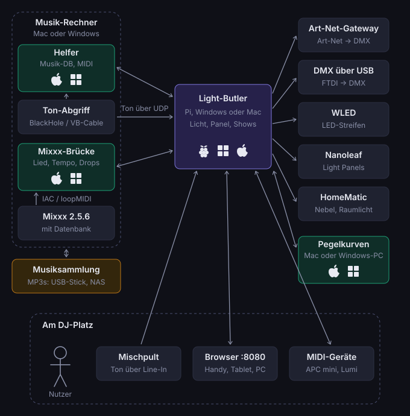
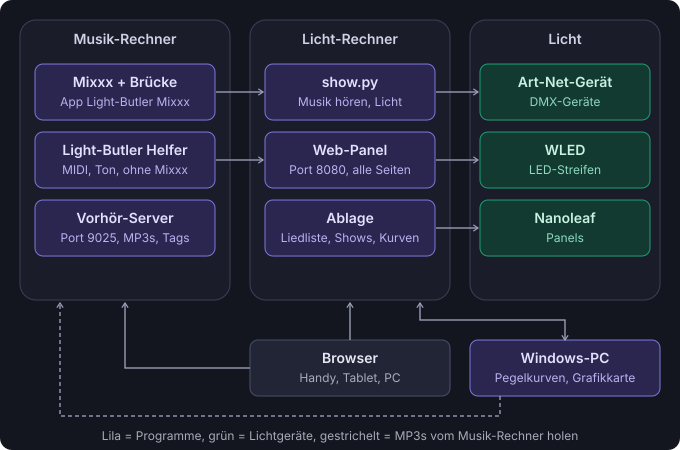

# Light-Butler – Technische Beschreibung

Lichtsteuerung zur Musik für Partys

**Markus Nepp** · Stand: November 2026

Diese Beschreibung wurde mit Unterstützung von KI (Claude von Anthropic) erstellt.

## Überblick

**Light-Butler** steuert deine Lichtanlage automatisch zur Musik: Ein **Licht-Rechner** (Raspberry Pi, Windows-PC oder Mac) wertet das Musiksignal aus und sendet die Lichtdaten an alle Geräte. Du bedienst ihn im Web-Panel am Handy, Tablet oder PC, auf Wunsch zusätzlich mit MIDI-Eingabetasten. Im Heimnetz erreichst du das Panel unter `http://<name-des-light-butler>:8080/`, zum Beispiel `http://lightbutler.local:8080/`. Im Browser des Handys legst du es über „Zum Home-Bildschirm“ als App mit dem Butler-Symbol ab.



Das Systemschema zeigt, was wo läuft: links der Musik-Rechner, in der Mitte der Light-Butler, rechts die Lichtausgänge und der Pegelkurven-Rechner, unten der DJ-Platz. Zum Antippen, mit den passenden Downloads, gibt es das Bild im Panel unter Einstellungen → Software für andere Rechner → **Systemschema und Downloads**.

Der Licht-Rechner ist die Mitte: Er hört die Musik, bekommt auf Wunsch Tempo und Drops von der DJ-Software, nimmt Befehle von Panel und Eingabetasten an und gibt die Lichtdaten an die Lichtausgänge weiter.

**Die Teile der Anlage**

- **DJ-Mischpult** liefert das Musiksignal über ein USB-Audio-Interface (Line-In) an den Licht-Rechner.
- **Licht-Rechner mit Light-Butler** analysiert Tempo, Beat, Takt, Tonart, Stimmung und Phasen (Aufbau, Drop, Break), berechnet die Szenen und stellt das Web-Panel auf Port 8080 bereit.
- **DMX-Geräte** (Moving Heads, Spider, Washes, Laser, Effektlichter, Nebelmaschine) bekommen die Lichtdaten auf einem von zwei Wegen:
  - über ein **Art-Net-Gateway** im Netzwerk, das Art-Net in DMX umsetzt (zum Beispiel ein zweiter Raspberry Pi mit OLA), oder
  - über einen **DMX-USB-Adapter** (FTDI, Open DMX USB) direkt am Licht-Rechner (Einstellung **DMX-Weg**, siehe Anhang).
- **WLED-LED-Streifen** und **Nanoleaf Light Panels** (beide optional) steuert der Light-Butler direkt über das Netzwerk.
  - Bei **Stille** (Ruhemodus) bleiben Effekt-Streifen ganz dunkel und spielen keine eigenen Presets.
  - **Ambiente-Streifen** (zum Beispiel an einer Bar) schaltet der Light-Butler beim Beenden aus und beim Start einmal wieder ein. Ein ausgeschaltetes WLED, das trotzdem Daten bekommt, blinkt sonst wild. Im Simulator werden die WLEDs nie angesprochen.
- **Musik-Rechner mit DJ-Software** (optional, Mac oder Windows): Die **Anbindung an die DJ-Software** schickt Tempo, Beat, Tonart und eine Vorhersage der Drops. Umgesetzt ist sie für **Mixxx**.
- **MIDI-Eingabetasten** (optional) per USB am Licht-Rechner oder am Musik-Rechner. Unterstützt werden der AKAI APC mini mk2 und die ROLI LUMI Keys.
- **Haussteuerung HomeMatic** (optional) für Raumlicht und Nebelschub.

**Was die Software kann**

Light-Butler macht das Licht und auf Wunsch auch die Musik von allein. Du kümmerst dich um deine Gäste und die Party, nicht um die Technik.

**Licht live zur Musik**

- **AUTO:** Das Licht folgt der Musik ohne Eingriff. Es erkennt Tempo, Beat, Takt, Tonart, Stimmung und Phasen (Aufbau, Break, Drop), mit vier Stufen von Chillen bis Vollgas.
- **Licht-Stile je Genre** (Club, Party, Rock, Ruhig, Weihnachten), auch über die Gruppe im Tag.
- **Feine Wirkungen:** Helligkeit folgt der Lautstärke, Hi-Hat-Funkeln, Beat-Puls, Geräte der Reihe nach.
- **40 Szenen** mit Szenen-Editor und Sofort-Knöpfe: STROBE, WOW! (aufbauender Strobo), SMOKE (Nebel), FREEZE, BLINDER, BLACKOUT und Laser. Alle außer AUTO wirken nur, solange du sie drückst.
- **Titelerkennung** über Shazam: Titel und Interpret auch ohne DJ-Software, das Genre wählt den Licht-Stil.
- **Liedtexte** laufen live zur Musik im Panel mit.

**Showmanager**

- **Eigene Lichtshows und Lasershows** zu einer MP3, Spur für Spur in einer Zeitleiste.
- **Show-Assistent:** erstellt automatisch eine Show aus der Liedanalyse und dem Raumplan, auf Wunsch zusammen mit Claude.
- **Quick-Show** mit einem Knopfdruck aus der Musik-Datenbank oder dem Hauptpanel.
- **Pegelkurven** (Schlagzeug, Bass, Gesang getrennt) für genauere Shows.
- Shows **starten von selbst**, sobald das passende Lied in der DJ-Software läuft.

**Musik**

- **Auto-DJ:** Playlist nach Energie, Tempo und Tonart, Übergänge im Takt, das Licht folgt. Musik und Licht laufen dann ganz von allein.
- **Anbindung an DJ-Software (Mixxx):** Tempo, Beat, Tonart und Hotcues kommen genau aus der DJ-Software, Drops werden vorausgesagt.
- **Ton von jedem Programm** am Musik-Rechner (zum Beispiel Spotify, YouTube) über das Netzwerk.

**Musik-Datenbank und Datenpflege**

- **Datenbanken** für Lieder, Interpreten (mit Bildern und Lebenslauf) und Alben (mit Titelliste und Merkliste „Fehlt mir“).
- **Für jedes Lied** misst der Light-Butler Energie, Tonart und BPM. Du vergibst Sterne und setzt Favoriten.
- **Vorhören** ab dem Hauptteil, mit Cover und Liedtext.
- **Tags und Cover:** Der Light-Butler besorgt die CD-Cover und trägt die Tags ein (Titel, Interpret, Album, Jahr, Genre), mit Tag-Editor, Vorschlägen und Auto-Tagger. Fehlt ein Cover, erzeugt er eines.
- **Aufräumen:**
  - Genre-Editor und Gruppen-Manager,
  - Doppelte finden, beschädigte MP3s erkennen und reparieren, in MP3 umwandeln,
  - Import-Assistent, CD-Assistent, Ordner auflösen,
  - NAS oder Stick spiegeln, Stick sicher auswerfen.

**Anlage und Geräte**

- **DMX** über ein Art-Net-Gateway oder einen DMX-USB-Adapter, Art-Net auch als Eingang für andere Lichtprogramme.
- **WLED-LED-Streifen**, **Nanoleaf Light Panels** (auch ihre eigenen Effekte) und **HomeMatic** für Raumlicht und Nebel.
- **MIDI-Eingabetasten:** AKAI APC mini und ROLI LUMI Keys, frei belegbar.
- **Ableton Link:** Der Light-Butler gibt das Tempo an Link-Geräte im Netz weiter.
- **Fixture-Manager** für deine Geräte, **Raumplaner** (daraus auch Lichtwellen durch den Raum), DMX-Monitor und DMX-Debugger.

**Sicherheit und Betrieb**

- **Sperren** für Laser, Strobe und Nebel, ein Sicherheitshinweis bei jeder neuen Anlage.
- Läuft auf **Raspberry Pi, Windows-PC oder Mac**, auch gemischt.
- **Bedienung** am Handy, Tablet oder PC, auf Deutsch oder Englisch, mit eigener Übersetzungstabelle.
- **Sicherung** jede Nacht, dazu ein Notfall-Ordner mit allen Programmen auf dem Musik-Stick.
- **Zustand und Statistik** der Anlage auf eigenen Seiten.

### Geräte, Programme und Verbindungen



| Von → nach | Port | Wofür |
| --- | --- | --- |
| Mixxx-Brücke → Licht-Rechner | UDP 9020 | Tempo, Beat, Tonart, Lied-Plan und die Liedliste („Light-Butler hat empfangen“ in der Musik-Datenbank) |
| Musik-Rechner (Brücke oder Helfer) ↔ Licht-Rechner | UDP 9021 | APC mini am Musik-Rechner: Tasten hin, LEDs zurück |
| Musik-Rechner → Licht-Rechner | UDP 9022 | Ton vom Musik-Rechner (am Mac über BlackHole, unter Windows über VB-Cable oder Stereomix: zum Beispiel Spotify, YouTube) |
| Musik-Rechner → Licht-Rechner | UDP 9023 | ROLI LUMI am Musik-Rechner, nur Noten |
| Browser → Licht-Rechner | TCP 8080 | Panel und alle Seiten |
| Browser → Musik-Rechner | TCP 9025 | Vorhör-Server: Vorhören, Cover, Tags schreiben, Ordnerbilder, Playlists für Mixxx |
| Musik-Rechner → Licht-Rechner | TCP 8080 | Einstellungen (Musikordner) alle 30 s, Sicherung von Kurven und Covern auf den Musik-Stick |
| Pegelkurven-Rechner (zum Beispiel Windows-PC) ↔ Licht-Rechner | TCP 8080 | Pegelkurven: Aufträge holen, fertige Kurven abliefern |
| Pegelkurven-Rechner → Musik-Rechner | TCP 9025 | MP3s für den Vorab-Lauf der Pegelkurven |
| Licht-Rechner → Art-Net-Gateway, WLED | Art-Net 6454 | DMX-Geräte (Universe 0), LED-Streifen |
| Licht-Rechner → Nanoleaf | UDP und HTTP | Panels |
| Mischpult, APC mini → Licht-Rechner | USB | Musik für die Analyse, Bedienung direkt am Licht-Rechner |

- **Light-Butler Mixxx** (App am Mac, unter Windows die Verknüpfung „Light-Butler Mixxx“) startet Mixxx und die **Brücke**. Die Brücke liest Mixxx mit (Decks, Lied, Plan) und schickt das an den Licht-Rechner. Liedliste und Vorhör-Server macht sie nur, wenn kein Helfer läuft (nach 30 Sekunden ohne Helfer übernimmt sie, kommt er wieder, gibt sie ab).
- Der **Light-Butler Helfer** läuft im Hintergrund, auch ohne Mixxx: APC, LUMI, Ton vom Musik-Rechner und der Pegelkurven-Wächter (rechnet Kurven für neue Shows, die letzten der Bibliothek als Reserve). Dazu standardmäßig alles, was Mixxx nicht braucht: Liedliste, Vorhör-Server (mit Auto-Tagger, Doppelten, Ordnerbildern), Schätzungen und Hintergrund-Analyse, auch während die Mixxx-App läuft. Macht die Mixxx-App eine neue Kopie ihrer Datenbank (bei jedem Start), lädt er die Liste binnen einer Minute neu.
- Am **Licht-Rechner** läuft ein einziges Programm `show.py` (am Pi als Dienst `lichtshow`): Musik hören, Licht rechnen, Web-Panel, Ablage.
- Der **Pegelkurven-Rechner** (zum Beispiel ein Windows-PC mit Grafikkarte, sonst der Mac) rechnet die Pegelkurven für den Showmanager (unter Windows als Aufgabe beim Anmelden, siehe Pegelkurven).
## Erste Schritte

Die Lichtsteuerung läuft auf dem Licht-Rechner (am Pi als Dienst `lichtshow`) und startet beim Einschalten von selbst. Du brauchst nur das Web-Panel im Browser.

**Panel öffnen**

- Adresse: `http://<name-des-light-butler>:8080/`, zum Beispiel `http://lightbutler.local:8080/` (oder die IP-Adresse des Licht-Rechners mit `:8080`).
- Es gibt keine Anmeldung. Benutze das Panel nur im Heimnetz.
- Lege am Handy ein Lesezeichen an.

**In fünf Minuten startklar**

1. Licht-Rechner, Art-Net-Gateway (zum Beispiel ein Raspberry Pi mit OLA, falls vorhanden), Mischpult und Lichter einschalten. Nach etwa einer Minute ist der Licht-Rechner bereit.
2. Panel öffnen. Oben links blinkt das **Beat-Lamperl** im Takt, sobald Musik läuft.
3. **AUTO** ist der Normalfall: Das Licht folgt der Musik allein, die Bedienung unter den Sofort-Knöpfen ist gesperrt. AUTO nochmal drücken = manuell.
4. Manuell eine **Szene** antippen, um sie festzuhalten. Dieselbe Szene nochmal antippen wählt sie wieder ab.
5. Mit dem **General Dimmer** (oben) die Gesamthelligkeit einstellen. **BLACKOUT** gedrückt halten schaltet alles aus, solange du drückst.
6. Unter **Verbindungen** (weiter unten) siehst du, ob Art-Net-Gateway, WLED und Nanoleaf erreichbar sind, mit ihren IP-Adressen. Die **Hinweiszeile** unten im Statusbereich warnt, wenn etwas fehlt.
7. Der kleine **?** oben rechts öffnet dieses Handbuch (in der Sprache, die im Panel eingestellt ist). Am Handy findest du es stattdessen im Menü **☰** der Kopfleiste (zum Beispiel über **⚙**).
8. Der rote **⏻** daneben fährt den Pi sauber herunter (mit Rückfrage). Danach kannst du den Strom trennen, ohne die SD-Karte zu gefährden.

**Pi herunterfahren**

- Den rötlichen Knopf **⏻** oben rechts antippen. Im Fenster steht je ein Knopf zum Ausschalten für die HomeMatic-Steckdosen deiner Geräte (zum Beispiel Nanoleaf, LED-Streifen, DMX-Geräte, Musikanlage und Strom der Nebelmaschine), solange sie laut CCU noch an sind. Sie gehen nicht von selbst aus. Mit **Herunterfahren** bestätigen: Das Licht geht sofort aus, die Laser sind aus, dann fährt der Pi herunter.
- Warte etwa **30 Sekunden**, bis die grüne LED am Pi nicht mehr blinkt. Dann den Strom trennen. Zum Einschalten den Strom wieder anstecken, der Dienst startet von selbst.
- **Einmalig einrichten:** Der Dienst braucht dafür eine Freigabe. Am Musik-Rechner im Projektordner (Terminal) ausführen und dein Pi-Passwort eingeben: `ssh -t admin@<name-des-light-butler> "sudo bash ~/lichtshow/install_poweroff.sh"`. Das erlaubt dem Benutzer admin genau den Befehl `/usr/sbin/poweroff` ohne Passwort, sonst nichts. Rückgängig: `sudo rm /etc/sudoers.d/lichtshow-poweroff`.
- Ohne Freigabe zeigt das Panel einen Hinweis und fährt nichts herunter. Im Simulator ist der Knopf gesperrt.

**Dienst verwalten (am Pi, per SSH)**

| Aufgabe | Befehl |
| --- | --- |
| Neu starten (nach jeder Änderung an Dateien) | `sudo systemctl restart lichtshow` |
| Status ansehen | `systemctl status lichtshow` |
| Letzte Meldungen lesen | `journalctl -u lichtshow -n 40 --no-pager` |
| Dateien prüfen vor dem Neustart | `cd ~/lichtshow && python3 phase2_test.py --check` |

Die Startoptionen stehen in `/home/admin/lichtshow/show.conf`, zum Beispiel `--device USB --master 1.0 --strobe --web 8080`. Neue Versionen spielst du vom Mac aus dem Projektordner mit `./deploy.sh push` ein und startest den Dienst mit `./deploy.sh restart` neu. Einfacher in einem Befehl: `./deploy.sh alles` kopiert (mit Tests), startet den Pi nur neu, wenn sich Programmdateien geändert haben (sudo-Passwort am Pi eintippen), installiert die App „Light-Butler Mixxx“ und den Light-Butler Helfer am Mac neu und startet den Helfer neu. Läuft „Light-Butler Mixxx“, bittet er dich, sie über das Symbol zu beenden, wartet darauf und startet sie danach selbst wieder. Fehlt im Ordner, aus dem du einspielst, etwas aus `main`, hält `push` an und zeigt die fehlenden Commits, damit auf dem Pi nichts überschrieben wird. Danach das Panel auf jedem Gerät **neu laden**, sonst läuft dort noch die alte Seite. Läuft das alte Verhalten weiter, wurde der Neustart vergessen.

**Pi umbenennen (Rechnername)**

Der Pi heißt bei der Einrichtung zum Beispiel `lightbutler`. Umbenennen geht vom Musik-Rechner aus (Mac, im Projektordner), zum Beispiel auf `lightbutler2`:

1. `./deploy.sh rename lightbutler2` ausführen und die Rückfrage mit **j** bestätigen.
2. Nach deinem **sudo-Passwort** fragt der Pi einmal, das tippst du selbst ein. Danach startet er neu, das Licht ist etwa eine Minute aus.
3. Der neue Name wird am Mac überall eingetragen: in `~/.light-butler-pi` (die gemeinsame Einstellung für `deploy.sh`, die Mixxx-App und den Helfer) sowie bei der Mixxx-App und beim Light-Butler Helfer. Beide Apps danach einmal beenden und neu starten.
4. Das Panel heißt dann zum Beispiel `http://lightbutler2.local:8080/` (oder mit der Domäne deines Routers). Lesezeichen und den Home-Bildschirm-Eintrag anpassen. Kennt der Router (zum Beispiel eine FRITZ!Box) den neuen Namen nach zwei Minuten nicht, dort in der Geräteliste des Heimnetzes den Namen des Pi ändern.

- Erlaubt sind Kleinbuchstaben, Ziffern und Bindestrich, nicht am Anfang oder Ende. Der Dienst `lichtshow`, der Ordner `~/lichtshow` und der Benutzer `admin` bleiben, wie sie sind.
- `./deploy.sh where` zeigt, welcher Pi gerade angesprochen wird. Wer einen Pi mit anderem Namen hat, trägt ihn einmal in `~/.light-butler-pi` ein (eine Zeile, zum Beispiel `meinpi.local`). Die Installationsskripte schlagen dann diesen Namen vor.
- Im Panel gibt es das Umbenennen absichtlich nicht: Es hat keine Anmeldung, und das Umbenennen braucht Administratorrechte.
## Das Web-Panel

Der obere Bereich hat feste Höhen, damit nichts springt, wenn sich Anzeigen ändern. Darunter folgen die Bedienelemente.

**Der Kopfbereich (von oben nach unten)**

| Zeile | Inhalt |
| --- | --- |
| 1 | **Beat-Lamperl** (blinkt im Takt), **BPM** als ganze Zahl (rechts daneben klein über „BPM“: **MIXXX** (oder **AUTO-DJ**) in Blau oder **MANUELL** in Orange, wenn der Wert von dort kommt; spielt Mixxx oder der Auto-DJ, zeigen Zahl und Lamperl deren Tempo auch dann, wenn am Eingang kein Ton anliegt, das Licht bleibt dann im Ruhemodus; Lamperl, Zahl und Statusfeld stehen auf einer Linie), das **Statusfeld** (so hoch wie die runden Knöpfe), das **Herz** für den **Zustand**, die **CD** für den **Auto-DJ**, die **Musik-Datenbank** (Datenbank-Symbol), die drei Balken für die **Statistik**, das Zahnrad **⚙** für die **Einstellungen**, der Hilfe-Knopf **?** (am Handy stattdessen in den Einstellungen) und **⏻** zum Herunterfahren |
| 2 | Betriebsart (AUTO, Szene, BLACKOUT, ALLES HELL), Stufe in Worten (**Chillen** = Stufe 0, **Groove** = 1, **Party** = 2, **Vollgas** = 3), Stimmung, Tonart (kommt sie aus Mixxx, folgt eine kleine blaue Marke **MIXXX**), Takt. Ganz rechts ein kleines **Pegelmeter** des Audio-Eingangs: Balken = Pegel (grün, ab −12 dB gelb, ab −3 dB rot), weißer Strich = Spitze, ganz rot = übersteuert, gestrichelter Rahmen = kein Signal. Daneben die Quelle **Line-In** oder **LAN** (Ton vom Musik-Rechner). Antippen öffnet die Einstellungen beim Audio-Eingang |
| 3 | **Mixxx-Zeile**: Deck, Titel des laufenden Liedes, verbleibende Spielzeit und die nächsten Ereignisse. Ohne Lied aus Mixxx und mit Titelerkennung **Live** mit dem erkannten Lied |
| 4 | **Liedverlauf**: immer gleich hoch; spielt kein Deck, steht dort ein gestrichelter Platzhalter, damit die Knöpfe darunter nicht springen |

**Das Statusfeld** hat immer denselben Platz und zeigt, was gerade passiert: **BLACKOUT**, **BLINDER**, **WOW! 42 %**, **FREEZE**, **STROBE**, **SMOKE**, **DROP !**, **AUFBAU**, **STILLE**, **BREAK**, **LASER AKTIV**, sonst dezent "normal" oder "keine Musik". Was du selbst drückst, hat Vorrang vor den automatisch erkannten Phasen. Am Handy ist das Feld zu schmal für Text und zeigt nur die Farbe, nur **LASER AKTIV** bleibt immer als Text sichtbar.

**Die Hinweiszeile** steht unten im Statusbereich und ist immer gleich hoch, damit nichts springt. Ist alles in Ordnung, steht dort „✓ Alle Geräte erreichbar“. Sonst zeigt sie je Hinweis ein Feld, bei vielen Hinweisen lässt sie sich waagrecht wischen: **rot** ein Gerät, das nicht erreichbar ist, **orange** eine abgeschaltete Ausgabe (DMX, WLED, Nanoleaf; Antippen schaltet ein), **blau** Art-Net von außen oder ein offener Neustart (antippbar). Hat das Gerät eine HomeMatic-Steckdose (zum Beispiel Nanoleaf oder ein LED-Streifen an einer oder mehreren Steckdosen), steht **⏻** davor: Antippen schaltet nach einer Rückfrage die Steckdose(n) ein. Geräte ohne eigene Erreichbarkeit (zum Beispiel DMX-Geräte an einer gemeinsamen Steckdose oder die Musikanlage) stehen dort mit dem Namen ihrer Steckdose als „⏻ <Name> aus“, sobald ihre Steckdose laut CCU aus ist, ebenfalls antippbar. Die Zuordnung steht in `homematic.yaml` unter `ccu.power_for` und `ccu.power_watch`. Ausschalten geht von dort nie, die Nebelmaschine ist ausgenommen.

**Die Mixxx-Zeile** zeigt links den Punkt und das Deck ("Deck 1" oder "Deck 2"), dann den Liedtitel und rechts **gespielt / gesamt** und die **verbleibende Spielzeit** (zum Beispiel "1:37 / 3:38 −2:01", bei Pitch auf die echte Zeit umgerechnet) und die nächsten Ereignisse, zum Beispiel "Stille 4,2 · Drop 5,1 s". Der Punkt ist **grün**, wenn das Licht der Vorhersage folgt, **blau** bei reiner Anzeige und grau ohne Verbindung.

**Energiestufe und Genre:** Vor dem Titel steht die Energiestufe des Lieds als Abzeichen **E1** bis **E9**, von Blau (ruhig) über Grün bis Rot (E7 grün, E8 braun, E9 rot wie die Trackfarben in Mixxx). Hinter dem Titel steht grau das **Genre** aus Mixxx. Die Stufe kommt aus dem **Kommentar** eines DJ-Analyseprogramms (zum Beispiel „8A - Energy 7“), sonst aus einer Crate **„Energy 9“** oder **„Energy 8“** (die höchste zählt), sonst aus der Trackfarbe (Rot #993333 = 9, Braun #997733 = 8, Grün #339933 = 7). Die Show verschiebt damit die Energie: Je Stufe über der Mitte (6) etwas mehr, je Stufe darunter etwas weniger. Bei E9 kommt Stufe 3 leichter und bleibt länger, ruhige Lieder bleiben ruhiger (Einstellungen **Gewicht Mixxx-Energie** und **Mitte Mixxx-Energie** im Bereich Mixxx). Lieder ohne Stufe bleiben unverändert.

**Geschätzte Energiestufe:** Lieder ohne Stufe aus einem DJ-Analyseprogramm bekommen am Musik-Rechner eine geschätzte Stufe. Die Mixxx-Brücke misst dazu einmal je Lied Lautheit, Dynamik, Bass- und Höhenanteil, Klangfarbe, Anschläge, Beat, Tempo und Tonart und rechnet daraus mit einem Modell die Stufe. Das Modell wurde an rund 8800 Liedern mit einer Stufe aus einem DJ-Analyseprogramm geeicht. Es trifft bei knapp 60 % genau dieselbe Stufe und bei 96 % höchstens eine Stufe daneben. E8 und E9 erkennt es nicht, dort sagt es E7. Die Länge zählt höchstens mit 15 Minuten: lange DJ-Mixe und Konzerte (mit früheren Versionen oft E1) werden so geschätzt wie ein Lied dieser Art; eine schon geschriebene falsche Stufe ersetzt die Brücke dann von selbst (nur ihre eigene). Geschätzte Stufen tragen eine Wellenlinie, zum Beispiel **E6~**, im Hauptpanel und in der Musik-Datenbank. Sie wirken wie eine echte Stufe auf Licht, Assistent und Quick. Neue Lieder misst die Brücke nach und nach im Hintergrund. Eine Stufe aus einem DJ-Analyseprogramm geht immer vor. In die MP3-Dateien schreibt die Brücke die geschätzte Stufe nur mit dem Schalter **Geschätzte Energiestufe in die MP3 schreiben** (Einstellungen allgemein → Titelerkennung, Standard aus). Sie verwendet dafür das ID3-Feld EnergyLevel wie verbreitete DJ-Analyseprogramme, mit dem Vermerk „geschätzt“. Die Musik in der Datei bleibt Byte für Byte gleich, die Shows finden ihre MP3 weiter. Eine Stufe aus einem DJ-Analyseprogramm wird nie überschrieben, Lieder in einem Deck lässt sie aus. Mixxx zeigt dieses Feld nicht an. In der Musik-Datenbank zeigt die Spalte **E geschätzt** die Schätzung für jedes gemessene Lied, auch neben einer Stufe aus einem DJ-Analyseprogramm. Weicht sie ab, steht der Unterschied daneben (zum Beispiel „+1“). So lassen sich Original und Schätzung vergleichen.

**Tonart ohne Mixxx:** Kennt Mixxx die Tonart eines Liedes nicht, holt die Brücke sie aus dem Feld TKEY der Datei (DJ-Analyseprogramme schreiben dort zum Beispiel „8A“). Steht auch dort keine, schätzt sie die Tonart aus dem Klang: mit essentia (Profil „bgate“), wenn am Mac die Umgebung `~/s2l-key` eingerichtet ist, sonst mit einem einfacheren eigenen Verfahren. In einer Stichprobe von 400 Liedern traf essentia bei 73 % genau dieselbe Tonart wie Mixxx und bei 84 % dieselbe oder eine eng verwandte (Paralleltonart oder Quinte), das einfache Verfahren bei 64 % und 78 %. Geschätzte Tonarten tragen in der Musik-Datenbank eine Wellenlinie (zum Beispiel „Am 8A~“). Ist die Tonart nicht eindeutig, bekommt das Lied keine: bei geringer Sicherheit der Schätzung (dort stimmte in der Stichprobe nur etwa jede fünfte), bei Dateien unter 30 Sekunden (Geräusche) und über 20 Minuten (ganze DJ-Sets). In der Musik-Datenbank steht dann „?“. Genauso misst die Brücke die **BPM** von Liedern, für die Mixxx keine kennt: zuerst das Feld TBPM der Datei, sonst mit essentia im selben Durchgang wie die Tonart (in einer Stichprobe von 300 Liedern bei 79 % auf 2 % genau wie Mixxx, bei weiteren 4 % doppelt oder halb so schnell). Ohne essentia misst die Brücke das Tempo selbst aus dem Takt der Anschläge (an 60 Liedern bei 75 % auf 2 % genau wie Mixxx, bei weiteren 8 % doppelt oder halb so schnell). Geschätzte BPM stehen mit „~“ in der Musik-Datenbank, nicht bestimmbare mit „?“; der Schalter heißt dafür **Geschätzte Tonart und BPM in die MP3 schreiben** und schreibt die BPM ins Feld TBPM, nie über einen vorhandenen Wert. In die Datei kommt dafür nichts, auch kein Platzhalter, denn andere Programme würden ihn als Tonart lesen. Aufs Licht wirkt sie wie die Tonart aus Mixxx, aber nur bei Liedern, die in Mixxx keine haben. Mit dem Schalter **Geschätzte Tonart und BPM in die MP3 schreiben** (Einstellungen allgemein → Titelerkennung, Standard aus) schreibt die Brücke sie als Camelot ins Feld TKEY, ohne Wellenlinie und mit dem Vermerk „geschätzt“. Eine vorhandene Tonart in der Datei überschreibt sie nie, die Musik bleibt gleich. Die Ergebnisse liegen je Datei am Musik-Rechner (`~/Light-Butler-Daten/tonart`) und gehen mit der Bibliothek an den Licht-Rechner.

**Lautheit (gleich laut abspielen):** Die Brücke (oder der Light-Butler Helfer) misst im Hintergrund die Lautheit jedes Liedes nach EBU R128, wie Radio und Spotify: wie laut das Lied fürs Ohr wirkt, in LUFS (−6 sehr laut, −14 wie Spotify, −20 leise), dazu die echte Spitze in dB. Das macht ffmpeg (am Mac aus Homebrew), rund 200-mal schneller als Echtzeit, eine Datei nach der anderen; die Musik bleibt dabei unverändert. In der Musik-Datenbank stehen die Werte in den Spalten **LUFS** und **Spitze** (über 0: die Datei übersteuert, orange), der Filter **Lautheit von – bis** findet Ausreißer (zum Beispiel bis −18 = die leisen), **ungemessen** zeigt die noch nicht gemessenen. Beim **Vorhören** gleicht der Haken **gleich laut** im Balken an: laute Lieder spielen leiser, so laut wie −14 LUFS (lauter machen kann der Browser dort nicht). Der **Auto-DJ** gleicht mit dem Haken **Gleich laut** in beide Richtungen an: laute leiser, leise lauter, aber nie über 1 dB unter der Spitze, damit nichts übersteuert. Mit dem Schalter **ReplayGain in die MP3 schreiben** (Einstellungen allgemein → Titelerkennung, Standard aus) schreibt die Brücke die ReplayGain-Angabe (REPLAYGAIN_TRACK_GAIN und _PEAK, Bezug −18 LUFS) in die MP3, damit auch Mixxx und andere Player gleich laut abspielen. Das geschieht nur in Dateien, in denen noch keine ReplayGain-Angabe steht; eine vorhandene von einem anderen Programm bleibt, wie sie ist (in der Spalte LUFS mit „ʳ“, von uns geschriebene mit „ᴸ“). Mixxx misst beim Analysieren auch selbst (Einstellungen → Normalisierung). Die Messungen liegen am Musik-Rechner in `~/Light-Butler-Daten/lautheit`. Aufs Licht wirkt das nicht.

**Betrieb ohne Mixxx:** Der Light-Butler geht auch ganz ohne die DJ-Software Mixxx. Dann holt der Musik-Rechner (Light-Butler Helfer) die Lieder aus dem Musikordner, misst Tonart, Tempo, Energie und Lautheit selbst und analysiert Aufbau und Drops im Hintergrund; Auto-DJ, Musik-Datenbank, Alben, Interpreten, Favoriten und Datenpflege laufen wie gewohnt. Der Schalter **Mixxx verwenden** (Einstellungen allgemein → Titelerkennung, Standard an) räumt dafür das Panel auf: aus, blendet es alles aus, was nur mit Mixxx geht (Abgleich Mixxx/Stick, „Geänderte → Mixxx“, „Mixxx aufräumen“, Kisten und Listen, Hotcue-Filter, die Spalten Gespielt, Zuletzt gespielt, Cues und Quelle), Hinweise und Erklärungen nennen Mixxx nicht mehr, und die Mixxx-Zeile im Hauptpanel erscheint nur noch für den Auto-DJ. Der Musik-Rechner nimmt die Lieder dann nur aus dem Musikordner, auch wenn noch eine alte Kopie der Mixxx-Datenbank daliegt. In Mixxx wird dabei nichts geändert oder gelöscht: wieder an, ist alles wie vorher (Sterne, die du inzwischen gesetzt hast, kommen beim nächsten Start der Mixxx-App hinein). Das Handbuch selbst bleibt vollständig. Aufs Licht wirkt der Schalter nicht.

**Cue-Punkte ohne Mixxx:** Hotcues kommen sonst nur aus Mixxx. Für Lieder ohne Hotcues gibt es zwei Schalter (Einstellungen allgemein → Titelerkennung, beide Standard aus). **Cues ohne Mixxx fürs Licht:** der Musik-Rechner nimmt die Cues aus der MP3 (falls ein anderes Programm sie dort gespeichert hat) oder schätzt sie aus der eigenen Analyse: Start (erster Beat bzw. Ende des Intros), deutliche Drops und die Anfänge von Vers, Hauptteil, Break und Outro, auf den Takt gerastet, höchstens 8, nie zwei näher als 8 Sekunden; Stücke unter 30 Sekunden (Samples, Jingles) bekommen nur „LB Start“, wo der Ton beginnt. Lieder ab 15 Minuten (DJ-Mixe, Live-Sets) werden in 8 gleich lange Stücke geteilt: im ersten der Start, in jedem anderen der beste Punkt dieses Stücks (Drop, sonst Hauptteil oder Break, sonst Vers oder Outro), ohne einen davon der Anfang des Stücks („LB Teil“); so reichen die 8 Cues über den ganzen Mix. Das Licht nutzt sie wie Hotcues aus Mixxx (Drops rasten darauf ein, an einem Cue wechselt das Licht wie bei einer neuen Phrase); Hotcues aus Mixxx gehen immer vor. **Geschätzte Cues in Mixxx schreiben:** die App „Light-Butler Mixxx“ schreibt sie beim Start, bevor Mixxx läuft, in die Mixxx-Datenbank, mit Sicherungskopie und nur in Lieder ganz ohne Hotcues. Sie heißen „LB Start“, „LB Drop“, „LB Hauptteil“ … (aus der MP3: „LB Cue 1“ …) und sind lila, damit du sie von deinen eigenen unterscheidest. Verschieben oder löschen kannst du sie in Mixxx wie jeden Hotcue; löschst du sie bei einem Lied, kommen sie dort nie wieder. Lange Mixe, die mit einer früheren Version schon LB-Cues bekamen (damals alle am Anfang), bekommen beim nächsten Start der App die verteilten, aber nur, wenn dort noch genau die alten LB-Cues stehen; hast du einen davon verschoben, umbenannt oder einen eigenen dazugesetzt, bleibt das Lied, wie es ist. In der Musik-Datenbank zeigt der Filter **ohne Hotcues** die Lieder, die noch keine haben. Außerdem legt die App beim Start in Mixxx die Wiedergabeliste **„LB zu analysieren“** an: alle Lieder, die Mixxx selbst noch nicht analysiert hat (Wellenform, Beat-Raster). Mixxx zeigt das sonst nirgends an, „Neue Titel“ unter Analysieren sind nur die der letzten Woche. In der Liste 30 bis 50 Lieder markieren, Rechtsklick → Analysieren; bei jedem Start der App wird sie kürzer, ist alles analysiert, verschwindet sie. Nicht Hunderte auf einmal analysieren: dabei kann sich Mixxx aufhängen (Fenster weg, reagiert nicht). **Gleiche Datei zweimal in Mixxx:** Umlaute können in Dateinamen auf zwei Arten gespeichert sein („ü“ als ein Zeichen oder als u mit Punkten); für Mixxx sind das zwei Lieder. Die App führt solche Paare beim Start zusammen: es bleibt der Eintrag in der Schreibweise, die Mixxx selbst beim Einlesen verwendet (Umlaut als ein Zeichen), Kisten, Wiedergabelisten, Hotcues und Bewertung gehen auf ihn über, der andere wird in Mixxx ausgeblendet; die Datei bleibt, wie sie ist. Die Doppelte-Seite zählt sie als eine Datei, und Wiedergabelisten des Light-Butler für Mixxx schreiben Pfade ebenso in dieser Schreibweise. (Frühere Versionen behielten den anderen Eintrag; nach „Bibliothek neu einlesen“ standen diese Lieder dann bei den fehlenden Tracks. Der nächste Start der App dreht das um, die fehlenden Tracks verschwinden dann.)

**Lieder aus dem Musikordner (ohne Mixxx):** Die Mixxx-Brücke liest zusätzlich alle MP3s im Musikordner ein (Einstellungen → Verbindungen, sonst `MUSIC_ROOT` in `config.sh`), beim Start und danach alle 10 Minuten. Lieder, die schon in der Mixxx-Bibliothek stehen, lässt sie weg (Vergleich über Ordner und Dateiname). Aus jeder übrigen Datei liest sie nur den Kopf: Titel und Interpret (ohne Tags aus dem Dateinamen „Interpret - Titel.mp3“), Genre, BPM (Feld TBPM), Tonart (TKEY), Energie (EnergyLevel oder der Kommentar eines DJ-Analyseprogramms), Länge und Bitrate. Ohne Stufe oder Tonart in der Datei schätzt die Brücke sie wie bei Mixxx-Liedern (mit ~). In der Musik-Datenbank zeigt die Spalte **Quelle** „Mixxx“ oder „📁 Ordner“, der Filter **nur Ordner (nicht in Mixxx)** zeigt nur diese Lieder. Vorhören, „+ Show“ und Cover gehen wie bei Mixxx-Liedern. Ohne Mixxx-Datenbank läuft die Brücke mit dieser Liste allein. Läuft Mixxx nicht, macht dasselbe der **Light-Butler Helfer** (siehe Kapitel Audio-Eingang). Beide nutzen dieselbe Ablage in `~/Light-Butler-Daten` (Tag-Vorschläge, Doppelte „Alle behalten“, Energie- und Tonart-Messungen); was der Helfer früher in seinem eigenen Ordner gesammelt hat, übernimmt er beim Start einmal dorthin. Der Auto-Tagger speichert nach jedem Lied, ein Neustart von Licht- oder Musik-Rechner verliert nichts. Die Analyse von Aufbau und Drops gibt es für diese Lieder noch nicht. Was schon gelesen ist, merkt sich die Brücke in `~/Light-Butler-Daten/ordner`.

**Ausgeschlossene Ordner:** Unter Einstellungen → **Verbindungen** steht unter dem Musikordner ein Feld **Ausgeschlossene Ordner**: je Zeile ein Ordner, vom Musikordner aus gesehen (zum Beispiel `Hörbücher` oder `Kindermusik/Duplikate`), oder ein voller Pfad. Nach **Speichern** holen sich die Mixxx-Brücke und der Helfer die Liste innerhalb von 30 Sekunden. Lieder in diesen Ordnern gibt es für den Light-Butler dann nicht: die Ordner-Liste liest sie nicht ein, Lieder aus Mixxx darin fallen aus der Musik-Datenbank, die Datenpflege (Doppelte, Dateien prüfen, Ordnerbilder, Genres, Tag-Vorschläge, Energie, Tonart) schaut nicht hinein, es gibt keine Analyse, keine Spur-Kurven und kein Vorhören, und es wird nie etwas in diese Dateien geschrieben. Unter dem Feld steht je Ordner, ob es ihn gibt und wie viele MP3s darin liegen. Nimmst du eine Zeile wieder heraus, ist der Ordner beim nächsten Durchgang dabei. Gross- und Kleinschreibung zählt nicht. Mixxx selbst kennt keine solche Liste: was im Musikordner liegt, nimmt Mixxx beim nächsten Einlesen auf. Neue Musik legst du deshalb zuerst in einen Wartebereich neben dem Musikordner (zum Beispiel `/Volumes/<Stick>/musik-import`) und schiebst sie erst in den Musikordner, wenn sie dazugehören soll. Die Liste steht in `music.json` auf dem Licht-Rechner, die Brücke merkt sie sich in `~/Light-Butler-Daten/ausschluss.json`.

**Stick auswerfen:** Läuft der Helfer oder die Mixxx-App, liest der Light-Butler immer wieder im Hintergrund auf dem Musik-Stick (Tags, Prüfen, Schätzen, Sicherung der Kurven), dann lässt sich der Stick (am Mac im Finder) oft nicht auswerfen. Der Knopf **⏏ Stick auswerfen** (Einstellungen → Verbindungen, unter dem Musikordner, und **⏏ Stick** oben in der Musik-Datenbank) hält diese Arbeiten am Musik-Rechner an, wartet, bis keine Datei mehr offen ist (höchstens eine Minute), und wirft den Stick aus. Das Panel meldet „Stick ausgeworfen, du kannst ihn abziehen“ oder, welches Programm ihn noch hält; ist es Mixxx (ein Lied vom Stick in einem Deck), Mixxx beenden und noch einmal tippen. Solange der Stick ausgeworfen ist, liefern Vorhören, Export und Import nichts. Steckst du ihn wieder an, arbeitet der Light-Butler von selbst weiter. Trägst du stattdessen einen anderen Stick als Musikordner ein (etwa einen Ersatzstick), fällt die Sperre innerhalb von 30 Sekunden weg. Die Sperre steht in `~/Light-Butler-Daten/stick_sperre.json`, damit sich Helfer und Mixxx-Brücke beide daran halten.

**Genre-Stile:** Das Genre aus Mixxx gibt in AUTO einen Stil vor: Farbpalette, Tempo der Bewegung, Energie und weiße Akzent-Blitze. Das Licht folgt weiter der Musik, der Stil färbt es nur. Im Panel steht der Stil hinter dem Genre, wenn er anders heißt (zum Beispiel „Techno → Club“).

| Stil | Genres | Farben | Bewegung | Energie | weiße Blitze |
| --- | --- | --- | --- | --- | --- |
| Weihnachten | Weihnachten | Rot, Grün, Gold, kein UV-Licht | langsam | etwas ruhiger | keine |
| Club | EDM, House, Techno, Trance, Dance, Electronic | nach Stimmung wie bisher | wie bisher | wie bisher | wie bisher |
| Party | Pop, Austropop, Schlager, Neue Deutsche Welle, Latin, Reggae, Oldies, Volksmusik | Magenta, Cyan, Gelb, Orange | lebhafter | wie bisher | wie bisher |
| Rock | Rock, Metal, Punk, Blues, Funk | Rot, Orange, Bernstein | etwas lebhafter | etwas mehr | wie bisher |
| Ruhig | Klassik, Ambient, Meditation, Soundtrack, Jazz, Musical, Soul, Folk, Synthesizer | Blau, Violett, Türkis | halb so schnell | deutlich ruhiger | keine |

Alle anderen Genres bleiben wie bisher. Auch die **Gruppe** im Tag zählt: eine Gruppe „Weihnachten“ (oder Christmas, Xmas) gibt den Weihnachts-Stil, ebenso jede Gruppe, der du in der Tabelle der Genre-Stile selbst einen Stil gibst; sie geht dann vor dem Genre. So kann ein Weihnachtslied das Genre Pop haben und leuchtet trotzdem rot, grün und gold. Andere Gruppen ändern am Licht nichts, und der Auto-DJ nimmt Lieder der Gruppe Weihnachten nur auf Wunsch. Selbst gewählte Farben im Panel gehen vor. Ein Stil macht Blitze nur seltener, nie häufiger, Strobe bleibt unberührt. Schalter **Genre-Stile** im Bereich Mixxx.

**Eigene Zuordnung:** Unter Einstellungen → Mixxx-Vorhersage steht die Tabelle **Genre-Stile** mit allen Genres deiner Mixxx-Bibliothek (die Zahl ist die Anzahl Lieder; die Liste schickt die Brücke am Musik-Rechner alle 30 Sekunden). Für jedes Genre wählst du **Standard** (die feste Zuordnung oben), einen der fünf Stile oder **kein Stil** (Licht wie bisher). Eigene Zuordnungen sind orange umrandet und gelten sofort. Sie stehen auf dem Licht-Rechner in `genre_styles.json` und bleiben beim Einspielen erhalten. Dafür muss die App „Light-Butler Mixxx“ aktuell sein: am Mac einmal `bash mac/mixxx_bridge/install_launcher.sh` ausführen und die App neu starten. Ohne Mixxx ändert sich nichts.

**Der Liedverlauf** liegt als schmaler Balken direkt darunter, solange ein Deck hörbar spielt: die Lautstärke des Lieds als Kurve (wie die Übersicht in Mixxx), **Aufbau** orange, **Break und Stille** dunkelblau, **Drops** als roter Strich, ein **Streifen am unteren Rand** für die Abschnitte (Intro und Outro türkis, Strophe grau, Hauptteil grün; die Brücke am Musik-Rechner leitet sie nach der Lautstärke ab, Wiederholungen erkennt sie nicht, „Hauptteil“ heißt also: voller Teil, meist der Refrain), die **Hotcues** aus Mixxx als kurze gelbe Striche oben und unten und ein **weißer Strich an der aktuellen Stelle**. Der schon gespielte Teil ist abgedunkelt. Ohne Analyse zeigt der Balken nur den Fortschritt. Für die Kurve muss die App „Light-Butler Mixxx“ aktuell sein: am Mac einmal `bash mac/mixxx_bridge/install_launcher.sh` ausführen. Der Balken ist nur zum Ansehen.

**Hotcues:** Viele Lieder haben schon Hotcues, gesetzt von Hand oder von einem Analyseprogramm (oft bis zu 8, „Cue 1“ bis „Cue 8“, taktgenau an den Wechseln zwischen Abschnitten). Die Show nutzt sie zweimal:

- **Drops einrasten:** Liegt ein Drop aus der Analyse höchstens 1,5 s neben einem Hotcue, rückt er genau auf den Hotcue. Aufbau und Stille davor enden mit. So kommen die Drops pünktlicher. Einstellung **Drops auf Hotcues einrasten** (0 = aus).
- **Wechsel an Hotcues:** Läuft das Lied über einen Hotcue, wechselt die Show wie nach 8 Takten: neue Farbe (frühestens nach der Mindestdauer je Farbe), neue Lichtmischung und ab und zu eine Szene. Springst du im Lied oder lädst ein anderes, gibt es keinen Wechsel. Einstellung **Wechsel an Hotcues** (an/aus).

**Die Knopfreihe** (Namen in der Sprache English, auf Deutsch in Klammern)

| Knopf | Wirkung |
| --- | --- |
| AUTO | Autopilot ein und aus (Normalbetrieb: ein). Der einzige Knopf, der kein Taster ist |
| STROBE | Alle Lichter blitzen, solange du drückst |
| WOW! | Aufbauender Strobo, solange du drückst, Loslassen löst den Drop aus |
| BLINDER (SONNENBRILLE) | Alles mit 100 % Helligkeit, solange du drückst, ignoriert Master und Gruppen-Regler |
| FREEZE | Licht und Bewegung bleiben stehen, solange du drückst, die Laser gehen sofort aus |
| BLACK OUT | Alles aus, auch Laser und Nebel, solange du drückst |
| SMOKE (NEBEL) | Nebel, solange du drückst, höchstens 10 Sekunden am Stück |

Ein aktiver Knopf hat einen **orangen Leuchtrahmen**, AUTO ist zusätzlich orange hinterlegt. Die Hintergründe zeigen die Funktion: Zebrastreifen für STROBE, Nebel-Grau für SMOKE, Schwarz für BLACKOUT, ein Verlauf zu Weiß für WOW!, Eisblau mit Schneeflocken für FREEZE, eine Sonnenbrille beim BLINDER.

**Sicherheit der Taster:** Solange du drückst, meldet das Panel alle 0,4 Sekunden „noch gedrückt“. Bleibt das 1,5 Sekunden aus (Handy gesperrt, WLAN weg), lässt die Show den Knopf selbst los. Wechselst du die App oder sperrst das Handy, wird sofort losgelassen.

Die großen Knöpfe sind so hoch wie die Knöpfe für Bewegung und Licht-Mix. Darunter wählst du links die **Blitze/s** mit sechs Knöpfen (1, 2, 4, 5, 6,7 oder 10), der gewählte ist orange. Ohne Strobe-Erlaubnis sind die Knöpfe über 3 abgedunkelt und wirken erst mit Erlaubnis (Tooltip „max. 3 ohne Erlaubnis“). Rechts daneben steht der **General Dimmer** für die Gesamthelligkeit mit dem Knopf **Gruppen ▾**: Er klappt die Regler je Lichtgruppe auf (siehe unten). Steht eine Gruppe nicht auf 100 %, zeigt der Knopf die Anzahl, zum Beispiel „1 geändert“. Ist der Bildschirm zu schmal (Handy), steht der Dimmer in einer eigenen Zeile darunter. Die **Strobe-Erlaubnis** steht unter Einstellungen, Weiße Blitze und Strobo.

**Weiter unten**

- **Gruppen-Helligkeit** (Knopf **Gruppen ▾** neben dem General Dimmer, zwei Spalten, am Handy eine): ein Regler je Lichtgruppe („Spider“, „Washes“, „PAR Barlicht“ für das Arbeitslicht an der Bar, „Eyes und Derby“ für die Effektlichter, „UV-Leiste“, „Moving Head“, „Ambiente“ und „Nanoleaf“). Gruppen-Regler wirken nur auf das Licht, nie auf die Laser. Das Arbeitslicht an der Bar (PAR) folgt zwei Reglern, **PAR Barlicht** und **Ambiente**, beide zusammen. Die UV-Leiste pulst nach der Musik: Sie folgt dem Regler genau, ist aber im Takt oft kurz dunkel und bei kleinen Werten kaum zu sehen. Mit **UV-Leiste: Grundhelligkeit** (Einstellungen, Gruppe Ambiente, Standard 0 %) leuchtet sie im AUTO-Modus immer mindestens so hell, die Musik pulst obendrauf.
- **Gemerkt über den Neustart:** Hauptdimmer (Master), alle Gruppen-Regler, die Blitze pro Sekunde und der Bereich Beam stehen nach einem Neustart wieder dort, wo du sie gelassen hast (Datei `levels.json` auf dem Licht-Rechner, gespeichert spätestens 2 Sekunden nach der letzten Änderung). Die **Strobe-Erlaubnis** wird absichtlich nie gemerkt: Ohne sie blitzt es nach dem Neustart höchstens 3-mal pro Sekunde, auch wenn der Regler höher steht. Bewegst du einen Fader am APC mini, gilt sofort seine Stellung.
- Die Knöpfe stehen in grau hinterlegten Bereichen. **Speed** und **Stil** stehen nebeneinander bei den Sofort-Knöpfen, darunter folgt ein Bereich mit **Color (Farbe)** und **Light Mix (Licht-Mix)**, dann **Movement (Bewegung)** zusammen mit **Target for all movements (Ziele)** und Beam. Bewegung und Licht-Mix haben dieselbe Anordnung wie am APC mini.
- **Speed (Geschwindigkeit):** Auto, Low, Med, Hot. Low bis Hot haben einen Farbverlauf von Blau (kalt) über Orange zu Rot (heiß).
- Am Ende stehen die **Szenen** und der Bereich **Effektband** für den WLED-Effekt-Streifen (siehe nächste Abschnitte).
- **Tempo-Fenster:** Ein Tipp auf das Lamperl oder die BPM-Zahl öffnet darunter ein kleines Fenster. Oben steht das erkannte Tempo (Mixxx oder Audio), groß das aktuelle. **÷ 2** und **× 2** helfen, wenn die Erkennung halb oder doppelt so schnell ist, **−1** und **+1** stellen fein, **Auto** gibt das Tempo wieder an die Erkennung. Mit **TAP im Takt** tippst du 4- bis 8-mal im Takt, das Tempo wird übernommen. Von Hand gestellt steht oben „MANUELL“ und die eingestellte Zahl. Es wirkt auf Szenen und WOW!, nicht auf AUTO. Ein Tipp außerhalb schließt das Fenster.
- **Schrift:** Das ganze Panel nutzt die Schrift **Inter** (freie Schrift, SIL Open Font License). Sie liegt auf dem Licht-Rechner (`static/inter.woff2`) und kommt von dort, das Panel braucht dafür kein Internet. Alle Knöpfe sind gleich gesetzt: 14 px halbfett, die enge obere Reihe 13 px (am Handy 11 px).
- **Kopfleiste auf jeder Unterseite:** Alle Seiten gehen im selben Tab auf (Ausnahme: der **Auto-DJ** öffnet sich in einem eigenen Fenster, damit seine Musik weiterläuft, während du im Panel blätterst; läuft das Fenster schon, holt der Knopf es nur nach vorne) und haben oben dieselbe Leiste: links **←** (zurück zur Seite, von der du gekommen bist, wie der Zurück-Knopf des Browsers; aus einer Show, die du aus einer anderen geöffnet hast, etwa nach dem Assistenten, zurück zur Showliste; hast du die Seite direkt geöffnet, etwa über ein Lesezeichen, geht er eine Ebene höher: von Fixtures, APC, Lumi, DMX-Monitor und DMX-Debugger zu den Einstellungen, vom Show-Editor zur Showliste, sonst zum Panel), dann der Titel, rechts **Haus** (immer zum Panel) und **☰** (Menü mit Panel, Showmanager, Musik-Datenbank, Auto-DJ, Raumplan, Statistik, Zustand, Einstellungen und Hilfe; die aktuelle Seite ist orange). Antippen daneben oder Escape schließt das Menü. Knöpfe, die nur zu einer Seite gehören (BLACKOUT, PDF-Anleitung), stehen in der Zeile darunter.
- **Zustand** (runder Knopf mit Herz links neben dem Statistik-Knopf): eine eigene Seite, oben die Kopfleiste. Oben steht ein Satz, wie es dem Light-Butler geht („Mir geht's gut“ oder was gerade nicht passt), dann **Show-Takt** (Bilder pro Sekunde, Rechenzeit je Bild, Aussetzer), **CPU** (gesamt, je Kern, Show-Programm, Warten auf den Speicher), **Temperatur** und CPU als Verlauf der letzten Stunde, **RAM**, **Speicher** (frei, seit dem Start des Rechners geschrieben, letzte Sicherung) sowie **Strom und Verbindungen** (Unterspannung, Bremsen, automatische Neustarts, Geräte, Netzwerk, Mixxx, Audio-Aussetzer, Sendefehler). Jede Karte zeigt OK, Achtung oder Kritisch. Die Seite aktualisiert sich alle 5 Sekunden, misst nur und wirkt nicht aufs Licht. Passt etwas nicht, färbt sich das **Herz** auf der Hauptseite: **gelb** bei Achtung, **rot** bei Kritisch.
- **Statistik** (runder Knopf mit drei Balken links neben dem Zahnrad): eine eigene Seite, oben die Kopfleiste. Sie zeigt die **Mixxx-Bibliothek** (Titel, davon analysiert mit Anteil, Stunden Musik, Titel mit Hotcues, Dateitypen), die Titel **je Stil** mit dem Anteil analysiert, die **Energie** E1 bis E9 als Säulen, das **Tempo** in 10-BPM-Schritten, die häufigsten **Genres** mit Anteil analysiert und die Titel, die **seit dem Start** des Dienstes gespielt wurden (Uhrzeit, Energie, Genre und Stil, nur erkannte Lieder). Die Zahlen der Bibliothek schickt die Brücke am Musik-Rechner alle 30 Sekunden (oben steht, wie alt sie sind), die Seite aktualisiert sich alle 10 Sekunden.
- **Einstellungen** (Zahnrad **⚙** oben): eine eigene Seite, oben die Kopfleiste. Darauf zwei große aufklappbare Bereiche: **Einstellungen allgemein** (darin Verbindungen, Haus, Sicherung, MIDI-Controller, Audio-Eingang und die Einstellungsgruppen Ausgabe, Haus, Nebel, Titelerkennung und Panel) und **Einstellungen (Auto-Erkennung)** (die Schwellen der Musikerkennung und der Show), darunter die weiteren Seiten geordnet: **Geräte** (Fixtures, Raumplan, APC mini · Belegung, ROLI Lumi · Belegung) und **Technik** (DMX-Monitor, DMX-Debugger), ganz unten **Software für andere Rechner**: zuerst **Systemschema und Downloads** (Seite `/software`: ein Bild, was auf welchem Rechner läuft; links der Musik-Rechner mit Helfer, Ton-Abgriff und Mixxx-Brücke, darunter die Musiksammlung (MP3s auf USB-Stick oder NAS), in der Mitte der Light-Butler, rechts die Lichtausgänge und HomeMatic, darunter der Rechner für die Pegelkurven (Mac oder Windows-PC), unten der DJ-Platz mit Mischpult, Browser und MIDI-Geräten. Die Symbole in den farbigen Kästen laden das passende Paket: Himbeere = Raspberry Pi, Fenster = Windows, Apfel = Mac; ein blasses Symbol heißt „kommt später“. Ein Kasten ohne Symbol zeigt eine kurze Erklärung), dann die einzelnen Pakete: **Mac: Mixxx-Brücke und Helfer (ZIP)**, **Windows: Pegelkurven (ZIP)**, **Windows: ganzer Light-Butler (ZIP)** (siehe Kapitel „Windows-PC als Licht-Rechner“), **Mac: ganzer Light-Butler (ZIP)** (siehe Kapitel „Mac als Licht-Rechner“), **Pi: frische Installation (ZIP)**, **Pi: Ersatzgerät mit meinen Geräten (ZIP)** und **Jüngste Sicherung des Pi (ZIP)**. **Neuer Raspberry Pi** (Pi 3, 4 oder 5, für einen Freund oder als Ersatzgerät): mit dem Raspberry Pi Imager ein Raspberry Pi OS (64 Bit) auf die SD-Karte spielen (dort Hostname, zum Beispiel `lightbutler2`, Benutzer `admin`, WLAN und SSH eintragen), das ZIP auf den Pi kopieren (`scp light-butler-pi.zip admin@lightbutler2.local:`), am Pi `unzip light-butler-pi.zip && cd Light-Butler-Pi && bash install_pi.sh`. Mit Internet am Pi geht es auch ohne Kopieren mit einem Befehl: `curl -sL https://raw.githubusercontent.com/neppma/Light-Butler/main/pi/install_online.sh | bash` (`pi/install_online.sh`: prüft auf 64-Bit-Pi, lädt `light-butler-pi.zip` aus dem neuesten Release auf GitHub, packt es nach `~/Light-Butler-Pi` aus, ein älteres Paket dort kommt nach `~/Light-Butler-Pi.alt`, und startet `install_pi.sh` mit der Eingabe vom Terminal). Ein fertiges SD-Karten-Image gibt es bewusst nicht: es wäre rund 1 GB groß, fast alles davon Raspberry Pi OS, das der Imager ohnehin lädt. Das Skript installiert die Systempakete und die Python-Umgebung `~/venv`, kopiert die Programme nach `~/lichtshow`, richtet den Dienst, die nächtliche Sicherung und den Knopf zum Herunterfahren ein (einmal das Passwort, 5 bis 15 Minuten). Das ZIP entsteht bei jedem Abruf neu aus den Programmen, die gerade am Pi laufen, ist also immer auf dem neuesten Stand; noch einmal ausführen aktualisiert und lässt Einstellungen, Szenen, Shows, Geräte und `show.conf` stehen. Persönliche Daten sind nicht dabei: keine Einstellungen, Szenen, Shows, Raumplan, Schlüssel; die frische Installation hat eine Gerätedatei mit allen Gerätetypen, aber ohne Geräte und Adressen (Geräte im Fixture-Editor anlegen, die Art-Net-Ziel-IP in `fixtures.yaml` eintragen) und ohne HomeMatic, das Ersatzgerät deine `fixtures.yaml` und `homematic.yaml` mit ihren Adressen. Startoptionen ohne Strobe-Erlaubnis. **Ein neuer Light-Butler startet mit allen Ausgaben aus** (DMX, WLED, Nanoleaf): senden zwei gleichzeitig, kämpfen sie ums Licht. Einschalten unter Einstellungen → Ausgabe erst, wenn nur dieser sendet. Für das Ersatzgerät danach die jüngste Sicherung einspielen: `cd ~/lichtshow && ~/venv/bin/python backup.py --restore ~/lichtshow-backup-….zip --only data --ausgaben-aus`, dann `sudo systemctl restart lichtshow` (nur Daten, die Programme bleiben die neuen, Ausgaben bleiben aus; Nanoleaf und Claude-Schlüssel neu eintragen). Am Mac wählt `./deploy.sh rename NAME`, an welchen Pi Ton und Mixxx gehen. Ein Pi 3 ist deutlich schwächer: als Notgerät gedacht, die Seite Zustand zeigt, ob er die 40 Bilder pro Sekunde schafft. Die Sicherung entsteht jede Nacht um 04:30 am Pi (`~/backups`, die letzten 14 bleiben, aber auf derselben SD-Karte); mit dem Link lädst du die jüngste herunter, um sie auf einem anderen Gerät aufzuheben, zum Beispiel auf einem NAS. Weil das Panel keine Anmeldung hat, fehlen darin der Nanoleaf-Token (`nanoleaf.json`) und der Schlüssel des Show-Assistenten (`claude.json`); nach einem Wiederherstellen den Nanoleaf neu koppeln und den Schlüssel neu eintragen. Alles andere ist drin (Einstellungen, Szenen, Fixtures, Raumplan, Shows ohne MP3s, Programme), `backup.py --verify` prüft sie. Für einen neuen Mac (oder einen neuen Benutzer): das ZIP laden, entpacken, im Terminal im Ordner `bash install_mac.sh` ausführen. Das Skript prüft Python (sonst sagt es, wie man es mit `xcode-select --install` bekommt), legt die Umgebung `~/s2l` mit allen Paketen an, fragt nach der Adresse des Light-Butler, richtet die App „Light-Butler Mixxx“ und den Light-Butler Helfer ein und bietet ffmpeg, essentia und die Pegelkurven an; am Ende steht, was noch von Hand zu tun ist (Mixxx, IAC-Treiber, Mapping, BlackHole). Für den Windows-PC: ZIP entpacken, `install_stems.ps1` wie in LIESMICH.txt beschrieben ausführen. Die Pakete stellt der Light-Butler bei jedem Abruf frisch zusammen, `./deploy.sh push` kopiert die Dateien dafür mit. Showmanager, Musik-Datenbank und Hilfe erreichst du über das Menü **☰**. Die Hauptseite endet mit Szenen und Effektband.
- Gewählte Knöpfe bei Bewegung, Licht-Mix, Speed, Beam, Farbe und Effektband sind **orange umrandet**, genau wie die Knöpfe in der Reihe oben. Bei Bewegung und Licht-Mix bewegt sich dann auch das kleine Zeichen im Knopf.

**Verbindungen**

- Zeigt das Art-Net-Gateway (zum Beispiel ein Raspberry Pi mit OLA), die WLED-Streifen und Nanoleaf mit **IP-Adresse** und erreichbar oder nicht. Ist das Gerät erreichbar, ist die IP-Adresse ein **Link zur Konfigurationsseite** des Geräts (neuer Tab): die OLA-Weboberfläche (Port 9090, wenn das Art-Net-Gateway OLA nutzt), WLED und die WebUI der HomeMatic-CCU. Nanoleaf hat keine Weboberfläche, dort steht nur die Adresse.
- Schalter für die **DMX-Ausgabe** (aus = andere Art-Net-Sender können das Art-Net-Gateway nutzen), an die **WLED-Lichter** und an die **Nanoleaf-Panels**, je mit **Aus** (bei DMX **Aus (Gateway frei)**), **An** und **Nicht vorhanden**. Aus ist für eine Weile gedacht, oben steht dann eine orange Erinnerung. Nicht vorhanden ist für eine Anlage ohne dieses Gerät: es wird nichts gesendet, oben steht keine Warnung, und der Light-Butler prüft auch nicht, ob es erreichbar ist (kein rotes „fehlt“). Fürs Licht ist es dasselbe wie Aus.
- **DMX-Weg:** **Art-Net-Gateway** (Art-Net übers Netzwerk zum Art-Net-Gateway) oder **USB-Adapter** (FTDI-Adapter direkt an diesem Licht-Rechner). Daneben steht der Zustand des Adapters: Gerätedatei und Kanalzahl oder ein Fehler (nicht gefunden, pyserial fehlt, Verbindung abgebrochen). Bei USB steht in der Liste **DMX-USB** statt **Art-Net-Gateway**. Beim Umschalten bekommt der bisherige Weg einige Blackout-Bilder.
- **Art-Net-Eingang** (Standard aus): Der Light-Butler nimmt Art-Net von einem anderen Lichtprogramm an so wie ein Art-Net-Gateway, etwa als Notlösung. Daneben steht „empfängt von <IP-Adresse>“ oder „wartet auf Daten“, oben im Kopf **ART-NET EXTERN** (antippen = aus). Mehr dazu im Anhang.
- **DMX-Monitor →** (rechts oben im Bereich): eigene Seite im selben Tab mit allen 512 Kanälen in einem Raster, ähnlich wie in der Weboberfläche von OLA. Sie zeigt genau das, was gerade rausgeht, viermal pro Sekunde aktualisiert und farbig nach Wert. Wählbar sind die DMX-Kette (**DMX (Art-Net-Gateway)**, bei USB **DMX (USB)**) und die WLED-Geräte. Ein Gerät beginnt mit einem blauen Rand und seinem Namen, belegte Kanäle sind umrandet. Ein Kanal antippen zeigt Gerät, Kanalname und Wert in Prozent. „nur belegte Kanäle“ blendet die freien aus. Die Seite ist nur zum Ansehen, einstellen lässt sich dort nichts.
- **DMX-Debugger →** (`/dmx-debug`, im selben Tab): jeden Kanal der DMX-Kette einzeln setzen, um ein Gerät zu erforschen. **Ohne alle Sperren**, auch für Laser, Hazer und die Mode- und Reset-Kanäle: Richte Laser nie auf Personen, und den Nebel schaltest du besser stromlos. Eingeschaltet ruht die Show auf der DMX-Kette, das Panel zeigt **DMX-DEBUG AN**. Der Taster **Kurz dunkel** (oder die Leertaste) setzt alle Kanäle auf 0, solange du hältst, beim Loslassen kommen die eingestellten Werte zurück. Er beginnt immer mit allen Kanälen auf 0 und geht sofort aus bei BLACKOUT, beim Schließen der Seite, nach 2 s ohne Verbindung und beim Neustart. WLED und Nanoleaf bleiben bei der Show.
- Schalter für **Ableton Link** (siehe Abschnitt Ableton Link).

**Sprache und Übersetzungen**

- Unter **Einstellungen allgemein → Panel → Sprache der Knöpfe** wählst du **Deutsch** oder **English** (Standard English). Das gilt sofort für alle Geräte, die das Panel offen haben. Der Hilfe-Knopf **?** öffnet dann auch das Handbuch in dieser Sprache.
- **Hinweistexte im Panel anzeigen** (Ja/Nein, Standard Ja): Bei Nein verschwinden die grauen Hinweiszeilen, zum Beispiel unter dem Effektband, bei Tempo, Farbe, in den Verbindungen und beim Bearbeiten von Zielen und Szenen. Die Beschreibungen in den Einstellungen bleiben sichtbar.
- Darunter steht die **Übersetzungstabelle**: Für jeden Knopf, jeden Bereich, jedes Menü, die Statuszeilen oben und die Namen der Einstellungsgruppen gibt es ein Feld für Deutsch und eines für English. Ändern, Feld verlassen, gilt sofort auf allen Geräten.
- Geänderte Zeilen sind orange, der Pfeil **↺** setzt eine Zeile zurück, **Alle Übersetzungen zurücksetzen** alles. Ein senkrechter Strich **|** macht einen Zeilenumbruch auf dem Knopf.
- Die eigenen Texte stehen in `texts.json` auf dem Licht-Rechner und sind in der Sicherung. Einstellungen, Fixtures und Hinweise bleiben deutsch.

**Fixtures ansehen und bearbeiten**

Auf der Seite **Fixtures** (Zahnrad **⚙** → **Fixtures →**, oben **←** zurück) steht jedes Gerät mit Nummer, Name und DMX-Adresse. Aufklappen zeigt alle Kanäle mit **Beschreibung** (Funktion und Wertebereiche), Live-Wert und Sicherheitshinweis (zum Beispiel "Laser: nur in der Szene Laser freigegeben").

- **Export (YAML):** Der Knopf oben lädt die Datei `fixtures.yaml` mit allen deinen Änderungen und den Kanalbeschreibungen herunter. Die Kommentare der Original-Datei fehlen in diesem Export.
- **Bearbeiten:** Schaltet den Editor ein. Pro Fixture änderst du **Name, Nummer, DMX-Adresse, Gruppe** und die **Ziel-IP** (bei WLED-Geräten). Die IP steht auch ohne Bearbeiten in der Kopfzeile des Geräts. Die Gruppe darf nur eine sein, die zum Gerätetyp passt (zum Beispiel Wash, Barlicht, Effekt oder **Ambiente** für ein Farbgerät). **Ambiente** heißt: so ruhig wie die Ambiente-Streifen (WLED), mit 1 Sekunde Überblendung, ohne Beat und ohne Blitze. Das ist gut für Licht, das zu sehr flackert, zum Beispiel ein PAR als Arbeitslicht an der Bar. Das Gerät hört dann auch auf den Gruppenregler „Ambiente“. In der Kanal-Tabelle bearbeitest du die **Kanalbeschreibungen**, sie gelten für alle Geräte desselben Typs.
- **+ Fixture:** Ein neues Gerät aus einem vorhandenen Typ anlegen. Adresse und Nummer sind vorbelegt. Überschneidet sich der DMX-Bereich mit einem anderen Gerät, erscheint eine Warnung.
- **Gerätetypen:** Für Geräte, die es noch nicht gibt, legst du einen eigenen Typ an: Kanalliste mit Parameter, Beschreibung, Standardwert und Maximum. Mit **Kopie von** startest du von einem vorhandenen Typ. Farbgeräte brauchen die Parameter r, g und b. Das Maximum schützt Kanäle wie einen Mode-Kanal.
- **Entfernen:** Ein Fixture verschwindet nach dem Neustart aus der Show. Unter **Entfernte Fixtures** holst du es wieder zurück. **Änderungen verwerfen** setzt alles auf den Stand der Datei zurück.
- **Wann wirkt es?** Name, Nummer und Beschreibungen gelten sofort. Adresse, Gruppe, Ziel, neue und entfernte Fixtures und neue Typen wirken nach einem **Neustart**: Der Hinweis "NEUSTART OFFEN" erscheint im Kopf, und im Bereich Fixtures steht "Jetzt neu starten" (das Licht ist dabei etwa 5 Sekunden aus).
- Die Änderungen stehen in der Datei `fixtures_user.json`, deine Datei `fixtures.yaml` bleibt unverändert. Die Sicherung enthält beide.
- **Nanoleaf:** Beim Eintrag "Nanoleaf Light Panels" änderst du im Bearbeiten-Modus die **IP-Adresse** und den **API-Key (Token)**. Der Token wird nie angezeigt, nur "hinterlegt". Ein neuer Token wird vor dem Speichern am Nanoleaf geprüft. Beides gilt nach dem Neustart. Die IP steht in `fixtures_user.json`, der Token in `nanoleaf.json`.
- Die Sperren der Laser-Kanäle gehören zum Gerätetyp und gelten auch für neue Geräte dieses Typs.

## Szenen und Auto-Modus

Im Modus AUTO hört die Software die Musik mit und wählt Farben, Muster und Bewegung selbst. Eine Szene hält dagegen ein festes Bild, bis du sie wieder abwählst.

**Was AUTO aus der Musik erkennt**

- **Tempo und Beat** aus dem Audio, oder genauer aus der DJ-Software (Mixxx).
- **Kick** (Bassdrum), Lautstärke und Höhenanteil.
- **Takt** 3/4 oder 4/4. Das Licht zählt nur dann in Dreiergruppen, wenn die Erkennung fast sicher ist (Einstellung `meter3_conf`).
- **Tonart** mit Dur oder Moll, zum Beispiel "A-Moll (62 %)".
- **Stimmung** (euphorisch, intensiv, froh, ruhig). Sie bestimmt die Farbfamilie.

**Die vier Intensitätsstufen** (Anzeige "Stufe" im Kopf)

| Stufe | Name | So fährt das Licht |
| --- | --- | --- |
| 0 | ruhig | langsames Atmen, weiche Farbwolke, nichts im Takt |
| 1 | sanft | langsame Wellen über die Lichter |
| 2 | Groove | Lichter hellen im Beat auf, Paare wechseln alle zwei Beats |
| 3 | Peak | volle Dynamik: Wechsel auf jedem Beat, Kick-Blitze, schnellere Bewegung |

Die Stufe folgt der Energie der Musik mit etwas Trägheit und wechselt höchstens alle paar Sekunden. Die Schwellen stellst du in den Einstellungen ein.

**Abwechslung der Spider** (Einstellung **Abwechslung Spider/Moving Head**, Gruppe Intensitätsstufen, Standard an): Die Funktion ist für eine Reihe von vier Spider (mitgelieferter Typ `docooler_90w`) mit einem Moving Head in der Mitte (mitgelieferter Typ Vega Spot 60) gebaut. In den Stufen 0 bis 2 leuchten die vier Spider nicht immer alle. Sie wechseln zwischen Gruppierungen, alle 8 Takte (Einstellung "neue Gruppierung alle") und nach jedem Drop sofort. Welches Gerät außen und welches innen hängt, ergibt sich aus der Reihenfolge der DMX-Adressen.

| Stufe | Spider | Moving Head in der Mitte |
| --- | --- | --- |
| 0 ruhig | einer allein, die zwei äußeren oder die zwei inneren | nur sanft, wenn die inneren dunkel sind |
| 1 sanft | äußere, innere, einzeln wandernd (außen links, außen rechts, innen links, innen rechts) oder links gegen rechts | leuchtet, wenn die inneren dunkel sind |
| 2 Groove | außen und innen im Wechsel jeden Takt, links gegen rechts, äußere oder innere | Treffer im Takt, wenn die inneren dunkel sind |
| 3 Peak und Drop | alle vier wie ohne Abwechslung | wie ohne Abwechslung |

Ausgeschaltet leuchten alle Spider immer, und der Moving Head läuft unabhängig.

**Die Phasen eines Liedes**

| Phase | Was das Licht tut |
| --- | --- |
| normal | Show nach Stufe und Stimmung |
| Aufbau | steigende Helligkeit und Tempo auf den Drop hin |
| Stille | kurzes Abdunkeln direkt vor dem Drop |
| Drop | weißer Einschlag (0,6 s), dann volle Farbe und Helligkeit für die eingestellte Drop-Dauer, in der letzten Sekunde weich ausgeblendet. Ein Strobo-Burst kommt nur mit Erlaubnis |
| Break | gedimmtes, ruhiges Licht ohne Bassteppich |
| keine Musik | Ruhemodus, die Laser sind aus |

**Szenen**

- Das Raster enthält **40 Standardszenen**. Eine Szene antippen = festhalten. **Dieselbe Szene nochmal antippen = wieder abgewählt.** Mit "All off" funktioniert es genauso.
- **Szenen-Editor:** "Bearbeiten" einschalten, dann eine Szene antippen. Einstellbar sind Name, Licht-Mix, Tempo, Farbe, Bewegung, Helligkeit, **welche Lichter mitmachen** (Lichtarten) und ein Preset. Das **+** für eine neue Szene und **Szenen auf Standard zurücksetzen** erscheinen erst nach „Bearbeiten“, wie bei den Zielen. Außerdem gibt es Kopieren, nach vorn oder hinten schieben und Löschen.
- **Spezialszenen** (All off, RESET, Laser und die Ziel-Szenen Bank, Tisch, Tür, Bar) kannst du nur umbenennen und verschieben.
- Die Szenenliste liegt in `scenes.json` und gehört zur Sicherung.

**Farbe, Licht-Mix, Bewegung, Speed** (English, auf Deutsch in Klammern)

- **Color (Farbe):** Auto, Red, Orange, Yellow, Green, Cyan, Blue, Violet, Magenta, White, UV. Die Knöpfe sind in ihrer Farbe eingefärbt und stehen alle in einer Zeile. Am Handy sind es nur Farbflächen, mit den Kürzeln **A** (Auto), **W** (Weiß) und **UV**.
- **Light Mix (Licht-Mix):** Ein Knopf wählt den Mix, **nochmal antippen wählt ihn wieder ab**.

| Knopf | Wirkung |
| --- | --- |
| Disco (Discokugel) | kurze Lichtpunkte, zufällig verteilt. Effekt-Streifen (WLED): Preset Disco (zum Beispiel WLED-Effekt Colortwinkles, bunte Lichtpunkte) |
| Carousel (Karussell) | ein weicher Lichtbereich kreist über alle Geräte. Effekt-Streifen: Preset Karussell (zum Beispiel Chase Rainbow) |
| Sparkle (Sternenhimmel) | seltene, weiche Lichtpunkte. Effekt-Streifen: Preset Sparkle (weiße Funken auf Dunkel) |
| Static (STOP) | **Farb-Freeze:** Farben und Helligkeit bleiben stehen, die Bewegung der Köpfe läuft weiter. Laser sind dabei aus |
| Chase-Out (nach außen) | Lauflicht wie Scanner, aber paarweise: von der Mitte des Aufbaus Gerät für Gerät nach außen, immer nur ein Paar an (Reihenfolge wie bei Scanner) |
| Chase-In (nach innen) | wie Chase-Out, aber von außen zur Mitte. Speed und Fade wirken wie bei Scanner, Shift und Size nur auf die Nanoleaf-Panels. Der Effekt-Streifen ist bei beiden aus |
| Scanner | ein Gerät nach dem anderen nach DMX-Adresse mit Nachleuchten, am Ende kehrt es um. Effekt-Streifen: Preset Scanner |
| Rainbow (Regenbogen) | jedes Gerät eine Regenbogenfarbe der Reihe nach, langsam weiterlaufend. **Bleibt in AUTO:** Helligkeit, Beat, Aufbau und Drop folgen weiter der Musik |

- **Movement (Bewegung)** des Moving Heads und der Spider: **Float** (Ente, Arme parallel, der Moving Head schwenkt und schwebt dabei leicht auf und ab), **Center** (Stop, Mitte), **Random** (Zufall), **Sweep** (Besen), **Circle** (Kreis), **Tilt** (Rauf-Runter, nur der Moving Head: Spider, die sich nur seitwärts drehen können, zum Beispiel der mitgelieferte Typ `docooler_90w`, bleiben stehen), **Pan** (Rechts-Links), **Swim** (Schwimmer, Arme auseinander). Nochmal antippen wählt ab, auch in einer Mix-Szene.
- **Feinregler** (je vier Regler unter Movement und unter Light Mix): **Jeder Knopf hat seine eigenen Werte.** Wählst du zum Beispiel Float, zeigen die Regler die Werte von Float. Was du verstellst, gilt nur für Float und bleibt gespeichert (Datei `fine.json` auf dem Licht-Rechner). Wechselst du zu Circle, springen die Regler auf die Werte von Circle. **Center** (Movement) und **Static** (Light Mix) haben keine Regler. Ohne gewählten Knopf, bei Center, Static, in festen Szenen und in AUTO ohne Auswahl sind die Regler ausgegraut und gesperrt. **50 % ist immer „wie ohne Regler“**. Doppeltippen auf einen Regler stellt ihn auf 50 %.

| Regler | Movement | Light Mix |
| --- | --- | --- |
| Fan / Fade | **Fan:** wie weit die Arme der Spider auffächern (0 % kein Fächer, 100 % doppelt so weit) | **Fade:** Übergänge hart (0 %, viermal schneller) bis weich (100 %, viermal langsamer) |
| Speed | Feinregler zu Low/Med/Hot: 0 % halb so schnell, 100 % doppelt so schnell. Beim Verstellen springt nichts | wie bei Movement, für das Muster des Licht-Mix (auch Rainbow) |
| Shift | Versatz der Arme gegeneinander: 0 % alle gleich, 100 % gegenläufig | Versatz der Geräte: das Muster läuft als Welle über den Aufbau (unter 50 % in die eine, über 50 % in die andere Richtung). Bei Rainbow dreht er die Farben |
| Size | Größe der Bewegung um die Mitte (Moving Head und Schwenk der Arme): 0 % steht in der Mitte, 100 % doppelt so groß bis zum erlaubten Rand | Breite des leuchtenden Bereichs: 0 % halb, 100 % doppelt so breit. Bei Rainbow: wie weit die Farben über den Aufbau verteilt sind |
- **Speed (Geschwindigkeit):** **Low**, **Med** oder **Hot**; nochmal antippen wählt ihn ab, dann gilt die Musik. Die Wahl gilt gemeinsam für AUTO und jeden Licht-Mix und bleibt beim Wechsel erhalten. In einem Licht-Mix bestimmt sie das Tempo der Muster und der Bewegung (bei Auto Med). Feste Szenen behalten ihre eigene Geschwindigkeit: Dort zeigt der Knopf das Tempo der Szene, Drücken ändert nichts (einzige Ausnahme ist die Szene Laser). Ein festes Tempo stellst du im Tempo-Fenster ein (Tipp auf die BPM-Zahl: ÷ 2, −1, Auto, +1, × 2, TAP). Es wirkt nur auf Szenen und WOW!, mit der Anbindung an DJ-Software (Mixxx) brauchst du es nicht.
- **Beam (Lichtstrahl)**, im Bereich Bewegung unter den Zielen, steuert den Strahl eines Moving Heads mit Gobo-Rad und Prisma (zum Beispiel der mitgelieferte Typ **Vega Spot 60**):
  - **Auto:** die Show steuert den Strahl selbst (Einstellung **Moving-Head-Strahl lebendig**, Gruppe Moving-Head-Strahl, Standard an):
    - ruhige Musik: Gobo offen, keine Drehung, kein Prisma;
    - mehr Energie: alle fünf Gobos im Wechsel (alle 16 Takte), die Drehung folgt Stufe und Tempo und wechselt alle 2 Phrasen die Richtung;
    - Aufbau: der Strahl wird enger, nach 2 Sekunden kommt das Prisma dazu (stehend), die Drehung wird schneller;
    - Drop: sofort das nächste Gobo, das Prisma dreht schnell, das Gobo auch.
    - Aus: einfache Steuerung (Gobo-Wechsel bei mehr Energie, feste langsame Drehung, nie Prisma oder Zoom).
  - **Gobo:** Open (offen) oder Gobo 1 bis 5 (beim Typ Vega Spot 60: Stern, Spirale, drei Punkte, Dreieck, fünf Punkte).
  - **Zoom:** Strahlgröße (Fokus) in Prozent, 100 % = Grundeinstellung.
  - **Roll:** Drehung des Gobos. 50 % steht still, darüber dreht es im Uhrzeigersinn (100 % am schnellsten), darunter gegen den Uhrzeigersinn (0 % am schnellsten).
  - **Prisma:** 0 % aus. 50 % Prisma steht, darüber dreht es im Uhrzeigersinn (100 % am schnellsten), darunter gegen den Uhrzeigersinn (1 % am schnellsten).
  - Sobald du Gobo oder einen Regler änderst, gilt Beam von Hand, in AUTO und in allen Szenen, bis du den Knopf **Von Hand** ausschaltest oder AUTO einschaltest. Blinder, WOW!, Blackout und Freeze wirken unverändert. Die Werte bleiben für das nächste Mal gemerkt, auch über einen Neustart (Datei `levels.json`). Doppeltippen auf einen Regler stellt ihn zurück (Zoom 100 %, Roll 50 %, Prisma 0 % = aus).
- **Stil**, bei den Sofort-Knöpfen rechts neben Speed: einer der fünf Genre-Stile **Weihnachten**, **Club**, **Party**, **Rock**, **Ruhig** (jeder Knopf in den Farben seines Stils, Club nach Stimmung). Damit wählst du den Stil von Hand, zum Beispiel bei Live-Musik ohne DJ-Software. Der Stil gilt wie bei Mixxx in AUTO für Farben, Bewegung, Energie und weiße Blitze (siehe Anbindung an DJ-Software (Mixxx), Genre-Stile). Von Hand geht vor dem Genre aus Mixxx. Bei **Auto** kommt der Stil aus dem Genre des laufenden Liedes in Mixxx, der passende Knopf ist dann weiß umrandet. Selbst gewählte Farben gehen weiter vor.

**Autopilot und manueller Modus**

Es gibt nur einen Knopf **AUTO**, oben in der Knopfreihe. Ist er an (orange, Standard nach dem Start), fährt die Show auf Autopilot: Speed, Stil, Farbe, Licht-Mix, Bewegung, Ziel, Beam, Szenen und Effekt-Streifen sind gesperrt und abgedunkelt, auch an den MIDI-Eingabetasten. Orange Rahmen zeigen, was gerade läuft. Bei Farbe und Bewegung ist das der ähnlichste Knopf, nur eine Anzeige. Frei bleiben STROBE, WOW!, BLINDER, FREEZE, BLACKOUT, SMOKE, Blitze/s, General Dimmer, Gruppen-Regler und das Tempo-Fenster.

AUTO nochmal drücken = **manuell**: Alle Knöpfe sind frei, das gerade Markierte bleibt als deine Auswahl stehen, und die Show wählt keine Szenen mehr selbst. AUTO wieder ein löscht alle Vorgaben von Hand. Im manuellen Modus legen Farbe, Bewegung und Tempo nur eine **Vorgabe** fest: Das Licht läuft weiter nach der Musik, mit allen Effekten. Es entsteht keine statische Szene.

- **Farbe:** Eine Farbe antippen = die Show nutzt nur diese Farbe. **Mehrere Farben antippen** (zum Beispiel Rot, Orange und Gelb) = sie wechseln sich bei jeder Phrase (8 Takte) und jedem Drop ab. Nochmal antippen nimmt eine Farbe wieder weg, ohne Farbe folgt sie wieder der Stimmung. Weiß und UV sind immer nur einzeln wählbar. Am APC mini wählt ein Farb-Pad genau eine Farbe.
- **Bewegung:** Moving Head und Spider fahren das gewählte Muster, die Lichter bleiben im Takt der Musik. **Den aktiven Bewegungsknopf nochmal tippen** gibt es wieder frei.
- **Speed:** Ohne Wahl folgt die Intensitätsstufe der Musik (ruhige Stellen bis Peak). Low, Med und Hot stellen die **Intensitätsstufe** fest auf 1, 2 oder 3 und bestimmen die Geschwindigkeit der gewählten Bewegung. Nochmal antippen = wieder nach der Musik. Break, Aufbau und Drop wirken weiter wie gewohnt.
- Die Vorgaben bleiben erhalten, wenn du zwischendurch eine Szene benutzt. Ist eine Szene aktiv, ändern die Knöpfe diese Szene.

**Szenen-Automatik** (Einstellungen, Gruppe **Szenen-Automatik**, Standard aus)

In AUTO wählt die Show ab und zu selbst kurz eine Szene, als würde ein Licht-DJ sie drücken. Die Szene trägt im Panel oben rechts ein grünes **AUTO**, der AUTO-Knopf bleibt an.

- **Welche Szene:** nach ihrer Stelle in deiner Szenenliste (vorne ruhig, hinten wild). Ruhige Stellen im Lied nehmen Szenen aus dem vorderen Teil, mittlere aus der Mitte, hohe Stufen aus dem hinteren Teil, ein **Drop** (auch vorhergesagt aus Mixxx) eine der wildesten vom Ende. Ordnest du die Liste um, folgt die Automatik der neuen Reihenfolge. Nie zweimal dieselbe hintereinander.
- **Wann und wie lange:** am Anfang einer Phrase (8 Takte) mit der eingestellten Wahrscheinlichkeit (**wie oft**, Standard 35 %), dann 1 Takt bis **höchstens Takte** (Standard 4). Beim Drop so lange wie der Drop (abschaltbar: **Szene beim Drop**). In Stille und im Break nie.
- **Nie automatisch:** die Szene **Laser**, die Ziel-Szenen (Bank, Tisch, Tür, Bar), All off, RESET und QUIZ. Strobe-Szenen (UV Strobe, Strobe Color, Strobe White, Gewitter) nur mit Strobe-Erlaubnis; die Erlaubnis schaltet sie nie selbst ein. Der Nebel bleibt Knopfsache.
- **Austria nur beim Austria-Lied:** Die Szene **Austria** (rot-weiß-rot, Effekt-Streifen-Preset Austria) wählt die Automatik sonst nie. Beim **Drop** und an jedem **Hotcue** eines Liedes aus Mixxx, in dessen Titel „Austria“ oder „Österreich“ steht, nimmt sie dagegen immer Austria (am Hotcue für **höchstens Takte**). Pausiert die Automatik nach eigener Bedienung, kommt auch Austria erst danach. Von Hand kannst du die Szene jederzeit wählen.
- **Auch Effekt-Streifen-Presets:** Ein Teil der Auswahl (**Anteil Effektband-Presets**, Standard 40 %) ist statt einer Szene nur ein passendes Preset des Effekt-Streifens für ein paar Takte, das übrige Licht läuft in AUTO weiter.
- **Du hast Vorrang:** Drückst du einen Sofort-Knopf (zum Beispiel Blackout oder Blinder), endet die automatische Szene sofort, und die Automatik pausiert (**Pause nach eigener Bedienung**, Standard 2 Minuten). Im manuellen Modus wählt sie keine Szenen.

**Effekt-Streifen** (unter den Szenen, im Panel „Effektband“)

- Ein Knopf je Preset des Effekt-Streifens (Nummer und Name, wie in WLED). Antippen: der Effekt-Streifen zeigt dieses Preset, in AUTO und in Szenen, auch in der Stille (dann gedimmt). Nochmal tippen: wieder automatisch.
- Grün umrandet = läuft gerade, **AUTO** = von der Szenen-Automatik gewählt. Presets, die blitzen (zum Beispiel Lightning oder ein Strobo-Preset), gehen nur mit Strobe-Erlaubnis.
- **♫** = soundgesteuertes Preset: Es reagiert über das Mikrofon des WLED-Controllers selbst auf die Musik (zum Beispiel die WLED-Effekte Gravimeter, Midnoise, DJ Light, Gravfreq, Gravcenter, Juggles, Noisefire, Noisemeter, Puddlepeak, Ripple Peak oder eine Playlist aus solchen Presets). Die Liste steht in `fixtures.yaml` (`preset_sound`). Legst du in WLED neue an, trag sie dort nach.
- **Effektband ohne Ton** (Einstellungen allgemein → Ausgabe, Standard aus): Liegt am Mikrofon des Effekt-Streifens kein Ton an, bleiben die ♫-Presets stehen. Mit **an** wählt die Show sie nicht mehr selbst aus, weder in AUTO noch als Drop-Akzent, in der Szenen-Automatik oder in festen Szenen. Sie nimmt stattdessen die anderen Presets derselben Rolle (für Party zum Beispiel Lauflicht-, Scanner- und Disco-Presets). Im Panel sind die ♫-Presets dann blass. Tippst du eins von Hand an, läuft es trotzdem.
- Wo der Effekt-Streifen sonst aus ist (Chase, UV, Laser, Blackout), bleibt er auch mit gewähltem Preset aus. Blitz, Strobo-Burst und WOW! nehmen weiter kurz Solid weiß.
- AUTO wählt die Presets selbst nach der Stufe im Lied (ruhig, mittel, Party); dazu gehören auch Sparkle (ruhig), Karussell (mittel) und Disco (Party).
## Spezialfunktionen

Diese Funktionen greifen von Hand in die Show ein. **STROBE, SMOKE, BLACKOUT, WOW!, BLINDER und FREEZE sind Taster:** Sie wirken nur, solange du sie drückst, im Panel und an den MIDI-Eingabetasten. Bleibt das Lebenszeichen 1,5 Sekunden aus, lässt die Show den Knopf selbst los.

**Blitz (Strobe)**

- Der Knopf **STROBE** lässt alle Lichter blitzen, solange du drückst. Der Regler darunter stellt **1, 2, 4, 5, 6,7 oder 10 Blitze pro Sekunde** ein.
- Ohne die **Strobe-Erlaubnis** (Einstellungen → Weiße Blitze und Strobo → ganz oben) ist die Rate auf **3 pro Sekunde** begrenzt. Die Erlaubnis gehört zur Sicherheit: Schnelles Blitzen kann bei empfindlichen Menschen Anfälle auslösen. Schalte sie nur ein, wenn du die Gäste kennst.
- Der Startwert der Erlaubnis hängt von der Option `--strobe` in `show.conf` ab. Nach einem Neustart gilt wieder dieser Wert.
- **Strobe-Grenze je Gruppe:** Unter Einstellungen, Weiße Blitze und Strobo legst du für jede Gruppe fest, bis zu welcher Stufe sie mitblitzt (nie, 1, 2, 4, 5, 6,7 oder 10). Bei schnellerem Strobe bleibt sie dunkel. Beispiel: Nanoleaf auf 5, weil die Panels ab 6,7 Blitzen pro Sekunde nicht mehr mitkommen. Das gilt für STROBE, Strobo-Burst und WOW!.

* **Warum nur diese Raten:** Die Show rechnet in Bildern zu 25 ms (40 pro Sekunde). Nur bei diesen Raten ist jeder Blitz gleich lang, sonst wird der Takt unregelmäßig. Alle Lichter schalten im selben Bild gleichzeitig um, ohne die Strobe-Kanäle der Geräte, die frei laufen und auseinanderdriften würden.
* **Blitzdauer:** Ein Blitz dauert standardmäßig 2 Bilder (50 ms). Einstellbar unter Einstellungen, Weiße Blitze und Strobo, Blitzdauer.
* **Effekt-Streifen (WLED):** Er wird beim Blitz, beim Strobo-Burst und bei WOW! auf das Preset Solid weiß gestellt und im Takt mit allen anderen ein- und ausgeschaltet. In WLED muss dafür die **Übergangszeit auf 0** stehen (Config, LED Preferences, Transition delay). **Auch die gespeicherten Presets dürfen keinen eigenen Übergang enthalten:** Ein Preset mit `"transition": 7` stellt beim Aufrufen 0,7 s ein, dann folgt der Effekt-Streifen der Helligkeit vom Light-Butler nur träge. Speicherst du in WLED ein Preset neu, prüfe unter Presets → Bearbeiten, dass dort kein Übergang mitgespeichert wird. Sichere die Presets vor größeren Änderungen (in WLED unter Config → Security & Updates → Backup presets). Der Schalter "Effektband blitzt synchron" (Einstellungen) stellt wieder das WLED-eigene Strobo-Preset ein, das nicht synchron läuft.
* Die Ausgabe sendet jedes Bild der Show genau einmal, damit der Takt auch auf der Leitung gleichmäßig bleibt.

**Einzel-Strobe im AUTO-Modus**

Mit der Strobe-Erlaubnis blitzt im AUTO-Modus ab und zu **ein einzelnes Fixture** über seinen eigenen Strobe-Kanal, während alle anderen normal weiterlaufen. Das Fixture leuchtet dabei in der aktuellen Farbe mit voller Helligkeit, das Statusfeld zeigt "SOLO" und den Namen.

- **Wann:** nur ab Intensitätsstufe 3, nur bei normaler Musik oder im Drop, nie bei einer Szene, bei Blackout, Freeze, WOW! oder bei STROBE. Standard: alle 4 Takte mit 60 % Wahrscheinlichkeit, 4 Beats lang, jedes Mal ein anderes Fixture. Alles unter Einstellungen, Weiße Blitze und Strobo ("Einzel-Strobe ..."), dort auch der Schalter und die Geschwindigkeit.
- **Welche Geräte:** alle Typen mit einem Strobe-Eintrag, in der Grundausstattung Spider, Moving Head (Shutter), PAR, UV-Leiste und Washes. Die Washes vom mitgelieferten Typ Wash 4in1 RGBUV blitzen über ihr Strobe-Programm (Mode 230, feste Farbe über den Colorwheel-Kanal, Geschwindigkeit über den Speed-Kanal). Effektlichter (Eyes), Derby-Effekte und Laser sind nie dabei. Die Werte stehen als `hw_strobe` je Typ in `fixtures.yaml`.
- **Geräte mit trägem Dimmer** (zum Beispiel die Washes vom Typ Wash 4in1 RGBUV, in `fixtures.yaml` mit `blitz: false`) sind für schnelles Dimmer-Ein/Aus zu langsam. Deshalb sind sie **nicht im allgemeinen Strobe** (STROBE, Strobo-Burst beim Drop, Strobo-Stufen von WOW!) und bleiben dort dunkel. Im Dauerlicht von WOW! leuchten sie wieder mit.
- **Ausprobieren:** Im Bereich Fixtures steht an jedem geeigneten Gerät ein Knopf **Einzel-Strobe testen (3 s)**. Das geht nur mit eingeschalteter Strobe-Erlaubnis. Beim ersten Test der Washes prüfen, ob die Farbe (Colorwheel) und die Geschwindigkeitsrichtung passen, und die Werte bei Bedarf in `fixtures.yaml` anpassen.

**WOW! (aufbauender Strobo)**

- Knopf **gedrückt halten**: Ein Strobo baut sich im Tempo-Raster der Musik auf und erreicht nach **8 Beats** die Endstufe (Dauerlicht).
- **Loslassen** löst einen **Drop** aus, wenn der Aufbau über 30 % war. Der Fortschritt steht im Statusfeld.
- Sicherheit: Meldet sich der Knopf 1,5 Sekunden lang nicht mehr (zum Beispiel bei abgerissener Verbindung), bricht WOW ab.

**Nebel**

- **SMOKE (NEBEL)** gedrückt halten: Pumpe und Lüfter der Nebelmaschine (Hazer) laufen, solange du drückst, **höchstens 10 Sekunden am Stück**. Loslassen stoppt den Nebel sofort.
- Danach gilt eine **Pause von 20 Sekunden ab dem Ende**. Der Knopf zeigt die Restzeit, das Statusfeld zeigt **SMOKE**, solange Nebel läuft. Pumpe und Lüfter stehen in `fixtures.yaml` unter `hazer: burst`.
- Die Nebelmaschine läuft nie von allein, nur auf diesen Knopf. **BLACKOUT** stoppt sie.
- **Nebelmaschine einschalten und aufheizen** (mit HomeMatic): Hängt die Nebelmaschine an einer schaltbaren HomeMatic-Steckdose und ist diese aus, schaltet der erste Druck auf SMOKE sie ein. Nebel gibt es erst nach der **Aufheizzeit** (Standard 4 Minuten, Einstellungen, Gruppe Nebel). War die Maschine beim Start der Show schon an, gilt sie als warm. Nach **30 Minuten ohne Nebel** schaltet die Show die Steckdose wieder aus (einstellbar, 0 = nie).
- **Nebel über DMX oder HomeMatic** (Einstellung **Nebel über**, Standard DMX): DMX steuert die Nebelmaschine über den DMX-Weg (Art-Net-Gateway, zum Beispiel ein Raspberry Pi mit OLA, oder DMX-USB-Adapter). HomeMatic schaltet stattdessen einen Schaltaktor an der CCU, der den Nebelschub auslöst (Schalter **Nebelschub**, in der HomeMatic-Anbindung eingetragen), zum Beispiel wenn der DMX-Empfang der Maschine unzuverlässig ist. Bei HomeMatic muss der Schalter zusätzlich erreichbar sein. Jeder Schub sendet zuerst eine **Einschaltdauer (ON_TIME, höchstens 10 s)**: Geht der Aus-Befehl über Funk verloren, schaltet der Schalter trotzdem selbst ab. Loslassen, 10 Sekunden, BLACKOUT und Dienstende schalten sofort aus.
- **Rauchmelder:** Bevor der SMOKE-Knopf die Nebelmaschine einschaltet, fragt das Panel nach („Nebelmaschine einschalten? Rauchmelder im Raum vorher deaktivieren!“). Solange die Maschine an ist, steht unter der Kopfzeile eine gelbe Leiste **„⚠ Nebel: Rauchmelder deaktiviert?“**, die du mit **OK** wegtippst. Geht die Maschine aus (von Hand oder nach 30 Minuten), erinnert eine grüne Leiste: **„Nebelmaschine aus: Rauchmelder wieder aktivieren“**. An den MIDI-Eingabetasten gibt es keine Rückfrage, die Leiste erscheint trotzdem.
- **Aufheizen abbrechen:** Tippst du während des Aufheizens nochmal auf SMOKE, fragt das Panel, ob es abbrechen soll, und schaltet die Nebelmaschine wieder aus.
- **Der SMOKE-Knopf zeigt seinen Zustand** in einer kleinen Zeile:

| Zustand | Aussehen | Zeile |
| --- | --- | --- |
| aus | dunkelgrau | 🔌 aus · tippen (Tippen schaltet die Maschine ein) |
| heizt auf | orange pulsierender Rahmen, Balken unten füllt sich | heizt 2:14, danach „warte auf Schalter“ bis der Nebelschub erreichbar ist |
| bereit | Nebelgrau, grüner Punkt | bereit · HM oder bereit · DMX |
| nebelt | weiß, ziehende Schwaden | Restzeit der 10 s |
| Pause | abgedunkelt, Balken läuft leer | Pause 14 s |
| Fehler | roter Rahmen | ⚠ keine CCU oder ⚠ Steckdose (nicht erreichbar) |

**Freeze, Blinder, Blackout**

- **FREEZE** hält Licht und Bewegung an, solange du drückst, dunkelt den Effekt-Streifen ab und schaltet die Laser sofort aus. Nur die Farben einfrieren und die Köpfe weiterbewegen kannst du mit dem Licht-Mix **Static**.
- **BLINDER (SONNENBRILLE)** schaltet alles auf **100 %**, solange du drückst, egal wie Master und Gruppen-Regler stehen.
- **BLACKOUT** schaltet alles aus, auch Laser und Nebel, solange du drückst. Für **dauerhaft dunkel** (Aufräumen, Pause) nimm die Szene **All off**. Sie bleibt, bis du sie nochmal antippst.

**Ziele (Target for all movements)**

- Ein Ziel richtet den **Moving Head** und die **Spider** auf einen festen Platz im Raum. Dabei leuchten nur der Moving Head (weiß) und die Spider (nur die Weiß-LEDs), alles andere bleibt dunkel. Der Moving Head fährt das Ziel auch ohne Musik an. Nochmal antippen (oder **Free**) beendet den Zielmodus.
- Fest eingebaut sind **Couch (Bank), Table (Tisch), Door (Tür), Bar**. Sie sind auch als Spezialszenen und auf den unteren Tasten des APC mini.
- **Bearbeiten** (Knopf rechts neben der Überschrift): **+ Target** legt ein neues Ziel an, es wird gleich ausgewählt. Ein Ziel antippen zeigt ein Namensfeld und darunter die Regler: Moving Head links ↔ rechts und oben ↔ unten, Neigung der Spider (Spider Tilt 1/2) für alle oder einzeln (ein Regler je Gerät). Danach **Speichern**.
- Eigene Ziele lassen sich löschen. Die vier festen Ziele kannst du umbenennen und verschieben, aber nicht löschen (Szenen und APC mini nutzen sie). Ein leerer Name bringt den Standardnamen zurück.
- Alle Zielpunkte und Namen stehen in `aim.json` und gehören zur Sicherung.
## Showmanager

Mit dem Showmanager programmierst du eine komplette Lichtshow zu einer MP3 und spielst sie synchron ab, ähnlich wie in einem Musikprogramm. Du erreichst ihn über den Knopf mit den drei Balken und dem Strich oben im Panel (am Handy in den Einstellungen unter **Showmanager**) oder direkt unter `/shows`. Eine ausführliche Bedienungsanleitung mit Bildern lädt der runde Knopf oben rechts als PDF herunter (nur auf Deutsch).

**Show abspielen (Seite `/shows`)**

1. Show in der Liste antippen.
2. **▶** drücken: Die Musik startet im Browser, das Licht folgt ihr.
3. **⏸** hält an, **⏹** beendet die Show und gibt das Licht an AUTO zurück, **⏮** springt zum Anfang. In der Wellenform springst du an jede Stelle.

**Schalter auf dieser Seite**

| Schalter | Bedeutung |
| --- | --- |
| **Licht an / aus** | Aus: Du hörst nur die Musik, das Licht bleibt bei AUTO |
| **Ton hier / woanders** | Woanders: Der Browser spielt nichts ab, die Show läuft nach der Uhr des Licht-Rechners |
| **BLACKOUT** | Alles dunkel, wie im Panel. Geht immer vor |

Solange eine Show das Licht steuert, zeigt das Panel in der Hinweiszeile **SHOW LÄUFT**. Antippen führt hierher. BLACKOUT, BLINDER, FREEZE, WOW!, Blitz, Nebel und General Dimmer wirken auch während einer Show.

**Show programmieren (Editor)**

1. In der Übersicht **+ Neue Show** antippen.
2. **MP3** wählen. Der Browser berechnet die Wellenform und schätzt das Tempo. Tempo und ersten Schlag kannst du unten bei den Eigenschaften der Show korrigieren.
3. Gerät oder Gruppe aus der linken Leiste in die Timeline ziehen. Es entstehen die Spuren Dimmer, Farbe und Bewegung, soweit es sie gibt. Weitere Spuren (Gobo, Farbrad, Zoom ...) legst du unten an, wenn das Gerät gewählt ist.
4. Unter **Muster** ein Muster auf eine Spur ziehen. Es lässt sich unten einstellen: Startzeit, Dauer, Geschwindigkeit, Intensität, Anfangs- und Endwert, Fade In, Fade Out, Wiederholungen.
5. Doppelt auf eine Spur tippen setzt einen **Keyframe**. Zwischen Keyframes wird übergeblendet: Linear, Ease In, Ease Out, Ease In/Out oder Konstant. Spuren mit festen Stufen (WLED-Preset, Gobo, Farbrad) springen immer, die Stufe wählst du unten in der Liste mit Namen (♫ = braucht Ton, ⚡ = blitzt, nur mit Strobe-Erlaubnis), die Timeline zeigt ihren Namen.
6. **Speichern**. Ungespeicherte Änderungen zeigt ein Punkt am Knopf. Jede Minute entsteht zusätzlich ein automatischer Stand.

**Bedienung der Timeline**

| Aktion | Maus | Touch | Taste |
| --- | --- | --- | --- |
| Zoomen | Strg + Rad | zwei Finger | + und − |
| Waagrecht scrollen | Umschalt + Rad | ziehen auf leerer Fläche | |
| Springen | Lineal antippen, in der Wellenform auch ziehen | ebenso | Pos1 = Anfang |
| Loop setzen | im Lineal oben ziehen, Ränder und Band verschieben | ebenso | |
| Loop ein, aus, entfernen | ⟳, ⟳✕ | ⟳, ⟳✕ | L, Umschalt+L |
| Verschieben | Ereignis ziehen | ebenso | |
| Länge ändern | linken oder rechten Rand ziehen (Zeiger wird zum Verschiebepfeil), oder ▲ ▼ am Feld | ebenso | Pfeil rauf und runter im Feld |
| Mehrfachauswahl | Rahmen ziehen, Umschalt + Klick | Knopf mit gestricheltem Rahmen | Strg+A = alles |
| Kopieren, Ausschneiden, Einfügen | Knöpfe | Knöpfe | Strg+C, X, V |
| Löschen | Knopf | Knopf | Entf |
| Rückgängig, Wiederholen | ↶ ↷ | ↶ ↷ | Strg+Z, Strg+Y |
| Keyframe an der Abspielposition | ◆ | ◆ | K |
| Play, Pause | ▶ | ▶ | Leertaste |
| Speichern | Knopf | Knopf | Strg+S |

**Loop:** Im Lineal einen Bereich ziehen, dann spielt der Editor ihn immer wieder, oranges Band oben. **⟳** schaltet ihn ein und aus, der Bereich bleibt in diesem Browser gemerkt. Gibt es noch keinen oder liegt er außerhalb der Ansicht, setzt **⟳** ihn neu: auf die gewählten Ereignisse, sonst vier Takte ab der Abspielposition oder dem Anfang der Ansicht. Einen neuen Bereich ziehst du auch über einen alten hinweg, **⟳✕** entfernt ihn ganz. Beim Abspielen springt die Linie dann gleich hinein. Scrollst oder zoomst du beim Abspielen selbst, bleibt die Ansicht stehen, bis du springst oder neu startest. Der Loop gilt nur im Editor, nicht auf der Playback-Seite und nicht aus Mixxx, und steht nicht in der Show. Bei jedem Rücksprung bleibt der Laser 0,5 s aus, und ein Nebelschub kommt nur, wenn die Mindestpause um ist.

**Linie und Ton:** Läuft die rote Linie hörbar hinter dem Ton her, stelle unten bei den Eigenschaften der Show **Linie vorziehen** ein, zum Beispiel 50 ms. Das wirkt nur auf die Anzeige in diesem Browser, nie auf das Licht oder gesetzte Zeiten. Weit herausgezoomt ist ein Pixel bis zu einem halben Beat breit, zum genauen Setzen also hineinzoomen. 

**Licht-Versatz:** Läuft das Licht vor oder nach dem Ton, stelle unten bei den Eigenschaften der Show **Licht-Versatz** ein, plus = früher. Er wirkt sofort, auch während die Musik läuft, und steht auch unter Einstellungen allgemein → Ausgabe. Am besten hörst du ihn mit einem Loop um einen Clip, der hart auf einem Schlag beginnt, nicht mit einem durchgehenden Muster: Ein Blinken im Takt sieht nach einer Verschiebung um einen ganzen Zyklus wieder gleich aus. Läuft das Licht gegen den Anfang eines Clips um den Versatz zu spät, bleibt es in dieser Zeit dunkel.

**Muster auf- und abdimmen:** **Fade In** und **Fade Out** blenden das ganze Muster ein und aus, in Sekunden. Beim Blinken mit Fade In von 4 s werden die Blitze also 4 s lang heller, die Dunkelphasen bleiben dunkel. **Intensität** ist dagegen die feste Stärke über den ganzen Clip.

**Einzelfarbe:** Unter **Muster** gibt es den Clip **Einzelfarbe**: Er hält eine feste Farbe, solange er läuft, mit Fade In und Fade Out. Soll eine Farbe bis zur nächsten Änderung stehen bleiben, setze auf der Spur **Farbe** einen Keyframe und stelle **Konstant** ein.

**Überblick:** Der Knopf **Alle zu** ganz oben in der Spalte mit den Spurnamen klappt alle Geräte auf ihre Kopfzeile ein, **Alle auf** wieder auseinander. Master, Szenen und Panel-Szenen bleiben stehen, der Browser merkt sich die Einstellung.

**Geräte ordnen:** Den Kopf eines Geräts in der Timeline (die Zeile mit dem Namen) nach oben oder unten ziehen, eine orange Linie zeigt das Ziel. Das ändert auch den Vorrang: Steuern ein Gerät und seine Gruppe denselben Wert, gewinnt die untere Spur, beim Dimmer weiter der hellste Wert. Antippen klappt die Spuren ein oder aus. Eingeklappt zeigt der Kopf je Spur eine schmale Zeile mit den Clips und Keyframes, du siehst also, wann das Gerät etwas tut. Doppelt darauf tippen klappt es wieder aus.

Das **Raster** (Takt, Beat, 1/2, 1/4, Sekunde, 0,1 s oder aus) zeigt seine Linien und rastet beim Ziehen ein. Clips zeigen ihre Art: Dimmer schwarz-weiß nach der Form des Musters, Farben bunt, Bewegung blaugrün, der Strich oben in der Farbe des Geräts. Exakte Zeiten gibst du unten bei den Eigenschaften ein, die Abspielposition durch Antippen der Zeitanzeige.

Die Zeile **Panel-Szenen** unter den Szenen ruft Szenen aus dem Hauptpanel für eine gewisse Zeit auf: doppelt antippen, unten die Szene wählen, Ränder ziehen. Die Szene läuft genau wie im Panel und ersetzt in dieser Zeit alle Spuren, der Master wirkt mit. Sondertasten und die Szene Laser gibt es hier nicht, Laser laufen nur über Laser-Clips.

**Liedtext:** Der Knopf **Liedtext holen** unten bei den Eigenschaften der Show sucht bei LRCLIB (frei, ohne Anmeldung; Titel und Interpret gehen dorthin, keine Musik, nur auf Knopfdruck). Passt die Länge des Eintrags zur MP3, stehen die Zeilen als Balken an ihrer Stelle unten in der Wellenform (das Ende ist oft geschätzt, weil Liedtext-Dateien meist nur den Anfang einer Zeile kennen), auf der Playback-Seite läuft die aktuelle Zeile mit, und Claude bekommt sie für den Entwurf. Passt die Länge nicht, zum Beispiel bei einem anderen Remix, gibt es nur den Text ohne Zeiten. Die Zeiten stammen von anderen Nutzern und können ungenau sein. Die Texte gehören ihren Rechteinhabern: für zu Hause gedacht, eine öffentliche Anzeige ist etwas anderes. Im **Hauptpanel** steht die aktuelle Zeile unter dem Liedtitel, wenn eine Show mit Liedtext läuft. Für AUTO gibt es in den Einstellungen unter Titelerkennung den Schalter „Liedtext zum laufenden Lied holen“ (Standard aus): Der Light-Butler sucht dann je Lied einmal bei LRCLIB und merkt es sich, ohne Treffer mit passender Länge bleibt die Zeile leer. Das gilt für Lieder aus Mixxx und, wenn die Titelerkennung an ist, auch für Musik ohne Mixxx. Dort kommt die Stelle im Lied aus der Antwort von Shazam, wenn sie mitkommt, und jede neue Erkennung rückt sie zurecht. Die Zeile hat im Statusbereich einen festen Platz, die Knöpfe darunter bleiben also stehen, auch ohne Text. Der Knopf **Text** daneben öffnet ein Fenster mit dem ganzen Text. Stimmt der Text nicht oder fehlt er, sucht **Text neu suchen** in diesem Fenster noch einmal, auf Wunsch mit anderem Interpret oder Titel; der alte Text bleibt, bis es einen Treffer gibt. Ohne Mixxx kannst du dort die Zeile antippen, die gerade gesungen wird, der Light-Butler rechnet ab dort weiter. Eine echte Live-Band erkennt Shazam oft nicht, und ihr Tempo weicht ab: Dann bleibt nur das Antippen, falls überhaupt ein Text da ist. Aufs Licht wirkt das nie. Auf der Seite **Vorab-Läufe** (Datenpflege, letzter Schritt, `/musik/vorab`) holt **Liedtexte vorab holen** die Texte aller Lieder der Mixxx-Bibliothek langsam im Hintergrund, eine Anfrage alle 3 Sekunden, also bei 10 000 Liedern mindestens rund 8 Stunden. Anhalten und später weitermachen geht jederzeit, nach einem Neustart macht es von selbst weiter, auch ohne Musik-Rechner, sobald der Light-Butler die Bibliothek einmal bekommen hat (der Musik-Rechner schickt sie alle 10 Minuten). Gezählt werden die Lieder der aktuellen Bibliothek, jedes einmal; „mit Liedtext“ heißt Liedtext mit Zeiten. Sind alle durchsucht, steht dort „Erledigt“ und der Knopf verschwindet (die Prozentzahl steht immer dabei, abgerundet: 99,9 % heißt, ein paar Lieder fehlen noch); kommen neue Lieder in die Bibliothek, erscheint **Starten** wieder. Dafür gehen alle Titel und Interpreten an LRCLIB, keine Musik. Danach läuft die Anzeige auch ohne Internet, wenn der Schalter an ist.

Das **Nanoleaf** kann statt Einzelpanels auch seine eigenen Effekte spielen: Muster **Nanoleaf-Effekt** auf die Spur „Effekt“ ziehen und unten den Effekt wählen, die Liste kommt vom Gerät, ♫ reagiert aufs Akustikmodul. Der Wechsel läuft übers Netz und ist nicht auf das Bild genau, nimm dafür Bereiche von ein paar Sekunden. Bei Pause, Stop, BLACKOUT, ALLES HELL und FREEZE geht das Nanoleaf zurück auf Einzelpanels. Der Master regelt die Helligkeit eines Effekts nicht.

Die Zeile **Master** unter den Szenen regelt die Helligkeit aller Geräte, zum Beispiel für ein Ausblenden am Liedende oder „im Break alles auf 50 %“. Ein doppeltes Antippen setzt einen Keyframe, oben ist 100 %, unten 0 %. Die Muster bleiben dabei erhalten, sie werden nur dunkler. Ohne Keyframe gilt 100 %, der Dimmer im Panel wirkt zusätzlich. Laser und Nebel regelt der Master nicht, sie laufen weiter nach ihren Clips.

Die **Abschnitte und Cue-Punkte** des Liedes helfen beim Positionieren. Die Abschnitte (Intro, Strophe, Main, Break, Outro) färben die Wellenform und liegen als zarte Bänder über allen Spuren, die Cue-Punkte sind gelbe Linien mit einer Nummer im Lineal. Dazu muss das Lied nur einmal in einem Mixxx-Deck liegen, danach stehen sie in der Show und sind auch ohne Mixxx da. Gefunden wird das Lied über die MP3 der Show oder den Titel unter **Lied wählen**. Ohne fertige Analyse gibt es nur die Cues. Stammen sie aus einer anderen Datei als die MP3 der Show, warnt der Editor, weil sie dann versetzt liegen können. Clips rasten an Cues und Abschnittsgrenzen ein, mit dem Anfang und mit dem Ende, außer das Raster steht auf „aus“. Der Knopf mit der Fahne neben dem Raster blendet alles aus und schaltet auch das Einrasten daran ab. Aufs Licht wirkt nichts davon.

**Show-Assistent**

Der Knopf **Assistent** erstellt aus Lied und Geräten einen fertigen Vorschlag als neue Kopie der Show, zum Beispiel „Mein Lied (Vorschlag)“. Deine Show bleibt unverändert, jeder weitere Klick macht einen neuen Vorschlag mit anderen Farben und Mustern. **Ist die Show noch leer** (keine Clips oder Keyframes) und im Editor nichts ungespeichert, kommt der Vorschlag direkt in diese Show statt in eine Kopie, so sammeln sich keine leeren Shows an; das Fenster sagt vorher, wohin er kommt. Danach brauchst du nur noch das Feintuning.

- **Woher er das Lied kennt:** Liegt das Lied einmal in einem Mixxx-Deck, nutzt er Abschnitte, Cues, Aufbauten, Pausen, Drops, Energie und Genre. Ohne Mixxx schätzt er den Aufbau aus der Wellenform der MP3, das ist ungenauer. Das Fenster zeigt, was vorliegt.
- **Mit den Pegelkurven der Spuren** (am Musik-Rechner oder einem Windows-PC gerechnet, siehe Pegelkurven der Spuren): Wo die Kick mindestens 2 Takte fehlt, ist es ruhig, auch wenn die Musik laut ist. Wird dort Snare/Hi-Hat lauter, baut es auf, und kommt die Kick nach mindestens 4 Takten zurück, ist das ein Drop. Sind alle Spuren leise, wird es finster. An ruhigen Stellen mit Gesang projiziert der Moving Head sein Gobo an die Wand gegenüber, oder das Nanoleaf leuchtet mit den Washes. Claude bekommt die Kurven grob, einen Wert je Takt.
- **Stil und Stärke:** Der Stil kommt aus dem Genre und lässt sich im Fenster ändern. Der Regler reicht von ruhig bis wild. Er steht am Anfang nach der Energiestufe des Liedes (aus einem DJ-Analyseprogramm oder Mixxx): Stufe 1 ganz ruhig, 6 in der Mitte, 9 fast ganz wild, ohne Energiestufe in der Mitte; du kannst ihn vor dem Erstellen verstellen. Quick nimmt denselben Wert.
- **Wie er arbeitet:** Ein Gerät spielt ein paar Sekunden allein, alles andere ist finster, dann kommt genau auf dem Beat das nächste: Moving Head, Nanoleaf, Effekt-Streifen, Spider, Laser, Effektlichter und Derby-Effekte, Washes, dann wieder von vorn. Im Hauptteil kommt jeder dritte Einsatz mit einem passenden zweiten Gerät, nie mehr: mal spielen beide gemeinsam, mal schalten sie jeden Beat hin und her. Liegt ein Cue oder ein neuer Abschnitt an der Stelle, ist der Effekt-Streifen dran. Nur an den großen Drops, weit auseinander, arbeiten für 2 Takte alle zusammen wie ein Gewitter. Starke Peaks, die man auch in der Wellenform sieht (Bass, Schiffshorn), erkennt er aus der MP3: Dort startet ein Gerät bei 100 % und klingt mit der Amplitude des Peaks ab, als Keyframes, die du nachziehen kannst; beim Laser bleibt der Fächer ganz offen, und das Bild zoomt klein. Dazwischen bleibt es bei dichten Peaks finster. Eine Reihe von Peaks gehört einem Gerät, die nächste Reihe dem nächsten: Effekt-Streifen, Laser, Spider, Moving Head, Nanoleaf. Jeder dritte Einsatz des Nanoleaf ist einer seiner eigenen Effekte, wenn er lang genug ist. Nach einigen Wechseln bleibt ein Gerät länger dran, damit es nicht hektisch wird. Wird das Lied am Schluss leiser, blendet die Zeile **Master** das Licht mit dem Pegel der Wellenform aus. Im Aufbau wird das Blinken schneller, in einer Pause der Musik wird es finster. Die Washes bleiben dezent (höchstens 40 %), neue Farben gibt es je Abschnitt. Das Ambiente ist aus, das Hakerl **Ambiente an** lässt die Ambiente-Geräte (zum Beispiel ein Arbeitslicht an der Bar und Ambiente-Streifen) ruhig mitleuchten.
- **Raum und Helligkeit** (Grundlage ist der Raumplan, siehe Kapitel Raumplan): Spider, die nur seitwärts drehen (Typ `docooler_90w`), bewegen sich nur waagrecht. Schwache Geräte (Moving Head, Effektlichter, Derby-Effekte, Washes) spielen im lauten Hauptteil nie allein: Moving Head, Effektlichter und Derby-Effekte bekommen die Spider dazu, die Washes das Nanoleaf. Peaks bekommen nur Geräte, die im Raum wirken (Effekt-Streifen, Laser, Spider, Nanoleaf). In ruhigen Stellen leuchtet das Nanoleaf gedämpft. Nach einem Nebelschub ist der Moving Head dran, dann sieht man seinen Strahl.
- **Mit dem Raumplan** (Seite Raumplan, erst nach dem Speichern): Chase, Lauflicht und Gruppenwelle laufen über Spider, Washes, Effektlichter und Derby-Effekte in der Reihenfolge, wie sie im Raum hängen. Jeder vierte Einsatz im Hauptteil ist eine **Lichtwelle**: Die Geräte leuchten von links nach rechts nacheinander auf, auf jedem Beat eine Stufe weiter, und wieder zurück. Geräte, die nah beieinander stehen, leuchten gemeinsam. Washes, Ambiente, Laser und Nebel machen nicht mit. Claude bekommt die Positionen in Metern.
- **Laser, Nebel, Blitze, Bewegung:** Jeweils ein Hakerl. Der Assistent setzt nur Clips und schaltet keine Erlaubnis ein: Laser und Nebel wirken weiter nur mit deinen Einstellungen, ohne Strobe-Erlaubnis gilt höchstens 2 Blitze pro Sekunde. Prüfe den Vorschlag vor dem ersten Einsatz, besonders den Laser.
- **Wer entwirft (freiwillig Claude):** Offline arbeitet der Assistent nach festen Regeln. „Claude verfeinert“ stellt diese Regie nur um. „Claude entwirft die ganze Show“ übergibt Anlage, Liedanalyse, Wunsch und, wenn du ihn einfügst, den Liedtext: Claude setzt dann selbst Clips und Keyframes, auch Panel-Szenen und Nanoleaf-Effekte. Das dauert einige Minuten und kostet geschätzt 50 Cent bis 1,50 Euro. Für beides braucht es Internet und einen API-Schlüssel von platform.claude.com, ein Abo reicht dafür nicht. Du hinterlegst ihn im Fenster, er bleibt nur auf dem Licht-Rechner und wird nicht mehr angezeigt. Löschen geht oben im Claude-Bereich, mit Rückfrage. Oben im Fenster steht immer die geschätzte Summe bisher, nach jedem Aufruf zusätzlich dessen Kosten, aus den Angaben von Claude und der Preisliste. Das ist keine Abrechnung und kein Guthaben: Beides steht auf platform.claude.com, über die API lässt sich das Guthaben nicht abfragen. An Anthropic gehen Titel, Genre, Tempo, Aufbau, Lautstärke je Takt, deine Anlage ohne Adressen, dein Wunsch und der Liedtext, keine Musik. Verfeinern kostet geschätzt einige Cent. Klappt es nicht, entsteht der Vorschlag offline und das Fenster nennt den Grund. Auch Claude kann nur bekannte Muster und Werte wählen und nichts einschalten, was du abgehakt hast; was nicht passt, verwirft der Light-Butler und nennt die Zahl.

**Gruppen und Szenen**

- **Gruppen:** Die Gruppen des Aufbaus sind schon da, eigene legst du unter **Gruppen** an. Eine Spur auf einer Gruppe steuert alle Geräte gemeinsam. Chase, Lauflicht und Gruppenwelle verteilen sich über die Geräte, bei anderen Mustern wirkt der Versatz je Gerät.
- **Szenen:** Unter **Szenen** eine leere Szene anlegen oder mit **+ Aus Position** das aktuelle Bild übernehmen und in die Zeile **Szenen** der Timeline ziehen. Fade In und Fade Out sind einstellbar. Spuren liegen über Szenen.
- **Zusammenführen:** Beim Dimmer gewinnt der hellste Wert, sonst die unterste Spur. Ein laufendes Muster liegt über den Keyframes seiner Spur.
- **Eigene Muster:** Einen eingestellten Clip mit **Als eigenes Muster** speichern. Er steht dann in allen Shows zur Verfügung.

**Licht beim Programmieren**

Beim Öffnen des Editors bleibt das Licht bei AUTO. **▶** geht dann ans echte Licht, das Panel zeigt **SHOW**. Auch bei **⏸** bleibt die Show am Licht und folgt der Abspielposition und jeder Änderung. **⏹** gibt zurück an AUTO. Mit **Licht aus** hörst du nur im Browser, die Anlage bleibt bei AUTO. Schaltest du im Stillstand **Licht an**, siehst du das Bild an der Abspielposition, ohne zu starten. Der Regler mit dem **Lautsprecher** oben rechts stellt die Lautstärke beim Anhören im Browser ein (nur dort, der Browser merkt sie sich).

**SHOW im Panel**

Solange eine Show das Licht steuert, zeigt das Panel in der Betriebsart **SHOW** mit dem Namen, im Statusfeld **SHOW**, und der Knopf AUTO heißt **SHOW**. Die Musiksteuerung ruht dann ganz. Szenen, Farben, Bewegung und Speed sind gesperrt, die Schnelleffekte, der General Dimmer und die Gruppen-Regler bleiben frei. Ein Tipp auf **SHOW** beendet die Show und schaltet auf AUTO, auch an den MIDI-Eingabetasten.

**Shows aus Mixxx**

Spielst du in Mixxx ein Lied, zu dem es eine Show gibt, übernimmt sie von selbst das Licht. Dafür unter Einstellungen allgemein → Ausgabe **Shows aus Mixxx automatisch starten** einschalten (Standard: aus). Der Ton kommt aus Mixxx, der Browser muss nicht offen sein.

- **So wird das Lied erkannt:** Ist in Mixxx dieselbe MP3 geladen wie in der Show, erkennt der Light-Butler sie von selbst, auch wenn sich die Tags geändert haben. Sonst wählst du im Editor unten bei den Eigenschaften der Show mit **Lied wählen** das Lied aus den Decks oder der Bibliothek. Dann müssen Titel und Länge (±1 s) passen.
- **Voraussetzung:** Das Lied braucht eine Analyse in Mixxx, sonst kennt der Light-Butler seinen Titel nicht.
- **Im Lied:** Die Show folgt dem Deck, auch bei Pitch, Sync und Sprüngen. Der **Vorlauf** aus Mixxx und der Licht-Versatz gelten auch hier.
- **Mischen:** Es läuft immer nur eine Show. Sie wechselt etwa 2 s, nachdem das andere Deck lauter geworden ist. Hat das andere Lied keine Show, übernimmt AUTO.
- **Ende:** Pause, leises Deck oder das Ende der Show schalten nach etwa 1,5 s auf AUTO. Nach dem Knopf **SHOW** bleibt die Show für dieses Lied aus, bis ein anderes Lied gespielt wurde.
- **Vorrang:** Spielt gerade eine Show aus dem Browser mit **Licht an**, bleibt sie. Ein angehaltener Editor oder einer mit **Licht aus** hält nichts auf. Mit dem Haken **startet aus Mixxx** schließt du eine einzelne Show aus. Gibt es Kopien mit derselben MP3, gewinnt die zuletzt gespeicherte.

**Synchron bleiben**

Der Browser spielt die Musik und gibt die Zeit vor. Die Anzeige **Synchron** nennt die Abweichung in Millisekunden. **Eigene Uhr** heißt: Der Browser meldet sich nicht (WLAN weg, Seite zu), die Show läuft nach der Uhr des Licht-Rechners weiter und findet zurück, sobald er wieder da ist. Läuft das Licht hörbar vor oder nach, stelle unter Einstellungen allgemein → Ausgabe den **Licht-Versatz** ein. Bluetooth-Lautsprecher brauchen etwa +150 bis +250 ms.

**Sicherheit**

- Einzelne Laser- und Hazer-Kanäle sowie die Mode- und Reset-Kanäle lassen sich nicht programmieren. Laser und Nebel gibt es nur als eigene Clips, siehe unten. Die Szene Laser ruht während einer Show.
- Ohne Strobe-Erlaubnis sind höchstens **2 Blitze pro Sekunde** möglich, egal was programmiert ist, und die Strobe-Kanäle bleiben aus. Die Erlaubnis gibst du nur im Panel, die Show schaltet sie nie ein.
- Eine laufende Show endet mit dem Lied. Danach gilt wieder AUTO.

**Laser und Nebel in Shows**

Beides ist nur mit einem Hakerl möglich: Einstellungen allgemein → Ausgabe → **Laser in Shows erlauben** und **Nebel in Shows erlauben** (Standard: aus). Die Hakerl gelten auch, wenn die Show aus Mixxx startet. Ohne Hakerl läuft die Show ohne Laser und Nebel, der Clip zeigt dann einen Hinweis.

- **Laser:** Unter **Muster** den Clip **Laser** auf ein Gerät mit Laser ziehen (Effektlicht Eyes, Derby-Effekt oder KTV-Laser, siehe Kapitel Laser; Spur **Laser** beim Gerät anlegen). Einstellbar sind Farbe, Tempo und Pulse je Beat, beim Derby das Muster, beim KTV **Gruppe** (Liniengruppe 1 bis 6, Animationsgruppe), **Muster** (0 bis 42), **Zoom**, **Drehung**, **Position**, **Welle**, **Fächer** und **Effekt** (Kanal 15). **Fächer**, **Zoom**, **Drehung** und die beiden **Positionen** haben zusätzlich einen Wert **bis**: Weicht er ab, läuft der Wert während des Clips dorthin, je nach **KTV: Verlauf** einmal, hin und her oder im Takt (je Beat, je Takt), mit wählbarem **Übergang**. Clips mit Verlauf zeigen in der Timeline ein ↗. Oben steht dann **LASER AKTIV**.
- **Laser sofort aus:** bei Pause, Springen, Stop, **Licht aus**, BLACKOUT, FREEZE, BLINDER und wenn sich Browser oder Mixxx mehr als 0,6 s nicht melden. Beim Programmieren im Stillstand siehst du den Laser also nicht, nur beim Abspielen. Ohne Strobe-Erlaubnis höchstens 2 Pulse pro Sekunde.
- **Richten:** Laser nie auf Personen oder in Augenhöhe. Die Software weiß nicht, wohin der Strahl zeigt und wer im Raum steht. Das bleibt deine Verantwortung, besonders wenn die Show aus Mixxx von selbst startet.
- **Nebel:** Den Clip **Nebelschub** auf den Hazer ziehen. Seine Dauer ist die Länge des Schubs, höchstens 10 s. Er nimmt denselben Weg wie der SMOKE-Knopf (DMX oder HomeMatic) mit derselben Mindestpause.
- **Nebel entfällt:** wenn die Maschine aus oder kalt ist oder die Pause nicht um ist. Das Panel zeigt dann einen Hinweis, die Show schaltet die Maschine nie selbst ein. Beim Springen über einen Schub kommt keiner, Pause, Stop und Springen beenden einen laufenden. Vorsicht Rauchmelder.

**Pegelkurven der Spuren (Vorbereitung)**

Der Musik-Rechner (Mac) oder ein Windows-PC kann die MP3 einer Show in Stimme, Bass, Schlagzeug und Sonstiges trennen und daraus fünf Pegelkurven berechnen: Stimme, Bass, Kick, Snare/Hi-Hat und Sonstiges. Er schickt sie selbst an den Light-Butler, dort liegt je MP3 eine kleine Datei unter `shows/_stems`, die getrennten Spuren werden wieder gelöscht. Shows mit derselben MP3 teilen sich diese Datei und werden nur einmal gerechnet. Noch wirkt das nicht aufs Licht, die Kurven sind die Grundlage für einen späteren Schritt. Im Editor stehen sie als fünf schmale Zeilen unter der Wellenform, jede in ihrer Farbe, und zeigen, wann Stimme, Bass, Kick, Snare/Hi-Hat und die übrigen Instrumente spielen. Der Knopf **Kurven** links unter „Musik“ klappt sie ein und aus, der Browser merkt sich das.

Einmalig am Mac einrichten (rund 550 MB, das Modell lädt beim ersten Lauf nach), danach im Projektordner:

```bash
bash mac/stems/install_stems.sh
```

```bash
~/s2l-stems/bin/python mac/stems/stems_show.py --liste
```

```bash
~/s2l-stems/bin/python mac/stems/stems_show.py "Mein Lied"
```

`--alle` rechnet alle Shows ohne aktuelle Kurven. Das dauert rund 1,5-mal so lang wie das Lied und belastet alle Kerne, deshalb startet es nicht, solange Mixxx läuft (außer mit `--auch-mit-mixxx`). **Von selbst:** Die App „Light-Butler Mixxx“ startet einen Wächter mit (`--watch`), der den Light-Butler jede Minute fragt und neue Shows ohne Kurven der Reihe nach rechnet, auch neben Mixxx (in der Zeit besser kein Lied abspielen). Ausschalten mit `STEMS_AUTO="0"` in `~/Light-Butler-Daten/config.sh`. Meldungen stehen in `~/Library/Logs/Light-Butler/stems.log`. Musik und Spuren bleiben auf deinem Rechner, im Internet landet nichts. Die Seite **Statistik** zeigt, wie viele MP3s der Shows schon Kurven haben, Kopien zählen einmal. Bekommt eine Show eine andere MP3, hat sie keine Kurven, bis du sie neu rechnest. Die nächtliche Sicherung des Licht-Rechners enthält die Kurven nicht. **Gesichert werden sie auf den USB-Stick:** Die Mixxx-Brücke am Musik-Rechner kopiert alle 30 Minuten neue Kurven vom Light-Butler in den Ordner `musik-backup/Light-Butler-Kurven` neben dem Musikordner (zum Beispiel `/Volumes/<Stick>/musik-backup/Light-Butler-Kurven`), nur was neu ist, am Musik-Rechner bleibt nichts liegen, auf dem Stick wird nie etwas gelöscht. Der Ordner heißt `musik-backup`, damit er neben `musik` und `musik-import` steht; eine ältere Sicherung im Ordner `Backup` zieht beim nächsten Abgleich von selbst dorthin um (eigene Dateien in `Backup` bleiben, wo sie sind). Steckt der Stick nicht, passiert nichts. Zurückspielen, etwa nach einem neuen Licht-Rechner (der Light-Butler prüft jede Datei): `python3 ~/Light-Butler-Daten/stems_backup.py --pi <name-des-light-butler> --ziel "/Volumes/<Stick>/musik-backup/Light-Butler-Kurven" --zurueck`.

**Nur Lieder bis zur eingestellten Länge:** Kurven gibt es nur für MP3s bis zur Länge aus **Einstellungen → Ausgabe → Pegelkurven bis Liedlänge** (Standard 10 Minuten, 0 = keine Grenze; die Länge der MP3 selbst, der Light-Butler liest sie aus der Datei). Die Einstellung gilt für Shows und für den Vorab-Lauf, Mac und Windows-PC holen sie sich vom Light-Butler. Längere wie Mitschnitte oder Mixe überspringt der Helfer, `--liste` zeigt sie als „MP3 zu lang“. Nur für einen Aufruf von Hand: `--max-min 8`, keine Grenze: `--max-min 0`. Nennst du eine Show beim Namen, wird sie immer gerechnet.

**Am Windows-PC mit Grafikkarte:** Derselbe Helfer läuft auch unter Windows und rechnet dort mit einer NVIDIA-Grafikkarte viel schneller. Die Dateien liefert der Light-Butler unter `http://<name-des-light-butler>:8080/helfer/` (`stems_show.py`, `stem_curves.py`, `install_stems.ps1`). Alle drei in einen Ordner laden, dort in der PowerShell `powershell -ExecutionPolicy Bypass -File install_stems.ps1` ausführen. Das legt `%USERPROFILE%\s2l-stems` an (rund 5 GB mit Torch für CUDA, Python 3.9 bis 3.12 nötig, ffmpeg nicht) und eine Aufgabe „Light-Butler Pegelkurven“, die beim Anmelden den Wächter ohne Fenster startet. Meldungen stehen in `%LOCALAPPDATA%\Light-Butler\stems.log`. Entfernen: dasselbe Skript mit `-Entfernen`. **Mac und PC teilen sich die Arbeit:** Bevor ein Rechner eine MP3 rechnet, meldet er sie am Light-Butler an, der andere nimmt sie dann nicht. Stürzt ein Rechner ab, verfällt die Anmeldung nach 20 Minuten.

**Ganze Bibliothek vorab (am Windows-PC):** Auf der Seite **Vorab-Läufe** (Datenpflege, letzter Schritt, `/musik/vorab`) startet die Karte **Spur-Kurven vorab (Bibliothek)** einen Lauf über alle MP3s der Mixxx-Bibliothek von 30 Sekunden bis zur eingestellten Länge (Standard 10 Minuten) (MP4, WAV und andere zählt die Karte als „keine MP3“: eine Show gibt es nur mit MP3), ob es eine Show dazu gibt oder nicht. Rechnen tut der Wächter am Windows-PC (er läuft dort mit `--vorab`, das richtet `install_stems.ps1` ein, `-OhneVorab` lässt es weg). Er holt jede MP3 beim Vorhör-Server am Musik-Rechner, deshalb müssen der Musik-Rechner mit der Mixxx-Brücke laufen und der Musik-Stick stecken; die Musik landet nie auf dem Licht-Rechner, nur die Kurven (rund 150 KB je Lied). Neue Shows gehen immer vor, alle 5 Minuten sieht der PC nach. Die Karte zeigt, wie viele Lieder schon Kurven haben, wer gerade woran rechnet, die durchschnittliche Zeit je Lied und eine Schätzung, wie lange es noch dauert. **Anhalten** stoppt nach dem laufenden Lied, **Starten** macht dort weiter; auch nach einem Neustart des Licht-Rechners läuft es weiter, wenn es lief. Ist der Musik-Rechner nicht erreichbar, wartet der PC und versucht es jede Minute wieder. Ein Lied mit Fehler (zum Beispiel Datei fehlt am Musik-Rechner) kommt erst nach einem Tag wieder dran, **Fehler neu versuchen** auf der Karte nimmt sie sofort wieder in die Liste; **Lieder mit Fehler anzeigen** zeigt, welche es sind und woran sie scheiterten. Legst du später eine Show zu einem Lied an, hat sie ihre Kurven sofort, denn sie hängen an der MP3. Der Stand liegt auf dem Licht-Rechner in `shows/_stems_vorab.json`.

**Cue-Punkte vorab:** Die Karte **Cue-Punkte vorab holen** auf der Seite Vorab-Läufe holt für jedes Lied der Mixxx-Bibliothek einmal Cue-Punkte, Abschnitte und Drops vom Musik-Rechner (aus der Mixxx-Datenbank und der Analyse der Brücke) und legt sie auf dem Licht-Rechner ab (`shows/_marks`, je Lied eine kleine Datei). Danach bekommt jede Show sie sofort, auch wenn der Musik-Rechner aus ist, ohne dass das Lied je in einem Deck lag. Rund eine Sekunde je Lied, anhalten und weitermachen jederzeit, nach einem Neustart geht es weiter. Lieder, die am Musik-Rechner noch nicht analysiert sind, kommen beim nächsten **Starten** wieder dran; Dateien, die die Analyse am Musik-Rechner nicht lesen kann (Filter „nicht lesbar“ in der Musik-Datenbank), bekommen nie Cue-Punkte vom Musik-Rechner und zählen nicht zu den 100 %, die Karte nennt sie eigens; geänderte Cue-Punkte in Mixxx ebenso nur mit einem neuen Lauf. Die Mixxx-Brücke sichert die Cue-Dateien zusammen mit den Kurven alle 30 Minuten auf den Stick in `musik-backup/Light-Butler-Cues` (lesbare Dateien mit Pfad, Titel, Cue-Punkten und Abschnitten, auch ohne Mixxx brauchbar); zurückspielen: `python3 ~/Light-Butler-Daten/stems_backup.py --pi <name-des-light-butler> --ziel "/Volumes/<Stick>/musik-backup/Light-Butler-Cues" --cues --zurueck`.

**Cover:** Das Bild zum Lied steht in der Musik-Datenbank (erste Spalte nach ▶, in **Spalten** ein- und ausblendbar), in der Showliste, groß über dem Player der Showmanager-Seite, oben im Show-Editor und im Hauptpanel links neben der Liedtext-Zeile (Lied aus Mixxx oder die laufende Show). Bei einer Show liest der Light-Butler das Bild direkt aus ihrer MP3, das geht auch ohne Musik-Rechner. Es kommt aus der Datei selbst (MP3: eingebettetes Bild, MP4/M4A: Cover-Atom), sonst aus einem Bild `cover`, `folder`, `front`, `albumart` oder `album` (.jpg/.png) im selben Ordner. Der Vorhör-Server am Musik-Rechner verkleinert es auf höchstens 300 Pixel; der Light-Butler holt es beim ersten Anzeigen einmal und merkt es sich (`shows/_covers`, Dateiname = Fingerabdruck der Musikdatei). Die Karte **Cover vorab holen** auf der Seite Vorab-Läufe holt alle auf einmal (rund eine halbe Sekunde je Lied, anhalten jederzeit). Lieder ohne Bild bleiben leer und werden erst beim nächsten **Starten** wieder gefragt. Die Mixxx-Brücke sichert die Cover alle 30 Minuten auf den Stick in `musik-backup/Light-Butler-Covers` (`<Fingerabdruck>.jpg`); zurückspielen: `python3 ~/Light-Butler-Daten/stems_backup.py --pi <name-des-light-butler> --ziel "/Volumes/<Stick>/musik-backup/Light-Butler-Covers" --covers --zurueck`. Aufs Licht wirkt das nicht. Mit der Maus über ein Cover fahren zeigt es groß (300 Pixel); am Tablet lange darauf drücken.

**Quick-Show im Hauptpanel:** Spielt in Mixxx ein Lied (MP3) mit Spur-Kurven, zu dem es noch keine Show gibt, steht rechts in der Liedtext-Zeile der Knopf **⚡ Quick-Show**. Er macht dasselbe wie Quick in der Musik-Datenbank (MP3 vom Musik-Rechner auf den Light-Butler, Wellenform, Cue-Punkte, Liedtext, Assistent mit Standardwerten, offline) und zeigt dabei den Schritt an. Ist die Show fertig, startet sie einmal mit dem laufenden Lied an der richtigen Stelle, auch wenn „Show automatisch mit Mixxx“ aus ist. Mit dem Knopf SHOW beendet, startet sie nicht wieder; beim nächsten Lied gilt der Knopf nicht mehr. Laser und Nebel der Show nur mit ihren Einstellungen wie immer.

**Show aus dem Showmanager und Mixxx:** Läuft eine Show aus dem Showmanager mit „Licht an“ (auch angehalten) und spielt Mixxx länger als 3 Sekunden hörbar ein anderes Lied, endet sie von selbst: das Licht geht zurück an AUTO, Cover und Liedtext im Hauptpanel folgen dem neuen Lied, und dessen Show startet, wenn es eine gibt und „Show automatisch mit Mixxx“ an ist. Spielt Mixxx dasselbe Lied, bleibt die Show.

**Im Showmanager sehen:** Im Editor steht oben in der Werkzeugleiste „Kurven: PC rechnet …“, „Kurven: noch keine“ oder „Kurven: MP3 zu lang“. Der Editor fragt alle 15 Sekunden nach und blendet fertige Kurven von selbst ein, ohne Neuladen. Auf der Seite Shows zeigt eine Zeile unter „Shows“, welcher Rechner gerade welches Lied rechnet (Show oder Bibliothek vorab) und wie weit der Vorab-Lauf ist; in der Liste steht bei jeder Show „Kurven ✓“ oder „Kurven werden gerechnet“.

**Dateien**

Jede Show ist ein Ordner unter `shows/NAME` im Programmordner (am Pi `~/lichtshow/shows/NAME`) mit `show.json`, `audio.mp3`, `fixtures.json`, `patterns.json` und `peaks.json`. Gelöschte Shows liegen in `shows/_papierkorb`; auf der Seite Shows zeigt der aufklappbare **Papierkorb** unten alle mit Löschdatum, **Zurücklegen** holt eine zurück (ist der Name inzwischen vergeben, heißt sie „Name (zurueck)“), **Endgültig löschen** und **Papierkorb leeren** fragen vorher nach und lassen sich nicht rückgängig machen. Die nächtliche Sicherung enthält die Shows, aber **nicht die MP3s**. Geräteprofile sicherst du mit **Profil sichern** beim Gerät und liest sie unter **Geräte** mit **Profil laden** wieder ein. Neue Geräte legst du wie bisher unter **Fixtures** an.

## Laser

Die Laser laufen nur in der Szene **Laser** und, wenn du es erlaubst, in Laser-Clips einer Show (Kapitel Showmanager). Sie sind aus Sicherheitsgründen vom normalen Licht getrennt.

**Geräte**

Für diese mitgelieferten Gerätetypen mit Laser ist die Laser-Szene gebaut. Startadresse und Fixture-Nummer legst du im Bereich Fixtures fest.

| Gerätetyp | Typ in `fixtures.yaml` | Kanäle |
| --- | --- | --- |
| Laser (mitgelieferter Typ KTV-Laser) | `laser_ktv34` | 34 Kanäle (am Gerät Modus und Startadresse einstellen, zum Beispiel `d301` für Adresse 301), siehe Kapitel Geräte-Anleitungen |
| Effektlicht mit Laser (Typ 21 Eyes) | `eyes_21` | 11 Kanäle (Laser, Motor, UV, LED) |
| Derby-Effekt mit Laser (Typ Derby 4in1) | `derby_4in1_15ch` | 15 Kanäle |

**So verhält sich die Laser-Szene**

- Beim Start der Szene gehen **alle anderen Lichter aus**, nur die Laser arbeiten zur Musik.
- Die Laser-Freigabe gilt für **jedes Bild einzeln**. Bei **Freeze, Blackout, Stille, Szenenwechsel** und beim Beenden des Dienstes sind die Laser **sofort** aus.
- Beim Starten erscheint ein Hinweis mit der Betriebsart. Richte Laser nie auf Personen oder in Augenhöhe.

**Die drei Betriebsarten** (Einstellungen → Gruppe **Laser** → **Laser-Betrieb**)

| Betriebsart | Eyes (Kanal 1) | Derby (Kanal 14) | KTV (Kanal 15) |
| --- | --- | --- | --- |
| **Pi steuert (DMX)** | Mode 0, der Light-Butler steuert Farben, Motor und Laser | Mode 0, der Light-Butler steuert | 0, kein Selbstlauf, der Light-Butler wählt die Muster |
| **Sound-to-Light (intern)** | **151** (DJ Sound, eigenes Mikrofon) | **116** (Tonsteuerung 1) | 253 (Sound-Effekte) |
| **Auto (eigene Show)** | **31** (AUTO, eigene Show ohne Mikrofon) | wie "Pi steuert" | wie "Pi steuert" |

Der Standard ist **Sound-to-Light**. Die Betriebsart "Auto" lohnt sich, wenn das eingebaute Mikrofon schlecht reagiert.

**Puls im Takt und Speed** (nur wenn der Light-Butler die Laser steuert, also bei „Pi steuert“, bei „Auto“ für KTV und Derby):
- Die Laser pulsieren im Takt: kurz nach jedem Puls an, dann aus bis zum nächsten. Wie lange sie an sind, stellst du mit **Laser: Puls-Anteil** ein (Einstellungen, Gruppe Laser, Standard 40 %, 100 % = immer an, ohne Pulsen).
- **Speed** wirkt in der Szene Laser:

| Speed | Puls | Muster- und Farbwechsel | Motoren |
| --- | --- | --- | --- |
| Low | alle 2 Beats | halb so oft | langsamer |
| Med (und Auto) | jeder Beat | Grundtempo | Grundtempo |
| Hot | jeder halbe Beat | doppelt so oft | schneller |

- **Sicherheit:** Ohne Strobe-Erlaubnis pulsen die Laser höchstens **2-mal pro Sekunde** (bei schnellem Tempo dann nur jeder zweite Beat), Hot pulst dann nicht schneller als Med. Mit Strobe-Erlaubnis gilt die Tabelle.

**Einstellungen und Grenzen**

- **KTV-Laser: Auto-Geschwindigkeit** (Standard 40): Wert für Kanal 6, wenn der KTV-Laser im 6-Kanal-Modus läuft (Typ `laser_ktv`). Im 34-Kanal-Modus wirkt sie nicht.
- Die Mode-Werte für Eyes und Derby stehen in `fixtures.yaml` (`sound_mode`, `auto_mode`). Andere Programme des Derby: Tonsteuerung 2 bis 4 sind 151, 186 und 221.
- Diese Werte gehen **nur in der Laser-Szene** an die Geräte. In jedem anderen Zustand stehen die Mode-Kanäle im sicheren Bereich (Eyes bis 30, Derby bis 10). Ein anderer Wert wird begrenzt.
- Die Gruppen-Regler (Eyes und Derby) wirken nur auf die LEDs, nicht auf die Laser.
## Audio-Eingang

Die ganze Automatik hängt am Audiosignal. Im Bereich **Audio-Eingang** (aufklappbar) wählst du das Gerät und stellst den Pegel ein. Eine Änderung braucht keinen Neustart. Eine Soundkarte, die du erst nach dem Start am Licht-Rechner einsteckst (zum Beispiel ein einfaches USB-Audio-Interface wie das Behringer UCA202, es heißt dort „USB Audio CODEC“), findet der Knopf **Geräte neu suchen** unter der Auswahl. Der Ton setzt dabei kurz aus, der gewählte Eingang ist danach wieder offen.

**Die Elemente**

- **Eingang:** Liste aller Eingänge des Licht-Rechners mit Kanalzahl und Abtastrate. Ein Tipp wechselt das Gerät.
- **Pegelanzeige:** Balken für den Pegel, weißer Strich für die Spitze (hält 1,5 s), Zahlen in dB. Bei Vollaussteuerung blinkt ein rotes **ÜBERSTEUERT** für 3 Sekunden.
- **Debug-Aufnahme bei Signal** (unten im Bereich, Standard aus, nach einem Neustart wieder aus): An: Sobald am Eingang Ton über der Stille-Schwelle liegt, nimmt der Light-Butler eine WAV-Datei auf (mit 1 s Vorlauf), direkt so, wie der Ton von der Soundkarte oder vom Netzwerk kommt: alle Kanäle (Stereo bleibt Stereo, links und rechts getrennt), vor Kanalwahl und Software-Verstärkung. Geschrieben wird nebenher, die Auswertung wartet nie darauf; kommt der Speicher (am Pi die SD-Karte) nicht nach, steht „Blöcke verworfen“ daneben. Ist 3 Sekunden lang nichts mehr, endet sie; beim nächsten Ton beginnt eine neue. Darunter steht „● Nimmt auf“ oder „Wartet auf Ton …“ und die Liste der Aufnahmen zum Herunterladen (⤓), **Alle löschen** räumt den Ordner. Höchstens 10 Minuten je Datei und 1 GB insgesamt, die ältesten fallen dann weg. Die Dateien liegen im Programmordner im Unterordner `aufnahmen` (am Pi `~/lichtshow/aufnahmen`). Aufs Licht wirkt das nicht. **MP3:** Jede fertige Aufnahme wandelt der Light-Butler im Hintergrund in eine MP3 um (Stereo 192 kbit/s, Mono 128 kbit/s, gleiche Abtastrate wie der Eingang, etwa ein Siebtel so groß) und löscht die WAV erst, wenn die MP3 vollständig da ist. Es läuft immer nur eine Umwandlung, mit niedrigster Priorität und einem einzigen Rechenkern: Show und eine gleich folgende Aufnahme gehen vor. Die Liste zeigt je Datei MP3 oder „WAV, wird zur MP3“ und darunter, wie schnell die letzte Umwandlung war. Dafür braucht der Licht-Rechner das kleine Programm lame (am Pi einmal: `ssh -t admin@<name-des-light-butler> sudo apt-get install -y lame`, dann Dienst neu starten) oder ffmpeg; ohne beide bleiben es WAV-Dateien (Hinweis in der Liste).
- **Verstärkung (Software):** -12 bis +24 dB. Sie wirkt vor der Analyse.
- **Kanal:** Summe (Standard), Links oder Rechts.
- **Regler der Soundkarte:** erscheint nur, wenn die Karte einen Aufnahme-Regler hat (ALSA). Einfache Interfaces haben oft keinen.

**Richtig aussteuern**

- Ziel: **Spitzen zwischen etwa -12 und -3 dB, nie rot.**
- Zu laut: Pegel am **Mischpult oder Interface** senken. Ein übersteuertes Signal lässt sich nicht retten, die Software-Verstärkung hilft dann nicht.
- Zu leise: Software-Verstärkung erhöhen. Die Stille-Schwelle (Standard -60 dB) und die Pegelauswertung wirken **nach** der Verstärkung.
- Verwende einen **Line-Eingang**, keinen Mikrofon-Eingang. Brummt es, hilft ein Ground-Loop-Isolator zwischen Pult und Interface.

**Gespeichert und sicher**

- Deine Wahl (Gerät, Verstärkung, Kanal) steht in `audio.json` und hat **Vorrang vor `--device`** in `show.conf`. Geräte werden nach ihrem Namen gewählt, nicht nach der wechselnden ALSA-Nummer. Zum Zurücksetzen löschst du `audio.json`.
- Beim Wechsel ist der Eingang etwa eine Sekunde weg, das Licht geht kurz in den Ruhemodus.
- Ist das Gerät nicht nutzbar (belegt, falsche Abtastrate), bekommst du eine Meldung, und das bisherige Gerät läuft weiter. Wird ein USB-Gerät abgezogen, zeigt die Anzeige "kein Signal vom Gerät".

**Ton vom Musik-Rechner (Eingang „Musik-Rechner (Netzwerk)“)**

Läuft die Musik am Musik-Rechner (Spotify, YouTube, Apple Music) und liegt am Licht-Rechner kein Line-In an, schickt der **Light-Butler Helfer** (oder die App „Light-Butler Mixxx“) eine Kopie des Tons übers Netzwerk an den Light-Butler (UDP-Port 9022). Die Analyse ist dieselbe wie beim Line-In. Die folgenden Schritte gelten für den Mac; an einem Windows-Musik-Rechner nimmt der Helfer VB-Cable, Stereomix oder Line-In (siehe Kapitel Windows-PC als Licht-Rechner).

1. Einmalig am Mac den virtuellen Audio-Treiber **BlackHole** installieren. Dafür brauchst du dein Mac-Passwort, das machst du selbst: `brew install blackhole-2ch`
2. Im Programm **Audio-MIDI-Setup** unten links auf **+** → **Gerät mit mehreren Ausgängen erstellen**. Dort deine Lautsprecher (oder Kopfhörer) **und** „BlackHole 2ch“ anhaken. Bei den Lautsprechern „Drift-Korrektur“ aus, bei BlackHole an. Oben beim Gerät mit mehreren Ausgängen, bei BlackHole und bei den Lautsprechern dieselbe **Rate** wählen (44100 Hz). Laufen sie verschieden (zum Beispiel 48000 und 44100 Hz), fehlen in der Kopie für den Light-Butler alle paar Sekunden kurze Stücke (Aussetzer von rund 0,1 s, dazwischen Rauschen).
3. In den Systemeinstellungen unter **Ton → Ausgabe** dieses Gerät mit mehreren Ausgängen wählen. Du hörst alles wie gewohnt, BlackHole bekommt eine Kopie.
4. Einmalig den **Light-Butler Helfer** installieren (siehe unten). Fragt macOS nach dem **Mikrofon-Zugriff**, erlauben: So nennt macOS das Mitlesen von BlackHole.
5. Im Panel unter **Audio-Eingang** den Eingang **Musik-Rechner (Netzwerk)** wählen. Darunter steht „Empfängt vom Musik-Rechner (<IP des Musik-Rechners>)“.

- Bei einem Gerät mit mehreren Ausgängen gehen die **Lautstärketasten des Mac nicht**. Die Lautstärke regelst du in der App (zum Beispiel Spotify) oder am Lautsprecher. Den Pegel für die Analyse stellst du wie beim Line-In mit der Software-Verstärkung ein.
- Der Ton kommt etwa 30 bis 80 Millisekunden später an als an den Lautsprechern. Das merkt man am Licht kaum.
- Ist der Helfer am Musik-Rechner aus oder spielt nichts, gilt das wie Stille. Zurück zum Line-In geht es jederzeit mit derselben Auswahl.

**Light-Butler Helfer (Musik-Rechner, ohne Mixxx)**

Der Helfer ist ein kleines Hintergrundprogramm für den Musik-Rechner. Er leitet den **APC mini mk2** (am Musik-Rechner angesteckt) und den **Ton vom Musik-Rechner** an den Light-Butler weiter und hält die **Musik-Datenbank** am Light-Butler aktuell. Mixxx braucht er nicht, er eignet sich also auch für jemanden ohne Mixxx. Die Schritte gelten für den Mac; für Windows gibt es das Paket **Windows: Musik-Rechner** (siehe Kapitel Windows-PC als Licht-Rechner).

1. Einmalig ausführen: `bash mac/helper/install_helper.sh` im `<Projektordner>` (oder `bash install_mac.sh` aus dem Paket **Mac: Mixxx-Brücke und Helfer** unter Einstellungen → Software für andere Rechner).
2. Die Adresse des Light-Butler bestätigen (zum Beispiel `lightbutler.local`).
3. Die Frage „Beim Anmelden am Mac automatisch starten?“ mit **J** beantworten. Dann läuft er immer im Hintergrund, ohne Symbol im Dock.
4. Fragt macOS nach dem **Mikrofon-Zugriff** für den „Light-Butler Helfer“, erlauben.

- Läuft der Helfer, überlässt ihm die App „Light-Butler Mixxx“ APC und Ton von selbst und kümmert sich nur noch um Mixxx. Ist kein Helfer da, macht die Mixxx-App beides mit.
- **Liedliste ohne Mixxx:** Der Helfer schickt die Lieder aus der Mixxx-Bibliothek (aus der letzten Kopie der Datenbank, `~/Light-Butler-Daten/mixxxdb.sqlite`, die die App „Light-Butler Mixxx“ bei jedem Start anlegt) und die MP3s im Musikordner an die Musik-Datenbank am Light-Butler. Neue MP3s im Ordner erscheinen so auch ohne Mixxx, mit geschätzter Energie und Tonart. Vorhören, „+ Show“ und Cover gehen wie mit der Mixxx-App (Port 9025). Noch nicht analysierte Mixxx-Lieder analysiert er im Hintergrund (Aufbau, Break, Drop; aus mit `BACKGROUND_ANALYSIS="0"` in `~/Light-Butler-Daten/config.sh` oder `--no-analysis`). Ganz ohne Liedliste: `--no-library`.
- **Startest du die App „Light-Butler Mixxx“, gibt der Helfer ihr diesen Teil binnen 2 Sekunden ab** (die Brücke trägt sich in `~/.light-butler-bruecke.pid` ein) und übernimmt ihn wieder, sobald du Mixxx beendest. APC und Ton bleiben dabei beim Helfer.
- Liegt die Musik auf einem USB-Stick oder einem NAS, fragt macOS beim ersten Mal, ob der „Light-Butler Helfer“ darauf zugreifen darf: erlauben.
- Log: `~/Library/Logs/Light-Butler/helper.log`. Beenden: `pkill -f helper.py`. Entfernen: `bash mac/helper/install_helper.sh --uninstall`.
- Nach einer neuen Fassung das Installationsskript noch einmal ausführen. Die App bleibt dabei bestehen, die Mikrofon-Erlaubnis auch.
## Titelerkennung (SongRec)

Läuft Musik ohne Mixxx, zum Beispiel über Line-In oder den Ton vom Musik-Rechner, kann der Light-Butler **Titel und Interpret** erkennen (nur auf dem Raspberry Pi). Das übernimmt das kostenlose Programm SongRec, das die Erkennung von Shazam nutzt. Aufs Licht wirkt nur das erkannte Genre, siehe unten.

**Einrichten (einmalig, an einem Rechner im Heimnetz im Terminal):**

1. `ssh -t admin@<name-des-light-butler> 'sudo apt install -y snapd'`
2. `ssh -t admin@<name-des-light-butler> 'sudo snap install songrec'`
3. `ssh -t admin@<name-des-light-butler> 'sudo snap refresh --hold songrec'` (keine automatischen Updates während einer Party)
4. `ssh -t admin@<name-des-light-butler> 'sudo loginctl enable-linger admin'` (ohne diese dauerhafte Sitzung meldet SongRec im Dienst „cannot track application process“)

**Einschalten:** Einstellungen allgemein → Titelerkennung → **Titel und Interpret erkennen**. Standard ist **aus**.

**Anzeige:** Kommt aus Mixxx kein Lied (nicht verbunden oder kein Deck hörbar), zeigt die Mixxx-Zeile stattdessen **Live** mit Interpret, Titel und Genre. Das Panel bleibt dabei gleich hoch. Auf der Seite Statistik steht das Lied unter den gespielten Titeln. Spielt ein Lied in Mixxx, steht dort wieder Mixxx, weil es den Titel genauer kennt.

| Anzeige | Bedeutung |
| --- | --- |
| wartet auf Musik | Stille, oder die Musik läuft noch keine 12 Sekunden |
| suche ... | Anfrage läuft |
| nicht erkannt | Shazam kennt die Stelle nicht, zum Beispiel bei einem Übergang oder einer Durchsage |
| kein Internet | Der Light-Butler erreicht das Internet nicht, die Show läuft normal weiter |
| SongRec nicht gefunden | Das Programm fehlt am Pi oder liegt an einem anderen Ort |
| Fehler bei der Erkennung | Andere Störung, zum Beispiel von Shazam gebremst. Der Grund steht als Hinweis auf der Zeile |

**Stil aus dem Genre:** Das Genre des erkannten Liedes gibt in AUTO den Stil vor, genau wie das Genre aus Mixxx (Farbpalette, Bewegung, Energie, weiße Blitze nur seltener). In der Zeile steht dann zum Beispiel „Rock“ oder „Dance → Club“. Ein Stil von Hand und ein Lied aus Mixxx gehen vor, selbst gewählte Farben auch. Abschalten lässt sich das mit **Erkanntes Genre gibt den Stil vor**. Shazam nennt Genres teils anders als Mixxx: **Holiday** gilt als Weihnachten, aber zum Beispiel **R&B/Soul**, **Hip-Hop/Rap** oder **Alternative** haben keinen festen Stil, das Licht bleibt dann wie ohne Stil. Erkannte Genres erscheinen in der Tabelle **Genre-Stile** (Einstellungen → Mixxx-Vorhersage), dort gibst du ihnen einen Stil. Endet das Lied und wird kein neues erkannt, fällt der Stil nach 20 Sekunden Stille oder drei Fehlversuchen weg.

**So arbeitet sie:** Der Light-Butler merkt sich die letzten 12 Sekunden Ton und fragt alle 40 Sekunden nach dem Titel (Einstellung **Abstand der Anfragen**). Bei Stille und während Mixxx spielt fragt er nicht, nach einem Fehler höchstens alle 2 Minuten. Ein neues Lied erscheint deshalb oft erst rund eine Minute nach seinem Beginn. Der alte Titel verschwindet nach 20 Sekunden Stille oder nach drei Fehlversuchen. Für die Anfrage hebt der Light-Butler den Ton auf einen festen Pegel an, ein leiser Eingang stört also weniger. Die letzte nicht erkannte Probe bleibt zum Nachhören in `~/songrec_tmp/last_nomatch.wav` auf dem Pi liegen (12 Sekunden, wird jedes Mal ersetzt).

**Gut zu wissen:** Es geht ein Fingerabdruck des Tons an den Online-Dienst von Shazam, keine Tonaufnahme. SongRec nutzt keinen offiziellen Zugang von Shazam, der Dienst kann sich also ändern oder ausfallen. Liegt SongRec an einem anderen Ort, gibst du den Aufruf in `show.conf` mit `--songrec-cmd` an.
## Anbindung an DJ-Software (Mixxx)

Mit der DJ-Software Mixxx am Musik-Rechner kennt der Light-Butler Tempo, Beat und Tonart genau und weiß schon vor dem Drop, dass er kommt. Das Licht reagiert dadurch nicht mehr nur auf das Audiosignal, sondern auf das, was im Lied geschieht. Die folgenden Schritte gelten für den Mac; für einen Windows-PC siehe Kapitel Windows-PC als Licht-Rechner (Verknüpfung „Light-Butler Mixxx“, loopMIDI statt IAC-Treiber).

**Die Bausteine am Musik-Rechner**

- **Mapping "Light-Butler Bridge"** in Mixxx: liest alle 0,1 Sekunden den Zustand der Decks (Position, Tempo, Pitch, Sync, Fader).
- **Brücke `mixxx_bridge.py`:** liest die Terminal-Ausgabe von Mixxx (Start mit `--controller-debug`), erkennt das Lied, holt oder berechnet die Analyse und schickt alles per UDP (Port 9020) an den Light-Butler. Ist der Licht-Rechner aus oder nicht erreichbar, laufen Mixxx und die Brücke weiter, die Daten kommen an, sobald er wieder da ist.
- **App "Light-Butler Mixxx"** (am Mac; unter Windows die gleichnamige Verknüpfung): startet Mixxx und die Brücke mit einem Klick.
- **`analyze_track.py`:** analysiert Lieder auf Aufbau, Stille und Drop.

**Einrichten (einmalig)**

1. **IAC-Treiber** einschalten: Audio-MIDI-Setup → MIDI-Studio → IAC-Treiber → "Gerät ist online".
2. **Mapping-Dateien** in den Controller-Ordner von Mixxx kopieren (läuft Mixxx im Container, liegt er unter `~/Library/Containers/org.mixxx.mixxx/Data/Library/Application Support/Mixxx/controllers`, über den Finder).
3. In Mixxx: Einstellungen → Controller → **IAC-Treiber Bus 1** aktivieren und das Mapping "Light-Butler Bridge" wählen.
4. Im Ordner `mixxx_bridge` ausführen: `bash install_launcher.sh`. Das Skript fragt die Adresse des Light-Butler, legt `~/Light-Butler-Daten` an und erzeugt die App `~/Applications/Light-Butler Mixxx.app`. Wiederfinden: `open -R ~/Applications/Light-Butler\ Mixxx.app`, dann ins Dock ziehen.
5. Auf dem Licht-Rechner müssen die Dateien `mixxx_link.py`, `show.py`, `settings.py` und `webpanel.py` aktuell sein; nach dem Kopieren einer neuen Fassung den Dienst neu starten. Der Light-Butler lauscht dann auf UDP-Port 9020.

**Im Betrieb**

- Mixxx **immer über die App starten**. Läuft Mixxx schon, bittet die App darum, es erst zu beenden, weil die Brücke einen frischen Start braucht.
- Die App kopiert bei jedem Start die Mixxx-Datenbank, damit neue Lieder bekannt sind. Beim ersten Start fragt macOS nach Erlaubnis (Daten anderer Apps, Netzlaufwerk). Erlaube beides.
- Wenn du ein Lied lädst, erkennt die Brücke es über **Länge, BPM und Tonart**. Gibt es das Lied doppelt (zum Beispiel auf USB-Laufwerk und NAS), nimmt sie die erreichbare Kopie.
- Fehlt die Analyse, rechnet die Brücke sie **im Hintergrund** (wenige Sekunden). Der **Speicherort der Musik (Stick oder NAS) muss dabei verbunden** sein. Die Ergebnisse liegen als kleine Dateien in `~/Light-Butler-Daten/analysis`. Ältere Analysen werden beim Laden automatisch erneuert.
- Die Mixxx-Zeile im Panel zeigt den Stand, bei Problemen den Grund: "Analyse läuft ...", "Datei nicht erreichbar", "Analyse fehlgeschlagen", "Lied mehrdeutig" oder "Lied nicht in der Bibliothek".

**Was von Mixxx übernommen wird**

Solange ein Deck **hörbar spielt** (Kanalfader und Crossfader zählen mit), kommen **Tempo, Beat und Tonart** aus Mixxx, auch mit Sync und Pitch. Das Beat-Lamperl und alle Wechsel im Takt folgen dann genau dem Raster von Mixxx. Im Kopf steht "(Mixxx)". Pausiert das Deck oder bricht die Verbindung ab, greift sofort wieder die Audio-Erkennung.

**Vorhersage von Aufbau, Stille und Drop**

- Die Analyse findet Breaks, Aufbauten, die Stille vor dem Drop und den Drop selbst (der Einsatz der Bassdrum). Dazu **Einsätze ohne Break**, etwa von der Strophe in den Refrain.
- Im Panel steht der Countdown, zum Beispiel "Drop 5,1 s", mit Pitch und Sync eingerechnet.
- Zuerst zeigt die Vorhersage nur an. Unter **Einstellungen → Mixxx-Vorhersage → Vorhersage fürs Licht nutzen** (Stellung "Licht folgt") steuert sie auch das Licht.
- Fällt die Verbindung oder der Plan weg, übernimmt wieder die Audio-Erkennung.

**Einstellungen der Gruppe Mixxx-Vorhersage**

| Einstellung | Bedeutung |
| --- | --- |
| Vorhersage fürs Licht nutzen | nur anzeigen oder Licht folgt |
| Tempo und Beat von Mixxx, Tonart von Mixxx | je an oder aus. Dazu Ruhemodus, wenn Mixxx pausiert (an): Meldet Mixxx "kein Deck hörbar" (Pause, Ende des Liedes, Fader zu), geht das Licht sofort in den Ruhemodus, ohne auf das Audiosignal zu warten und ohne falschen Drop. Läuft über das Pult Musik aus einer anderen Quelle, merkt die Show das an den Kicks (Einstellung **Mixxx pausiert: Musik am Eingang ab**, Standard 4 Kicks in 3 Sekunden) und übernimmt mit der Audio-Erkennung, samt Beat-Lamperl und BPM |
| Mindeststärke für Drops | ab welcher Stärke ein Einsatz nach Break (0,35) oder ohne Break (0,30) als Drop zählt |
| Vorlauf | früher (plus) oder später (minus) reagieren, -0,2 bis +0,5 s. Blitzt das Licht vor dem Schlag: Wert senken |
| Zeitverschiebung | verschiebt Aufbau, Stille und Drop gemeinsam, -3 bis +3 s |
| Drops auf Hotcues einrasten | Drops bis zu diesem Abstand (1,5 s) rücken genau auf den Hotcue, 0 bis 3 s; 0 = aus |
| Wechsel an Hotcues | an jedem Hotcue neue Farbe, Lichtmischung, eventuell eine Szene (an) |
| Genre-Stile | Farben, Bewegung, Energie und Blitze nach dem Genre aus Mixxx (an) |
| Gewicht Mixxx-Energie, Mitte Mixxx-Energie | je Energiestufe über der Mitte (6) so viel mehr Energie, darunter so viel weniger (0,03, 0 bis 0,10; 0 = aus). Beispiel: E9 = +0,09, E3 = −0,09 |
| Verbindung gilt als weg nach | Dauer ohne Meldungen bis zum Rückfall (2 s) |

**Die ganze Bibliothek vorab analysieren**

**Automatisch im Hintergrund (Standard):** Läuft die App „Light-Butler Mixxx“, analysiert sie nach und nach alle Lieder, die noch keine Analyse haben, eines nach dem anderen in einem eigenen Prozess mit niedriger Priorität. Lädst du in Mixxx ein Lied, wird es zuerst analysiert, die Hintergrund-Arbeit pausiert und geht 10 Sekunden danach weiter. Ist der Speicherort der Musik nicht verbunden, wartet sie. Dateien, die sich nicht lesen lassen, stehen in `~/Light-Butler-Daten/analysis/_nicht_lesbar.json` und werden beim nächsten Start nicht wieder versucht (Datei löschen = neuer Versuch). Beendest du Mixxx, hört sie auf, und beim nächsten Start macht sie dort weiter. Den Fortschritt zeigt die Seite **Statistik** unter Mixxx-Bibliothek. Abschalten: in `~/Light-Butler-Daten/config.sh` `BACKGROUND_ANALYSIS="0"` setzen (bleibt auch beim Neuinstallieren erhalten).

**Von Hand, alles auf einmal:** So ist jedes Lied beim Laden sofort fertig. Der Speicherort der Musik muss verbunden sein, ein NAS am besten per LAN-Kabel. Am Mac, in der Python-Umgebung `~/s2l`:

```
cd ~/Light-Butler-Daten
python3 analyze_track.py --db mixxxdb.sqlite --all --jobs 4
```

Bereits fertige Lieder werden übersprungen. Heißt das Laufwerk am Musik-Rechner anders als in der Bibliothek, hilft `--path-map /Volumes/alt=/Volumes/neu`.

**Grenzen**

- Etwa 5 % der Lieder sind über Länge, BPM und Tonart nicht eindeutig. Dort läuft die Audio-Erkennung wie gewohnt, eine falsche Vorhersage gibt es nicht.
- Die Analyse ist eine Schätzung. Lieder ohne Bass-Pause, etwa viel Pop, haben oft keine Ereignisse. Stimmen einzelne Zeiten nicht, hilft die Zeitverschiebung.
## Ableton Link

Der Light-Butler kann das aktuelle Tempo per **Ableton Link** ins Netz geben, über LAN und WLAN. Ableton Live, Link-Apps und Synthesizer übernehmen es dann.

- **Einschalten:** Verbindungen → **Ableton Link** → An. Standard ist aus, die Wahl bleibt nach einem Neustart erhalten.
- **Tempo:** genau das Tempo, das oben im Panel steht (aus Mixxx oder der Audio-Erkennung), auf zwei Nachkommastellen. **Bei Stille sendet der Light-Butler 20 BPM**, das kleinste Tempo, das Link kennt.
- Der Light-Butler gibt das Tempo vor. Stellt jemand an einem anderen Gerät um, setzt der Light-Butler es nach einer Viertelsekunde zurück.
- Neben dem Schalter steht zum Beispiel "sendet 128.00 BPM an 2 Geräte".
- Übertragen wird nur das Tempo, nicht die genaue Lage der Schläge.
- Benötigt das Paket `LinkPython-extern` in der Python-Umgebung des Licht-Rechners (am Pi: `/home/admin/venv/bin/pip install LinkPython-extern`). Fehlt es, steht im Panel "nicht verfügbar", die Show läuft normal weiter.
## AKAI APC mini mk2

Der Controller bedient die Show haptisch: Pads für Szenen, Tasten für die wichtigsten Funktionen, Fader für Helligkeiten. Die LEDs zeigen den Zustand, auch wenn du etwas im Panel änderst.

**Einrichten (am Raspberry Pi)**

1. Pakete installieren: `sudo apt install -y python3-mido python3-rtmidi`.
2. Dateien `midi_ctl.py`, `show.py`, `dmx.py` und `webpanel.py` nach `~/lichtshow/` kopieren (bei einer neuen Installation schon dabei).
3. Controller per USB anstecken. Prüfen mit `aconnect -l`: Es erscheint "APC mini mk2" mit zwei Ports (Control und Notes).
4. `sudo systemctl restart lichtshow`. Im Panel unter **MIDI-Controller** muss "verbunden" stehen.

Der Light-Butler hört beide Ports ab und nutzt den, auf dem etwas ankommt (meist der Port Control). Steckst du den Controller ab und wieder an, verbindet er sich von selbst. Mit `--no-midi` in `show.conf` schaltest du die Funktion aus.

**Controller am Musik-Rechner statt am Licht-Rechner**

Steht der Licht-Rechner zu weit weg, steckst du den APC per USB an den Musik-Rechner. Der **Light-Butler Helfer** (siehe Kapitel Audio-Eingang, ohne Mixxx) oder die App „Light-Butler Mixxx“ leitet dann jede Taste und jeden Fader über das Netzwerk an den Light-Butler weiter (UDP-Port 9021) und schickt die LED-Farben zurück. Belegung und Funktionen sind genau gleich.

1. Einmalig am Mac das Installationsskript erneut ausführen: `bash mac/mixxx_bridge/install_launcher.sh` (kopiert `apc_relay.py` mit). `mido` und `python-rtmidi` sind in `~/s2l` schon installiert. Am Windows-PC übernimmt das Paket **Windows: Musik-Rechner** diesen Teil.
2. In Mixxx unter Einstellungen → Controller den APC mini **nicht** aktivieren, sonst reagiert auch Mixxx auf die Tasten.
3. App „Light-Butler Mixxx“ (oder den Helfer) starten. Im Panel unter **MIDI-Controller** steht dann „APC mini mk2 Control (am Mac)“.

- Der APC funktioniert nur, solange die App oder der Helfer am Musik-Rechner läuft. Ist der Musik-Rechner aus oder im Ruhezustand, bleibt das Panel als Bedienung. Gehaltene Taster (STROBE, SMOKE und so weiter) lässt die Show nach 1,5 Sekunden ohne Lebenszeichen selbst los.
- Steckt der APC direkt am Licht-Rechner, hat dieser Anschluss Vorrang.
- Steckst du den APC am Musik-Rechner ab und wieder an (dazwischen mindestens 2 Sekunden warten), verbindet er sich von selbst, und der Light-Butler schickt alle Pad-Farben neu.
- Leuchten die Pads, aber Tasten und Fader reagieren nicht, hängt der APC selbst: USB-Kabel kurz abziehen und wieder anstecken.
- Zum Testen ohne Mixxx: `cd ~/Light-Butler-Daten && ~/s2l/bin/python3 apc_relay.py <name-des-light-butler>`.

**Belegung als Grafik**

Unter Einstellungen (Zahnrad **⚙**) → **APC mini · Belegung** oder im Bereich MIDI-Controller über **Belegung als Grafik →** siehst du das ganze Board gezeichnet:

- **8 × 8 Pads** mit ihrer Belegung (Szenen mit Nummer und Namen) in der **LED-Farbe wie am Gerät**, live: aktive Pads grün, pulsierende pulsieren auch hier.
- Die **8 Scene-Launch-Tasten** rechts (Low, Med, Hot, Laser, frei, TAP, frei, frei), die **untere Reihe** und **SHIFT**, alle quadratisch wie am Gerät. Aktive Tasten sind grün.
- Die **9 Fader** mit Gruppenname und aktuellem Wert.
- Oben schaltest du zwischen **Hauptseite** und **Farbseite** um.
- **Drückst du am APC eine Taste oder bewegst einen Fader, blitzt sie in der Grafik kurz auf.** So findest du schnell die Nummer für eigene Belegungen in `midimap.json`.
- **Umbelegen:** Tipp auf **Umbelegen**, dann auf ein Pad, eine Taste oder einen Fader, oder betätige sie am APC (das löst auch die bisherige Funktion aus), und wähle die neue Belegung aus der Liste. Sie wirkt sofort und bleibt in `midimap.json` gespeichert. Pads gelten für die gerade gezeigte Seite, SHIFT bleibt fest. **Standard wiederherstellen** löscht alle eigenen Änderungen. Strobe-Erlaubnis, Laser-Freigabe und Nebelgrenzen gelten unverändert.
- Ist kein APC verbunden, steht „nicht verbunden“, die Belegung wird trotzdem gezeigt.

**Pads (8×8), Hauptseite**

| Reihe | Belegung |
| --- | --- |
| 1 | **AUTO**, **Strobe**, **Wow**, **Blinder**, **Freeze**, **Blackout**, **Smoke**, **BPM** (wie die Knopfreihe im Panel) |
| 2 | Bewegung: Float, Center, Random, Sweep, Circle, Tilt, Pan, Swim |
| 3 | Licht-Mix: Disco, Carousel, Sparkle, Static, Chase-Out, Chase-In, Scanner, Rainbow |
| 4 bis 8 | Szenen 1 bis 40 in der Reihenfolge des Panels, links oben beginnend |

- In Reihe 1 sind alle außer AUTO und BPM **Taster** wie im Panel. **BPM** blinkt im Takt grün (auf der Eins etwas länger).
- **AUTO** schaltet den Autopilot ein und aus. Ist er an, wirken nur Reihe 1, TAP, der Seitenwechsel und die Fader.
- **Farben der Pads:** nicht aktiv rot, Reihe 1 gelb, AUTO blau. Aktiv grün, die aktive Szene pulsiert grün.
- **SHIFT gedrückt halten** (Taste rechts unten): Die Pads zeigen die **Farben** (Reihe 1: Auto, Rot, Orange, Gelb, Grün, Cyan, Blau, Violett; Reihe 2: Magenta, Weiß, UV) in ihrer echten Farbe. Wie im Panel wählst du mehrere Farben nacheinander dazu (sie wechseln sich dann ab), nochmal drücken wählt eine Farbe wieder ab; ohne Farbe gilt Auto. Loslassen bringt die Hauptseite zurück.

**Runde Tasten**

| Reihe | Belegung |
| --- | --- |
| Rechts, von oben nach unten | **Low**, **Med**, **Hot** (Speed, die aktive Taste nochmal drücken = nach der Musik), **Laser**-Szene, frei, **TAP** (Tempo: 4- bis 8-mal im Takt drücken, leuchtet, solange das Tempo von Hand steht), frei, frei |
| Unten, von links nach rechts | vier Ziele (Ziel-Positionen von Moving Head und Spider, zum Beispiel Bank, Tisch, Tür, Bar), Laser, frei, **Hauptseite**, **Farbseite** (die Farben bleiben stehen, auch ohne SHIFT) |

**Fader**

Jeder Fader regelt eine Gerätegruppe (die Gruppe stellst du je Gerät im Fixture-Editor ein):

| Fader | Funktion |
| --- | --- |
| 1 | Spider (Gruppe `bars`) |
| 2 | Washes (Gruppe `wash`) |
| 3 | PAR / Arbeitslicht an der Bar (Gruppe `bar`) |
| 4 | Effektlichter und Derby-Effekt (Gruppe `fx`, nur LEDs) |
| 5 | UV-Leiste (Gruppe `uv`) |
| 6 | Moving Head (Gruppe `spot`) |
| 7 | Ambiente (Gruppe `ambient`: Ambiente-Streifen, Effekt-Streifen) |
| 8 | Nanoleaf |
| 9 | General Dimmer |

**Fader-Übernahme:** Ein Fader wirkt erst, wenn du ihn bis an den aktuellen Wert herangefahren hast. Dadurch springt nichts. Änderst du einen Wert im Panel, fängt der Fader ihn bei der nächsten Berührung wieder ein.

**Abgleich und eigene Belegung**

- Im Panel unter **MIDI-Controller** steht die aktuelle Pad-Seite (Hauptseite oder Farben) und ein Monitor zeigt jede gedrückte Taste mit Nummer und Port. SHIFT ist Note 122. Der **LED-Test** lässt Pad n in Farbe n leuchten, der **Tasten-Test** lässt die runden Tasten nacheinander leuchten.
- Eigene Belegungen schreibst du in `midimap.json` (neben `show.py`), nur das, was abweicht. `pads1` ist die Hauptseite, `pads2` die Farbseite. Pad-Nummern: unten links 0, oben links 56, oben rechts 63. Tasten unten 100 bis 107, rechts 112 bis 119, Fader 48 bis 56.
- Mit **Belegung neu laden** wirkt die Datei ohne Neustart. Die Formate stehen in `README_midi.txt`.
## ROLI LUMI Keys

Der LUMI Keys ist eine zweite Bedienung neben dem APC und ersetzt ihn nicht: Du wählst auf der Klaviatur Farben, Bewegung, Licht-Mix und Szenen. Er hat keine Fader. Mit dem Lumi-Programm zeigen seine Tasten die Belegung in Farbe, aber nicht den Zustand der Show.

**Einrichten (am Musik-Rechner)**

1. Den Lumi per USB an den Musik-Rechner stecken.
2. Einmalig das Installationsskript der App erneut ausführen, die du benutzt: am Mac `bash mac/helper/install_helper.sh` oder `bash mac/mixxx_bridge/install_launcher.sh`, am Windows-PC das Paket **Windows: Musik-Rechner** (siehe Kapitel Windows-PC als Licht-Rechner).
3. Light-Butler Helfer oder App „Light-Butler Mixxx“ starten. Im Panel unter **MIDI-Controller** steht dann „ROLI Lumi: verbunden“ mit „LUMI Keys BLOCK (am Mac)“.

Die Noten gehen über das Netzwerk an den Light-Butler (UDP-Port 9023), getrennt vom APC. Beide können gleichzeitig laufen. In Mixxx unter Einstellungen → Controller den Lumi **nicht** aktivieren. Steckt der Lumi direkt am Licht-Rechner, hat dieser Anschluss Vorrang. Mit `--no-lumi` beim Helfer oder bei der Mixxx-Brücke bleibt er aus.

**Belegung**

Es zählt die Note, nicht die Lage auf dem Gerät: Die Oktav-Tasten am Lumi wirken darum wie ein Seitenwechsel. In Grundstellung reichen die 24 Tasten von Note 36 bis 59, also Oktave 0 und 1. Jeder Druck auf Oktave hoch schiebt das Fenster um eine Oktave weiter.

| Oktave | Ab Note | Weiße Tasten | Schwarze Tasten |
| --- | --- | --- | --- |
| 0 | 36 (C2) | Rot, Orange, Gelb, Grün, Cyan, Blau, Violett | Wow, Blinder, Freeze, AUTO, TAP |
| 1 | 48 (C3) | Magenta, Weiß, UV, Low, Med, Hot, Blackout | Szenen 1 bis 5 |
| 2 | 60 (C4) | Bewegung 1 bis 7 | Szenen 6 bis 10 |
| 3 | 72 (C5) | Bewegung 8, Licht-Mix 1 bis 6 | Szenen 11 bis 15 |
| 4 | 84 (C6) | Licht-Mix 7 und 8 | Szenen 16 bis 20 |

- Wow, Blinder, Freeze und Blackout wirken nur, solange du die Taste hältst.
- Ist der Autopilot an, wirken nur die Schnelleffekte und TAP. Farben, Bewegung, Licht-Mix, Speed und Szenen gehen erst, wenn du ihn mit AUTO ausschaltest.
- Die Szenen zählen in der Reihenfolge des Panels, aber nur normale Szenen.

**Belegung als Grafik**

Unter Einstellungen (Zahnrad **⚙**) → **ROLI Lumi · Belegung** oder im Bereich MIDI-Controller über **Belegung als Grafik →** siehst du den Lumi gezeichnet, mit dem Namen der Belegung auf jeder Taste.

- Die Pfeile **‹ ›** oben zeigen die übrigen Seiten, wie die Pfeile am Gerät. Die Seite erfährt nicht, wenn du die Pfeile am Lumi drückst.
- **Drückst du am Lumi eine Taste, blitzt sie in der Grafik auf.** Liegt sie gerade nicht im Bild, wechselt die Grafik dorthin.
- Die Tasten am Gerät leuchten in diesen Farben, wenn das Lumi-Programm geladen ist (siehe unten).
- Die Seite zeigt auch deine eigene Belegung.

**Tasten umbelegen**

Auf der Seite **ROLI Lumi · Belegung** tippst du auf **Umbelegen**, dann auf eine Taste oder drückst sie am Lumi, und wählst die neue Belegung aus der Liste. Sie wirkt sofort und bleibt in `lumimap.json` gespeichert. Eine am Gerät gedrückte Taste löst dabei auch ihre bisherige Funktion aus. **Standard wiederherstellen** löscht alle eigenen Änderungen. Danach zeigen die Tasten am Lumi noch die alten Farben, bis du das Lumi-Programm neu lädst.

**Tastenfarben (Lumi-Programm)**

Damit die Tasten in den Farben der Belegung leuchten, läuft auf dem Lumi das Programm `LightButler.littlefoot`. Du lädst es auf der Seite **ROLI Lumi · Belegung** mit dem Knopf **Lumi-Programm** herunter und ziehst die Datei im ROLI Dashboard auf das Bild des Lumi. Jeder Oktav-Pfeil springt damit zwei Oktaven, also eine ganze Seite von 24 Tasten: Noten 36–59, 60–83 und 84–107. Die Farben wechseln sofort mit, eine gedrückte Taste leuchtet weiß.

- Das Programm ersetzt das Standardprogramm dauerhaft, auch für andere Musikprogramme: kein Regenbogen, keine Mode-Taste. Zurück geht es im Dashboard mit „Reset Block to factory settings“.
- Der Knopf erzeugt die Datei immer aus der aktuellen Belegung. Nach einer Änderung lädst du sie neu herunter und ziehst sie wieder aufs Bild.
- Die Farben sind fest und zeigen nicht, was gerade aktiv ist.

**Bewusst nicht auf dem Lumi**

Laser, Strobe und Nebel gibt es hier nicht, weil man auf einer Klaviatur leicht daneben trifft. Das gilt auch für die Szenen Laser, UV Strobe, Strobe Color, Strobe White, alle Gewitter-Szenen sowie All off, Reset und die Ziele. Eine eigene Belegung kann das nicht ändern.

**Eigene Belegung**

Lege neben dem Programm die Datei `lumimap.json` an. `base_note` verschiebt die ganze Standardbelegung, `keys` ändert einzelne Noten, `null` macht eine Note frei:

`{"base_note": 36, "keys": {"60": {"color": "rot"}, "61": null}}`

Erlaubt sind `color`, `move`, `mix`, `speed`, `aim`, `scene`, `scene_index` und `cmd` (`wow`, `allbright`, `freeze`, `blackout`, `auto`, `tap`, `beam_auto`, `eb_auto`). Nicht Erlaubtes wird ignoriert und im Panel gemeldet. Nach einer Änderung: **Belegung neu laden** im Bereich MIDI-Controller.
## Nanoleaf Light Panels

Die Nanoleaf Light Panels arbeiten als eigene Lichtgruppe mit. Der Light-Butler streamt die Farben per UDP direkt an das Gerät, ohne DMX.

**Einrichten**

1. Im Programmordner des Light-Butler (am Pi `~/lichtshow`) die Datei `nanoleaf.json` anlegen mit `host` (IP des Controllers) und `token` (der API-Schlüssel des Nanoleaf).
2. `python3 nanoleaf.py --setup` liest die Panels aus und speichert ihre Lage. Es meldet die Zahl der leuchtenden Panels, sie muss zu deinem Aufbau passen.
3. `python3 nanoleaf.py --test` lässt die Panels der Reihe nach von links nach rechts leuchten.
4. Dienst neu starten. Im Panel erscheint der Punkt **Nanoleaf** bei den Verbindungen und unter Fixtures der Eintrag "Nanoleaf Light Panels".

Mit `python3 nanoleaf.py --status` siehst du den Zustand des Geräts. Der Schlüssel in `nanoleaf.json` ist geheim, gib die Datei und die Sicherungen nicht weiter. **IP-Adresse und Token** kannst du später im Panel ändern (Fixtures → Bearbeiten → Nanoleaf Light Panels).

**Verhalten**

- Die Panels folgen Farbe, Muster und Helligkeit der Szenen und von AUTO. Muster wie Scanner und Carousel wandern nach der **Lage der Panels** von links nach rechts.
- Bei der **UV-Szene** (und der Farbe UV) bleiben die Panels **dunkel**, weil ihr Blau sonst den UV-Effekt zerstört.
- **Bei Stille** (keine Musik, Ruhemodus) sind die Panels ganz **dunkel**, während die anderen Lichter leicht weiteratmen.
- **Blinder** = volle Helligkeit, **Blackout** = aus. Der Regler **Nanoleaf** unter Gruppen-Helligkeit (Fader 8 am APC mini) blendet die Panels ein oder aus.
- Bei schnellem Strobe kommen die Panels nicht mehr mit. Stell unter Einstellungen, Weiße Blitze und Strobo die **Strobe-Grenze: Nanoleaf** zum Beispiel auf 5, dann bleiben sie darüber dunkel.
- Beim **Beenden des Dienstes** stellt der Light-Butler den vorherigen Effekt der Panels wieder her (Einstellung `on_exit`: restore, off oder keep).

**Feinabstimmung in `nanoleaf.json`**

| Schlüssel | Bedeutung | Standard |
| --- | --- | --- |
| `fps` | Bilder pro Sekunde. Höher = flüssiger, die Panels vertragen etwa 10 bis 20 | 10 |
| `trans` | Überblendzeit. 0 = härter, 2 = weicher | 1 |
| `on_exit` | Was beim Beenden passiert: restore, off, keep | restore |

Nach jeder Änderung den Dienst neu starten. Sind die Panels laut Verbindungsanzeige nicht erreichbar, prüfe Strom und WLAN des Controllers.
## Haus (HomeMatic)

Im aufklappbaren Bereich **Haus** (unter Verbindungen) schaltest du Geräte deiner HomeMatic-CCU direkt aus dem Panel, ohne weitere Haussteuerung dazwischen. Welche Geräte dort erscheinen, legst du selbst fest (siehe unten, Einstellungen: CCU und Kanäle).

- **Raumlicht** (im Panel „Wohnzimmerlicht“, ein Dimmer): Schieberegler für die Helligkeit, dazu **Aus** und **An**. An bringt die zuletzt eingestellte Helligkeit zurück.
- **Steckdosen:** zum Beispiel für Nanoleaf, LED-Streifen, Effektlichter, Musikanlage und Nebelmaschine (Strom). Ein Tipp schaltet um. Eingeschaltete Steckdosen sind orange, darunter steht An oder Aus.
- Der Zustand wird alle 5 Sekunden von der CCU gelesen, mit einem einzigen Aufruf über ReGa (Port 8181) aus dem Speicher der CCU, **ohne Funk**. Schaltest du etwas am Wandschalter oder in einer anderen App, sieht das Panel es kurz danach.
- **Duty Cycle:** Die CCU darf nur begrenzt funken (gesetzliche Grenze, bei 100 % sind Geräte „nicht erreichbar“). Darum schickt die Show höchstens **12 Schaltbefehle pro Minute** (darüber erscheint ein Hinweis im Bereich Haus), die Automatik höchstens einen Befehl alle **30 Sekunden** und keinen, wenn das Licht schon so steht. Jeder Schaltbefehl steht im Log des Dienstes (Zeilen mit „HomeMatic:“, am Pi zum Beispiel mit `./deploy.sh logs`).
- Ein nicht erreichbares Gerät (zum Beispiel ausgesteckt) ist ausgegraut mit "nicht erreichbar".
- **Nebel:** Die Steckdose der Nebelmaschine schaltet nur den Strom (zum Aufheizen); der SMOKE-Knopf schaltet sie bei Bedarf selbst ein. Der Nebelschub selbst geht nur über den SMOKE-Knopf, wahlweise per DMX oder über einen Schaltaktor „Nebelschub“ an der CCU (siehe Spezialfunktionen, Nebel). Als Kanal im Bereich Haus ist der Nebelschub bewusst nicht schaltbar.
- **Verbindung:** Schalten per XML-RPC ohne Anmeldung (HmIP Port 2010, BidCos Port 2001), Lesen per ReGa (Port 8181). Wer im Heimnetz ist, kann die Geräte also über das Panel schalten.
- **Automatik Raumlicht** (Einstellungen, Gruppe Haus, im Panel „Wohnzimmerlicht automatisch“, Standard an): Läuft länger keine Musik (Standard **10 Sekunden** im Ruhemodus), dimmt die Show das Raumlicht auf **60 %** hoch, und die Partylichter bleiben dunkel statt zu atmen, aber nur, wenn vorher insgesamt mindestens **5 Minuten** Musik gelaufen ist (**Licht an nur nach Musik von**; Rauschen oder ein Geräusch am Eingang schalten so nichts, danach zählt es von vorn; 0 = schon nach kurzer Musik). Hoch- und ausgedimmt wird langsam über die **Dimmzeit** (Standard **5 Sekunden**, 0 = sofort; der Regler im Bereich Haus dimmt weiter sofort). Läuft wieder Musik (Standard **30 Sekunden** lang) und ist mindestens ein Partylicht erreichbar (Art-Net-Gateway, ein WLED-Streifen oder Nanoleaf), schaltet sie das Raumlicht aus. Sie schaltet nur beim Wechsel: Was du dazwischen selbst schaltest, bleibt. Die Zeiten, die Helligkeit und Ein/Aus stellst du direkt im Bereich **Haus** unter "Automatik Wohnzimmerlicht" ein (dieselben Werte wie unter Einstellungen, Gruppe Haus).
- Unter **Verbindungen** steht auch die **CCU** mit ihrer IP-Adresse und grünem oder rotem Punkt.
- **Einstellungen: CCU und Kanäle** (ganz unten im Bereich Haus, aufklappen). Alles gilt sofort, ohne Neustart, und bleibt gespeichert:
  - **Adresse der CCU:** `<IP der CCU>` eintragen, **Speichern**. Trägst du wieder die Adresse aus `homematic.yaml` ein, gilt diese.
  - **Namen ändern:** in das Feld mit dem Namen tippen, neuen Namen schreiben, Feld verlassen (oder Enter). Höchstens 40 Zeichen.
  - **Kanal hinzufügen:** **Kanäle von der CCU holen** tippen. Die Show liest die Liste aller Steckdosen und Dimmer aus der CCU (ohne Funk, schont den Duty Cycle). Beim gewünschten Kanal **+ Hinzufügen** tippen, danach am besten gleich umbenennen. Steht dort „schon da“, ist der Kanal bereits im Panel. Der **Nebelschub** erscheint nie in der Liste und lässt sich auf keinem Weg hinzufügen (Sicherheitsregel: Nebel nur über den Nebel-Knopf).
  - **Entfernen:** blendet den Kanal im Panel aus (mit Rückfrage). Über „Kanäle von der CCU holen“ kommt er jederzeit zurück. Wird das Raumlicht entfernt, ruht die Automatik.
  - Die Änderungen stehen in `homematic_user.json` auf dem Licht-Rechner (Zustandsdatei, wird beim Aktualisieren nie überschrieben und ist in der täglichen Sicherung). `homematic.yaml` bleibt unverändert.
- Im Simulator ist die Anbindung aus.
## Raumplan

Der runde Knopf mit dem Grundriss oben im Panel (am Handy in den Einstellungen **Raumplan →** oder im Menü **☰**) führt zur Seite `/raum`. Dort zeichnest du ein, wo die Geräte deiner Anlage im Raum stehen. Aufs Licht wirkt der Plan nicht direkt, er ist die Grundlage für Regeln des Show-Assistenten.

- **Verschieben:** Ein Gerät mit Finger oder Maus ziehen. Mit dem Hakerl rastet es auf 10 cm ein.
- **Genau einstellen:** Ein Gerät antippen. Daneben stehen X und Y in Metern, die Blickrichtung (Knöpfe ±15° und 90°) und die Länge.
- **LED-Streifen:** WLED-Streifen sind Linien mit einer Länge. **+ Stück** fügt ein weiteres Stück desselben Streifens hinzu, zum Beispiel ein zweites Segment, das um eine Ecke läuft.
- **Fehlende Geräte:** Sie stehen unter **Noch nicht im Plan**. Das Nanoleaf steht dort als Ganzes, nicht Panel für Panel. Antippen setzt sie in die Mitte, **Aus dem Plan** nimmt eines wieder heraus.
- **Raum:** Länge und Breite in Metern, Standard 8 × 5 m. **Spiegeln ↔** und **Spiegeln ↕** drehen den ganzen Plan um.
- **Speichern:** Ein Punkt am Knopf zeigt ungespeicherte Änderungen. Der Plan liegt in `raum.json` auf dem Licht-Rechner. Solange du nicht gespeichert hast, zeigt die Seite einen Vorschlag als Ausgangspunkt.
## Musik-Datenbank

Der runde Knopf mit dem Datenbank-Symbol (rechts neben der CD; am Handy im Menü **☰** der Kopfleiste) führt zur Seite `/musik`: eine Liste aller Lieder deiner Mixxx-Bibliothek. Aufs Licht wirkt die Seite nicht.

- **Spalten:** ▶ zum Vorhören, Titel, Interpret, BPM, Tonart (mit Camelot-Nummer, zum Beispiel „Am · 8A“), Energie (1 bis 9 als farbiger Chip: blau ruhig, gelb mittel, orange und rot hoch, „–“ ohne Stufe), Genre, Länge, Typ (Dateiendung: MP3, MP4, WAV …), kb/s (Bitrate der Datei aus Mixxx, leer solange die Brücke am Musik-Rechner sie noch nicht schickt), Text, Show, Kurven (✓ = Pegelkurven Bass, Stimme, Schlagzeug usw. zur MP3 einer zugeordneten Show liegen am Licht-Rechner, siehe Pegelkurven im Showmanager), Analyse, Cues, Ordner und Dateiname. Am Handy fallen die breiten Spalten weg.
- **Spaltenbreite:** Am rechten Rand jedes Spaltenkopfs ziehen (Maus oder Finger), Doppelklick dort stellt die Standardbreite wieder her. Die Spalte Ordner ist von Haus aus doppelt so breit. Jeder Browser merkt sich die Breiten, **Standard** im Fenster Spalten setzt auch sie zurück.
- **Spalten ordnen:** Der Knopf **Spalten** öffnet ein Fenster mit allen Spalten: Hakerl = sichtbar, **↑** und **↓** verschieben eine Spalte nach links oder rechts, **Standard** stellt die ursprüngliche Ordnung wieder her. Jeder Browser merkt sich das selbst, am Handy kann also eine andere Auswahl gelten als am Laptop.
- **Text:** ✓ heißt Liedtext mit Zeiten am Licht-Rechner (aus „Liedtexte vorab holen“, aus AUTO oder aus einer Show), ~ heißt gesucht, aber nur Text ohne Zeiten oder nichts gefunden, ein Punkt heißt noch nie gesucht. **Show:** ✓ führt direkt in den Editor der Show zu diesem Lied; bei mehreren Shows steht die Anzahl daneben, die Maus zeigt alle Namen. Gefunden wird eine Show über das in ihr gewählte Mixxx-Lied (gleicher Titel, Länge bis auf 1,5 s) oder, wenn keines gewählt ist, über die Länge ihrer MP3 und den Shownamen (er enthält den Liedtitel, oder er steckt im Titel). **Analyse:** die Analyse am Musik-Rechner (Aufbau, Drops) ist fertig.
- **Filter:** Suchfeld (mehrere Wörter, Interpret, Titel, Album, Datei, Ordner, Genre, Tonart, Kisten und Listen; das Album zeigt auch die Spalte **Album**, die Nummer auf der CD die Spalte **Track**, beide aus dem Tag der Datei, sonst aus Mixxx; die Spalte **Hinzugefügt** zeigt, wann ein Lied dazukam (Importdatum, das die Import-Seite beim Verschieben ins Tag schreibt, sonst wann Mixxx es aufgenommen hat, sonst wann die Datei auf den Stick kam), die Auswahl **hinzugefügt** zeigt nur die zuletzt dazugekommenen: **heute** und **gestern** (Kalendertag ab Mitternacht), **seit 1 Tag** bis **seit 1 Jahr**, oder **von … bis …** mit zwei Datumsfeldern (bis einschließlich; das zweite leer = bis heute). Ein Klick auf die Spalte Hinzugefügt stellt die neuesten nach oben; die Spalte **Gruppe** zeigt das Feld Gruppe aus dem Tag (in Mixxx „Gruppierung“, zum Beispiel „Après-Ski“). Anders als der Kommentar lassen DJ-Analyseprogramme die Gruppe in Ruhe, darum eignet sie sich für eigene Einteilungen. Mit „Après-Ski“ im Suchfeld und **CSV** bekommst du die Liste; die Spalten **Gespielt** und **Zuletzt gespielt** zeigen, wie oft und wann zuletzt ein Lied in Mixxx lief (Mixxx zählt selbst, Vorhören und Auto-DJ im Browser zählen nicht), ein Klick stellt die meistgespielten oder zuletzt gespielten nach oben), Genre und Tonart als Auswahl mit Anzahl, BPM von–bis, Energie als Knöpfe 1 bis 9 (mehrere gleichzeitig, „?“ für Lieder ohne Stufe), dazu Hakerl **mit Liedtext**, **mit Show**, **analysiert**, **nicht analysiert**, **nicht lesbar** (Dateien, die die Analyse am Musik-Rechner nicht lesen konnte; rotes ✗ in der Spalte Analyse; die Seite Statistik verlinkt mit **anzeigen →** direkt hierher), **mit Hotcues** und **mit Kurven**. **Filter leeren** setzt alles zurück. Oben steht, wie viele Lieder der Filter trifft. Das **Lamperl** links oben zeigt, ob man den Zahlen trauen kann: **grün „Liste vollständig“** = der Licht-Rechner hat die ganze Liedliste vom Musik-Rechner; **orange „Liste im Aufbau“** mit Prozent = der Musik-Rechner schickt sie gerade (etwa nach einem Neustart des Licht-Rechners, rund 5 Minuten), bis dahin können Lieder fehlen, zum Beispiel beim Filter „heute“; sobald sie komplett ist, lädt die Seite sie von selbst neu; **grau „Musik-Rechner nicht verbunden“** = die zuletzt gespeicherte Liste. Findet die Suche nichts, steht unter „Nichts gefunden.“ der Knopf **Auf Spotify suchen: „…“** mit genau deinem Suchbegriff: er öffnet die Suche auf Spotify in einem eigenen Fenster (jede weitere Suche kommt in dasselbe), dort kannst du das Lied anhören. Hin geht nur der Suchtext. Daneben merkt **+ merken** die Suche auf der Liste **Fehlt mir**.
- **🏷 Gruppe setzen** (oben neben 〰 Fade): schreibt eine Gruppe in alle MP3s, die der Filter gerade zeigt, zum Beispiel erst nach „heute“ filtern, dann „Après-Ski“ eintragen. Das Fenster zeigt, welche Gruppen dort schon stehen; leer lassen löscht die Gruppe, mehrere trennst du mit „;“. Nach einer Rückfrage mit der Zahl schreibt der Musik-Rechner Lied für Lied nur das Feld Gruppe (TIT1), Musik und andere Tags bleiben gleich; Lieder, die die Gruppe schon haben, lässt er aus. Oben steht der Fortschritt. Mixxx zeigt die Gruppe nach „Metadaten aus Datei importieren“ (Liste „Geänderte → Mixxx“).
- **Musik-Datenquelle nicht erreichbar:** Ist der Client mit der Musik (Light-Butler Helfer bzw. Mixxx-App) nicht erreichbar oder fehlt dort der Musikordner (Stick nicht angesteckt), steht oben auf allen Musik-Seiten ein roter Hinweis. Vorhören, Tags, Cover, Import und Auto-DJ gehen dann nicht. Ist alles wieder da, verschwindet er innerhalb von 30 Sekunden.
- **Export:** kopiert die gefilterte Liste als Dateien in einen Ordner, alle in einer Ebene ohne Unterordner, zum Beispiel auf einen Party-Stick oder die NAS. Das Fenster zeigt zuerst die Laufwerke, die gerade am Musik-Rechner hängen (💾 Stick, 🗄 NAS, 🏠 Benutzerordner, je mit freiem Platz); du klickst dich zum Zielordner durch, **+ Neuer Ordner** legt einen an, **↻ Laufwerke neu laden** holt einen eben angesteckten Stick dazu. **Hierher kopieren** fragt noch einmal nach (Zahl der Lieder, ungefähre Größe) und kopiert dann; ein Balken zeigt den Fortschritt, **Anhalten** hört auf. Es wird nur kopiert, die Originale bleiben, und nie etwas überschrieben: liegt dieselbe Datei schon im Ziel, wird sie übersprungen (ein abgebrochener Export lässt sich einfach noch einmal starten), ein anderes Lied mit gleichem Namen bekommt „(2)“ angehängt. In den Musikordner selbst geht kein Export, sonst entstünden Doppelte. Reicht der Platz nicht, sagt der Musik-Rechner das vorher. Der zuletzt gewählte Ordner kommt beim nächsten Mal gleich wieder. In den gruppierten Ansichten (Interpreten, Alben, Genres, Gruppen, Energie, Kisten/Listen) hat jede Gruppe rechts ihren eigenen Knopf **⤓ Export**: er nimmt nur die Lieder dieser Gruppe (die Filter oben gelten weiter), der Knopf **Export** oben dagegen alle gefilterten Lieder; das Gruppieren allein filtert nicht. Kopieren kann nur der Musik-Rechner, also nur auf Laufwerke am Musik-Rechner (nicht direkt aufs iPad), und nur, solange dort der Helfer oder die Mixxx-App läuft.
- **Ansicht:** Über der Tabelle **Liste** wie bisher oder gruppiert zum Aufklappen: **Interpreten** (mit A-Z-Leiste), **Alben** (Album aus dem Tag der Datei, sonst aus Mixxx; die Lieder nach Track, daneben der Interpret oder bei Samplern die Zahl der Interpreten; mit A-Z-Leiste), **Genres**, **Gruppen** (Feld Gruppe aus dem Tag, zum Beispiel Après-Ski oder Lizenzfrei; ein Lied mit mehreren Gruppen, mit „;“ getrennt, steht in jeder), **Energie** und **Kisten/Listen**. Die Filter wirken auch hier, der Browser merkt sich die Ansicht.
- **Sortieren:** Spaltenkopf antippen, nochmal für die andere Richtung. Lieder ohne Wert stehen immer unten.
- **Vorhören (▶):** spielt die MP3 direkt vom Musik-Rechner, auf dem die Mixxx-Brücke läuft (USB-Stick oder NAS), der Licht-Rechner bekommt den Ton nie. Unten erscheint eine Leiste mit Titel, Fortschrittsbalken (zum Springen), Pause, Lautstärkeregler und ✕. Die Lautstärke gilt nur fürs Vorhören in diesem Browser (er merkt sie sich), dazu kommt die Lautstärke des Geräts. Die Knöpfe sind grau, solange die Brücke nicht läuft. Dafür liefert die Brücke die Dateien ihrer Bibliothek auf Port 9025 aus (nur lesend, nur im Heimnetz). Liegt der Stick woanders als Mixxx glaubt, trägst du den **Musikordner am Musik-Rechner (zum Beispiel USB-Stick)** in den Einstellungen unter **Verbindungen** ein (zum Beispiel `/Volumes/<Stick>/musik`, unter Windows etwa `E:\musik`) und tippst **Speichern**; die Brücke holt sich den Ordner alle 30 Sekunden vom Licht-Rechner und sucht die Datei dort. Leer heißt: nur die Pfade aus Mixxx, als Reserve gilt `MUSIC_ROOT` in `~/Light-Butler-Daten/config.sh` (unter Windows `music_root` in `%USERPROFILE%\Light-Butler-Daten\config.json`). Die Einstellung liegt in `music.json` auf dem Licht-Rechner.
- **+ Show** (in der Spalte Show bei Liedern ohne Show): legt eine neue Show zu diesem Lied an. Nach der Frage nach dem Namen (Vorschlag „Interpret - Titel“) holt der Browser die MP3 vom Musik-Rechner, schickt sie auf den Licht-Rechner, ordnet das Lied aus Mixxx zu („startet aus Mixxx“) und öffnet den Editor, der Wellenform und Tempo rechnet. Geht etwas schief, wird die halbe Show wieder gelöscht. Geht nur, solange die Brücke läuft. Bei kurzen Dateien unter 2 Minuten (Samples, Jingles) fehlen „+ Show“ und „⚡ Quick“. Unter 30 Sekunden bleiben BPM und Tonart leer (auch kein „?“), bei so kurzen Stücken sind sie nur geraten.
- **Ordner:** die Spalte ganz rechts zeigt den Ordner der Datei am Musik-Rechner ohne den Musikordner (der aus den Einstellungen, sonst der häufigste Anfang wie `/Volumes/<Stick>/musik/`; er steht oben in der Zusammenfassung). Lieder außerhalb des Musikordners zeigen ihren ganzen Pfad. Der volle Pfad erscheint beim Zeigen mit der Maus und steht in der CSV-Datei.
- **Doppelte:** zeigt nur Lieder, deren Dateiname mehrfach in der Bibliothek vorkommt (dieselbe MP3 in mehreren Ordnern), Gruppe für Gruppe abwechselnd hinterlegt, mit „2ד neben dem Titel. Solche Doppelten sind oft der Grund, warum ein Lied nicht analysiert ist. Die Seite löscht nichts, das machst du in Mixxx oder im Datei-Manager (Finder, Explorer).
- **Mistkübel 🗑** (neben ▶): legt die MP3 am Musik-Rechner **in den Papierkorb**, zum Aufräumen doppelter Dateien. Vorher fragt die Seite nach und zeigt den ganzen Pfad, und ob es die Datei noch an anderer Stelle gibt. Endgültig weg ist sie erst, wenn du den Papierkorb leerst, bis dahin holt sie am Mac im Finder „Zurücklegen“ wieder. Unter Windows kommt sie in den Ordner „Light-Butler Papierkorb“ ganz oben auf dem Laufwerk (von dort zurückziehen oder endgültig löschen). Beim ersten Mal fragt macOS, ob die App „Light-Butler Mixxx“ den Finder steuern darf, das bitte erlauben. Das Lied verschwindet sofort aus der Liste; Mixxx zeigt es noch, bis es die Bibliothek neu einliest, die Brücke schickt es aber nicht mehr (spätestens nach 10 Minuten auch nach einem Neuladen weg). Shows mit diesem Lied behalten ihre eigene Kopie der MP3 am Licht-Rechner. Geht nur, solange die Brücke am Musik-Rechner läuft.
- **→ MP3** (neben 🗑, nur bei Liedern, die keine MP3 sind: MP4, M4A, WAV, AIFF, FLAC, AAC, OGG): wandelt die Datei am Musik-Rechner mit ffmpeg in eine MP3 um, 320 kbit/s, mit Titel, Interpret und Cover aus der Quelle. Die MP3 kommt mit demselben Namen in denselben Ordner, das Original bleibt liegen. Gibt es die MP3 schon (gleicher Name im selben Ordner), erscheint der Knopf gar nicht erst, eine vorhandene Datei wird nie überschrieben. Bei einer MP4 mit Video kommt nur der Ton mit, dazu das Cover, wenn die Datei eines hat. Während der Umwandlung steht dort „→ MP3 …“, danach „✓ MP3“; geht etwas schief, „✗ MP3“ (der Grund beim Zeigen mit der Maus, ein Klick versucht es neu). Die Brücke liest danach den Musikordner gleich neu ein, die neue MP3 erscheint nach ein paar Sekunden in der Liste mit Quelle Ordner 📁, in Mixxx erst, wenn es die Bibliothek neu einliest. Was Mixxx zur Originaldatei kennt (Titel, Interpret, Genre, BPM, Tonart und den Kommentar mit der Energie eines DJ-Analyseprogramms), kommt in die leeren Felder der neuen MP3, was die Quelle selbst mitbringt, bleibt. Braucht ffmpeg am Musik-Rechner (am Mac einmal im Terminal `brew install ffmpeg`, unter Windows `winget install Gyan.FFmpeg`) und geht nur, solange die Brücke am Musik-Rechner läuft.
- **Doppelte prüfen** (Knopf oben in der Musik-Datenbank, Seite `/musik/doppelte`): Der Musik-Rechner sucht doppelte Lieder (gleicher Dateiname ohne Endung und Zusätze wie „(1)“ oder „Kopie“, oder gleicher Interpret und Titel, oder gleicher Interpret, gleiches Album und gleiche Tracknummer bei auf 0,3 Sekunden gleicher Länge, etwa wenn im Tag der Albumname als Titel steht) und nimmt in eine Gruppe nur Dateien, die höchstens 3 Sekunden verschieden lang sind. Andere Fassungen, Live-Versionen und Alben mit lauter gleichen Titeln bleiben draußen, ebenso Dateien im selben Ordner mit verschiedenem Namen (etwa nur andere Tracknummer) und Dateien, deren Tags etwas anderes sagen: andere Tonart, anderes Tempo (mehr als gut 1 %, doppelt oder halb zählt als gleich) oder dasselbe Album mit anderer Tracknummer. Nur ein gleicher Fingerabdruck der Musik schlägt das. Bei jeder vorgeschlagenen Datei steht, worin ihre Tags von der behaltenen abweichen („anders: Album …“) und welche Angaben die behaltene noch nicht hat („übernimmt beim Löschen: Jahr 1993“); diese fehlenden Angaben schreibt der Musik-Rechner vor dem Löschen in die behaltene MP3, vorhandene überschreibt er nie. Hat die behaltene keine Tracknummer, kommt sie auch aus dem Dateinamen der gelöschten („11 - …“ wird Track 11). Je Datei stehen ihr Cover (oder ein leerer Rahmen, mit der Maus darüber groß), Dateiart, Bitrate, Abtastrate, Länge, Dateigröße, Cover, wie viele der wichtigen Tags da sind, Hotcues, Energie, ob sie in Mixxx steht und ob eine Show oder Kurven daran hängen. Je Gruppe ist die beste Datei als **behalten** markiert (MP3 vor MP4 und WAV, dann Bitrate, Cover, Tags, Hotcues, Show; bei sonst Gleichem die längere, dann die größere Datei, dann die ohne Tracknummer vorne im Dateinamen, etwa „Toni Braxton - I Love Me Some Him.mp3“ statt „11 - Toni Braxton - …“), grün hinterlegt, zu löschende rot, die anderen stehen mit den Gründen daneben, zum Beispiel „MP3 statt MP4, 320 statt 128 kbit/s, hat Cover“. Vorab angehakt sind nur Dateien, die direkt zur behaltenen passen und klar schlechter oder genau dieselbe Musik sind; gleichwertige stehen ohne Haken da, Dateien mit Show werden nie vorgeschlagen. Du kannst eine andere Datei auf „behalten“ setzen, Haken ändern jede Datei mit ▶ anhören und bei jeder MP3 mit **Tag** das Tag-Fenster öffnen. Der Filter **MP4 neben MP3** zeigt die Lieder, die es auch als MP3 gibt. Die Liste ist in Seiten zu je 20 Gruppen geteilt (‹ Zurück, Weiter ›), jede Datei steht mit ihrem ganzen Pfad. Dateien, die es im Ordner nicht mehr gibt (nur noch ein Eintrag in Mixxx, bis Mixxx die Bibliothek neu einliest), zählen nicht. Je Gruppe entscheidest du einzeln: **… markierte löschen** legt nach einer Rückfrage nur die angehakten Dateien dieser Gruppe in den Papierkorb des Musik-Rechners, **Alle behalten** merkt sich die Gruppe am Musik-Rechner (keine echten Doppelten oder bewusst beide), sie kommt auch bei der nächsten Prüfung nicht wieder. Danach ist die Gruppe erledigt und verschwindet. **Alle Markierten dieser Seite löschen** oben nimmt nur die gerade gezeigte Seite. Aus dem Papierkorb holt am Mac „Zurücklegen“ im Finder eine Datei wieder (unter Windows: Ordner „Light-Butler Papierkorb“ oben auf dem Laufwerk). **Neu prüfen** sieht die Bibliothek noch einmal durch (rund eine Minute).
- **Tag-Vorschläge** (Knopf oben in der Musik-Datenbank, Seite `/musik/vorschlaege`): Der **Auto-Tagger** nimmt dir die Klickarbeit im Fenster Tag bearbeiten ab. Mit **Starten** geht er am Musik-Rechner langsam im Hintergrund alle MP3s ohne Cover durch (Lieder in den Ordnern SAMPLES und TESTSAMPLES ohne Suche: sie stehen gleich in der Liste, Stufe und Reiter **nur Cover**, zum Cover erzeugen; **Alle Cover automatisch** erzeugt für alle diese Lieder der Reihe nach ein Cover und speichert es gleich, nur das Bild, die Tags bleiben; derselbe Knopf hält an; im Reiter **nichts gefunden** heißt er **Für alle Cover erzeugen** und macht dasselbe für diese Lieder): zuerst die Internetsuche mit den vorhandenen Tags (zählt nur, wenn Titel und Interpret dastehen und passen), sonst ein zweiter Versuch mit Interpret und Titel aus dem Dateinamen (Tracknummer und Album davor zählen nicht), erst dann Shazam (12 Sekunden aus der Mitte über den Light-Butler) und danach die Suche mit dem erkannten Titel; dazu das beste Cover (zuerst das zum gefundenen Album, vorher probehalber geholt). Er ergänzt nur fehlende Angaben, vorhandene bleiben; Titel und Interpret ändert er nur, wenn Shazam das Lied erkannt hat. Jede Zeile zeigt links „jetzt“ (mit Spieldauer und leerem Cover-Rahmen) und rechts den „Vorschlag“ (mit dem gefundenen Cover, neue Angaben blau), darunter Dateiname und ganzen Ordnerpfad; ▶ spielt das Lied ab einem Drittel an, mit der Maus über einem Cover zeigt es groß. Jeder Vorschlag hat eine Stufe: **gut** (vorab angehakt), **unsicher** (Shazam fand ein anderes Lied, als Titel oder Dateiname sagen, nicht angehakt), **nichts gefunden**. Die Reiter-Knöpfe zeigen in Klammern, wie viele Vorschläge dahinter stehen; oben stehen nur noch erledigt und abgelehnt. **Gute automatisch übernehmen** (Schalter oben, Standard aus): schreibt nach einer Rückfrage gleich alle Vorschläge „gut“ (mit neuen Angaben oder Cover) in die MP3s und ab dann jeden, den die Suche neu als „gut“ einstuft, sofort. Das läuft am Musik-Rechner, auch wenn die Seite zu ist, und bleibt nach einem Neustart an; die unsicheren entscheidest du weiter selbst. Klappt einer nicht (Cover-Server weg), bleibt er offen und wird ein paar Minuten später wieder versucht. Die Liste zeigt 20 Vorschläge je Seite (‹ Zurück, Weiter ›). Oben: **Markierte dieser Seite übernehmen** schreibt nach einer Rückfrage Tags und Cover der angehakten Vorschläge dieser Seite in die MP3s („alle auf dieser Seite anhaken“ hakt nur diese Seite an). Rechts je Zeile: **Übernehmen** schreibt nur diesen Vorschlag, **Ablehnen** merkt sich das Lied (es kommt nicht wieder), **🗑 Löschen** legt die Datei nach einer Rückfrage in den Papierkorb des Musik-Rechners (etwa wenn sie kaputt ist und nur rauscht; am Mac im Finder mit „Zurücklegen“ wiederherstellbar, auch die Musik-Datenbank zeigt sie dann nicht mehr), **Ansehen** öffnet das Tag-Fenster mit dem Vorschlag schon eingetragen. Links bei „jetzt“, für Eigenmischungen, bei denen die Vorschläge nicht stimmen: **Tag-Editor** öffnet das Tag-Fenster mit den Angaben, die gerade in der Datei stehen; **Cover erzeugen** macht ein Cover nur aus dem, was schon in der Datei steht (Titel, Interpret, BPM, Tonart, Energie und die Wellenform), und **Cover speichern** (zeigt „Speichere …“, dann „✓ Gespeichert“) legt nur dieses Bild in die MP3, die Tags bleiben, wie sie sind. Bekommt ein Lied so ein Cover, ist sein Vorschlag erledigt; Lieder, die anderswo ein Cover bekommen haben, verschwinden von selbst. Nichts wird ohne deinen Klick geschrieben. Eine Shazam-Anfrage kommt höchstens alle 20 Sekunden, darum dauert der erste Durchgang bei einigen tausend Liedern rund einen Tag; die Liste füllt sich laufend, **Anhalten** und erneutes **Starten** gehen jederzeit, nach einem Neustart macht er weiter, wenn er an war. Braucht die laufende Mixxx-Brücke (oder den Helfer) am Musik-Rechner und für Shazam ffmpeg und Internet am Licht-Rechner.
- **Statusanzeige** (unter dem Hinweis oben): bis zu drei Zeilen mit kleinem Balken. „Mac liest die Tags der MP3s“ (der Musik-Rechner liest; x von N Dateien, sonst wann zuletzt und wann wieder), „Mac schickt die Liste an den Pi“ (vom Musik-Rechner an den Licht-Rechner) (Teil x von y, sonst wann der nächste Durchgang kommt) und „Light-Butler hat empfangen“ (der Licht-Rechner; nur solange die Liste unvollständig ist, mit geschätzter Restzeit). Der Musik-Rechner schickt die Liste nur, wenn sie sich geändert hat: Er vergleicht alle 2 Minuten eine Prüfsumme mit der Fassung, die der Licht-Rechner gespeichert hat (auch nach einem Neustart des Licht-Rechners muss dann nichts neu übertragen werden). Hat sich etwas geändert (etwa ein Tag), schickt er nur die geänderten Teile, meist ein paar Sekunden: Jedes Lied hat nach seinem Dateipfad einen festen Platz, darum ändert auch Löschen oder Hinzufügen nur ein Teil; nur nach einem Neustart des Licht-Rechners einmal alles. Was du in der Musik-Datenbank oder bei den Doppelten löschst, bleibt dort 30 Minuten ausgeblendet, auch wenn der Licht-Rechner es noch kurz meldet. Gehen Teile im WLAN verloren, steht das dort, und der Musik-Rechner schickt nur die fehlenden nach. Bis dahin stammt die Liste aus der Ablage am Licht-Rechner; ist der Balken weg, ist sie aktuell.
- **Tags aus der Datei:** Mixxx liest geänderte Tags erst nach „Metadaten aus Datei importieren“ neu ein. Die Musik-Datenbank zeigt darum Titel, Interpret und Genre so, wie sie in der MP3 stehen: Der Musik-Rechner liest alle 10 Minuten die Tags aller MP3s im Musikordner (nur geänderte Dateien werden geöffnet). Was du im Tag-Editor oder auf den Seiten Titel bereinigen und Doppelte schreibst, steht sofort in der Liste. Leere Felder in der Datei lassen den Wert aus Mixxx stehen. BPM, Tonart und Energie kommen weiter aus Mixxx.
- **Knöpfe „über 10 min“ und „nicht MP3“** (bei den Filtern): nur Lieder länger als 10 Minuten (Mitschnitte, Mixe) beziehungsweise nur Dateien, die keine MP3 sind (zum Umwandeln mit → MP3).
- **Knopf „Titel = Interpret“** (oben bei den Filtern): zeigt nur Lieder, deren Titel gleich dem Interpreten ist (Groß-/Kleinschreibung und Satzzeichen zählen nicht), meist falsch getaggt. Ändern mit dem Knopf Tag in der Zeile. Ist der Filter an, erscheint daneben **Assistent: N prüfen**: der Musik-Rechner fragt für diese Lieder zuerst Shazam (ein Ausschnitt geht dafür an Shazam, höchstens alle 20 Sekunden), sonst nimmt er Interpret und Titel aus dem Dateinamen und sucht im Internet. Die Vorschläge stehen auf der Seite **Tag-Vorschläge** im Reiter **Titel = Interpret** (aus dem Dateinamen immer als „unsicher“), geschrieben wird nur auf Klick, nie automatisch.
- **Datenpflege** (Knopf 🧹 oben in der Musik-Datenbank, Seite `/musik/pflege`): alle Werkzeuge zum Bereinigen als Rezept, von oben nach unten: 0 Sicherung, 1 Datenmüll, 2 alles in MP3, 3 Doppelte entfernen (auch die Originale nach dem Umwandeln), 4 Mixxx aufräumen (fehlende Titel entfernen, neu einlesen), 5 Titel bereinigen, 6 Titel = Interpret, 7 Ordnerbilder in die MP3, 8 Tag-Vorschläge und Cover, 9 Geänderte → Mixxx, 10 Dateinamen. Je Schritt steht, wie viel gerade offen ist (grün = nichts zu tun, blau = der nächste sinnvolle Schritt), „Öffnen“ führt zum Werkzeug, Sicherung und Mixxx aufräumen hakst du selbst ab. Darunter, was von selbst läuft (Analyse, Kurven, Cover und Liedtexte vorab): **Öffnen** führt zur Seite **Vorab-Läufe**, dort stehen die Karten Liedtexte, Cue-Punkte, Cover, Spur-Kurven und Spur-Kurven der Bibliothek zum Starten und Anhalten. Die Seite Statistik zeigt nur noch die Zahlen der Mixxx-Bibliothek.
- **Als Nächstes spielen** (Knopf mit CD und ▶ neben dem Vorhören, je Lied): das Lied kommt im **Auto-DJ** als nächstes in die Playlist, direkt nach dem laufenden. Läuft der Auto-DJ nicht, geht sein Fenster auf und nimmt das Lied gleich mit; mehrere hintereinander: das zuletzt gewählte spielt zuerst.
- **Dateien prüfen** (Knopf in der Musik-Datenbank, Seite `/musik/pruefen`): der Musik-Rechner geht den Musikordner durch. **Datenmüll** sind Thumbs.db und desktop.ini (Reste von Windows) und alles aus der Liste **Eigene Müll-Namen** (aufklappbar im Reiter Datenmüll: ein Name pro Zeile, `*` = beliebig viel, Groß/klein egal, etwa `*.nfo`; am Anfang stehen die Cover-Kopien vom Windows Media Player `AlbumArt_{*}_Large.jpg`, `AlbumArt_{*}_Small.jpg`, `AlbumArtSmall.jpg`). „Vorschau“ zählt je Zeile, wie viele Dateien sie erwischt, „Speichern und neu prüfen“ merkt die Liste am Musik-Rechner (`~/Light-Butler-Daten/pruefen/muell_namen.txt`; der Datenordner `~/Light-Butler-Daten` liegt unter Windows in `%USERPROFILE%\Light-Butler-Daten`). Musikdateien sind nie Müll, egal was in der Liste steht; Bilder nur, wenn daneben ein anderes Cover-Bild liegt (Folder.jpg, cover.jpg, front.jpg) oder jedes Lied im Ordner sein eigenes Cover hat; mit 🗑 einzeln oder „Alle in den Papierkorb“ weg. Die Hilfsdateien von macOS („._“-Dateien, .DS_Store) zeigt die Seite nicht: macOS legt sie auf USB-Sticks immer wieder an. **Sonstige** sind Dateien, die weder Musik noch Bild sind (Logs, Texte, .bat), selbst entscheiden. **Dateinamen** zeigt Lieder, deren Name nicht zu den Tags passt (Groß/klein und Satzzeichen zählen nicht; Namen mit Tracknummer und Album wie bisher gelten als passend), mit Vorschlag „Interpret - Titel“ ohne Tracknummer (die steht im Tag, so sortiert der Datei-Manager nach Interpret); ▶ zum Anhören mit Leiste zum Spulen, „Umbenennen“ benennt einzeln im selben Ordner um, nie überschreibend, „So lassen“ nimmt das Lied aus der Liste (kommt nicht wieder); der Reiter **So gelassen** zeigt diese Lieder mit dem heutigen Vorschlag, „Doch umbenennen“ holt eines zurück in die Liste. Gelöscht wird hier nichts. 🗑 bei Datenmüll und Sonstigen legt in den Papierkorb des Musik-Rechners (am Mac im Finder zurücklegbar). Am Mac legt der Light-Butler Dateien mit Umlauten im Pfad selbst in den Papierkorb (auf FAT-Sticks scheitert der Finder bei alten Dateien sonst mit Fehler -43), dann geht im Finder „Zurücklegen“ nicht, Herausziehen schon. Unter Windows immer, am Mac, wenn der Finder hängt oder macOS den Papierkorb des Sticks nicht zulässt, landen gelöschte Dateien überall (Doppelte, Musik-Datenbank, hier) im Ordner **„Light-Butler Papierkorb“** ganz oben auf dem Laufwerk: von dort zurückziehen oder endgültig löschen. Mixxx merkt sich Lieder über den Pfad: der Light-Butler merkt sich darum jede Umbenennung und trägt sie beim nächsten Start von „Light-Butler Mixxx“ (am Mac die App, unter Windows die Verknüpfung) in die Mixxx-Datenbank ein, bevor Mixxx startet (Sicherungskopie in `~/Light-Butler-Daten/umbenannt`, die letzten fünf). Hotcues, Beatgrid, Kisten und Playlists bleiben. Bis dahin in Mixxx nicht „Bibliothek neu einlesen“, sonst legt Mixxx das Lied neu an und der alte Eintrag bleibt (dann wird nichts geändert). Lieder mit solchen Daten sind gelb markiert und fragen vorher nach. **Gleiche Namen** zeigt Dateinamen, die es im ganzen Musikordner mehrmals gibt (Groß/klein zählt nicht), mit allen Pfaden und ▶; wichtig, falls einmal alles in einen Ordner kommt. Kein Dateiname soll doppelt werden: Ist der Vorschlag schon vergeben, schlägt die Seite „Interpret - Titel (Album)“ vor, sonst „(2)“, und „Umbenennen“ auf einen vergebenen Namen geht nicht. Der Schritt „Gleiche Dateinamen“ der Datenpflege zeigt die Zahl. **Namensregeln** (Hinweistafel „ℹ Namensregeln für Dateinamen“ auf der Seite): `Interpret - Titel.mp3`; erlaubt sind Buchstaben mit Umlauten und Akzenten, Zahlen, Leerzeichen und `- , . ' & + ( )`; schräge Anführungszeichen werden zu `'`, lange Striche zu `-`, `;` zu `,`, `[ ]` zu `( )`, `:` zu ` - `, `/` zu `-` (zwischen zwei Namen ` & `); `! ? * < > |` und „feat. …“ fallen weg; Interpreten über 40 Zeichen werden zu „erste Namen u. a.“; höchstens 100 Zeichen, gekürzt wird der Titel. Haben im selben Ordner mindestens drei Lieder denselben Interpreten und Titel, jedes mit eigener Tracknummer (Hörbuch, Sätze, Teile), kommt die Tracknummer zweistellig hinten an: `Interpret - Titel - 04.mp3` statt „(2)“. Ist dieser Titel der CD-Name oder der Interpret (falsche Tags einer Musik-CD), gibt es keinen Vorschlag, sondern den Hinweis, erst mit „Tags“ → Shazam die richtigen Titel zu holen. Namen, die heute schon passen, bleiben so. Die Doppelte-Suche behandelt ’ und ' sowie ‐ und - gleich. Stehen in den Tags Schriftzeichen einer anderen Schrift (chinesisch, kyrillisch …), die im Dateinamen nicht vorkommen, gibt es keinen Vorschlag: meist sind die Tags falsch, erst anhören und mit „Tag bearbeiten“ richtigstellen. Beim Umbenennen nimmt der Light-Butler mit, was er sich nach Pfad merkt (geschätzte Tonart, BPM und Energie am Musik-Rechner, Cue-Punkte und Cover am Licht-Rechner). Shows, Pegelkurven und Liedtexte hängen ohnehin nicht am Dateinamen. **Leere Ordner** zeigt Ordner, in denen weder selbst noch in einem Unterordner Musik liegt (MP3, MP4, WAV …), nur den obersten, mit der Zahl der übrigen Dateien (Bilder, Texte); 🗑 oder „Alle leeren Ordner in den Papierkorb“ legt den ganzen Ordner in den Papierkorb des Musik-Rechners, liegt inzwischen Musik darin, bleibt er. **Kurze Stücke** zeigt MP3s unter 30 Sekunden (Samples, Jingles) mit BPM, Tonart oder geschätzter Energie im Tag: dort ist das nur geraten, „Leeren“ (oder „Bei allen … leeren“) entfernt nur diese Felder (eine Energie eines DJ-Analyseprogramms bleibt). Beide haben einen Schritt in der Datenpflege. **Energie eintragen** (Schritt der Datenpflege): zählt die MP3s ab 30 Sekunden ohne Energie im Tag (weder von einem DJ-Analyseprogramm noch von Hand) und schreibt mit „Eintragen“ die geschätzte Stufe hinein (TXXX EnergyLevel, nur die Zahl, nie über eine Stufe aus einem DJ-Analyseprogramm, nie bei einem Lied in einem Deck, im Hintergrund). Lieder, die noch gemessen werden, kommen danach dazu. Kürzere Stücke bekommen keine Energie, auch nicht mit der Einstellung „Energie in die MP3“. Die Spalte „E geschätzt“ (Vergleich mit der Stufe aus dem DJ-Analyseprogramm) ist ausgeblendet.
- **CD-Assistent** (Knopf „💿 CD-Assistent“ auf der Seite Dateien prüfen, Seite `/musik/cd`; bei CDs mit falschen Titeln steht er auch direkt im Hinweis): für ganze CDs mit falschen oder fehlenden Tags. Ordner wählen ist freiwillig (die Auswahl zeigt alle Ordner mit Liedern); ohne Ordner sucht der Assistent die Lieder in der ganzen Bibliothek, über Titel und Interpret oder dasselbe Album im Tag („Vol.“ zählt nicht, „Future Trance Vol. 13“ = „Future Trance 13“), und zeigt bei jedem Lied, in welchem Ordner es liegt, mit ▶ zum Anhören. Heißt das Album in deinen Tags anders als in der Liste („MUSICAL STARS Volume 1“ statt „Musical Stars Mit Den Deutschen Original-Künstlern“), nimmt er das Album, aus dem die meisten gefundenen Titel stammen. Lieder, die nur über die Länge passen, nimmt er dabei nur aus dem gewählten Ordner oder vom gleichen Album. Dann die Trackliste aus dem Internet hineinkopieren (Discogs, Wikipedia, Händler; Formen wie „1. Titel – Interpret“ oder „1 Interpret – Titel 5:42“, Fußnoten und Discogs-Sternchen fallen weg), **Zuordnen**. Angaben mit Namen wie „Interpret: …“, „Album: …“, „Jahr: …“ übernimmt er in die Felder, eine Zeile mit einem Ordnerpfad („POP/Artists/…/Disc 2“) ins Ordnerfeld. Lieder mit gleichem Album aus anderen Ordnern sind nur Vorschläge (nicht angehakt). **CD eines Interpreten** („1 Seid ihr mit mir? – 4:08“, ohne Interpret in den Zeilen): Der Interpret kommt aus dem Feld Album-Interpret; steht er vorne in der ersten Zeile („Xavier Naidoo Nicht Von Dieser Welt“) und kennt ihn deine Bibliothek, trennt der Assistent ihn selbst ab. **Doppel-CDs** gehen auch: Nummern wie „1-01“, „2-05“ oder Überschriften „CD 1:“, „CD2:“; Zeilen mit Mitwirkenden („Remix – …“, „Vocals – …“) überspringt er, eine Länge in eigener Zeile gehört zum Lied davor, „(2)“ hinter einem Discogs-Namen fällt weg; geschrieben wird dann auch das Feld CD („1/2“) und der Track je CD („4/20“). Der Assistent ordnet zuerst über den Titel zu (steckt der Titel der Liste im Dateinamen oder im Titel-Tag), dann über Tracknummer und CD, jeweils mit der Länge gegengeprüft (mehr als 4 s daneben: nicht angehakt). Dateien mit falschem Titel ordnet er nur über die Länge zu, mit dem typischen Unterschied der sicheren Paare (Dateien sind oft 2 bis 3 s länger als die Liste); solche Vorschläge stehen gelb da („nur die Länge“) und sind nicht angehakt: erst anhören. Lieder derselben CD in anderen Ordnern (gleiches Album im Tag) kommen mit dazu. Ob in der Liste zuerst Titel oder Interpret steht, errät er an den bekannten Interpreten deiner Bibliothek (Hakerl zum Umdrehen); Album, Jahr und den Interpreten einer nachgespielten CD liest er aus dem Text. **Nachgespielt** (Cover-Versionen, etwa LaserLight): Interpret ist die Band der CD, der Original-Interpret kommt in Klammern hinter den Titel. Die Vorschau zeigt je Zeile die Datei jetzt, Interpret und Titel zum Ändern und den neuen Namen; **Angehakte schreiben** schreibt Interpret, Titel, Album, Album-Interpret, Jahr, Track („4/16“) und auf Wunsch das Genre, benennt nach den Namensregeln um (nie doppelt, sonst mit Album in Klammern) und verschiebt auf Wunsch in einen eigenen Ordner `<oberster Ordner>/Compilations/<Album>`; der leere alte Ordner kommt weg. Die Dateiprüfung (damit kein Name doppelt wird) startet der Assistent beim Öffnen selbst, fehlt sie beim Schreiben (etwa weil der Helfer am Musik-Rechner neu gestartet wurde), macht der Musik-Rechner sie dann selbst und schreibt danach („Prüfe und schreibe …“, ein bis zwei Minuten); die Eingaben bleiben. Erreichbar auch als Schritt „CD-Assistent“ in der Datenpflege, mit der Zahl der CDs mit falschen Titeln. Musik und Fingerabdruck bleiben gleich, Mixxx übernimmt die neuen Namen beim nächsten Start von „Light-Butler Mixxx“ (bis dahin nicht „Bibliothek neu einlesen“), die neuen Tags mit „Geänderte → Mixxx“.
- **Ordner umbenennen** (Schritt in der Datenpflege, Seite `/musik/ordner`): einen Ordner umbenennen oder an eine andere Stelle verschieben (`…/1998 - Nicht Von Dieser Welt/Disc 2` → `…/Xavier Naidoo/1999 - Live`), Unterordner gehen mit. Nie überschreiben, nie aus dem Musikordner hinaus, keine verbotenen Zeichen; ein leerer alter Überordner kommt weg. Jede Datei darin wird für Mixxx vorgemerkt (auch die, deren neuer Name noch wartet), Mixxx übernimmt die Pfade beim nächsten Start von „Light-Butler Mixxx“, Hotcues und Playlists bleiben.
- **Ordner auflösen** (Werkzeug ⚙ in der Datenpflege, Seite `/musik/aufloesen`): einen Oberordner, den du früher nur zum Auswählen angelegt hast (zum Beispiel OLDIES), in einen anderen einsortieren (zum Beispiel POP). Oben wählst du **Auflösen** und **einsortieren in**; jedes Lied steht mit Cover, ▶ (Leiste unten), **Tag** und dem Ziel nach dem Muster `<Oberordner>/Artists/<Interpret>/<Interpret> - <Titel>.mp3` da (vorhandene Interpreten-Ordner werden erkannt, auch in anderer Schreibweise, das Feld lässt sich ändern). Gibt es das Lied außerhalb des Ordners schon, steht das vorhandene daneben (Länge, Bitrate, Cover, ▶), Vorgabe ist dann „Liegen lassen“; wählbar sind **Verschieben**, **Ersetzen** (das vorhandene in den Papierkorb), **Papierkorb**, **Liegen lassen**. **Gruppe eintragen** (Vorgabe: der Ordnername) schreibt den Namen ins Feld Gruppe, nur wo er noch fehlt; so findest du die Auswahl später im Reiter „Gruppen“ der Musik-Datenbank wieder. Seiten zu 20 Liedern, **Ausführen** gilt für die gezeigte Seite; nie wird überschrieben („(2)“), ein leer gewordener Ordner kommt weg. Die Lieder kennt Mixxx schon: die neuen Pfade übernimmt Mixxx beim nächsten Start von „Light-Butler Mixxx“ (Hotcues, Kisten, Playlists bleiben), bis dahin in Mixxx nicht „Bibliothek neu einlesen“.
- **Beschädigte Dateien** (Schritt in der Datenpflege mit Zahl, nach „Leere Ordner“, Seite `/musik/defekt`): Dateien, die das Abspielmodul des Systems nicht öffnen kann (am Mac Core Audio, unter Windows prüft ffmpeg die ersten Sekunden). Mixxx öffnet MP3s am Mac mit Core Audio, solche Dateien „konnten nicht geladen werden“ (Beispiel: am Anfang der Musikdaten standen Bytes, die nicht dorthin gehören). Der Musik-Rechner prüft im Hintergrund jede Datei der Liedliste einmal (rund eine Stunde für die ganze Sammlung vom Stick, gebremst, pausiert bei ausgeworfenem Stick), danach alle 10 Minuten nur neue oder geänderte; gemerkt in `~/Light-Butler-Daten/defekt`. Je Datei ▶ (wenn der Browser sie lesen kann), Cover mit **Tag bearbeiten**, Ordner und Grund. **Reparieren** (nur MP3, auch **Alle MP3s reparieren**, mit Rückfrage): ffmpeg schreibt die Musik ohne Neukodieren in eine saubere Datei, Tags und Cover bleiben, der Name bleibt, also behält Mixxx Hotcues und Playlists. Erst wenn die Prüfung die neue Datei lesen kann und die Länge auf eine Sekunde passt, kommt das Original in den Papierkorb des Musik-Rechners (am Mac im Finder „Zurücklegen“); sonst bleibt alles, wie es war, und die Datei zeigt „Nicht reparierbar“ mit Grund. Andere Formate (M4A, WAV …) führt **→ MP3** in die Musik-Datenbank zum Umwandeln. 🗑 legt eine Datei nach Rückfrage in den Papierkorb. Braucht ffmpeg am Musik-Rechner (am Mac `brew install ffmpeg`, unter Windows `winget install Gyan.FFmpeg`).
- **Lose Album-Lieder** (Schritt in der Datenpflege mit Zahl, Seite `/musik/lose`): Lieder eines Albums, die lose im Interpreten-Ordner liegen, während der Rest des Albums in seinem Ordner steckt (etwa `Falco/Falco - Zuviel Hitze.mp3` neben `Falco/1982 - Einzelhaft/`). Die Alben-Seite zählt sie schon zum Album; hier verschiebt der Musik-Rechner sie auf Wunsch in den Album-Ordner. Je Album das Ziel, die losen Lieder mit ▶ und Haken (abwählbar), **Verschieben** je Album oder **Angehakte dieser Seite verschieben**, Seiten zu 20 Alben. Der Dateiname bleibt, überschrieben wird nie: gibt es im Album-Ordner schon eine Datei mit dem Namen, bleibt das Lied liegen. Mixxx übernimmt die neuen Pfade beim nächsten Start der Mixxx-App, Hotcues, Kisten und Playlists bleiben. Unten steht der **Verlauf**, jeder Schritt lässt sich **zurücknehmen**. Während der Stick ausgeworfen wird, passiert nichts.
- **Spiegeln** (Werkzeug ⚙ ganz unten in der Datenpflege, Seite `/musik/spiegeln`): bringt ein Laufwerk auf den Stand eines anderen, etwa wenn die Pflege am Stick fertig ist. Oben stehen die **Vorlagen** „Stick → NAS“, „NAS → Stick“, „Stick → Ersatzstick“ und „Stick → Mac“ (auf die interne Festplatte des Musik-Rechners); **+ eigene** legt eine weitere mit Quelle und Ziel von jetzt an, **Umbenennen** und **Vorlage löschen** gehen nur bei eigenen. Darunter links die **Quelle** (wird nur gelesen), rechts das **Ziel** (wird angeglichen), dazwischen ein Pfeil in Spiegelrichtung (am Handy untereinander, Pfeil nach unten). Beide wählst du aus einer Liste aller Laufwerke am Musik-Rechner, mit Art (Laufwerk mit Dateisystem, etwa FAT32, oder Netzlaufwerk), Größe und freiem Platz; Systemplatte und Recovery fehlen, schreibgeschützte Laufwerke gehen nur als Quelle. Ganz unten steht **🖥 Dieser Mac**, die interne Festplatte des Musik-Rechners: dort geht nur ein Ordner in deinem Benutzerordner (nicht der Benutzerordner selbst, nicht Library oder Programme). Wählst du ihn, nimmt die Seite `Musik-Spiegel/musik` im Benutzerordner (wird beim Spiegeln angelegt), der Papierkorb ist dort `Spiegel-Papierkorb` im Benutzerordner. Achte auf den freien Platz: der Balken und der Probelauf sagen, ob die Musik passt. Beim Wählen eines Laufwerks nimmt die Seite den passenden Ordner: liegt dort dein Musikordner, diesen; ein Ersatzstick bekommt denselben Ordner wie der Stick (etwa `musik`, wird beim Spiegeln angelegt); sonst das Laufwerk selbst. **ändern** wählt einen anderen Ordner; **＋ Neuer Ordner** legt dabei im gezeigten Ordner einen neuen an (Name eintippen) und öffnet ihn gleich, dann **Diesen Ordner nehmen**. Unter dem Ziel zeigt ein Balken belegt, frei und das, was dazukommt. Schon vor dem Probelauf zählt die Seite im Hintergrund, wie groß die gewählten Ordner an der Quelle sind (steht unter der Quelle) und was davon am Ziel schon liegt; die Differenz braucht es mindestens. Passt schon das nicht, steht unter dem Ziel rot „passt sicher nicht“, der Balken zeigt den fehlenden Teil rot und der Pfeil in der Mitte ist mit einem roten ✕ durchgestrichen. Genau rechnet erst der Probelauf (ersetzte Dateien bleiben im Papierkorb am Ziel und brauchen dort auch Platz). Ein Satz darunter sagt die Richtung noch einmal in Worten. Unter **Ordner** hakst du an, welche Oberordner gespiegelt werden: vom Musikordner anfangs alle (dazu der Wartebereich `musik-import` und die Sicherung `musik-backup` mit Kurven, Cue-Punkten und Covern; beide liegen neben dem Musikordner und kommen am Ziel wieder daneben, auf der NAS in den Ordner selbst), sonst die, die es am Ziel schon gibt (NAS → Stick: Ordner, die es nur auf der NAS gibt, bleiben weg). Neue Ordner an der Quelle kommen nach derselben Regel dazu. Ist ein Ordner der Quelle nicht angehakt, steht das orange über den Knöpfen (mit „fehlt am Ziel“, wenn es ihn dort nicht gibt), **Auch anhaken** nimmt alle dazu. Ordner, die es nur am Ziel gibt, bleiben unberührt; an der Quelle ändert sich nie etwas. **Probelauf** rechnet nur und zeigt je Ordner, was neu dazukommt, was ersetzt und was am Ziel gelöscht würde (die Liste zum Aufklappen); **Spiegeln** macht es dann, mit Balken und **Anhalten**. Was ersetzt oder gelöscht wird, kommt in den Papierkorb des Ziels: auf der NAS `#recycle/Spiegel-Datum`, auf Sticks und Platten `Spiegel-Papierkorb/Spiegel-Datum` ganz oben am Laufwerk (die Seite zeigt, wie groß er ist; leeren im Datei-Manager). **Schutz:** Quelle und Ziel dürfen nicht ineinander liegen. Ohne frischen Probelauf (auch nach geänderter Ordner-Auswahl) startet kein Spiegeln. Reicht der Platz am Ziel nicht oder sind Dateien ab 4 GB dabei, obwohl das Ziel FAT32 ist, steht eine rote Warnung da und **Spiegeln** bleibt grau. Kommen am Ziel 20 Dateien oder mehr weg, warnt die Seite rot mit der Zahl und fragt ausdrücklich nach. Ist das Ziel dein Musik-Stick, ruhen während des Spiegelns Analyse, Ordner-Liste und Vorhören (Mixxx vorher beenden, die Seite sagt, wenn es läuft), danach liest der Musik-Rechner den Ordner neu ein. Wird ein beteiligter Stick ausgeworfen, hört das Spiegeln auf. **⏏ Auswerfen** unter Quelle und Ziel wirft das jeweilige Laufwerk am Musik-Rechner aus, etwa den Ersatzstick nach dem Spiegeln; beim Musik-Stick hält der Light-Butler vorher seine Arbeit daran an. Der Knopf ist grau, solange gespiegelt wird und bei Netzlaufwerken (die trennt der Finder bzw. Explorer). Geht es nicht, steht da, welches Programm das Laufwerk noch offen hat. Die Seite merkt sich je Vorlage, welche Ordner sie gespiegelt hat: ist einer an der Quelle verschwunden (aufgelöst, etwa OLDIES), bietet der Probelauf an, ihn am Ziel ebenfalls in den Papierkorb zu legen (nur mit Haken). **Dauer:** vor dem Probelauf steht, wie lange er beim letzten Mal gedauert hat; danach, wie lange das Spiegeln etwa dauert und wann es fertig ist (Zeit des Probelaufs plus Menge durch die Geschwindigkeit dieses Wegs). Die Geschwindigkeit misst jeder Lauf je Weg (Stick → NAS, NAS → Stick, Stick → Stick); bis dahin gilt eine Annahme (Stick → NAS 25 MB/s, NAS → Stick 20 MB/s, Stick → Stick 15 MB/s), die Seite sagt, ob gemessen oder angenommen. Während des Laufs steht, wie lange es noch dauert. Braucht rsync 3 am Musik-Rechner (am Mac aus Homebrew, `brew install rsync`). **NAS:** nur wenn ein Netzlaufwerk beteiligt ist, zeigt die Seite, ob die NAS läuft. Du trägst sie unter Einstellungen → Verbindungen → **NAS** ein: Name oder IP, MAC-Adresse (für das Wecken, steht im Router oder in den Einstellungen der NAS) und die Uhrzeit, zu der sie abschaltet (leer = nie). Reicht die Zeit bis zur Abschaltung nicht (mit einem Viertel und 5 Minuten Reserve), steht eine rote Warnung da und **Spiegeln** startet nicht. Auch der **Probelauf** ist gesperrt, wenn bis zur Abschaltung weniger Zeit bleibt, als der letzte Probelauf gedauert hat (mindestens 3 Minuten). **⏻ NAS wecken** erscheint nur, wenn die NAS nicht erreichbar ist: es schickt ein Wake-on-LAN-Paket an ihre MAC-Adresse (ohne Eintrag sucht der Musik-Rechner sie selbst), wartet bis zu 4 Minuten, bis sie antwortet, und verbindet dann die Freigabe wieder (am Mac mit dem Passwort aus dem Schlüsselbund).
- **Tags aus Dateinamen** (Werkzeug ⚙ in der Datenpflege, Seite `/musik/dateinamen`): für Lieder ohne Tags, etwa lizenzfreie Musik. Ordner wählen (Auswahl mit Zahl der Lieder, Unterordner gehen mit) und ein **Muster**: „Interpret - Titel“, „Titel - Interpret“, „Nr - Interpret - Titel“, „Nr - Titel“, „nur Titel“ oder „wörter-mit-bindestrich-123 (Pixabay)“ (wird zu „Wörter Mit Bindestrich“, die Nummer fällt weg). Die Vorschau zeigt je Lied, was jetzt im Tag steht und was danach drinsteht (grün = kommt dazu); Standard ist, nur leere Felder zu füllen, mit **auch vorhandene überschreiben** ersetzt es auch Vorhandenes. Je Lied ▶ (Leiste unten), Cover und **Tag**; Seiten zu 20 Liedern, **Eintragen** gilt für die angehakten Lieder der gezeigten Seite. Geschrieben werden nur Interpret, Titel und Track; die Musik bleibt gleich. Die Lieder kommen auf die Liste „Geänderte → Mixxx“.
- In der Datenpflege stehen Werkzeuge ohne Nummer mit einem großen Zahnrad ⚙ im Kreis. Bei „Tag-Vorschläge und Cover“ führt die Zahl „… ohne Cover →“ zu genau diesen Liedern in der Musik-Datenbank (Filter „ohne Cover“); die Vorschlags-Seite zeigt nur Lieder, zu denen der Assistent etwas gefunden hat (abgelehnte im Reiter „Abgelehnt“), für die übrigen gibt es im Tag-Fenster „Cover erzeugen“. Oben steht der **Stand der Liedliste**: ob der Licht-Rechner die aktuelle Liste hat, wie viel er gerade empfängt, wann der Musik-Rechner die Tags zuletzt gelesen hat und ob er gerade schickt. Der Link „NAS in den Einstellungen ändern“ auf der Spiegel-Seite öffnet die Einstellungen direkt bei der NAS.
- **Neue Musik importieren** (Werkzeug ⚙ in der Datenpflege, mit der Zahl der wartenden Lieder; Seite `/musik/import`): neue Lieder legst du zuerst in den Wartebereich `musik-import` neben dem Musikordner (auf dem Stick: `<Stick>/musik-import`, Unterordner nach Belieben), dort sehen sie weder Mixxx noch der Light-Butler. Neue Dateien legst du einfach direkt in `musik-import` (ohne Unterordner); ist das Kopieren fertig, tippst du auf **Einsortieren**: der Musik-Rechner vergleicht jede Datei mit der Bibliothek (Interpret und Titel aus dem Tag, sonst aus dem Dateinamen „Interpret - Titel“; Groß/klein, „feat.“ und Klammern wie „(Radio Edit)“ zählen nicht) und verschiebt sie nach `gibt es schon` (gleicher Interpret und Titel, Länge höchstens 4 s anders), `gibt es schon, andere Länge`, `gleicher Titel, anderer Interpret` oder `neu`; andere Formate als MP3 kommen nach `nicht MP3`. Liegt dort etwas, steht oben ein Hinweis mit dem Knopf **Ansehen / umwandeln**: Er zeigt die Dateien mit Größe, ▶ zum Vorhören, **→ MP3** je Datei und **Alle in MP3 umwandeln** (am Musik-Rechner mit ffmpeg, 320 kbit/s, eine nach der anderen). Die fertige MP3 kommt lose in den Wartebereich, **Einsortieren** verteilt sie dann wie jede neue Datei. Ist die MP3 fertig, kommt das Original von selbst in den Papierkorb des Musik-Rechners (am Mac im Finder mit „Zurücklegen“ wiederherstellbar); scheitert die Umwandlung, bleibt es. **🗑 Original** (mit Rückfrage) wirft eine Datei weg, ohne sie umzuwandeln. Was eben erst kopiert wurde (jünger als 15 s), bleibt diesmal liegen; Bilder und sonstige Dateien bleiben, wo sie sind; nie wird etwas überschrieben. Fehlen `musik-import` oder die vier Ordner auf dem Laufwerk des Musikordners (Stick oder NAS), legt die Seite sie beim Öffnen an (nur, wenn der Musikordner da ist). Jeder andere Ordner in `musik-import`, etwa `Archiv`, ist kein Reiter: **Einsortieren** nimmt auch seine Dateien (mit allen Unterordnern) und verteilt sie genauso auf die vier Ordner, danach werden leere Ordner gelöscht (Ordner, in denen noch Bilder oder andere Dateien liegen, bleiben). Geht das beim ersten Mal nicht (auf dem Stick wandern versteckte Begleitdateien einen Augenblick später mit), versucht es die Seite noch zweimal und beim nächsten Öffnen wieder; was stehen bleibt, nennt sie mit Grund. Die Seite zeigt nur die vier Ordner als Reiter (neu zuerst, mit der Zahl der Lieder), zu 20 Liedern je Seite (**‹ Zurück**, **Weiter ›**); **Ausführen** und „Für alle auf dieser Seite“ gelten nur für die gezeigte Seite, so lässt sich ein großer Import in Etappen erledigen (gemerkt wird nichts: was du nicht ausführst, bleibt im Wartebereich). Je Lied: links das Cover (Maus darüber zeigt es groß), ▶ hört vor (unten die Leiste zum Springen, Lautstärke), **Tag** öffnet das Fenster „Tag bearbeiten“, gibt es das Lied schon in der Bibliothek (gleicher Interpret und Titel), steht das vorhandene daneben (Länge, Bitrate, ▶). Gibt es nur den gleichen Titel von einem anderen Interpreten (Reiter „gleicher Titel, anderer Interpret“), stehen diese vorhandenen Lieder blau darunter, mit Cover, Interpret, Länge, Ordner und ▶ (bis zu 6, die mit ähnlichster Länge zuerst): so hörst du gleich, ob es dasselbe Lied ist oder ein anderes. Eine Tracknummer am Anfang des Titels („13 - “) und der eigene Interpret davor („Interpret - Titel“ im Titelfeld) zählen beim Vergleich nicht. Beginnt der Titel im Tag mit einer Tracknummer oder ist er gleich dem Interpreten (oft steht dann der Albumname in beiden Feldern), steht beim Lied **⚠ Tag prüfen**: erst mit **Tag** den richtigen Titel eintragen, dann stimmen Abgleich und Ziel. **🔊 Klang prüfen** findet dieselbe Musik auch unter ganz anderem Namen oder mit anderer Bitrate (Beispiel: „01 - Future Trance 13 - Techno.mp3“ mit 128 kbit/s ist am Stick „Aquagen - Partyalarm (Radio Mix)“ mit 320 kbit/s): der Musik-Rechner vergleicht den Klang jedes Liedes in „neu“, „gleicher Titel, anderer Interpret“ und „gibt es schon, andere Länge“ mit den Liedern deiner Bibliothek, die fast gleich lang sind (±2 s), mit Chromaprint (am Mac einmal im Terminal `brew install chromaprint`, unter Windows muss `fpcalc` von Chromaprint installiert sein; es rechnet nur am Musik-Rechner, nichts geht ins Internet). Treffer kommen nach „gibt es schon“ und zeigen **Gleicher Klang** mit dem vorhandenen Lied zum Vorhören, Ersetzen oder Wegwerfen. Schon geprüfte Dateien rechnet er nicht noch einmal; neben dem Knopf steht der Fortschritt, **Anhalten** jederzeit. Je Lied wählst du **Verschieben** (Ziel nach dem Muster `<Oberordner>/Artists/<Interpret>/<Interpret> - <Titel>.mp3`, ein vorhandener Interpreten-Ordner wird erkannt, das Feld lässt sich ändern, der Oberordner oben), **Ersetzen** (das vorhandene Lied kommt in den Papierkorb, das neue an seinen Platz), **Papierkorb** oder **Liegen lassen** (Vorgabe für Lieder, die es schon gibt); „Für alle auf dieser Seite“ setzt alle Lieder der Seite. **Ausführen** fragt noch einmal nach und verschiebt dann; nie wird etwas überschrieben (belegter Name: „(2)“). Danach in Mixxx „Bibliothek neu einlesen“; der Light-Butler liest den Musikordner gleich von selbst neu ein.
- **Vorhören** auf allen Seiten mit ▶ (Musik-Datenbank, Dateien prüfen, Doppelte, Tag-Vorschläge, Genres, CD-Assistent): unten erscheint eine Leiste mit Play/Pause, Position im Lied zum Springen, Zeit und Lautstärke (gilt für alle diese Seiten), ✕ schließt sie. **Ab Hauptteil** (Haken in der Leiste, Standard an, gilt für alle Seiten zum Vorhören): ▶ beginnt nicht ganz vorne, sondern dort, wo man ein Lied beurteilen kann, kurz eingeblendet: beim ersten Hauptteil (voller Teil, etwa der Refrain), gibt es keinen, beim 2. Hotcue aus Mixxx, sonst beim ersten Drop, sonst bei einem Drittel des Liedes (kürzer als eine Minute: vom Anfang). Die Stellen kommen aus der Analyse am Musik-Rechner (bzw. aus der Ablage des Vorab-Laufs der Cue-Punkte am Licht-Rechner); bis sie da sind, beginnt das Lied beim Drittel und springt dann an die richtige Stelle, solange du nicht selbst gesprungen bist. Unter dem Schiebebalken zeigen kleine Striche die Stellen: grün Hauptteil, orange Hotcue, rot Drop. **⏭** springt zur nächsten Stelle (gibt es keine mehr, 30 Sekunden weiter), **⏮** an den Anfang des Liedes. Ohne Haken beginnt ▶ wie früher vorne. Das Fenster „Tag bearbeiten“ beginnt immer vorne.
- **Interpreten** (Knopf „👤 Interpreten-Seite“ in der Musik-Datenbank (rechts neben den Ansichten), Menü ☰, Seite `/musik/interpreten`; ein Klick auf den Interpreten in der Tabelle führt direkt hin): alle Interpreten als Kacheln mit Bild, darunter Name, Zahl der Lieder und wie oft gespielt. Suche, Buchstaben A bis Z, Sortierung nach meisten Liedern, A bis Z, meist oder zuletzt gespielt; **auch Einzellieder** zeigt Interpreten mit nur einem Lied, **nur ohne Bild** die, denen noch eines fehlt. Je Seite stehen 60 Kacheln, geblättert wird oben und unten mit „zurück“, „weiter“ und den Seitenzahlen (die Knöpfe bleiben an ihrem Platz); das Auffrischen während „Bilder für alle holen“ bleibt auf der Seite. Der Knopf **Bereich** klappt eine Liste mit Häkchen auf: Ordner des Musikordners (etwa KLASSIK oder POP) und Gruppen im Tag (etwa Après-Ski), mehrere zugleich; gezeigt werden dann nur Interpreten aus diesen Bereichen, und die Zahl auf der Kachel sagt, wie viele seiner Lieder dort liegen. **Keine** zeigt wieder alle. Der Browser merkt sich die Auswahl. Daneben gibt es genauso **Genre** mit Häkchen (etwa Pop, mehrere zugleich); beide wirken zusammen, zum Beispiel Bereich POP und Genre Pop, und die Zahl auf der Kachel zählt dann die passenden Lieder. Die Alben-Seite hat dieselben zwei Filter. „Falco feat. Brigitte Nielsen“ und „John Williams; Skywalker Symphony Orchestra“ zählen beim Ersten. Bei „&“, „und“, „and“, „with“ oder Beistrich steht ein Lied beim vorderen Namen, wenn es den in deiner Sammlung auch allein gibt (mindestens so oft wie den ganzen Eintrag, oder mindestens 3-mal und ein Fünftel so oft), und dann auch bei den Namen dahinter: „Johann Sebastian Bach & Glenn Gould“ steht bei Bach und bei Glenn Gould, „Rainhard Fendrich & Vienna Symphony Orchestra“ bei Rainhard Fendrich (Orchester, Chöre und Ensembles bekommen keine eigene Kachel). Hinter dem ersten Namen wird nur beim Beistrich getrennt, „Niki & The Dove“ bleibt also ganz. Ohne bekannten vorderen Namen wird bei genau einem Trenner trotzdem getrennt, wenn eine der beiden Seiten mindestens zwei Wörter hat („John Travolta & Olivia Newton-John“, „Albina & Stefy De Cicco“, „Clean Bandit & Topic“); eine Begleitung dahinter („Bob Marley & the Wailers“, „Bill Haley and His Comets“, „Oliver Shanti & Friends“) zählt nur beim vorderen Namen. Ganz bleiben Bands wie „Simon & Garfunkel“, „Kool & The Gang“ oder „The Mamas & the Papas“, Einträge mit Orchester oder Ensemble (dann nur der erste Name, wenn das Orchester hinten steht) und verunglückte Tags mit „ - “, „/“, Klammern oder „Meets“. Listen mehrerer Namen („Alok, Sofi Tukker & Inna“) werden an Beistrichen und „&“ getrennt, alle bekommen das Lied; zwei einzelne Wörter mit „&“ bleiben als Duo zusammen („Calmani & Grey“), ebenso Namen, die es bei dir allein gibt („Klaus & Klaus“). Nur aus einzelnen Wörtern mit „&“ am Ende („Earth, Wind & Fire“, „Crosby, Stills & Nash“) ist eine Band und bleibt ganz. „Interpret ändern“ ändert bei so einem Lied nur den Teil des gewählten Interpreten; Bands wie „Seiler und Speer“ oder „Simon & Garfunkel“ bleiben ganz. Antippen zeigt rechts (am Handy oben) das große Bild, die Zahlen und alle Lieder mit ▶, Cover und Spielzahl (zum Hören muss der Musik-Rechner laufen). Mit der Maus über dem Bild des Interpreten zeigt es groß (500 × 500 Pixel), über einem Cover ebenso; Antippen öffnet gleich **Tag bearbeiten**. Darunter stehen **Infos** aus dem Internet: geboren oder gegründet, gestorben, Herkunft, Stil und ein Lebenslauf von TheAudioDB (meist auf Deutsch; **mehr lesen** zeigt alles), dazu die **Alben** mit Cover und Jahr von Deezer (ohne Singles). Geholt wird beim ersten Ansehen, gemerkt am Licht-Rechner 90 Tage; **neu laden** fragt sofort wieder. **Bild suchen** holt ein Bild aus dem Internet: von Deezer (gibt es den Namen mehrmals, gewinnt der, der eines deiner Lieder im Programm hat, sonst der mit deutlich den meisten Fans; gibt es ihn nur einmal, gilt er auch mit wenigen Fans), sonst von TheAudioDB; beide ohne Anmeldung, dorthin geht nur der Name des Interpreten. **Bild ändern** zeigt die Treffer zur Auswahl und nimmt mit **Eigenes Bild vom Rechner …** ein Foto vom Laptop, Handy oder iPad (wird quadratisch zugeschnitten). **Bild entfernen** nimmt es weg; der Vorab-Lauf holt es dann nicht von selbst wieder. **Interpret ändern …** schreibt einen neuen Namen in alle MP3s dieses Interpreten oder entfernt ihn (Feld leer lassen), etwa bei falsch getaggten Samples; „feat. …“ hinter dem Namen bleibt, andere Dateien als MP3 bleiben unverändert. Der Musik-Rechner schreibt nur dieses Feld, die Musik bleibt gleich. Danach steht dort **Zurücknehmen**; die Änderung steht auch im Protokoll des Genre-Editors und lässt sich dort zurücknehmen. Mixxx zeigt den neuen Namen erst nach „Metadaten aus Datei importieren“. **Bilder für alle holen** (auch als Karte auf der Seite Vorab-Läufe) sucht im Hintergrund für alle Interpreten, die mit den meisten Liedern zuerst, einen alle 3 Sekunden, und läuft nach einem Neustart weiter; wo nichts gefunden wurde, fragt er erst nach 30 Tagen wieder; **Leere noch einmal versuchen** sucht diese gleich noch einmal (von Hand entfernte Bilder bleiben leer). Die Bilder liegen am Licht-Rechner in `shows/_interpreten` (je Interpret eine Datei mit dem vereinfachten Namen, etwa `falco.jpg`), die Mixxx-Brücke bzw. der Helfer sichert sie alle 30 Minuten auf den Stick nach `musik-backup/Light-Butler-Interpreten`. Zurückspielen auf einen neuen Licht-Rechner: `python3 ~/Light-Butler-Daten/stems_backup.py --pi <name-des-light-butler> --ziel "/Volumes/<Stick>/musik-backup/Light-Butler-Interpreten" --interpreten --zurueck`.
- **Alben** (Knopf „💿 Alben-Seite“ in der Musik-Datenbank (rechts neben den Ansichten), Menü ☰, Seite `/musik/alben`; ein Klick auf das Album in der Tabelle führt direkt hin): gebaut wie die Interpreten. Alle Alben als Kacheln mit dem Cover des ersten Liedes, darunter Name, Interpret (bei Samplern „Verschiedene“), Jahr und Zahl der Lieder. Ein Album ist Albumname plus Ordner: gleich benannte Alben verschiedener Interpreten („Greatest Hits“) bleiben getrennt, Unterordner wie „CD 1“, „Disc 2“ oder nur „Disc“ gehören zum Album darüber. Liegen Lieder desselben Albums und Interpreten lose im Ordner direkt darüber (etwa `Falco/` neben `Falco/1982 - Einzelhaft/`), zählen sie zum selben Album; verschiedene Ausgaben in Nachbar-Ordnern (1998 und 1999) und Sampler bleiben getrennt. Ein Sampler hat viele Interpreten, keiner mit der Mehrheit. Suche (Album oder Interpret), A bis Z, **Bereich** mit Häkchen wie bei den Interpreten, Auswahl **nur Sampler** oder **ohne Sampler**, Sortierung nach Liedern, A bis Z, Interpret, Jahr, meist oder zuletzt gespielt; Alben mit nur einem Lied erst mit **auch Einzellieder**; 60 je Seite. Antippen zeigt das große Cover und die Lieder in CD-Reihenfolge (CD, Track; lose Lieder neben „Disc 1/2“ am Ende), mit ▶, Spielzahl, Interpret als Link und Cover-Antippen für **Tag bearbeiten**. Darunter die **Titelliste laut Deezer** mit Erscheinungsdatum und Label: ✓ = hast du, – = fehlt dir („dir fehlen 7“); andere Fassungen in Klammern („Remastered“, „Gold Mix“) zählen als vorhanden. Geholt beim ersten Ansehen, am Licht-Rechner 90 Tage gemerkt, **neu laden** fragt sofort; ins Internet gehen nur Album- und Interpretenname. Fehlt ein eigenes Cover, zeigt die Seite das von Deezer. Neben jedem fehlenden Titel steht ein grünes **Spotify-Symbol** und **+ merken** (setzt das Lied auf die Liste „Fehlt mir“, nochmal antippen nimmt es heraus): Antippen sucht das Lied (Titel und Interpret) auf Spotify, am iPad oder Mac in der Spotify-App, sonst im Browser in einem eigenen Fenster (jedes weitere Lied kommt in dasselbe Fenster, der Light-Butler bleibt, wie er war). Der **Bleistift ✎** neben dem Albumnamen macht ihn zum Eingabefeld (etwa um „Ich Wollte Nie Einer Von Denen Sein“ in „Ich wollte nie einer von denen sein“ zu ändern); **Schreiben** trägt den neuen Namen nach einer Rückfrage in alle MP3s dieses Albums ein, **Abbrechen** (oder Esc) lässt alles, wie es war. Nur das Feld Album ändert sich, die Musik bleibt gleich; danach steht dort **Zurücknehmen**, die Änderung steht auch im Protokoll des Genre-Editors. Mixxx zeigt den neuen Namen erst nach „Metadaten aus Datei importieren“. Auf der Interpreten-Seite stehen unter dem Bild seine Alben aus deiner Sammlung, ein Klick führt hierher. Sie bleiben so breit wie ihr Cover; ein zu langer Titel läuft langsam hin und zurück (mit „Bewegung reduzieren“ im System steht er zweizeilig).
- **Fehlt mir** (Datenpflege, gleich nach dem Import, Seite `/musik/fehlt`): deine Merkliste für Lieder, die in der Sammlung fehlen. Merken geht mit **+ merken** bei den fehlenden Titeln eines Albums (Titelliste laut Deezer) und in der Musik-Datenbank, wenn die Suche nichts findet (dann wird der Suchtext gemerkt). Je Eintrag Titel, Interpret, Album und Datum, das grüne Symbol sucht ihn auf Spotify (eigenes Fenster), **✕** nimmt ihn heraus; oben ein Suchfeld. Kommt ein Lied in deine Sammlung (gleicher Titel ohne Klammern wie „(Remix)“, passender Interpret; bei einem Suchtext ein Lied mit allen seinen Wörtern), zeigt die Liste es nicht mehr, ganz von selbst; die Zahl der so ausgeblendeten steht oben. Gemerkt am Licht-Rechner in `shows/_fehlt_mir.json`, nichts geht ins Internet.
- **Gruppen** (Knopf „🗂 Gruppen“ in der Musik-Datenbank, Seite `/musik/gruppen`): der Gruppen-Manager für das Feld **Gruppe** im Tag (in Mixxx „Gruppierung“). Links alle Gruppen mit der Zahl ihrer Lieder (die größten zuerst, mit Suche), ganz unten **ohne Gruppe**. Antippen zeigt rechts die Lieder der Gruppe mit ▶, Cover (antippen = **Tag bearbeiten**) und allen Gruppen des Liedes. Lieder anhaken (**Alle anhaken** gilt für die Suche), Ziel-Gruppe wählen oder neu eintippen, dann **Verschieben** (aus dieser Gruppe in die Ziel-Gruppe), **Zusätzlich zuordnen** (bleibt auch hier) oder **Aus der Gruppe nehmen**; bei „ohne Gruppe“ heißt der Knopf **In Gruppe aufnehmen**. Für die ganze Gruppe: **Gruppe umbenennen / zusammenlegen …** (gibt es den neuen Namen schon, werden beide eins) und **Gruppe auflösen …** (die Gruppe kommt aus allen Liedern heraus, andere Gruppen bleiben). Ein Lied kann in mehreren Gruppen sein (im Tag mit „;“ getrennt). Der Musik-Rechner schreibt nur dieses Feld und nur in MP3s, mit Fortschritt; danach steht **Zurücknehmen** da, die Änderung steht auch im Protokoll des Genre-Editors. Mixxx zeigt es nach „Metadaten aus Datei importieren“. „🏷 Gruppe setzen“ in der Musik-Datenbank bleibt für die ganze gefilterte Liste.
- **Favoriten** (Knopf „♥ Favoriten“ in der Musik-Datenbank (rechts neben den Ansichten), Menü ☰, Seite `/musik/favoriten`): Herz bei Liedern, Alben, Interpreten und Genres, dieselbe Form wie das Zustands-Herz im Hauptpanel. Leer umrandet = kein Favorit, Antippen füllt es, noch einmal Antippen nimmt es wieder weg. Das Herz steht in der Musik-Datenbank (Spalte ♥), auf den Kacheln und im Kopf bei Alben und Interpreten (rechts oben im Bild), vor jedem Lied in deren Liedlisten, im Gruppen-Manager, im Genre-Editor (bei jedem Genre und Lied), im Fenster **Tag bearbeiten** (neben der Überschrift, wirkt sofort, ohne „In die MP3 schreiben“) und im Hauptpanel neben dem Cover des laufenden Liedes (Einstellungen allgemein → Panel → **Herz im Hauptpanel**, Standard an). **Halbes Herz** = Lied eines Lieblings-Albums oder -Interpreten; ein eigenes Herz geht vor. Sortieren und Filtern: Musik-Datenbank Auswahl **♥** (nur Favoriten, oder Favoriten und halbe) und Sortieren nach der Spalte ♥, Lieblings-Genres stehen in der Genre-Auswahl oben; bei Interpreten und Alben **nur ♥** und Sortierung **Favoriten zuerst**. Die Seite Favoriten zeigt alles auf einmal: oben die **Genres** als Leiste (mit „+ Genre …“ zum Dazunehmen), darunter drei Spalten bis zum unteren Rand, jede scrollt für sich: **Lieder** (breit, mit ▶, Cover für Tag bearbeiten, Sortierung zuletzt markiert, A bis Z, Interpret, meist gespielt; beim Scrollen kommen weitere dazu; **auch halbe ♥** zeigt die Lieder der Lieblings-Alben und -Interpreten dazu), **Interpreten** und **Alben** als Bild-Kacheln. Am Handy stehen die Spalten untereinander. Gemerkt am Licht-Rechner in `shows/_favoriten.json`; ein Lied hängt am Pfad und zusätzlich an Interpret, Titel und Länge, so findet das Herz eine umbenannte oder verschobene Datei wieder. Fehlt ein Lied gerade in der Bibliothek, bleibt sein Herz und es steht grau da. Mit der Einstellung **Favoriten auch in die MP3 schreiben** (Einstellungen allgemein → Panel, Standard aus) schreibt der Musik-Rechner das Herz eines Liedes zusätzlich als Bewertung 5 Sterne (POPM) in die MP3, Herz weg = diese Bewertung weg; Mp3tag, MusicBee, foobar und Windows zeigen das. Jede Änderung ändert die Datei, beim nächsten Spiegeln wird sie neu kopiert. **Herzen in die MP3s schreiben** auf der Seite Favoriten holt das für die bisherigen Herzen nach. Im **Auto-DJ** (Schritt 3) wählt **♥ Favoriten bevorzugen** aus, etwas oder stark: Lieder mit Herz kommen öfter in die Playlist, halbe Herzen und Lieblings-Genres zählen halb; die Regeln für Energie, Tempo und Tonart bleiben. Aufs Licht wirken Favoriten nie. **Alle in den Auto-DJ** (bei einem Interpreten und einem Album oben neben „In Musik-DB zeigen“, auf der Seite Favoriten über den Liedern) hängt alle Lieder der Liste hinten an die Playlist des Auto-DJ, die schon drin sind nicht doppelt; ist der Auto-DJ nicht offen, geht er auf und nimmt sie. Jedes Lied dieser Listen hat dazu den Knopf **Als Nächstes spielen** wie in der Musik-Datenbank. **Sterne aus Mixxx:** Die Bewertung, die du in Mixxx vergibst (0 bis 5 Sterne), kommt mit der Liedliste zum Light-Butler: in der Musik-Datenbank als Spalte **★** (sortierbar) und als Filter **★** (ab 1, 3, 4 Sternen oder genau 5). Lieder mit **5 Sternen in Mixxx zählen als Favorit** mit vollem Herz, auch im Auto-DJ. Nimmst du hier das Herz weg, bleibt es weg; in Mixxx ändert sich nichts. Mixxx speichert Sterne nur in seiner eigenen Datenbank, nicht in der MP3. **Sterne im Light-Butler setzen:** in der Musik-Datenbank in der Spalte ★ auf den 1. bis 5. Stern tippen (derselbe Stern noch einmal = keine Sterne), bei Alben und Interpreten bei jedem Lied oder mit **Alle ★ …** für die ganze Liste, im Fenster **Tag bearbeiten** neben dem Herz. Der Light-Butler zeigt sie sofort; der Musik-Rechner holt sie in seine Warteschlange, und beim nächsten Start der Mixxx-App trägt das Startskript sie in die Mixxx-Datenbank ein, bevor Mixxx läuft (vorher eine Sicherungskopie; ist Mixxx nicht sauber beendet worden, bleibt alles für den nächsten Start). Danach sind sie auch in Mixxx zu sehen.
- **Genres** (Knopf „🏷 Genres“ in der Musik-Datenbank, Seite `/musik/genres`, Schritt in der Datenpflege; dort zählen nur Lieder ganz ohne Genre als offen, „Other“ gilt als vergebenes Genre): alle Genres aus den Tags mit Anzahl; „Lieder“ zeigt die Lieder eines Genres mit ▶ und **Tag** (Fenster „Tag bearbeiten“, etwa um nur diesem Lied ein anderes Genre zu geben). **Zusammenlegen oder umbenennen:** Genres anhaken (oder rechts einen Vorschlag übernehmen: nur Groß/klein, mehrere Genres in einem Feld wie „Eurodance; Other“, gleiche Bedeutung wie Classical und Klassik, seltene Genres mit weniger als 5 Liedern), neuen Namen eintippen, „In … Dateien schreiben“. Geschrieben wird nur das Genre-Feld der MP3s (andere Formate werden übersprungen), die Musik bleibt Byte für Byte gleich. Der Licht-Stil geht mit: Hatten die alten Genres denselben Stil (zum Beispiel Ruhig), bekommt das neue Genre ihn auch. „Nicht vorschlagen“ merkt sich ein Genre. **🤖 Claude fragen:** Für Genres ohne Vorschlag (etwa „80s“) fragt der Knopf über deinen Claude-Schlüssel (der des Show-Assistenten), in welches Genre deiner Hausliste sie passen; 🤖 neben einem Genre fragt nur dieses. An Anthropic gehen nur die Hausliste, diese Genres und je bis zu fünf Beispiele (Interpret und Titel), keine Musik und keine Pfade. Was du mit **Nicht vorschlagen** weggelegt hast, sammelt sich unter den Vorschlägen bei **🚫 Nicht vorgeschlagen** (mit der Zahl der Lieder); **Wieder vorschlagen** holt ein Genre zurück. Die Auswahl **zusammenlegen mit …** bei einem Vorschlag und die Auswahl im Feld **Umbenennen / Zusammenlegen** bieten nur die Genres deiner Hausliste an (ohne Hausliste alle; ein anderes lässt sich weiter eintippen). **🤖 je Lied:** bei jedem einzelnen Lied (in den Liedern unter einem Vorschlag, in der aufgeklappten Genre-Liste und im Reiter Füllen) fragt 🤖 Claude nur für dieses Lied (Interpret, Titel, jetziges Genre); der Vorschlag steht darunter, **Eintragen** schreibt ihn (im Reiter Füllen landet er gleich in der Auswahl). Genauso steht 🤖 im Fenster „Tag bearbeiten“ neben dem Genre: der Vorschlag kommt nur ins Feld, geschrieben wird mit Speichern; ein Genre, das nicht in der Hausliste steht, ist dort orange umrandet. Claude darf nur Genres der Hausliste nennen oder sagen, dass keins passt; der Vorschlag steht mit kurzem Grund unter dem Genre und ist in der Auswahl vorgewählt, geschrieben wird erst mit **Übernehmen**. **Lieder** neben einem Vorschlag klappt die Lieder dieser Genres auf, je mit Cover, ▶ und **Tag**, damit du selbst entscheiden kannst. Die Kosten (meist Bruchteile eines Cents) kommen in die Kostenübersicht des Show-Assistenten. **Genre als Nummer:** Manche alte Dateien haben im Genre-Feld nur eine Nummer aus der ID3v1-Liste, zum Beispiel „(148)“ für Abstract. Mixxx zeigt den Namen, andere Programme nicht. Der Light-Butler übersetzt sie jetzt wie Mixxx (Ordner-Liste, Tag-Editor), und ganz oben bei den Vorschlägen schreibt **Namen eintragen** den Namen in diese Dateien; auch Speichern im Tag-Editor trägt ihn ein. **Hausliste:** welche Genres es geben soll; andere zeigt die Seite gelb. **Genre füllen:** Lieder ohne Genre oder mit „Other“ (ohne die Ordner SAMPLES und TESTSAMPLES, außer auf Wunsch) bekommen einen Vorschlag vom Interpreten (seine anderen Lieder), vom obersten Ordner (zum Beispiel KLASSIK) oder auf Knopfdruck aus dem Internet (iTunes, ein Lied alle 3 Sekunden, angeglichen an vorhandene Genres: „Hard Rock“ wird Rock); anhaken und „Angehakte schreiben“. Standardmäßig zeigt der Reiter nur Lieder ganz ohne Genre („Other“ gilt als vergeben, lässt sich oben einblenden). Je Zeile: Cover, ▶, Titel, jetziges Genre und rechts die Genre-Auswahl mit 🤖 daneben, darunter Herkunft und Grund. Der Knopf **Angehakte schreiben** bleibt beim Scrollen unten sichtbar. Die Auswahl „nur ohne Genre“ / „nur Other“ grenzt die Liste ein, Die Liste zeigt 20 Lieder je Seite. „Allen … dieser Seite eintragen und anhaken“ gibt den Liedern der gezeigten Seite dasselbe Genre, „Alle dieser Seite mit Vorschlag anhaken“ hakt nur die Vorschläge dieser Seite an (beides höchstens 20, die anderen Seiten bleiben, wie sie sind), „Keine anhaken“ nimmt alle Haken wieder weg, etwa „Sample“ für die Samples. Ein Klick auf die Zahl „… ohne Genre“ oben zeigt genau diese Lieder, auch die in SAMPLES und TESTSAMPLES (die Zeile nennt, wie viele dort liegen). **Protokoll:** jede Sammeländerung mit „Zurücknehmen“ (alte Genres zurück). Ablage am Musik-Rechner in `~/Light-Butler-Daten/genres`. Mixxx übernimmt die neuen Genres mit „Metadaten aus Datei importieren“ (Datenpflege → Geänderte Tags).
- **Titel bereinigen** (Knopf in der Musik-Datenbank, Seite `/musik/titel`): findet Titel, die mit einer Nummer beginnen („01 - Lied“, „(07) Lied“). Der Musik-Rechner liest dazu den Titel-Tag jeder MP3. Grün = sicher eine Tracknummer (Trenner wie „-“, führende Null oder gleiche Nummer im Track-Tag), vorab angehakt. Orange = hinterfragen, ohne Haken: Die Zahl gehört vielleicht zum Titel („99 Luftballons“, „5. Sinfonie“), oder der Track-Tag hat eine andere Nummer. Den neuen Titel kannst du vorher ändern. **So lassen** merkt sich, dass die Zahl zum Titel gehört („10 Nackte Friseusen“); das Lied kommt nicht wieder, solange der Titel gleich bleibt (Reiter „so gelassen“, dort „Nicht mehr behalten“). Für die orangen fragt die Seite im Hintergrund das Internet (wie „Vorschläge“ im Tag-Editor: MusicBrainz, iTunes, Deezer): Gibt es den Titel samt Zahl beim selben Interpreten, kommt er gleich zu „so gelassen“ („gibt es laut Internet so“). Das Ergebnis merkt sich der Licht-Rechner in `shows/_titel_behalten.json`, gefragt wird je Titel nur einmal. Geschrieben wird nur auf Klick, nur der Titel und, wenn der Track-Tag frei ist, die Nummer dorthin. Mixxx zeigt die neuen Titel erst nach „Metadaten aus Datei importieren“.
- **Hinweis „Mixxx ist nicht mehr aktuell“** (oben in der Musik-Datenbank, nur wenn etwas nicht passt): Der Musik-Rechner vergleicht Datei für Datei die Mixxx-Bibliothek mit dem Stick. Er meldet Lieder, die Mixxx noch führt, deren Datei aber fehlt (etwa bei den Doppelten gelöscht), und MP3s im Musikordner, die Mixxx nicht kennt. Aufklappen zeigt die betroffenen Pfade. Vor dem Bereinigen überträgt „Light-Butler Mixxx“ bei jedem Start Plattenkisten, Wiedergabelisten und Hotcues der fehlenden Titel auf das gleiche Lied, das noch da ist (zuerst feste Paare: alle Umbenennungen der Seite „Dateien prüfen“ und `~/Light-Butler-Daten/umbenannt/zwillinge.tsv`, auch wenn Mixxx die umbenannten Dateien schon neu eingelesen hat; sonst gleicher Dateiname, sonst gleicher Interpret und Titel mit höchstens 3 s Unterschied; Hotcues nur, wenn das Lied keine eigenen hat; dazu Bewertung, Farbe, Wiedergaben und das frühere „hinzugefügt am“); die Datenpflege zeigt im Schritt „Mixxx aufräumen“, ob noch etwas offen ist. Dann in Mixxx die Bibliothek neu einlesen und fehlende Titel dort entfernen (Seitenleiste links, nicht das Menü oben: beim obersten Eintrag „Titel“/„Tracks“ den Pfeil ▸ aufklappen, „Fehlende Titel“ (Missing Tracks) → „Alle auswählen“ → „Bereinigen“ (Purge)). Der Musik-Rechner schaut dafür jede Minute in die aktuelle Mixxx-Datenbank (nur lesend; die App kopiert sie dazu nach `~/Light-Butler-Daten/mixxxdb.live.sqlite`). Lieder, die Mixxx nach dem Einlesen schon als fehlend kennt, zählen nicht mehr als Warnung; ein blauer Hinweis nennt sie, bis du sie in Mixxx unter Bibliothek → Fehlende Titel (Missing Tracks) entfernst.
- **Filter „ohne Cover“**: zeigt nur Lieder, für die der Musik-Rechner weder in der Datei noch im Ordner ein Cover gefunden hat. Noch nie geprüfte Lieder zählen nicht dazu, die prüft **Cover vorab holen** auf der Seite Vorab-Läufe. Bekommt ein Lied im Fenster Tag bearbeiten ein Cover, verschwindet es gleich aus dem Filter.
- **Tag** (bei jeder MP3, neben 🗑): öffnet das Fenster **Tag bearbeiten**. Es liest alle Felder der MP3 am Musik-Rechner. Titel, Interpret, Album, Album-Interpret, Jahr, Track, CD, Genre (daneben eine Auswahl aus deiner Hausliste des Genre-Editors; eintippen geht weiter), Gruppe, BPM, Tonart und Kommentar stehen gleich da, Komponist, Verlag, ISRC und Energie unter **Weitere Felder**, alle anderen Einträge der Datei nur zum Ansehen (sie bleiben unverändert). Rechts oben spielt ▶ das Lied ab (die MP3 kommt vom Musik-Rechner), darunter das Cover, **Cover entfernen** nimmt es heraus. Jedes neue oder geänderte Cover holt der Light-Butler gleich nach dem Schreiben vom Musik-Rechner; Cover, die du mit einem anderen Programm änderst, holt er, sobald die Ordner-Liste am Musik-Rechner die geänderte Datei bemerkt (alle 10 Minuten). Der Browser fragt bei jedem Anzeigen kurz nach, ob das Cover neu ist, und die Mixxx-Brücke spielt es beim nächsten Abgleich (alle 30 Minuten) auch in die Sicherung `musik-backup/Light-Butler-Covers` auf dem Stick, auch wenn es gleich heißt wie das alte. **Cover erzeugen** malt für Lieder ohne Cover, zum Beispiel eigene Mischungen, ein eigenes: oben BPM, Tonart und Energie, in der Mitte die Wellenform des Liedes, unten Titel und Interpret, die Farbe nach der Energiestufe (ruhig blau bis wild rot). Es entsteht im Browser ohne Internet; bei sehr langen Dateien (über 40 MB, etwa mehrstündige Mitschnitte) holt er nur 18 kurze Stücke über die ganze Länge, statt die ganze Datei zu laden. Es kommt erst mit „In die MP3 schreiben“ in die Datei, mit dem Vermerk „Light-Butler (erzeugt)“ im Feld Cover-Quelle. Danach gilt das Lied als „mit Cover“ und der Auto-Tagger lässt es in Ruhe. **Bild vom Rechner …** nimmt ein eigenes Bild vom Laptop, Handy oder iPad (JPEG, PNG, HEIC …): der Browser schneidet die Mitte quadratisch aus und verkleinert auf höchstens 1000 × 1000 Pixel (vergrößert nie), als JPEG; durchsichtige Stellen werden weiß. Auch das kommt erst mit „In die MP3 schreiben“ in die Datei, mit dem Vermerk „Eigenes Bild“. **Shazam** erkennt das Lied am Klang, wenn Titel oder Interpret nicht stimmen: 12 Sekunden aus der Mitte gehen über den Light-Butler an Shazam (SongRec wie bei der Titelerkennung, nur auf Knopfdruck, braucht Internet am Licht-Rechner). Das Ergebnis steht als Vorschlag bei Titel, Interpret und Genre, **Übernehmen und im Internet suchen** setzt Titel und Interpret und sucht gleich neu, dann finden sich meist auch Album und Cover. **Aus Dateiname** trägt Titel und Interpret aus dem Dateinamen ein („Interpret - Titel.mp3“, eine Tracknummer vorne wie „03 - “ kommt ins Feld Track; ohne „ - “ wird der ganze Name zum Titel, „99 Luftballons“ bleibt ganz), dazu das Album aus dem Ordner, in dem die Datei liegt (nicht, wenn der Ordner wie der Interpret heißt oder ein Sammelordner wie Artists ist; bei „CD 1“ der Ordner darüber; „Interpret - Album (1979)“ wird „Album“). Das kommt nur in die Felder, geschrieben wird erst mit „In die MP3 schreiben“. **Im Internet suchen** fragt MusicBrainz, iTunes und Deezer nach Interpret und Titel (keine Musik, nur auf Knopfdruck, kostenlos und ohne Anmeldung): Vorschläge für Album, Album-Interpret, Jahr, Track, CD und Genre stehen blau neben dem Feld (← Wert), ein Klick übernimmt einen, **Alle Vorschläge übernehmen** alle, die Auswahl daneben wechselt zwischen den gefundenen Veröffentlichungen (das eigene Album des Interpreten steht vor Samplern). Darunter stehen Cover-Vorschläge vom Cover Art Archive, von iTunes und Deezer, ein Klick wählt eines. Erst **In die MP3 schreiben** ändert die Datei, und nur die geänderten Felder. Die Musik bleibt Byte für Byte gleich, Shows und Kurven passen weiter. Mixxx zeigt die neuen Angaben erst, wenn es die Tags neu einliest (dort Rechtsklick → Metadaten aus Datei importieren). Geht nur, solange die Brücke am Musik-Rechner läuft, und nur bei ID3v2.3 und v2.4 (fast alle MP3s).
- **Fade-in und Fade-out:** **〰 Wellenform** im Tag-Fenster zeigt die Wellenform einer MP3; links hineintippen setzt das Ende des Fade-in, rechts den Beginn des Fade-out (oder Sekunden eintippen, höchstens 60). **▶ Anfang** und **▶ Ende** spielen mit dem Lautstärkeverlauf zur Probe, die Datei bleibt dabei unverändert. **In die MP3 rechnen** lässt den Musik-Rechner den Ton neu kodieren (ffmpeg, 320 kbit/s): von 0 auf 100 % am Anfang, von 100 auf 0 % am Ende. Für viele Lieder auf einmal gibt es **〰 Fade** in jeder Gruppenzeile der Musik-Datenbank und oben neben Export (alle gefilterten MP3s): Sekunden eintragen, **Starten**, der Musik-Rechner bearbeitet eine nach der anderen, **Anhalten** jederzeit. Solange der Musik-Rechner rechnet, steht oben in der Musik-Datenbank neben dem Lamperl **〰 Fade läuft: 21 von 41** mit dem Lied, an dem er gerade ist, auch wenn das Fenster zu ist; **■** hält nach dem laufenden Lied an, danach steht dort eine Minute lang **Fade fertig**. Die Tags bleiben Byte für Byte gleich (Cover, Gruppe, Energie, Importdatum), das Original kommt in den Papierkorb, die neue Datei hat denselben Namen, so behält Mixxx Hotcues und Playlists. Die Lieder kommen auf die Liste „Geänderte → Mixxx“; Mixxx zeigt die neue Wellenform nach „Analysieren“. **Beschneiden** (im selben Durchgang): **vorne weg** und **hinten weg** schneiden so viele Sekunden am Anfang und am Ende ab (höchstens 600, es bleiben mindestens 5 s). Die Reihenfolge ist: vorne weg, Fade-in, Fade-out, hinten weg; der Ton wird trotzdem nur einmal neu kodiert. In der Wellenform stellst du mit **Tippen setzt: Schnitt** um, dann setzt ein Tipp die Schnittstelle; was wegkommt, ist abgedunkelt, und das Probehören überspringt es. Achtung: vorne abschneiden verschiebt Hotcues und Beat-Raster in Mixxx um diese Sekunden (nach dem Analysieren prüfen), und eine Show zu dem Lied passt danach nicht mehr genau.
- **⚡ Quick** (neben „+ Show“, nur bei MP3s, für die es schon Spur-Kurven gibt): legt die Show ohne Namensfrage an („Interpret - Titel“), holt die MP3 vom Musik-Rechner, rechnet Wellenform und Tempo, holt Abschnitte, Cue-Punkte und Drops aus der Analyse am Musik-Rechner (auch wenn das Lied nie in einem Deck lag) und den Liedtext (aus dem Speicher am Licht-Rechner, sonst einmal von LRCLIB) und lässt dann gleich den Assistenten die Show füllen (Abschnitte und Cue-Punkte holt sich übrigens jede Show beim Öffnen im Editor einmal vom Musik-Rechner, wenn sie noch keine hat), mit den Standardwerten seines Fensters (Stil nach Genre, Regler nach der Energiestufe, Hakerl wie vorbelegt, offline nach festen Regeln, ohne Claude). Alles läuft **hier in der Liste**, nichts öffnet sich: In der Spalte Show steht, wo es gerade ist („MP3 vom Mac“, „Wellenform“, „Assistent“ …), am Ende das ✓ mit dem Link zur Show. Mehrere Quick hintereinander kommen in eine Warteschlange (zum Beispiel nach einem Filter auf Energie 8 bei zehn Liedern drücken). Geht etwas schief, steht dort „✗ Fehler“ (der Grund beim Zeigen mit der Maus), die halbe Show kommt in den Papierkorb, **⚡ nochmal** versucht es neu. Die Seite muss dafür offen bleiben. Laser und Nebel wirken dabei nur, wenn sie in den Einstellungen für Shows erlaubt sind.
- **Auto-DJ** (runder Knopf mit der CD oben rechts im Hauptpanel, direkt neben dem Herz; am Handy über die Adresse; Seite `/musik/autodj`): stellt eine Playlist aus deiner Sammlung zusammen und legt sie im Browser auf. Am Laptop und am iPad quer hat die Seite zwei Spalten: links **Event einrichten** und das **Mischpult**, rechts die **Playlist** (sie bleibt beim Scrollen stehen, nur die Liste darin scrollt); schmaler, etwa am iPad hochkant oder am Handy, steht alles untereinander. **Event einrichten** ist ein Assistent in fünf Schritten (Anlass, Publikum, Musik, Wann/Länge/Energie, Vorschlag; mit ‹ Zurück und Weiter › oder über die Schritt-Knöpfe, Vorlagen wie „Geburtstag“ füllen das Feld mit einem Tipp): Thema, Zielgruppe, Genres, Gruppen (🏷, das Feld Gruppe im Tag, zum Beispiel „Après-Ski“; mehrere in einem Lied mit „;“ getrennt) sowie Plattenkisten und Wiedergabelisten (▶) aus Mixxx (einzeln antippen, nichts gewählt = alle, die Zahl ist die Anzahl Lieder; Gewähltes zählt zusammen), sonstige Wünsche, **Beginn** (Uhrzeit, Standard 20:00), Länge (Standard 4 Stunden), Energie von bis, BPM von bis (leer = automatisch) und Erscheinungsjahr von bis (leer = alle; mit Bereich zählen Lieder ohne Jahr nicht). Er gilt nur für diese Sitzung; nach dem Vorschlag klappt er zu und zeigt die Wahl als kleine Kärtchen, **Ändern** klappt ihn wieder auf. **Mit Claude vorschlagen** lässt Claude nach Thema und Zielgruppe passende Lieder aus deiner Sammlung wählen und die Dramaturgie vorschlagen (dafür gehen Interpret, Titel, Genre, BPM, Tonart und Energie an Anthropic, keine Musik und keine Pfade; ein paar Cent je Vorschlag, der Schlüssel ist derselbe wie beim Show-Assistenten). Danach ordnen die Regeln fein, die auch allein mit **Playlist nach Regeln** arbeiten (kostenlos, ohne Internet): leicht beginnend und immer stärker (Energie und Tempo steigen, nie deutlich schwächer als das Lied davor), BPM-Sprünge klein, Tonarten nach Camelot passend (gleich, ±1 oder A/B gleicher Zahl), derselbe Interpret nicht kurz hintereinander, Samples unter 90 s und Weihnachtslieder nur, wenn das Thema danach ist. Antwortet Claude nicht, entsteht die Playlist nach Regeln. **Neu würfeln** macht eine andere mit denselben Wünschen. **Playlist:** Energiekurve (orange) und Tempo (blau), darunter eine Zeitachse mit Uhrzeiten ab dem Beginn, ein blauer Strich zeigt, wo das Event gerade steht; bei jedem Lied steht die Uhrzeit, wann es laut Plan läuft; Skala und Uhrzeiten bleiben fest ab dem Beginn, auch wenn du ein späteres Lied spielst; ein grün gestrichelter Strich zeigt die echte Uhrzeit, so siehst du, ob du vor oder hinter dem Plan bist; das laufende Lied ist hinterlegt, beim nächsten steht „als Nächstes“, je Lied BPM, Camelot, Energie, Länge und Claudes Grund, zwischen den Liedern, ob Tonart und Tempo passen. ▶ spielt sofort ab diesem Lied, ⤴ als Nächstes, ↑ ↓ umstellen, ✕ herausnehmen, oben ein Lied suchen und einfügen. **🗑 Leeren** leert die Playlist rechts (mit Rückfrage): läuft gerade ein Lied, spielt es zu Ende, alles danach fällt weg; gemerkte Playlists bleiben. **Merken** und **Laden** heben Playlists am Licht-Rechner auf (`shows/_autodj.json`), **Umbenennen** gibt der gewählten einen neuen Namen, **Löschen** entfernt sie (mit Rückfrage). **Mischpult:** Deck A und Deck B, quadratisch, mit dem Cover des Liedes als Hintergrund (ohne Cover eine Farbe nach der Energie); darauf BPM und Tonart, Titel, Interpret, Energie, Fortschritt und Restzeit, das spielende Deck mit orangem Rahmen. In der Mitte Play/Pause, **Jetzt mixen**, die Anzeige der Überblendung von A nach B und Stopp, oben rechts „Lied 7 von 32 · noch 1:24 h“. Am Handy stehen die Knöpfe unter den Decks. **Übergang:** passend (Standard: der Auto-DJ wählt selbst, Echo, wenn Tempo oder Raster nicht passen, Filter, wenn beide Lieder elektronisch sind, sonst weich), weich (wie bisher), Filter (dem alten Lied werden über die Überblendung die Bässe weggefiltert), Echo (das alte Lied verhallt im Takt, das neue blendet ein) oder Bremse (das alte Lied wird wie ein Plattenspieler abgebremst, das neue setzt danach hart ein). Unten im Status steht, welcher Übergang als Nächstes kommt. **Samples:** vier Tasten unter den Decks spielen kurze Dateien aus deinen Ordnern SAMPLES und TESTSAMPLES über den Auto-DJ ab (am Laptop auch mit den Zifferntasten 1 bis 4); jeder Druck spielt von vorne, die Taste leuchtet, solange das Sample läuft, ■ (oder Escape) stoppt alle; solange ein Sample spielt, wird die Musik leiser (Auswahl daneben: gleich laut, etwas leiser, leiser, fast weg). Wechselst du die Seite, hört der Ton auf (das kann der Browser nicht anders), der Auto-DJ fragt deshalb vorher nach; Playlist und Stelle merkt er sich, beim Zurückkommen spielt ▶ an derselben Stelle weiter. Darum öffnen der CD-Knopf und das Menü den Auto-DJ in einem eigenen Fenster: dort läuft die Musik weiter, während du im Panel die Seiten wechselst. ✎ belegt die Tasten, oben stehen die kurzen (bis 15 Sekunden). Die Belegung merkt sich der Browser. Die Musik kommt vom Vorhör-Server am Musik-Rechner, am besten im Browser am Musik-Rechner spielen und den Ton von dort ins Mischpult geben, das Fenster offen lassen. Der Auto-DJ blendet vor dem Ende der Musik über (Standard 4 Takte, auf einem Takt; **Bässe tauschen** ist vorab an), gleicht das Tempo des neuen Liedes bis ±6 % an (Tonhöhe bleibt) und hält die Beats beider Lieder während der Überblendung in Phase (Anzeige „Versatz … ms“). Danach geht das neue Lied in 30 Sekunden zurück auf sein eigenes Tempo. Das Beat-Raster kommt aus der Analyse am Musik-Rechner; fehlt es, schätzt die Seite den ersten Beat aus den ersten 50 Sekunden der MP3 („Raster geschätzt“). Ohne BPM oder bei zu großem Tempounterschied blendet er nur 12 Sekunden weich über. **Jetzt mixen** springt nach 8 Takten zum nächsten Lied, **Bässe tauschen** nimmt in der Mitte der Überblendung die Bässe des alten Liedes heraus. **Licht folgt dem Auto-DJ** (Häkchen beim Mischpult, Standard an): Die Seite meldet dem Licht-Rechner wie die Mixxx-Brücke, welches Lied auf welchem Deck läuft, Stelle, Tempo, Beat und Lautstärke, dazu je Lied die Analyse vom Musik-Rechner (Aufbau, Drops, Hotcues, Abschnitte, Energie). Das Licht arbeitet damit genau wie mit Mixxx, oben im Panel steht dann **Auto-DJ Deck A** oder **B** statt Mixxx, über BPM und bei der Tonart **AUTO-DJ**. Spielen Mixxx und Auto-DJ zugleich, gilt das lautere Deck. Pause: wie bei Mixxx der Ruhemodus, nach 30 Sekunden Pause oder wenn das Fenster zu ist, hört das Licht wieder selbst zu. Laser, Strobe und Nebel bleiben hinter ihren Freigaben. Ohne Häkchen hört das Licht die Musik wie immer nur über den Audio-Eingang des Licht-Rechners. Grenzen: Takt heißt hier Beat-genau, ob der erste Beat auch der Takt-Anfang ist, weiß die Analyse nicht sicher; im Browser am iPad ist das Nachregeln ungenauer.
- **CSV:** lädt die gefilterte Liste als Datei für Excel oder Numbers herunter.
- Die Liste schickt die Mixxx-Brücke am Musik-Rechner alle 10 Minuten in kleinen Stücken; der Licht-Rechner speichert sie in `shows/_mixxx_bibliothek.json` und zeigt sie auch ohne Musik-Rechner. Läuft die Brücke nicht, steht oben ein Hinweis. Die Seite lädt die ersten 200 Zeilen, beim Scrollen kommen die nächsten.

## Einstellungen

Im Bereich **Einstellungen (Auto-Erkennung)** stellst du die Werte ein, mit denen AUTO die Musik deutet. Jede Änderung wirkt sofort und bleibt gespeichert (Datei `settings.json`). Jeder Wert hat einen Regler, ein Zahlenfeld und den Knopf **↺** für den Standardwert. "Alle auf Standard" setzt alles zurück. Schalter wie **Laser-Betrieb** erscheinen als Knopfreihe. Wo eine Einstellung Spider oder Moving Head nennt, gilt sie für die Geräte der Gruppe `bars` bzw. `spot`.

**Die Gruppen**

| Gruppe | Wofür |
| --- | --- |
| Eingang und Stille | **Stille-Schwelle** (Standard -60 dB) und wie lange es still sein muss (3 s), bis "keine Musik" gilt. Dazu die relative Stille: Rauscht oder brummt der Eingang lauter als die Schwelle, gilt es trotzdem als Stille, wenn das Signal weit unter der letzten Musik liegt und es lange keinen Kick oder Beat gab. In der zweiten Kopfzeile steht dann "Stille" |
| Kick und Beat | Empfindlichkeit der Bassdrum-Erkennung und wie lange das Licht nach Kick und Beat nachleuchtet. **Hi-Hat-Funkeln** (0,5): Hi-Hat, Shaker, Clap und Snare lassen in AUTO **Derby-Effekt**, **Effektlicht (Eyes)** und **Moving Head** kurz aufleuchten, als weicher Puls, höchstens 60 % heller (bei 0,5 halb so viel), je Gerät abschaltbar (zum Beispiel **Hi-Hat-Funkeln: Moving Head**). Der Moving Head pulsiert zwischen seinen Treffern auf den Beat und hält sich an die Abwechslung mit den Spider. Wahlweise (**Hi-Hat-Funkeln: Nanoleaf**, Standard aus) leuchtet bei jedem Schlag ein zufälliges Nanoleaf-Panel kurz voll auf. Das Arbeitslicht an der Bar (PAR) pulsiert nie. Ohne Strobe-Erlaubnis höchstens 2 Pulse pro Sekunde, mit ihr höchstens 8. **Hi-Hat-Funkeln: Anteil** (100 %): zu Beginn jeder Phrase (8 Takte) wird gewürfelt, ob es in dieser Phrase funkelt; 30 % heißt ungefähr jede dritte Phrase. **Hi-Hat-Funkeln: nur im Hauptteil** (aus): funkelt nur im Abschnitt Hauptteil, ohne Analyse ab der Stufe Party. **Hi-Hat-Funkeln: Effektband zurücknehmen** (0 %): solange es funkelt, wird der Effekt-Streifen um so viel dunkler, damit er das Funkeln nicht überstrahlt; beim Drop bleibt er voll. **Beat-Puls: Licht** und **Beat-Puls: Effektband** (je 0 %, höchstens 70 %): in AUTO pulsiert das Licht auf denselben Beats wie das Beat-Lämpchen, auf dem Beat volle Helligkeit, dazwischen um so viel dunkler. Ambiente (Arbeitslicht an der Bar, Ambiente-Streifen) pulsiert nie. Ohne Strobe-Erlaubnis höchstens 2 Pulse pro Sekunde, bei schnellen Liedern pulsiert dann jeder zweite Beat. Bei Stille, Blackout, Blinder und Freeze nie. 0 = aus. Erkennt das Funkeln zu viel oder zu wenig: **Hi-Hat: Schärfe** (1,6) und **Hi-Hat: Mindestpegel** (0,25) |
| Stimmung: Energie | wie Tempo, Lautstärke, Kick-Dichte, Pegelanstieg und Höhen in die Energie eingehen. Der Regler **Gesamt ruhiger / lebhafter** verschiebt alle Stufen gemeinsam. **Helligkeit folgt Lautstärke** (0,5): wird eine Passage leiser als die lauten Teile des Liedes, wird das normale Licht dunkler, ab 2 dB leiser allmählich, bei **voller Wirkung ab** (14 dB) bis zur **Untergrenze** (40 %, bei 0,5 halb so stark). Blitze, Drop, Blinder und WOW! bleiben voll, 0 = aus. Mit Mixxx und analysiertem Lied zählt die Lautstärkekurve der Analyse (ohne Verzögerung), ohne Analyse das Audiosignal |
| Stimmung: Farbe und Tonart | wie schnell sich die Stimmung ändert, wie sicher die Tonart sein muss und wie lange eine Farbe mindestens bleibt (8 s) |
| Phasen: Break, Build, Drop | wann Break, Aufbau, Stille und Drop erkannt werden, wie lange sie dauern und wie hell der Break ist. **Rückkehr nach Stille oder Break: Abstand** (6 dB): ein Drop nach Break oder Stille erst, wenn der Pegel bis auf so viel an den Pegel davor herankommt. So löst eine leisere Passage mit weiterlaufendem Beat keinen Drop aus (früher 15 dB) |
| Intensitätsstufen | die Schwellen für Stufe 1 (0,38), 2 (0,55) und 3 (0,75), Hysterese und Mindestdauer je Stufe, **Abwechslung Spider/Moving Head** |
| Weiße Blitze und Strobo | ganz oben die **Strobe-Erlaubnis**. Wie oft weiße Blitze kommen, wann ein Strobo-Burst beim Drop zulässig ist (Dauer 1 s, Pause 30 s), der Einzel-Strobe und die **Strobe-Grenze** je Gruppe |
| Takt | ab welcher Sicherheit bei 3/4 in Dreiergruppen gezählt wird |
| Mixxx-Vorhersage | siehe Kapitel Anbindung an DJ-Software (Mixxx) |
| Laser | Laser-Betrieb, Puls-Anteil (40 %) und die Auto-Geschwindigkeit für den mitgelieferten Typ KTV-Laser |
| Nebel | Nebel über DMX oder HomeMatic (DMX), Aufheizzeit (4 min), Maschine aus nach (30 min, 0 = nie) |
| Moving-Head-Strahl | Strahl des Moving Heads lebendig an/aus (an): Gobo, Drehung, Prisma und Zoom in AUTO |
| Szenen-Automatik | an/aus (aus), wie oft (35 %), Anteil Effektband-Presets (40 %), höchstens Takte (4), Szene beim Drop (an), Pause nach eigener Bedienung (120 s) |
| Ambiente | Trägheit der Ambiente-Lichter. Die Ambiente-Lichter (Gruppe ambient, zum Beispiel **Arbeitslicht an der Bar** und Ambiente-Streifen) blinken nie mit, weder beim Drop noch bei weißen Blitzen oder beim Einzel-Strobe; sie folgen nur langsam der Stimmung. Beim Strobe (Blitz-Knopf, Strobo-Burst, WOW!) gehen sie für den Kontrast ruhig aus. **Ambiente: Grundhelligkeit** (25 %): heller als das werden sie nie dunkel, auch in Stille und Pausen (0 = dürfen ganz dunkel werden). Blackout, Laser-Szene und das Raumlicht (Haus) schalten sie weiter aus |
| Ausgabe | DMX-Ausgabe, DMX-Weg (Art-Net-Gateway oder USB-Adapter), WLED und Nanoleaf ein oder aus, Ableton Link |
| Panel | Sprache der Knöpfe (Deutsch oder English) und die Übersetzungstabelle |
| Haus | Automatik Raumlicht (im Panel „Wohnzimmerlicht“): an oder aus, an nur nach Musik von (5 min), Stille ab (10 s), Helligkeit bei Stille (60 %), Dimmzeit (5 s), Musik seit (30 s) |

**Typische Anpassungen**

- **Das Licht ist zu unruhig oder zu ruhig:** Gesamt ruhiger / lebhafter nach links oder rechts schieben. Feiner: die Schwellen von Stufe 2 und 3 ändern.
- **Leise Passagen bleiben zu hell (oder werden zu dunkel):** **Helligkeit folgt Lautstärke** erhöhen (oder senken), für eine stärkere Wirkung bei kleineren Unterschieden **volle Wirkung ab** verkleinern.
- **Zu viele oder zu wenige Drops:** die Schwellen der Gruppe Phasen anpassen. Bei Mixxx hilft die Mindeststärke für Einsätze.
- **Das Licht schaltet bei leisen Stellen in den Ruhemodus:** Stille-Schwelle senken (zum Beispiel -70 dB) oder die Stille-Dauer erhöhen.
- **Der Strobo-Burst beim Drop ist zu kurz oder zu selten:** Dauer und Pause in der Gruppe Weiße Blitze und Strobo ändern. Er wirkt nur, wenn die Strobe-Erlaubnis eingeschaltet ist.
- **Der Drop-Effekt hält nicht lange genug:** die Einstellung zur Drop-Dauer in der Gruppe Phasen erhöhen. Der helle Effekt dauert so lange, danach wird in der letzten Sekunde ausgeblendet.
- **Nach einer Anpassung gefällt es nicht:** mit **↺** zum Standard zurück. Die Standardwerte sind für gemischte Partymusik abgestimmt.
## Sicherung und Wiederherstellung

Auf dem Raspberry Pi (und als Licht-Rechner auch auf dem Mac) sichert der Light-Butler jede Nacht um 04:30 Uhr alle Einstellungen, Szenen und Programme in ein Zip. Dazu kommt eine wöchentliche Sicherung der Analysen am Musik-Rechner (Mac).

**Raspberry Pi**

- **Einrichten (einmal):** `backup.py` und `install_backup.sh` nach `~/lichtshow/` kopieren (bei einer neuen Installation schon dabei), dann am Pi `cd ~/lichtshow && sudo bash install_backup.sh`. Das Skript legt den Zeitplan an (verpasste Läufe werden nachgeholt) und macht gleich die erste Sicherung.
- **Wo:** `~/backups/lichtshow-backup-DATUM_UHRZEIT.zip`. Die letzten 14 bleiben, ein Protokoll steht in `backup.log`.
- **Inhalt:** alle Programme und Einstellungen aus `~/lichtshow` (fixtures.yaml, fixtures_user.json, show.conf, scenes.json, settings.json, aim.json, audio.json, midimap.json, texts.json, nanoleaf.json, HANDBUCH.md, MANUAL_EN.md), die Dienstdateien von systemd, eine Paketliste, Anleitungen und eine Prüfsummen-Liste.
- **Im Panel:** Bereich **Sicherung** mit "Jetzt sichern" und der Liste der letzten Sicherungen, jede mit einem Knopf **Download**.
- **Kopie außerhalb des Pi:** Fällt die SD-Karte aus, ist auch `~/backups` weg. Trage deshalb in `~/lichtshow/backup.conf` einen Ordner auf einem NAS ein, zum Beispiel `{"copy_to": "/mnt/nas/backups"}`. Ist das NAS nicht da, vermerkt das Protokoll es, die Sicherung auf dem Pi gelingt trotzdem.
- **Notfall-Koffer am Musik-Stick:** Der Helfer am Musik-Rechner legt neben dem Musikordner den Ordner **Light-Butler-Programme** an und hält ihn aktuell: alle Pakete aus Einstellungen → Software für andere Rechner (Mac, Windows-Pegelkurven, ganzer Light-Butler für Windows, Pi, Pi-Ersatzgerät), die jüngste Sicherung des Light-Butler (ohne Nanoleaf-Token und Claude-Schlüssel), das Handbuch auf Deutsch und Englisch (`Handbuch.html`, `Manual-EN.html`, im Browser öffnen) das Showmanager-Handbuch (PDF) und die Broschüre zum Weitergeben (`Light-Butler-Broschuere.pdf`, ohne eigene Daten), dazu eine `LIESMICH.txt` mit Stand und Anleitung. Alles kommt neu, sobald eine neue Fassung am Light-Butler eingespielt ist (er meldet unter `/download/stand` ein Kennwort seiner Dateien), die Sicherung, sobald eine neuere entstanden ist. Die vorige Fassung liegt im Unterordner `vorher`. Geprüft wird alle 30 Minuten, nicht während der Stick ausgeworfen wird; zusammen rund 15 MB. Die Seite **Vorab-Läufe** zeigt den Stand (Karte **Programme am Musik-Stick**), das Spiegeln „Stick → NAS“ nimmt den Ordner mit. Pi kaputt: neue SD-Karte, `light-butler-pi-ersatz.zip` und die Sicherung auf den Pi kopieren, `bash install_pi.sh`, dann `python3 backup.py --restore DATEI.zip`.

**Befehle am Pi**

| Aufgabe | Befehl |
| --- | --- |
| Jetzt sichern | `python3 backup.py --now` |
| Sicherungen anzeigen | `python3 backup.py --list` |
| Prüfsummen kontrollieren | `python3 backup.py --verify DATEI.zip` |
| Trockenlauf der Wiederherstellung | `python3 backup.py --restore DATEI.zip --dry-run` |
| Wiederherstellen | `python3 backup.py --restore DATEI.zip` |
| Nur Einstellungen, Szenen, Ziele | `python3 backup.py --restore DATEI.zip --only data` |
| Auch die Dienstdateien | `sudo python3 backup.py --restore DATEI.zip --system` |

Vor jedem Zurückspielen sichert das Programm den jetzigen Stand, und ein verändertes oder beschädigtes Zip wird abgelehnt. Danach: `sudo systemctl daemon-reload && sudo systemctl restart lichtshow`. Probiere die Wiederherstellung einmal mit `--dry-run`, damit du den Ablauf kennst.

**Optionen in `backup.conf`**

| Schlüssel | Bedeutung | Standard |
| --- | --- | --- |
| `dir` | Zielordner | \~/backups |
| `keep` | wie viele Sicherungen bleiben | 14 |
| `copy_to` | zusätzliche Kopie, zum Beispiel auf einem NAS | leer |
| `include_secrets` | false lässt nanoleaf.json (API-Schlüssel) weg | true |

Das Zip enthält den Nanoleaf-Schlüssel und hat deshalb auf dem Pi nur für dich Zugriff. Im Panel kannst du jede Sicherung mit **Download** herunterladen. Wer im Heimnetz ist, kann das ebenfalls, gib das Zip nicht weiter. Die Einstellungen des **Art-Net-Gateways** (zum Beispiel eines Raspberry Pi mit OLA) werden nicht gesichert.

**Musik-Rechner (Mac)**

- Die App "Light-Butler Mixxx" sichert beim Start höchstens **einmal pro Woche** den Ordner `~/Light-Butler-Daten` (Analysen, Programme der Brücke, Einstellungen) nach `~/Documents/Light-Butler-Backups`. Die letzten 8 bleiben.
- Von Hand: `python3 ~/Light-Butler-Daten/backup_mac.py`, anzeigen mit `--list`.
- Wiederherstellen: Zip im Finder entpacken, den Ordner `Light-Butler` nach `~` kopieren (den alten vorher umbenennen).
- Die Analysen kosten viel Rechenzeit. Nimm `~/Documents/Light-Butler-Backups` in Time Machine oder iCloud mit auf.
## Windows-PC als Licht-Rechner

Der Light-Butler läuft auch auf einem Windows-PC (Windows 10 oder 11), mit demselben Programm wie am Raspberry Pi. Der PC kann den Pi ersetzen oder als zweiter Licht-Rechner dienen, etwa für eine andere Anlage.

- **Ohne Python: Light-Butler.exe** (neue Fassung): Einstellungen → Software für andere Rechner → **Windows: Light-Butler.exe ohne Python (ZIP)**. Entpacken, `Light-Butler.exe` doppelklicken; Python ist eingebaut, die Programme liegen daneben im Ordner `lichtshow`. Windows warnt beim ersten Mal vielleicht („Der Computer wurde durch Windows geschützt“): „Weitere Informationen“ → „Trotzdem ausführen“. Beim Anmelden starten: eine Verknüpfung in den Autostart-Ordner legen (Windows+R, `shell:startup`). Die EXE wird an einem Windows-PC gebaut (`windows/build_exe.py`), nicht am Licht-Rechner: für eine neue Fassung dort neu bauen, das ZIP am Entwicklungs-Rechner (Mac) nach `windows/build/` legen und `./deploy.sh push`; erst dann steht sie hier und auf dem Stick. Fehlt sie noch, sagt der Download, was zu tun ist.
- **Installer Light-Butler-Setup.exe** (16.11.2026): baut GitHub selbst, sobald auf der Projektseite ein Release veröffentlicht wird (`.github/workflows/windows-setup.yml`: Windows-Rechner von GitHub, `windows/build_exe.py` mit PyInstaller, dann `windows/light-butler.iss` mit Inno Setup), und hängt ihn mit dem ZIP der EXE an das Release. Installiert für den angemeldeten Benutzer ohne Administrator-Rechte nach `%LOCALAPPDATA%\Programs\Light-Butler`, mit Startmenü, Desktop-Symbol und auf Wunsch Autostart. Exe und Installer tragen das Light-Butler-Symbol (`windows/light-butler.ico`, am Mac aus `pi/icon.svg` mit `windows/make_ico.py`). Die Symbole starten mit `--browser`: das Panel öffnet sich nach ein paar Sekunden im Browser (nicht beim Autostart und nicht beim Neustart aus dem Panel). Ein neuer Installer ersetzt nur die Programme; `fixtures.yaml` und `show.conf` kommen nur bei der ersten Installation, Einstellungen, Szenen und Shows entstehen erst im Betrieb und bleiben auch beim Deinstallieren im Ordner. Von Hand: auf GitHub unter Actions → Windows-Installer → Run workflow, mit dem Tag eines vorhandenen Releases. Vor einem Update und beim Deinstallieren beendet der Installer den Light-Butler aus seinem Ordner (auch den Helfer); beim Deinstallieren fragt er, ob auch die eigenen Daten (Einstellungen, Szenen, Shows, Geräte) weg sollen, Standard Nein. Die Verknüpfungen nehmen das Symbol aus `light-butler.ico` im Programmordner. Eine Aufgabe „Light-Butler“ aus `install_windows.ps1` meldet er ab.
- **Mac-App Light-Butler.dmg** (16.11.2026): baut GitHub beim Release auf einem Mac (`.github/workflows/mac-dmg.yml`, `mac/app/build_app.py` mit PyInstaller, für Apple-Chip). Die App enthält Python und alle Pakete, die Programme liegen in `Contents/Resources` und werden beim Start nach `~/Light-Butler` kopiert (`mac/app/light_butler_mac.py`, nur nach einem Update; `*.json`, `show.conf`, `backup.conf`, `fixtures.yaml`, `homematic.yaml` und `shows/` nie überschrieben). Ein kleines Fenster (tkinter) mit Panel öffnen und Beenden; der Light-Butler läuft als eigener Prozess (`--show`), der Musik-Teil des Helfers als `--helfer`. Beenden im Fenster, im Dock oder mit Cmd-Q schickt SIGTERM (Blackout), Neustart aus dem Panel startet `--show` neu. Info.plist mit Mikrofon-Text, ohne bezahlte Apple-Unterschrift (ad hoc): beim ersten Öffnen „Dennoch öffnen“. Symbol `mac/app/light-butler.icns` aus `pi/icon.svg` (`windows/make_ico.py`). Logs in `~/Library/Logs/Light-Butler`.
- **Installer Light-Butler-Musik-Setup.exe** (16.11.2026): Windows-PC als Musik-Rechner (`windows/light-butler-musik.iss`, dieselbe Exe ohne `lichtshow`). Fragt nach der Adresse des Light-Butler und schreibt sie nach `%USERPROFILE%\.light-butler-pi`. `Light-Butler.exe --musik` startet den Helfer ohne Fenster (`--helfer-musik`: `helper.py <Adresse> --no-stems`, mit APC, Lumi und Ton), Log `%LOCALAPPDATA%\Light-Butler\helfer.log`; im Autostart auf Wunsch. Das Symbol „Mixxx mit Light-Butler“ startet `helfer\mixxx_bridge\mixxx_start.py` mit der Exe. Eine ältere Aufgabe „Light-Butler Helfer“ aus `install_windows_musik.ps1` meldet der Installer ab.
- **Installieren:** Einstellungen → Software für andere Rechner → **Windows: ganzer Light-Butler (ZIP)**. Am PC Python 3.12 von python.org installieren (dabei „Add python.exe to PATH“ anhaken), das ZIP entpacken, im entpackten Ordner ein Terminal öffnen und `powershell -ExecutionPolicy Bypass -File install_windows.ps1` eintippen. Administratorrechte braucht es nicht. Das Skript richtet die Python-Umgebung ein, kopiert die Programme und legt in der Aufgabenplanung die Aufgabe **Light-Butler** an, die beim Anmelden ohne Fenster startet. Das Panel steht dann unter `http://localhost:8080/`, im Heimnetz unter `http://<Name-des-PC>:8080/`.
- **Wie beim Pi-Paket:** keine persönlichen Daten, eine Geräteliste mit allen Gerätetypen, aber ohne eigene Geräte, und **alle Ausgaben aus** (DMX, WLED, Nanoleaf), bis du sie im Panel einschaltest. Senden zwei Light-Butler gleichzeitig, kämpfen sie ums Licht. Strobe, Laser und Nebel sind wie bei jeder neuen Anlage aus.
- **Firewall:** Fragt Windows beim ersten Start, ob Python im Netzwerk erreichbar sein darf, nur **Private Netzwerke** zulassen. Sonst erreichen Handy, Tablet und der Ton vom Musik-Rechner den PC nicht. Das Panel hat keine Anmeldung und darf nie ins Internet.
- **Was unter Windows geht** (am echten Gerät geprüft): Ton über USB-Audio oder vom Musik-Rechner über das Netz („Musik-Rechner (Netzwerk)“), APC mini mk2 und ROLI LUMI Keys per USB (ROLI Connect darf laufen), DMX über einen FTDI-USB-Adapter (Open DMX USB, erscheint als COM-Port) oder Art-Net zu einem Art-Net-Gateway, WLED und Nanoleaf über das Netz. Tempo und Takt erkennt aubio wie am Pi (die Installation und die Exe bringen es mit); lässt es sich nicht installieren, springt ein eigener Ersatz ein.
- **Was nur am Pi geht:** Titelerkennung (SongRec), Temperatur und Spannung auf der Zustand-Seite, die nächtliche Sicherung (am PC die Sicherung im Panel von Hand laden).
- **Ton vom Musik-Rechner zum PC:** Der Helfer am Mac schickt seinen Ton an den Rechner aus `~/.light-butler-pi`. Soll der PC statt des Pi das Licht machen, am Mac `install_mac.sh` aus dem Mac-Paket noch einmal ausführen und dabei den Namen oder die Adresse des PC angeben (nicht `./deploy.sh rename`: das benennt den Pi um). Zum Ausprobieren ohne Umstellen geht eine zweite Weiterleitung: `~/s2l/bin/python3 ~/Light-Butler-Daten/audio_send.py <Adresse-des-PC>`, beenden mit Ctrl+C.
- **Mixxx am PC** (Mixxx-Brücke unter Windows): Ist Mixxx 2.5 installiert, legt `install_windows.ps1` die Verknüpfung **Light-Butler Mixxx** (Startmenü und Desktop) an. Sie startet Mixxx mit der Mixxx-Brücke, wie die App „Light-Butler Mixxx“ am Mac: Tempo, Beat, Lied, Drops und Hotcues gehen an den Light-Butler, auf diesem PC oder auf einem anderen Licht-Rechner (Adresse in `%USERPROFILE%\Light-Butler-Daten\config.json`, Feld `pi`). Einmalig: **loopMIDI** (kostenlos, tobias-erichsen.de) installieren und darin den Anschluss `Light-Butler` anlegen, er ersetzt den IAC-Treiber des Mac; in Mixxx unter Einstellungen → Controller **Light-Butler** aktivieren und das Mapping „Light-Butler Bridge“ wählen (die Verknüpfung legt es selbst in den Controller-Ordner). Vor jedem Start, solange Mixxx zu ist, sichert sie die Mixxx-Datenbank (die letzten 5 in `Light-Butler\mixxx-sicherung`) und trägt Umbenennungen und Sterne über eine geprüfte Kopie ein. Ton an einen anderen Licht-Rechner: VB-Cable, Stereomix oder Line-In, der Reihe nach gesucht. Meldungen: `%LOCALAPPDATA%\Light-Butler\bridge.log` und `launcher.log`.
- **Nur Musik-Rechner:** Macht der Pi oder ein anderer Rechner das Licht und der Windows-PC nur die Musik (Mixxx, Musikordner), reicht Einstellungen → Software für andere Rechner → **Windows: Musik-Rechner (ZIP)** (`/download/light-butler-windows-musik.zip`), das Gegenstück zum Mac-Paket. Darin nur der Light-Butler Helfer und die Mixxx-Brücke, kein Light-Butler. Entpacken und `powershell -ExecutionPolicy Bypass -File install_windows_musik.ps1` eintippen: Das Skript fragt nach dem Namen des Light-Butler (gemerkt in `%USERPROFILE%\.light-butler-pi`), richtet die Aufgabe **Light-Butler Helfer** (startet beim Anmelden: Liedliste, Vorhören, Analyse, APC und Lumi an diesem PC, Ton an den Light-Butler) und die Verknüpfung **Light-Butler Mixxx** ein. loopMIDI und die Einstellung in Mixxx wie oben. Pegelkurven mit der Grafikkarte bleiben ein eigenes Paket. Entfernen: `install_windows_musik.ps1 -Entfernen`.
- **Meldungen:** `%LOCALAPPDATA%\Light-Butler\show.log`. Startoptionen: `<Ziel>\lichtshow\show.conf` (zum Beispiel `--device USB` für einen bestimmten Audio-Eingang). Nach einer Änderung in der Aufgabenplanung die Aufgabe Light-Butler beenden und wieder ausführen. Ein Neustart aus dem Panel (etwa nach Änderungen an den Fixtures) geht von selbst.
- **Aktualisieren:** neues ZIP holen und `install_windows.ps1` noch einmal ausführen. Einstellungen, Szenen, Shows, Geräte und `show.conf` bleiben. **Entfernen:** `install_windows.ps1 -Entfernen` (Aufgabe und Python-Umgebung weg, die Daten bleiben in `%USERPROFILE%\Light-Butler`).
## Mac als Licht-Rechner

Der Light-Butler selbst (Licht, Panel, Shows) läuft auch auf einem Mac, Bild für Bild wie am Raspberry Pi. Diese Fassung ist neu: im Simulator und mit Tests geprüft, am echten Licht und mit einer echten Installation noch nicht.

- **Installieren:** Einstellungen → Software für andere Rechner → **Mac: ganzer Light-Butler (ZIP)** (oder im Systemschema den Apfel beim Light-Butler). Entpacken, im Terminal in den Ordner wechseln und `bash install_lightbutler_mac.sh` eintippen. Ein Administrator-Passwort braucht es nicht. Fehlt `python3`, sagt das Skript, wie man es bekommt (`xcode-select --install`). Es legt in `~/Light-Butler` die Python-Umgebung und die Programme an und richtet den Autostart beim Anmelden ein (launchd, startet nach einem Absturz neu) sowie die Sicherung jede Nacht um 04:30 nach `~/Light-Butler/backups`.
- **Neue Anlage:** alle Ausgaben aus (DMX, WLED, Nanoleaf), keine Strobe-Erlaubnis, Geräte im Fixture-Editor anlegen. Noch einmal ausführen aktualisiert die Programme und lässt Einstellungen, Szenen, Shows, Geräte und `show.conf` stehen.
- **Ton:** Beim ersten Start fragt macOS vielleicht, ob Python das Mikrofon benutzen darf: erlauben. Bleibt es still: Systemeinstellungen → Datenschutz & Sicherheit → Mikrofon. Eingang im Panel wählen: USB-Soundkarte am Mischpult oder BlackHole für Mixxx am selben Mac. Ohne aubio nimmt die Beat-Erkennung den Ersatz `tempo_np`.
- **Helfer und Mixxx-Brücke:** eigenes Paket **Mac: Mixxx-Brücke und Helfer** (`install_mac.sh`); laufen sie auf demselben Mac, als Adresse des Light-Butler `localhost` angeben.
- **Nicht am Mac:** Titelerkennung (SongRec), Temperatur und Spannung auf der Seite Zustand, Herunterfahren aus dem Panel.
- Meldungen: `~/Library/Logs/Light-Butler/show.log`. Neu starten: `launchctl kickstart -k gui/$(id -u)/light-butler.show`. Entfernen: `bash install_lightbutler_mac.sh --entfernen` (Autostart, Sicherung und Python-Umgebung; Daten bleiben).
## Über Light-Butler, Lizenz und Sicherheitshinweis

- **Seite „Über Light-Butler“** (Menü ☰ ganz unten, auch ganz unten in den Einstellungen): Stand der Programme, Copyright © 2026 Markus Nepp, Kontakt (lightbutler@gmx.at), Quelltext (https://github.com/neppma/Light-Butler), ein Hinweis zur Entstehung (programmiert mit Unterstützung von KI, Claude von Anthropic), Lizenz, fremde Bestandteile und die **Dienste im Internet** (Shazam, Deezer, iTunes, MusicBrainz, Cover Art Archive, TheAudioDB, LRCLIB, Claude, Spotify-Link), jeweils mit dem, was sie bekommen; alle nur auf Knopfdruck oder mit eigener Einstellung, das Licht läuft ohne Internet. Der volle Lizenztext lässt sich aufklappen.
- **Lizenz:** Light-Butler ist freie Software unter der GNU General Public License Version 3 (GPLv3), ohne jede Gewährleistung. Jedes Download-Paket enthält die Datei `LICENSE`, jede `LIESMICH.txt` den Copyright-Hinweis.
- **Sicherheitshinweis bei einer neuen Anlage:** Die Installationen (Pi, Windows, Mac, Light-Butler.exe) legen `sicherheit.json` an. Beim ersten Öffnen des Panels erscheint dann ein Fenster zu Strobe, Laser, Nebel, Ausgaben und Aufbau. „Verstanden“ gilt für die ganze Anlage, nicht je Handy; danach erscheint es nie wieder. Bestehende Anlagen und der Simulator zeigen es nicht. Derselbe Text steht auf der Seite „Über Light-Butler“.
## Sicherheit

Die Software hat mehrere Sperren eingebaut. Sie ersetzen nicht deine Aufmerksamkeit vor Ort.

**Im Notfall**

- **BLACKOUT** (Panel oder APC-Pad) gedrückt halten schaltet sofort alles aus, auch Laser und Nebel. Für **dauerhaft dunkel** die Szene **All off** antippen.
- **FREEZE** gedrückt halten schaltet die Laser sofort aus und dunkelt die Effekt-Streifen ab.
- **Dienst beenden** (am Pi `sudo systemctl stop lichtshow`, unter Windows die Aufgabe Light-Butler beenden) beendet den Light-Butler. Dabei werden die Laser sofort auf 0 gesetzt.

**Laser**

- Laser laufen **nur in der Szene Laser** und, mit dem Hakerl, in Laser-Clips einer Show. Bei Freeze, Blackout, Stille, Szenenwechsel und Beenden sind sie sofort aus.
- Richte sie nie auf Personen oder in Augenhöhe. Plane die Ausrichtung beim Aufbau, nicht während der Party.
- Die internen Programme der Laser (Mode-Kanäle) sind außerhalb der Laser-Szene gesperrt, auch bei einem falschen Wert.
- **Laser in Ruhe (zum Beispiel der mitgelieferte Typ KTV-Laser):** Im 34-Kanal-Modus (Typ `laser_ktv34`) sind außerhalb der Laser-Szene und der Laser-Clips alle 34 Kanäle **0**, sein Rad bleibt dabei ruhig. Stellst du ihn auf den 6-Kanal-Modus zurück (Typ `laser_ktv`), sendet er auf Kanal 2 den Ruhewert **255** (`rest_values` in `fixtures.yaml`), sonst surrt dort der Motor. Für die Leistung lässt die Software nie einen Ruhewert zu.

**Strobo und Blitz**

- Blitzen ist ohne **Strobe-Erlaubnis** auf 3 pro Sekunde begrenzt. Schnelles Blitzen kann bei Menschen mit Epilepsie Anfälle auslösen. Schalte die Erlaubnis nur ein, wenn du weißt, dass es für alle Gäste in Ordnung ist, und nimm sie danach zurück.
- Der Strobo-Burst beim Drop und der Strobo von WOW gehören zur selben Vorsicht.
- STROBE ist ein Taster: Er blitzt nur, solange du drückst. Bleibt das Lebenszeichen vom Panel oder APC 1,5 Sekunden aus, hört er von selbst auf.

**Nebel**

- Die Nebelmaschine (Hazer) läuft nie von allein, nur solange SMOKE gedrückt ist oder, mit dem Hakerl, in einem Nebelschub einer Show, höchstens 10 Sekunden am Stück. Danach gilt eine Pause von 20 Sekunden ab dem Ende. Das gilt für DMX und für einen HomeMatic-Schaltaktor für den Nebelschub; dieser bekommt bei jedem Schub zusätzlich eine Einschaltdauer von höchstens 10 Sekunden, damit er auch bei verlorenem Funkbefehl ausgeht.
- Achte auf Rauchmelder in der Nähe der Anlage.

**Moving Head und Spider**

- **Moving Head (zum Beispiel der mitgelieferte Typ Vega Spot 60):** Pan und Tilt bleiben in dem für dein Gerät eingemessenen Bereich. Der Reset-Befehl des Geräts (beim Vega Spot 60 Kanal 15, 251 bis 255) und seine internen Programme werden nie gesendet.
- **Spider (zum Beispiel der mitgelieferte Typ `docooler_90w`):** Der Tilt ist begrenzt (`safe_limits` in `fixtures.yaml`, beim `docooler_90w` 10 bis 220), der Reset-Kanal geht nie über 199.

**Netzwerk und Daten**

- Das Panel hat **keine Anmeldung**. Benutze es nur im Heimnetz, öffne den Port 8080 nie ins Internet und gib Gästen nicht das Heim-WLAN, wenn du das nicht willst.
- Der Nanoleaf-Schlüssel (`nanoleaf.json`) ist geheim. Er steckt auch in den Sicherungen des Light-Butler. Im Panel lässt er sich nur neu eintragen, nie anzeigen. Wer im Heimnetz ist, kann ihn also ändern, aber nicht auslesen.
## Fehlersuche

Die meisten Probleme erkennst du schon an der Anzeige im Panel. Die dritte Spalte nennt den ersten Schritt. Die Befehle mit `systemctl` gelten für den Raspberry Pi; unter Windows und am Mac siehe die Kapitel Windows-PC als Licht-Rechner und Mac als Licht-Rechner.

| Problem | Wahrscheinliche Ursache | Prüfen und lösen |
| --- | --- | --- |
| Panel öffnet nicht | Licht-Rechner aus, falsches Netz, Dienst gestoppt | IP-Adresse des Licht-Rechners statt des Namens versuchen. Am Pi `systemctl status lichtshow`, dann `sudo systemctl restart lichtshow` |
| Nach neuer Datei läuft das alte Verhalten | Dienst nicht neu gestartet | `sudo systemctl restart lichtshow`, die Seite neu laden |
| Licht reagiert nicht auf Musik, Statusfeld zeigt keine Musik | kein Signal am Eingang oder Pegel unter der Stille-Schwelle | Bereich Audio-Eingang: Gerät wählen, Pegel ansehen, Verstärkung erhöhen oder Stille-Schwelle senken |
| Rotes ÜBERSTEUERT | Pegel zu hoch | am Mischpult oder Interface leiser stellen |
| Kicks oder Pegel bei Stille | Brummschleife, Rauschen | Ground-Loop-Isolator zwischen Pult und Interface, Line- statt Mikrofon-Eingang |
| Art-Net, kein DMX | Art-Net-Gateway nicht erreichbar | Strom und Netz des Art-Net-Gateways (zum Beispiel ein Raspberry Pi mit OLA, `<IP des Art-Net-Gateways>`) prüfen, Art-Net Universe 0 |
| DMX-USB, kein DMX | USB-Adapter fehlt oder lässt sich nicht öffnen | Adapter am Licht-Rechner einstecken (nicht gleichzeitig am Art-Net-Gateway), Text neben DMX-Weg lesen, notfalls DMX-Weg auf Art-Net |
| WLED-Streifen ohne Licht | WLED-Gerät offline | Strom und WLAN, die IP-Adressen der WLED-Geräte (Fixtures) |
| Ambiente-Streifen blinkt wild nach dem Neustart | WLED war vom letzten Beenden noch ausgeschaltet | Der Light-Butler schaltet sie beim Start ein. Blinkt es trotzdem: in der WLED-Oberfläche einmal ein- und ausschalten oder Strom kurz trennen und den Fehler melden |
| Nanoleaf | Controller offline | Strom und WLAN, `python3 nanoleaf.py --status`, Datei `nanoleaf.json` |
| Mixxx-Zeile meldet nicht verbunden | Mixxx nicht über die App gestartet, Mapping inaktiv, Musik-Rechner und Licht-Rechner in verschiedenen Netzen | App starten, in Mixxx den Controller IAC-Treiber Bus 1 (Windows: loopMIDI-Anschluss Light-Butler) aktivieren, Adresse des Light-Butler in `~/Light-Butler-Daten/config.sh`, Meldungen in `~/Library/Logs/Light-Butler/bridge.log` |
| Lied nicht in der Bibliothek oder mehrdeutig | Datenbank-Kopie alt, Lied doppelt mit gleichen Werten | App neu starten (kopiert die Datenbank). Mehrdeutige Lieder laufen mit der Audio-Erkennung |
| Datei nicht erreichbar | Stick oder NAS nicht verbunden oder anderer Pfad | Laufwerk im Finder verbinden. Anderer Name: `--path-map /Volumes/alt=/Volumes/neu` |
| Analyse fehlgeschlagen, Operation not permitted | macOS erlaubt der App den Zugriff auf Netzlaufwerke nicht | Systemeinstellungen, Datenschutz und Sicherheit: Zugriff erlauben |
| Drop kommt zu früh oder zu spät | Zeit der Analyse ungenau oder Verzögerung | Einstellung Zeitverschiebung oder Vorlauf ändern. Alte Analysen erneuert die Brücke beim Laden automatisch |
| APC mini ohne Funktion | Pakete fehlen, nicht erkannt | `aconnect -l` zeigt APC mini mk2? Pakete `python3-mido` und `python3-rtmidi` installieren, Dienst neu starten |
| APC-Fader tut nichts | Fader-Übernahme | Fader erst bis an den aktuellen Wert heranfahren |
| Laser bleiben aus | falsche Szene oder Sperre | Szene Laser wählen. Freeze, Blackout und Stille schalten sie ab. Laser-Betrieb in den Einstellungen prüfen |
| Das Panel zeigt Altes | Seite nach einem Update nicht neu geladen | Seite neu laden (am Handy nach unten ziehen), auf jedem Gerät |
| Ein Knopf oben wirkt nur kurz | STROBE, SMOKE, BLACKOUT, WOW!, BLINDER und FREEZE sind Taster | gedrückt halten. Dauerhaft dunkel: Szene All off |
| SMOKE reagiert nicht | Pause von 20 Sekunden nach dem letzten Nebel, Maschine aus oder heizt noch | die Zeile auf dem Knopf zeigt den Grund: Pause, aus · tippen, heizt oder warte auf Schalter. Bei „warte auf Schalter“: ist die Nebelmaschine an? |
| Nanoleaf flackert oder hinkt beim Strobe | Panels zu langsam für schnelle Blitze | Einstellungen, Weiße Blitze und Strobo: Strobe-Grenze Nanoleaf senken |
| Ableton Link "nicht verfügbar" | Paket fehlt | am Pi `/home/admin/venv/bin/pip install LinkPython-extern`, Dienst neu starten |
| Haus: Gerät "nicht erreichbar" | Gerät ausgesteckt oder Funk gestört, CCU nicht erreichbar | Gerät einstecken, in der CCU nachsehen. Ist alles grau: CCU (`<IP der CCU>`) erreichbar? |
| ⏻ meldet "noch nicht eingerichtet" | Freigabe fehlt | am Pi einmal `ssh -t admin@<name-des-light-butler> "sudo bash ~/lichtshow/install_poweroff.sh"` |
| APC: SHIFT zeigt keine Farben | andere Notennummer | im Panel MIDI-Controller die Nummer im Monitor ablesen, in `midimap.json` eintragen |

**Weitere Hilfen**

- Meldungen des Dienstes (am Pi): `journalctl -u lichtshow -n 40 --no-pager`.
- Dateien prüfen (am Pi): `cd ~/lichtshow && python3 phase2_test.py --check`.
- Im Bereich **Fixtures** (Panel) siehst du für jedes Gerät die DMX-Adresse und die Live-Werte jedes Kanals. So erkennst du, ob die Software etwas sendet.
## Geräte einbinden

Welche Geräte der Light-Butler kennt und wie sie angesteuert werden, steht in der Datei `fixtures.yaml` im Programmordner des Licht-Rechners. Darin gibt es zwei Teile: **Gerätetypen** (`types`: welche Kanäle ein Gerät hat und was sie bedeuten) und **Geräte** (`fixtures`: welches Gerät mit welchem Typ an welcher DMX-Adresse hängt).

**Mitgelieferte Gerätetypen**

- **Moving Heads und Spider** mit Neigung, Dimmer, Strobe und Farbe.
- **Washes** (zum Beispiel RGB mit UV).
- **PAR-Scheinwerfer** (RGBW, 8 Kanäle), zum Beispiel als ruhiges Ambiente-Licht.
- **Effektlichter**, **Derby-Effekte** und **UV-Leisten**.
- **Laser** und **Nebelmaschine (Hazer)**, beide mit festen Sperren (siehe unten).
- **WLED** in zwei Betriebsarten: `wled_drgb` (Helligkeit und RGB, für Ambiente-Streifen) und `wled_preset` (Helligkeit und Preset-Nummer, für Effekt-Streifen).
- **Nanoleaf-Panel** (`nanoleaf_panel`): wird automatisch aus der Nanoleaf-Anbindung erzeugt.

Einige Typen sind nach bestimmten Geräten modelliert und passen genau nur zu diesen, zum Beispiel der KTV-Laser im 6-Kanal-Modus (`laser_ktv`) und im 34-Kanal-Modus (`laser_ktv34`), der Spider mit zwei Zellen (`docooler_90w`), der 4in1-Wash RGBUV (`led_4in1_rgbuv`), der Derby-Effekt mit 15 Kanälen (`derby_4in1_15ch`) und das Effektlicht 21 Eyes (`eyes_21`). Für ein anderes Gerät mit ähnlichen Kanälen nimmst du einen solchen Typ als Vorlage und passt die Kanäle an.

**Geräte im Fixture-Editor anlegen**

Unter Einstellungen → **Fixtures** schaltest du **Bearbeiten** ein und legst mit **+ Fixture** ein neues Gerät aus einem vorhandenen Typ an:

- **Name** (wie das Gerät im Panel heißt) und **Typ**.
- **Startadresse** (DMX-Adresse, wie am Gerät eingestellt). Überschneidet sich der Bereich mit einem anderen Gerät, erscheint eine Warnung.
- **Gruppe** (zum Beispiel Wash, Effekt oder Ambiente); erlaubt sind nur Gruppen, die zum Typ passen.
- Neue Geräte, Adressen und Gruppen wirken nach einem **Neustart** („Jetzt neu starten“). Die Änderungen stehen in `fixtures_user.json`, die Datei `fixtures.yaml` bleibt unverändert. Mehr dazu im Kapitel zum Fixture-Editor.

**Eigene Gerätetypen in `fixtures.yaml`**

Für ein Gerät, das zu keinem Typ passt, legst du entweder im Fixture-Editor unter **Gerätetypen** einen eigenen Typ an (mit **Kopie von** ausgehend von einem vorhandenen), oder du ergänzt ihn in `fixtures.yaml` unter `types`. Dabei wichtig:

- **Kanäle:** `channels` (Anzahl), `map` (Parametername → Kanalnummer im Gerät), `defaults` (Ruhewerte) und `desc` (Beschreibung je Kanal, im Panel sichtbar). Farbgeräte brauchen die Parameter `r`, `g` und `b`.
- **`safe_limits`:** Grenzen für Mode- und Reset-Kanäle (und andere heikle Kanäle), zum Beispiel `{mode: [0, 10]}` oder `{reset: [0, 199]}`. Der Light-Butler sendet nie Werte außerhalb dieser Grenzen. Trage für jeden Kanal, der das Gerät umschaltet, zurücksetzt oder in einen Selbstlauf bringt, eine Grenze ein.
- **`locked_channels`:** Kanäle, die immer 0 senden, außer in der Szene Laser mit freigegebenem Laser-Betrieb. Bei jedem Gerät mit Laser (auch Effektlichter und Derbys mit eingebautem Laser) gehören alle Laser-Kanäle hier hinein.
- **`hw_strobe`:** welcher Kanal mit welchen Werten den eigenen Strobe des Geräts auslöst (für den Einzel-Strobe im AUTO, nur mit Strobe-Erlaubnis). Fehlt der Eintrag, blitzt das Gerät nie einzeln.

**Prüfen und testen**

- Nach jeder Änderung an `fixtures.yaml` im Programmordner `python3 phase2_test.py --check` ausführen. Es prüft die Datei, die Adressen (Überschneidungen, Bereich über 512) und die Kanalnummern. Erst wenn es keine Fehler meldet, den Light-Butler neu starten.
- Der **DMX-Monitor** (Einstellungen → Technik) zeigt, was gerade auf jedem Kanal rausgeht. So siehst du, ob das Gerät an der richtigen Adresse liegt.
- Mit dem **DMX-Debugger** (Einstellungen → Technik) setzt du jeden Kanal einzeln, um herauszufinden, was ein Kanal am Gerät bewirkt.
- **Achtung:** Der DMX-Debugger arbeitet **ohne alle Sperren**, auch für Laser, Nebelmaschine und Mode- und Reset-Kanäle. Richte Laser nie auf Personen, schalte die Nebelmaschine beim Testen besser stromlos und teste Strobe-Kanäle nicht, wenn Gäste mit Epilepsie da sein könnten. BLACKOUT geht immer vor, und nach 2 Sekunden ohne Verbindung geht der Debugger aus.
## Anhang

**Geräteliste**

Die Geräte deiner Anlage mit Nummer, Name, Typ und DMX-Startadresse siehst du auf der Seite **Fixtures** (Einstellungen → Fixtures). Die Ziel-IP der WLED-Geräte steht dort in der Kopfzeile des Geräts, die Adresse der Nanoleaf Light Panels beim Eintrag „Nanoleaf Light Panels“. Wie du Geräte hinzufügst, steht im Kapitel „Geräte einbinden“.

DMX läuft als Art-Net über ein Art-Net-Gateway, zum Beispiel ein Raspberry Pi mit OLA (`<IP des Art-Net-Gateways>`, Standard Universe 0), oder, mit **DMX-Weg = USB-Adapter**, direkt über den FTDI-Adapter (Open DMX USB, ohne eigenen Prozessor) am Licht-Rechner.

**DMX direkt über den USB-Adapter**

- Der Licht-Rechner erzeugt das DMX-Signal selbst (Break, Startcode, 250 kBaud), so wie sonst OLA. Er sendet nur bis zum höchsten belegten Kanal. So passt jedes der 40 Show-Bilder pro Sekunde auf die Leitung, OLA schickt nur 30.
- Einmalig das Paket installieren, am Pi: `~/venv/bin/pip install pyserial`.
- Den Adapter am Licht-Rechner einstecken (steckte er vorher am Art-Net-Gateway, dort abziehen) und das DMX-Kabel dort anschließen. Im Panel unter Verbindungen **DMX-Weg → USB-Adapter** wählen. Der Adapter wird automatisch gefunden (`--dmx-port /dev/ttyUSB0` in `show.conf` legt ihn fest, unter Windows zum Beispiel `--dmx-port COM3`).
- Fehlt der Adapter oder wird er abgezogen, läuft die Show weiter und sucht alle 2 Sekunden neu. Zurück geht es jederzeit mit **DMX-Weg → Art-Net-Gateway** und dem Adapter wieder am Art-Net-Gateway.
- Laser-Sperre, Grenzen und Strobe-Regeln gelten unverändert: Über USB gehen genau dieselben Werte raus wie per Art-Net.

**Art-Net-Eingang (statt Art-Net-Gateway, für ein anderes Lichtprogramm)**

- Einschalten: Verbindungen → **Art-Net-Eingang** → An. Die Wahl bleibt nach einem Neustart erhalten.
- Im anderen Lichtprogramm als Art-Net-Ziel die Adresse des Licht-Rechners eintragen (`<name-des-light-butler>` beziehungsweise seine IP), **Universe 0**. Der Light-Butler antwortet auch auf die Gerätesuche (ArtPoll) unter dem Namen „Light-Butler“.
- Solange Daten kommen, gehen sie statt der Show auf die DMX-Kette, über den USB-Adapter oder das Art-Net-Gateway, je nach DMX-Weg. Kommt 3 Sekunden nichts mehr, übernimmt wieder die Show.
- **Immer abgesichert:** Laser bleiben aus, die Nebelmaschine bleibt aus (Nebel nur per SMOKE), die Grenzen der Mode- und Reset-Kanäle und die Bewegungsgrenzen der Geräte gelten. Ohne **Strobe-Erlaubnis** sind die Strobe-Kanäle aus; bei den mitgelieferten Typen bleibt zum Beispiel der Shutter des Moving Heads (Typ Vega Spot 60) offen und der Blitz der 21 Eyes höchstens „an“. Schnelles Ein- und Ausschalten über die Dimmer kann der Filter nicht erkennen: Setze im anderen Lichtprogramm keine schnellen Blitz-Effekte ein, wenn Gäste mit Epilepsie da sein könnten.
- **BLACKOUT** im Panel oder an den MIDI-Eingabetasten wirkt weiter und hat Vorrang.
- Kanäle ohne eingetragenes Fixture bleiben 0. WLED und Nanoleaf steuert weiter die Show.

**Dateien auf dem Pi (Ordner `~/lichtshow`)**

| Datei | Aufgabe |
| --- | --- |
| `show.py` | Hauptprogramm: Szenen und Auto-Engine (40 Bilder pro Sekunde), Start |
| `audio.py` | Audio-Analyse, Eingangswahl |
| `health.py` | Zustand des Licht-Rechners und der Show für die Seite Zustand |
| `dmx.py` | Geräte, Kanäle, Art-Net-Ausgabe, Sicherheitsgrenzen |
| `dmx_usb.py` | DMX direkt über den FTDI-USB-Adapter, Weiche Art-Net-Gateway/USB |
| `scenes.py` | Szenen, Muster, Szenen-Editor |
| `webpanel.py` | Web-Panel |
| `settings.py` | alle Einstellungen |
| `texts.py` | Texte des Panels auf Deutsch und Englisch |
| `fine.py` | Feinregler je Bewegungs- und Licht-Mix-Knopf |
| `ableton_link.py` | Tempo per Ableton Link |
| `HANDBUCH.md`, `MANUAL_EN.md` | dieses Handbuch auf Deutsch und Englisch (Hilfe-Knopf ?) |
| `install_poweroff.sh` | einmalige Freigabe für den Knopf ⏻ (Herunterfahren) |
| `homematic.py`, `homematic.yaml` | Anbindung an die HomeMatic-CCU und die schaltbaren Geräte (Bereich Haus) |
| `homematic_user.json` | Änderungen aus dem Panel: Adresse der CCU, Namen, hinzugefügte und entfernte Kanäle (Zustandsdatei, nur am Licht-Rechner) |
| `nanoleaf.py` | Nanoleaf-Anbindung und Testbefehle |
| `mixxx_link.py` | Empfänger der Mixxx-Brücke und Vorhersage |
| `midi_ctl.py` | APC mini mk2 |
| `backup.py` | Sicherung |
| `fixtures.yaml` | Gerätedefinitionen mit Kanalbeschreibungen, Zielpunkte, Nebel-Werte (Änderungen aus dem Panel liegen in fixtures\_user.json, Programm: fixture\_edit.py) |
| `phase2_test.py` | Prüfung der Dateien (`--check`) |
| `show.conf` | Startoptionen des Dienstes |
| `scenes.json`, `settings.json`, `aim.json`, `audio.json`, `midimap.json`, `texts.json`, `fixtures_user.json`, `fine.json`, `levels.json`, `nanoleaf.json`, `backup.conf` | deine Daten und Einstellungen (alle in der Sicherung) |

**Dateien am Musik-Rechner (Mac)**

| Ort | Inhalt |
| --- | --- |
| `~/Light-Butler-Daten` | `mixxx_bridge.py`, `analyze_track.py`, `backup_mac.py`, `config.sh` (Adresse des Light-Butler), Ordner `analysis` mit den Analysen |
| `~/Applications/Light-Butler Mixxx.app` | die Start-App |
| `~/Library/Logs/Light-Butler` | `bridge.log` und `launcher.log` |
| `~/Documents/Light-Butler-Backups` | die Sicherungen des Mac |

**Glossar**

- **Art-Net:** Netzwerkprotokoll, das DMX-Daten zum Art-Net-Gateway und zu den WLED-Streifen bringt.
- **BPM:** Schläge pro Minute, das Tempo der Musik.
- **Break:** Abschnitt ohne Bassdrum, meist vor dem Drop.
- **Build-up (Aufbau):** Anstieg von Energie und Spannung auf den Drop.
- **Deck:** ein Abspielgerät in Mixxx (1 bis 4).
- **DMX:** Standard, mit dem Lichtgeräte gesteuert werden, 512 Kanäle je Universe.
- **Drop:** der kraftvolle Einsatz nach einem Aufbau.
- **Fixture:** ein Lichtgerät mit seinen Kanälen.
- **Hazer:** Nebelmaschine.
- **Pitch / Sync:** Tempoverschiebung am Deck / automatisches Angleichen der Tempi. Mixxx meldet beides, der Light-Butler rechnet damit.
- **Szene:** ein festes Lichtbild mit Muster, Farbe und Bewegung.
- **Stufe:** Intensität der Show von 0 (ruhig) bis 3 (Peak).
- **WLED:** Software für LED-Streifen, die der Light-Butler übers Netzwerk ansteuert.
